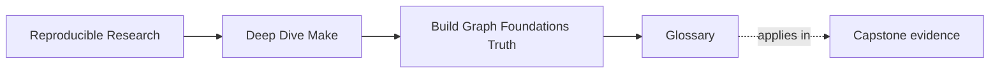
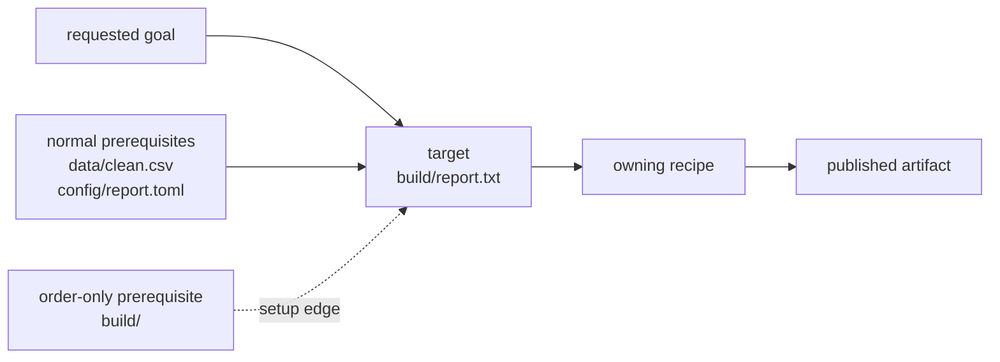
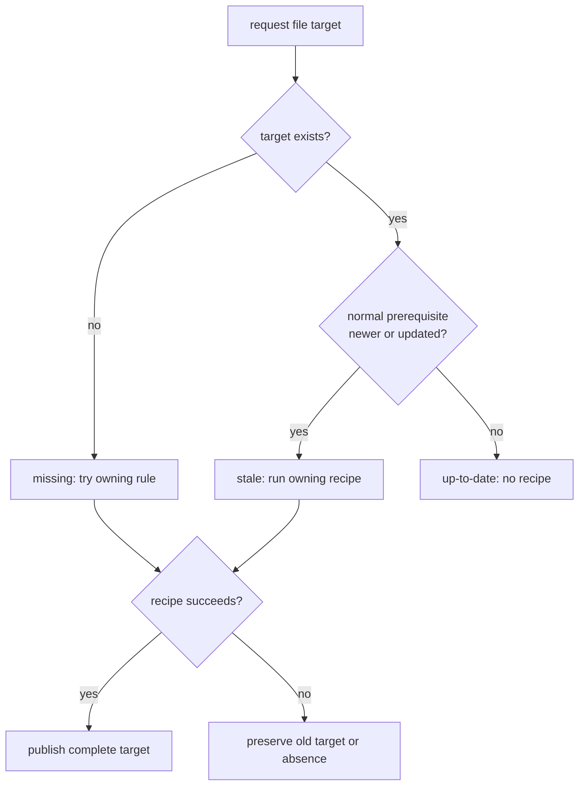
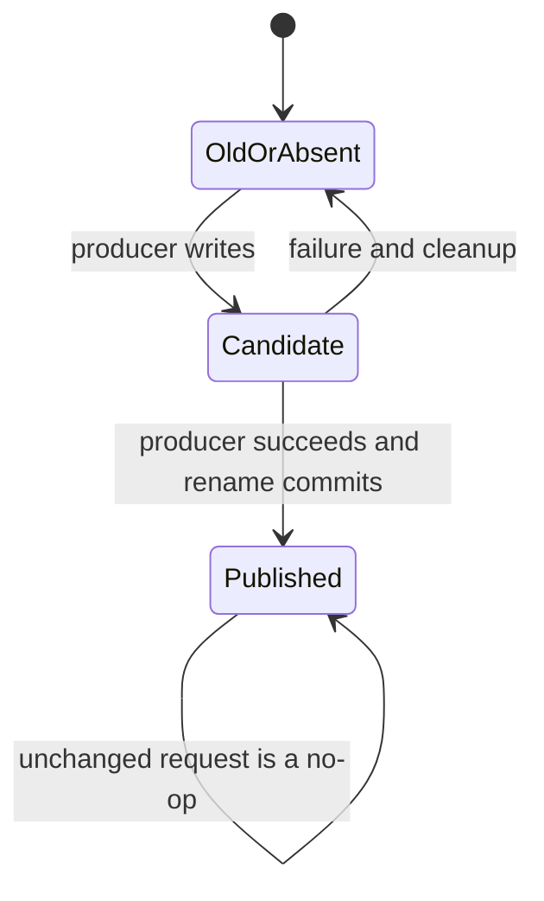

# Build Graph Vocabulary


<!-- page-maps:start -->
## Page Maps




<!-- page-maps:end -->

This page is a reasoning aid, not an alphabetical command index. Use it when an
explanation feels vague, when two terms are being treated as synonyms, or when a trace
does not match your prediction. The definitions are scoped to the update decisions and
publication guarantees taught in Module 01.

## Read a rule as a contract

For this rule:

```make
build/report.txt: data/clean.csv config/report.toml | build/
	python scripts/report.py $^ > $@
```

the graph language maps to concrete parts:



The target is the path whose state Make is deciding. Normal prerequisites can make that
target stale. The order-only prerequisite must exist first but does not express output
meaning. The recipe is the action taken only after the graph warrants an update.

## Node and edge terms

| Term | Meaning here | Example or diagnostic question |
| --- | --- | --- |
| requested goal | The target named by the user or selected as the default. | In `make all`, `all` is requested even when the real file of interest is `app`. |
| target | A file path or named goal whose update state Make evaluates. | What exact path will this rule make available? |
| file target | A target represented by a filesystem object whose timestamp can carry freshness evidence. | `build/main.o`, `report.pdf`, or a semantic stamp. |
| phony target | A target deliberately declared with `.PHONY` because it represents an action or grouping, not a file. | `all`, `check`, and `clean`; would a coincidental file of this name otherwise suppress work? |
| source leaf | An existing prerequisite the current build does not know how to produce. | `src/main.c` or checked-in `raw.csv`. |
| intermediate target | A generated file consumed by another target. | `cleaned.csv` between raw data and two reports. |
| final artifact | A published file intended for a user or downstream consumer. | `app`, `report.pdf`, or a release archive. “Final” describes graph role, not a filename. |
| prerequisite | A target or source whose state participates in deciding another target. | If it changes meaning, where is its edge? |
| normal prerequisite | A prerequisite whose missing or newer state can make the target stale. | A source file, header, configuration, or semantic stamp. |
| order-only prerequisite | A prerequisite after `|` that must be available first but whose timestamp does not make the target stale. | A destination directory needed for publication. |
| edge | A declared target–prerequisite relationship. | `report.pdf -> results.csv` means the report's update decision observes the results. |
| dependency graph | The targets and prerequisite edges reachable from the requested goal. | Draw paths and arrows; do not reduce it to the order commands happened to print. |

An edge does not mean “run this first” in the abstract. It means the downstream target
depends on the prerequisite being brought up to date, and for a normal edge, on its
freshness evidence.

## Update-decision terms

| Term | Precise use | Evidence route |
| --- | --- | --- |
| missing | The requested file target does not exist. | `test ! -e path`; Make normally tries its owning rule. |
| stale or out of date | The target exists, but a normal prerequisite is newer or has just been updated. | Predict the prerequisite chain, then inspect `make --trace target`. |
| up-to-date | The target exists and no reachable graph fact warrants updating it. | A safely captured `make -q target` status of `0`. |
| freshness | The timestamp-based evidence Make uses for ordinary file edges. | Compare target and prerequisite modification times without treating them as content hashes. |
| update | Bringing a requested target into the state promised by its rule. | It may require prerequisite recipes before the target's own recipe. |
| no-op rebuild | An unchanged request in which no artifact-producing recipe runs. | An empty relevant trace plus query status `0`. |
| convergence | Reaching a fixed point: after a successful build, an unchanged equivalent request performs no work. | Successful build, unchanged rerun, then query status `0`. |
| relevant mutation | A controlled change that should make a named target stale. | Edit a declared source, header, or semantic input and predict the exact rebuild set. |
| irrelevant mutation | A controlled change that should not affect the requested graph. | Edit an unrelated note and prove the build remains quiet. |
| acceptance evidence | Evidence that warranted work did run. | The header-change trace contains both affected objects. |
| rejection evidence | Evidence that unwarranted work did not run. | The implementation-only trace excludes an unrelated object. |

The four main update outcomes are distinct:



“Make rebuilt it” is an observation, not an explanation. A complete explanation names
the starting state, decisive prerequisite, selected owning rule, and publication result.

## Rule and ownership terms

| Term | Meaning here | Boundary to defend |
| --- | --- | --- |
| rule | A target pattern or target list, prerequisites, and optionally a recipe. | A rule contributes graph facts; it does not necessarily own a recipe body. |
| recipe | Shell commands Make invokes to update a target. | The commands must fulfill the target contract and fail visibly when they cannot. |
| recipe ownership | Exclusive responsibility for publishing a target path. | Two competing recipes for one path are a multi-writer defect. |
| target membership | The explicit set of outputs that belong in a larger goal. | `OBJS := build/a.o build/b.o` determines application membership. |
| mapping | The reusable relationship from a target shape to prerequisite shape. | `build/%.o: src/%.c` maps object names to source names. |
| explicit rule | A rule naming a concrete target path. | `build/a.o: src/a.c`; direct but potentially repetitive. |
| pattern rule | A reusable rule with one `%` stem relationship. | It says how a matching requested target can be built, not whether it belongs in `all`. |
| static pattern rule | A rule applying a pattern to an explicit target list. | Useful when reusable mapping and bounded membership must be visible together. |
| stem | The substring matched by `%` and reused in the prerequisite pattern. | For `build/a.o`, the stem in `build/%.o` is `a`. |
| built-in rule | A rule supplied by Make itself unless disabled. | Could an undeclared implicit rule be masking an incomplete teaching graph? |
| default goal | The target Make requests when none is named. | Set `.DEFAULT_GOAL := all` when file order should not choose course behavior accidentally. |

Multiple rule lines may contribute prerequisites to one target:

```make
build/a.o: src/a.c
build/a.o: include/a.h
	$(CC) -c $< -o $@
```

That still has one recipe owner. Adding another recipe body for `build/a.o` creates
competing writers. Likewise, replacing explicit compile rules with a pattern rule
generalizes policy but does not remove the need for an explicit application object list.

## Expansion and value terms

| Term | Meaning here | Example |
| --- | --- | --- |
| immediate expansion | Expansion performed while Make reads the relevant construct. | `FILES := $(wildcard data/*.csv)` captures one list during parsing. |
| deferred expansion | Stored text expanded when Make later needs the value. | `FILES = $(wildcard data/*.csv)` reruns the expression at use sites. |
| variable flavor | Whether a variable is simple/immediate or recursive/deferred. | Inspect with `$(flavor FILES)`. |
| variable origin | Where the effective value came from. | `$(origin CFLAGS)` may report `file`, `environment`, or `command line`. |
| raw value | The stored text before recursive references are expanded. | `$(value FILES)` helps distinguish expression from result. |
| Make expansion | Replacement performed by Make before a recipe reaches the shell. | `$(CC)`, `$@`, and `$<`. |
| shell expansion | Replacement performed by the recipe shell after Make has produced command text. | Write `$$status` in a recipe so the shell receives `$status`. |
| automatic variable | A Make value derived from the current rule application. | `$@` target; `$<` first normal prerequisite; `$^` unique normal prerequisites. |
| graph-shaping value | A value used to determine targets or prerequisites. | Source lists and generated target lists should have a stable interpretation during a run. |

The word “expansion” is incomplete unless you name the owner. Ask:

1. Does Make replace this text while parsing or before launching a recipe?
2. Does the shell receive a dollar and replace it later?
3. Does the expanded value shape the graph or only affect recipe behavior?

## Semantic evidence terms

| Term | Meaning here | Example |
| --- | --- | --- |
| semantic input | A fact that changes output meaning even when ordinary source paths do not change. | Compiler flags, interpreter choice, schema version, or analysis configuration. |
| hidden input | A semantic input with no graph-visible evidence or prerequisite edge. | Changing `CFLAGS` while an object rule depends only on its `.c` file. |
| semantic stamp | A generated file that represents a semantic value for graph comparison. | `build/compile-flags.<id>.stamp` contains the canonical compiler settings; a shared object tree retains only its active stamp so value reversals remain observable. |
| content-addressed path | A path whose name incorporates a digest or identifier of represented content. | A new flag value selects a missing stamp path; historical evidence must not let a return to an older value appear current. |
| manifest | Human- or machine-readable evidence recording several semantic inputs together. | Tool versions, flags, configuration hashes, and dataset identity. |
| depfile | Make syntax emitted by a compiler to record discovered include edges. | `build/a.o: src/a.c include/a.h`. |
| bootstrap include | Tolerant inclusion of generated graph data that may not exist on the first parse. | `-include $(DEPS)` permits first compilation to create depfiles. |
| phony header stub | A no-recipe rule emitted by compiler `-MP` for an included header. | It softens the parse-time failure when a previously included header is removed. |

A stamp does not make a value semantic. First decide that the value changes output
meaning; then give that fact stable representation and connect it to affected targets.

## Publication and failure terms

| Term | Meaning here | Required invariant |
| --- | --- | --- |
| artifact | A file deliberately published for later trust or consumption. | Its path must never advertise incomplete success. |
| candidate | An unpublished file written while producing a possible new artifact. | Use a target-local, process-local name in the final directory. |
| final path | The stable path consumers are allowed to trust. | Do not stream fallible producer output directly into it. |
| publication | Making a complete candidate visible at the final path. | Occurs only after the producer succeeds. |
| atomic rename | A same-filesystem rename that switches one path from old state to complete new state without exposing partial bytes. | It protects one final path, not an arbitrary group of files. |
| commit point | The operation after which the new artifact is considered published. | Usually the final candidate-to-target rename. |
| failure policy | The promised filesystem state after a recipe fails. | Preserve the old valid target, or preserve absence if no valid target existed. |
| failure hygiene | Cleanup and status behavior that enforces the failure policy. | Remove candidates and propagate the producer's nonzero status. |
| recovery-biased ordering | An order for multiple publications that minimizes dangerous inconsistent states. | Publish a depfile before its object, with the object rename as commit point. |
| convergence after repair | The repaired input rebuilds the target once and then reaches a no-op. | Proves both recovery and restored incremental truth. |

Atomic publication is a property of one target transition:



`.DELETE_ON_ERROR` is useful defense, but it is not a substitute for candidates. It can
remove a failed target Make knows was being updated; it cannot retroactively prevent a
consumer from observing partial bytes written directly to the final path.

## Confusable pairs

| Do not collapse | The distinction |
| --- | --- |
| target vs recipe | The target is the promised state; the recipe is one mechanism for reaching it. |
| prerequisite vs command argument | A recipe can read an undeclared argument; that makes it a hidden input, not a prerequisite. |
| phony target vs always-rebuilt artifact | A phony name is intentionally not a file contract; a real artifact should converge. |
| mapping vs membership | A pattern can explain how to build a path without deciding that the path belongs in a requested goal. |
| setup vs semantics | A directory may need to exist without its timestamp changing output meaning. |
| clean success vs incremental correctness | Cleaning proves reconstruction from absence, not detection of relevant changes. |
| trace vs proof | A trace records behavior; a prediction and graph fact turn it into evidence. |
| checksum identity vs freshness | A digest can encode semantic identity; ordinary Make update decisions still compare graph-visible file state. |
| candidate vs cache | A candidate is unpublished work for one transaction; a cache is reusable stored work with a separate validity policy. |
| one rename vs grouped atomicity | A rename can atomically publish one path; two related renames still expose an intermediate state. |

## Replace vague explanations

| Vague wording | More reviewable wording |
| --- | --- |
| “Make noticed a change.” | “`config.h` became newer than `build/a.o` through a generated normal edge, so the object became stale.” |
| “It rebuilt everything.” | “The trace shows `cleaned.csv`, `summary.txt`, and `chart.svg`; no other artifact recipe ran.” |
| “The pattern finds the files.” | “The pattern maps a requested `build/%.o` to `src/%.c`; `OBJS` declares membership.” |
| “The variable is evaluated later.” | “The recursive value stores `$(name)` and expands it when referenced; the graph-shaping use therefore sees the effective value then.” |
| “The output is atomic.” | “The producer writes a same-directory candidate and renames it to the final path only after success.” |
| “The build is reproducible.” | “The demonstrated claim is narrower: relevant changes rebuild, irrelevant changes do not, failures preserve trust, and an unchanged rerun converges.” |

## Vocabulary checkpoint

Choose one target from your lab and explain it in this order:

1. identify its node role and owning rule
2. list normal and order-only prerequisites
3. classify its current update state
4. name any semantic evidence or generated edges
5. locate the publication commit point and failure policy
6. cite one acceptance test, one rejection test, and the convergence result

If you cannot fill one item, the vocabulary has exposed a design or evidence gap. Return
to the relevant core lesson and repair the graph rather than substituting a broader word
such as “dependency,” “cache,” or “reproducible.”
