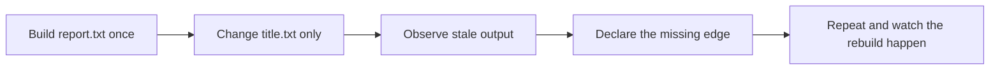
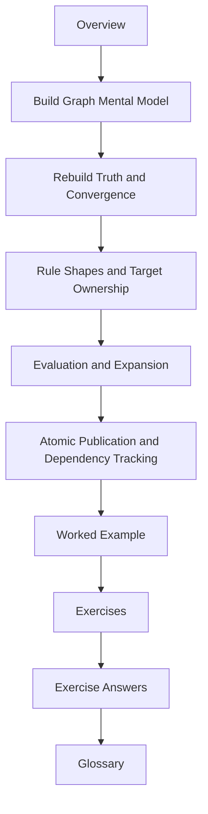

# Module 01: Build Graph Foundations and Truth
Make becomes much easier once you stop treating it like a shell script runner and start
treating it like a decision system. The central question of this module is simple:

> When Make decides to rebuild or skip a target, what facts is it relying on, and how do
> we keep those facts honest?

If you can answer that question, the rest of the course has a stable foundation. If you
cannot, later topics such as parallelism, multi-output generators, and release
publication will feel like folklore instead of engineering.

## The module promise

At the end of this session, you will have a graph-truth packet that explains:

1. what request the reader made;
2. which file targets and action targets belong to that request;
3. which declared input can make each file target stale;
4. which recipe owns publication of each output;
5. which hidden input you exposed and modeled;
6. how a failed producer avoids poisoning later runs;
7. why an unchanged successful request converges.

```mermaid
flowchart LR
  request["requested target"] --> graph["declared target graph"]
  graph --> decision["freshness decision"]
  decision --> recipe["selected recipe"]
  recipe --> publication["accepted artifact"]
  publication --> replay["unchanged replay"]
```

Each arrow is a different reasoning boundary. A recipe can succeed while the graph is
incomplete; a graph can select the right recipe while publication leaves a broken file.

## Why this day matters

Most weak Make usage starts with one mistaken mental model: "Make runs commands in order."
That is not how Make thinks. Make compares target files with the files and facts that are
declared to produce them.

This first teaching day is where you learn to see that decision process. Once you can
predict one honest rebuild, later modules have something solid to build on.

## What this module is for

Module 01 gives you a durable mental model for four things:

- what a target really is
- what counts as an input
- why a build converges or fails to converge
- how to publish files without poisoning the graph

The goal is not to memorize syntax like a parser. The goal is to look at a Makefile,
predict the next rebuild decision, and explain it in plain language.

## Entry diagnostic

Begin with a three-file lab, not the C build. Confirm you can:

| Claim | Evidence |
| --- | --- |
| the requested file is missing | directory listing before Make |
| its declared prerequisites exist | named input paths |
| Make plans one recipe | dry-run output |
| the recipe publishes the file | exit plus content inspection |
| unchanged replay needs no work | trace and query exit zero |
| one changed prerequisite invalidates it | prediction plus bounded trace |

If any row feels mysterious, keep the text-file lab until you can explain it. The C
example adds compiler and depfile behavior; it should not be the first place you discover
what a prerequisite means.

## The classroom demo for this module

If you only run one demonstration before reading deeper, run this one:



This tiny failure contains the whole module:

- the recipe can read a file that the graph does not know about
- Make can only react to declared prerequisites
- the wrong graph can look successful until one input changes
- a small truthful fix is stronger than a large clean rebuild

## See a missing edge fail

Create a fresh directory with `title.txt`, `body.txt`, and this Makefile:

```make
report.txt: body.txt
	cat title.txt body.txt > $@
```

The recipe reads two files, but the graph names only one. Build once, change only the
title, and ask Make what it intends to do:

```sh
printf 'First title\n' > title.txt
printf 'Body\n' > body.txt
make --trace report.txt
printf 'Corrected title\n' > title.txt
make --trace report.txt
cat report.txt
```

The last file still contains `First title`. Make did exactly what the rule said:
`body.txt` did not change, so `report.txt` looked current. The shell command knew about
`title.txt`; the graph did not.

Repair the rule:

```make
report.txt: title.txt body.txt
	cat $^ > $@
```

Run the same experiment again. This is the first important failure in the course because
it separates two ideas beginners often blend together:

- a recipe can read a file
- Make can react to that file only when the graph declares it

Keep this directory. It is a smaller and better debugging tool than the C example when
you need to recheck the meaning of an edge.

## Plan for the day

| Block | Activity | Evidence you should produce |
| --- | --- | --- |
| First contact | Write one file target and one phony target | a Makefile you can explain character by character |
| Graph reading | Draw the target-prerequisite graph before running Make | a graph with file and action nodes marked |
| Incremental behavior | Build twice, then change one prerequisite | a written prediction and a `--trace` transcript |
| Rule reuse | Replace repeated compile rules with one pattern rule | the same outputs with less duplicated policy |
| Failure safety | Interrupt or fail a recipe before publication | proof that no partial final artifact remains |
| Practice | Complete all ten exercises | commands, outputs, and short explanations |

### Suggested independent-study timing

| Work | Approximate time | Stop when |
| --- | ---: | --- |
| rule reading and graph drawing | 45 minutes | every target, prerequisite, and owner can be named |
| freshness and hidden inputs | 55 minutes | one stale result is reproduced and repaired without cleaning |
| rule form and evaluation | 55 minutes | the evaluated target set and values can be predicted |
| publication and depfiles | 60 minutes | failure and header-change drills both pass |
| worked example and exercises | 100 minutes | the graph-truth packet supports independent review |

Preserve learning evidence under
`artifacts/learning/deep-dive-make/module-01-graph-truth/`. Completion depends on the
evidence, not the clock.

If this is your first day with Make, stop after each command and inspect the files that
exist. The filesystem is part of Make’s memory.

## What to keep in front of you

For the whole day, keep one sheet of paper or one note with four headings:

- requested target
- declared prerequisites
- recipe reads that are not yet declared
- prediction before the next run

That note keeps the lesson anchored in graph truth instead of drifting into syntax
memorization.

## Separate the evidence layers

| Layer | Question | Suitable observation |
| --- | --- | --- |
| request | what did the consumer ask Make to establish | command and working directory |
| declaration | which targets, prerequisites, and recipes exist | Makefile and bounded database |
| selection | why is an update required or skipped | trace and target state |
| execution | what command ran and how it exited | recipe log |
| publication | what accepted path and content now exist | artifact inspection |
| replay | does unchanged state require more work | no-op trace and query exit |
| challenge | does a relevant input change wake the right edge | controlled input mutation |

Do not call dry-run output proof of publication. Do not call exit zero proof that every
input was declared.

## Read a rule aloud

For every rule, use the same sentence:

```make
target: prerequisites
	recipe
```

> To update **target**, first update **prerequisites**. If the target is missing or older
> than any prerequisite, run **recipe**.

This sentence is intentionally simple. It remains useful when the rules become much more
advanced.

## Study route



Read the module in that order the first time through. When you return later, use the file
whose title matches the question in front of you instead of rereading the whole module.

## The ten files in this module

1. Overview (`index.md`)
2. [Build Graph Mental Model](build-graph-mental-model.md)
3. [Rebuild Truth and Convergence](rebuild-truth-and-convergence.md)
4. [Rule Shapes and Target Ownership](rule-shapes-and-target-ownership.md)
5. [Evaluation and Expansion](evaluation-and-expansion.md)
6. [Atomic Publication and Dependency Tracking](atomic-publication-and-dependency-tracking.md)
7. [Worked Example: Tiny C Build](worked-example-tiny-c-build.md)
8. [Exercises](exercises.md)
9. [Exercise Answers](exercise-answers.md)
10. [Glossary](glossary.md)

This page stays short on purpose. It tells you what the module covers, how the files fit
together, and what "done" means before you move on.

## How to use the file set

| If you need to... | Start here |
| --- | --- |
| understand what Make is deciding | [Build Graph Mental Model](build-graph-mental-model.md) |
| explain a surprising rebuild or a rebuild that never ends | [Rebuild Truth and Convergence](rebuild-truth-and-convergence.md) |
| choose between explicit rules, pattern rules, and generators | [Rule Shapes and Target Ownership](rule-shapes-and-target-ownership.md) |
| understand why a variable changed the graph | [Evaluation and Expansion](evaluation-and-expansion.md) |
| prove that failed builds do not poison later runs | [Atomic Publication and Dependency Tracking](atomic-publication-and-dependency-tracking.md) |
| see the whole module in one small build | [Worked Example: Tiny C Build](worked-example-tiny-c-build.md) |
| test your own understanding | [Exercises](exercises.md) |
| compare your reasoning against a reference answer | [Exercise Answers](exercise-answers.md) |
| stabilize vocabulary while you read | [Glossary](glossary.md) |

## The running example

Throughout Module 01 you will use a very small C project:

```text
project/
  Makefile
  include/
    util.h
  src/
    main.c
    util.c
```

That example is deliberately small enough to reason about by hand. You should be able to
draw the dependency graph on paper, touch one file, and predict what Make ought to do
before you run it.

Do not begin by copying the reference Makefile. Build it in the layers shown by the
worked example. At each layer, draw the graph you believe exists and compare that drawing
with `make -n` and `make --trace`.

## What a strong first session looks like

By the end of the day, you should have done more than read about Make truth. You should
have:

- built a file target and rerun it without changes
- created one hidden input bug on purpose
- repaired that bug by changing the graph, not by cleaning
- drawn at least one dependency graph by hand
- explained one rebuild using trace output rather than instinct

Package the work as:

```text
graph-truth/
├── graph.md
├── hidden-input-repro/
├── repaired-edge/
├── failed-publication/
├── header-rebuild/
└── convergence-note.md
```

The exact names are flexible. A reviewer must be able to distinguish a graph declaration,
a selected update, a published artifact, and a replay result.

## Recovery route after a missed class

If you are studying alone:

1. run the text-file missing-edge demo;
2. draw its broken and repaired graphs;
3. read the mental-model and convergence lessons;
4. complete Exercises 1, 2, and 6;
5. read rule shapes, evaluation, and publication;
6. build the tiny C example one layer at a time;
7. complete the remaining exercises before reading their answers.

Do not copy the final reference Makefile first. The learning comes from predicting how
each added edge changes the next decision.

## The five commands to keep open

These commands are the evidence loop for the whole module:

```sh
make -n all
make --trace all
make -pRrq all
set +e; make -q all; query_exit=$?; set -e; printf '%s\n' "$query_exit"
```

Run destructive or clean-build drills only in the module lab or a harness-owned
workspace. Use these commands constantly, while stating what each one can and cannot
prove.

## Learning outcomes

By the end of this module, you should be able to:

- read a Makefile as a dependency graph instead of a command list
- explain rebuilds and skips using Make-native evidence
- spot hidden inputs before they become "works only after clean" bugs
- choose a rule form that keeps ownership of outputs obvious
- publish outputs in a way that survives failure and incremental rebuilds

## Exit standard

Do not move on to Module 02 until all of these are true:

- you can say why a target rebuilt without guessing
- you can point to one hidden input and model it explicitly
- you can explain why one writer per output path matters
- you can force a failure and prove that no broken artifact remains behind
- you can run `make -q all` after a successful build and understand the exit code
- you completed ten exercises and can reproduce at least eight without reading the answers

When those become ordinary, not dramatic, Module 01 has done its job.
