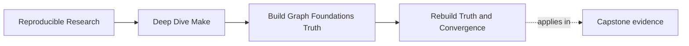

# Rebuild Truth and Convergence


<!-- page-maps:start -->
## Page Maps




<!-- page-maps:end -->

Once you see the graph, the next question is whether the graph stays truthful over time.

The practical rule is straightforward:

> A correct build does not just succeed once. It converges. After a successful build,
> running the same build again without meaningful change should produce "nothing to do."

That sounds simple, but many real Makefiles fail here.

## What Make can see by default

Out of the box, Make mainly sees:

- whether a target file exists
- whether a prerequisite is newer than its target
- whether a target is declared phony

That is enough for many file-to-file relationships. It is not enough for every build
fact that matters.

## Four incremental outcomes

For a relevant input change:

| Make decision | Artifact result | Interpretation |
| --- | --- | --- |
| rebuild | correct new result | truthful edge and producer for this case |
| rebuild | wrong or partial result | selection was plausible; recipe/publication failed |
| skip | stale old result | semantic input is missing from freshness evidence |
| skip | still-correct result | input was irrelevant or artifact identity is unchanged |

For an irrelevant change, unnecessary rebuilding is also a defect: the graph has a false
or overbroad edge. Truth means responding to relevant changes and ignoring irrelevant
ones.

## The hidden-input problem

Some things can change output meaning without appearing in the prerequisite list:

- compiler flags
- environment variables
- tool versions
- generated configuration fragments
- recipe-time discovery of files

If one of those facts changes but the graph does not mention it, Make keeps making a
decision from incomplete evidence.

Another way to say the same thing is:

Make can only be as truthful as the evidence you hand it. If the graph omits a build fact
that changes output meaning, the next rebuild decision becomes guesswork wearing a clean
exit code.

## A small example

Suppose you write this:

```make
CFLAGS ?= -O2

build/main.o: src/main.c
	$(CC) $(CFLAGS) -c $< -o $@
```

Now you run:

```sh
make CFLAGS=-O0
```

The recipe text changed in a meaningful way, but the graph did not. On the next run,
Make still sees only `src/main.c` and `build/main.o`. It has no file-based evidence that
the object was compiled with different flags.

That is how a build can be "green" while still being untruthful.

## Two failure stories worth recognizing

### "Nothing rebuilt, but the binary changed in meaning"

This is the classic hidden-input problem. The graph did not mention something that
matters, so Make had no reason to act.

### "Everything rebuilds every time"

This is the opposite failure. Instead of missing evidence, you introduced unstable
evidence. Common causes include timestamps, random values, or shell discovery that moves
from run to run.

## What convergence means

A convergent build has a stable resting state.

In an isolated module lab or harness-owned workspace:

```sh
make all
set +e
make -q all
query_exit=$?
set -e
printf 'query_exit=%s\n' "$query_exit"
```

After a successful build:

- `0` means Make believes everything is up to date
- `1` means something would rebuild
- `2` means an error occurred

Module 01 wants you to care about that middle case. A build that rebuilds forever without
meaningful change is telling you the graph is unstable.

Query mode does not inspect artifact meaning. A missing edge can yield exit zero while a
stale file remains. Pair convergence with controlled input challenges.

## A practical truth loop

Use this loop whenever a build feels suspicious:

1. preserve initial source and target state;
2. build the requested target successfully;
3. query unchanged state and require exit zero;
4. change one relevant input and predict the affected closure;
5. trace the rebuild and inspect accepted artifact content;
6. query unchanged state again;
7. change one irrelevant input and require no needless work;
8. restore the fixture through its owned reset route.

That loop tells you:

- whether the build reaches a resting state
- whether the right edges wake up after a semantic change
- whether irrelevant changes stay outside the closure
- whether the producer publishes the expected new artifact

Do not clean between the relevant input change and its rebuild. Cleaning would erase the
incremental question.

## Two common ways convergence breaks

### Time-dependent values

```make
BUILD_ID := $(shell date +%s)
```

If that value influences an output, the build meaning changes on every run. The graph has
no stable resting state.

### Unstable file discovery

```make
SRCS = $(wildcard src/*.c)
```

GNU Make’s wildcard function returns sorted matches for each expression. The unresolved
question is membership: does every matching file belong in the target contract? A
scratch source can silently widen the graph even when order is canonical. Module 03
develops discovery policy in depth.

### Recipe text that depends on moving state

Sometimes the problem is not file discovery but recipe construction. If the recipe embeds
a moving value such as a time-based define or volatile environment string, the output
meaning changes while the target path stays the same.

That is still a hidden-input problem. The graph is missing evidence about a change it
cares about.

## The basic repair pattern

Model semantic inputs as explicit, stable artifacts.

One common way is a stamp or manifest whose content changes only when the input meaning
changes. The important property is not the filename. The important property is that the
file becomes trustworthy evidence about a build fact.

## A small semantic-stamp example

```make
FLAGS_LINE := CFLAGS=$(CFLAGS) CPPFLAGS=$(CPPFLAGS)
FLAGS_ID := $(shell printf '%s' "$(FLAGS_LINE)" | cksum | awk '{print $$1}')
FLAGS_STAMP := build/flags.$(FLAGS_ID).stamp

$(FLAGS_STAMP): | build/
	@printf '%s\n' "$(FLAGS_LINE)" > $@

build/%.o: src/%.c $(FLAGS_STAMP) | build/
	$(CC) $(CPPFLAGS) $(CFLAGS) -c $< -o $@
```

This does not solve every build-fact problem, but it teaches the right instinct:

- if a semantic fact changes output meaning
- and Make cannot otherwise see it
- give the graph evidence that changes when the fact changes

The exact stamp design can improve later. The habit matters now.

## Prefer content-preserving semantic evidence

A fixed stamp path avoids accumulating one file per value, but its timestamp must change
only when normalized content changes:

```make
FLAGS_STAMP := build/flags.stamp

$(FLAGS_STAMP): FORCE | build/
	@candidate="$@.candidate.$$$$"; \
	printf '%s\n' 'CC=$(CC)' 'CPPFLAGS=$(CPPFLAGS)' 'CFLAGS=$(CFLAGS)' > "$$candidate"; \
	if test -r "$@" && cmp -s "$$candidate" "$@"; then \
	  rm -f "$$candidate"; \
	else \
	  mv -f "$$candidate" "$@"; \
	fi

.PHONY: FORCE
FORCE:
```

Consumers use `$(FLAGS_STAMP)` as a normal prerequisite. The check runs each invocation,
but unchanged semantic content preserves the stamp timestamp, so consumers converge.

Do not include current time, process IDs, random values, or unrelated environment state
in correctness evidence.

## Clean success and incremental truth differ

A clean build can hide:

- missing header edges because every object is rebuilt anyway;
- missing flag evidence because no prior object exists;
- unsafe stale-output behavior after a generator input changes;
- a target whose recipe only works when directories happen to be empty.

An incremental build can hide:

- a source-package omission never tested in a fresh workspace;
- undeclared generated files borrowed from a previous run;
- a missing bootstrap rule.

Keep both proof routes. Do not treat “clean fixes it” as a repair.

## Timestamp limits

Make’s ordinary file freshness depends on filesystem timestamps. Reason carefully when:

- clock changes make a target appear newer than future prerequisites;
- timestamp resolution collapses rapid changes;
- files are restored with preserved mtimes but changed content;
- remote or generated filesystems have unusual time behavior.

Do not respond by touching everything routinely. Use repository-supported hash,
manifest, or always-check-and-content-preserve patterns for semantic facts that mtime
cannot represent reliably.

## Write a convergence note

```text
Requested target:
Initial build result:
Unchanged query exit:
Relevant input challenge:
Predicted rebuild closure:
Observed trace:
Artifact acceptance:
Second unchanged query exit:
Irrelevant input challenge:
Decision:
Limit:
```

## Questions to ask during review

- What input changed build meaning here?
- Where is that input represented as evidence?
- Does that evidence stay stable when the meaning stays stable?
- Can the build reach a quiet state after success?
- Does a relevant change wake the smallest truthful closure?
- Does an irrelevant change avoid needless work?

## Practical questions for review

- If `CFLAGS` changes, what target proves that change matters?
- If a tool version changes output meaning, where is that fact recorded?
- If a target rebuilds every time, which input is moving even when the source files are
  not?
- Could query exit zero be preserving a stale target because an edge is missing?

When you can answer those questions for a real build, you have moved from "it usually
works" to "the graph is telling the truth."
