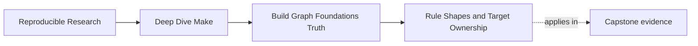
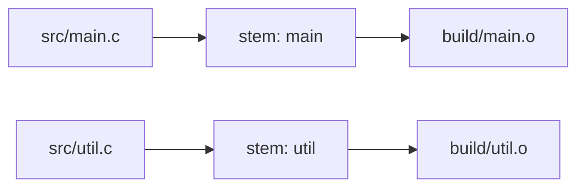

# Rule Shapes and Target Ownership


<!-- page-maps:start -->
## Page Maps




<!-- page-maps:end -->

Make gives you several ways to describe work. The best choice is the one that keeps
ownership of outputs obvious.

This page is about two ideas:

- choosing a rule form that matches the shape of the build
- keeping exactly one recipe responsible for publishing each output path

## The main rule forms

### Explicit rule

Use an explicit rule when one target deserves one clearly named recipe.

```make
app: build/main.o build/util.o
	$(CC) $^ -o $@
```

This is the easiest form to read and review.

### Pattern rule

Use a pattern rule when many targets follow the same shape.

```make
build/%.o: src/%.c include/util.h
	$(CC) -Iinclude -c $< -o $@
```

Pattern rules remove duplication, but they also make matching behavior less obvious. When
in doubt, confirm with `make --trace`.

### Static pattern rule

Use a static pattern rule when you know the exact target list but want one shared shape.

```make
$(OBJS): build/%.o: src/%.c include/util.h
	$(CC) -Iinclude -c $< -o $@
```

This is often a good compromise between repetition and clarity.

## A quick chooser

| Situation | Best starting choice | Why |
| --- | --- | --- |
| One binary, one archive, one generated report | explicit rule | the target deserves a named contract |
| Many object files built the same way | pattern rule or static pattern rule | avoids noisy duplication while keeping ownership clear |
| A known list of targets with one shared build shape | static pattern rule | keeps the target set visible |
| One command creates several coupled outputs | slow down and model the coupling deliberately | this is where casual rules turn confusing |

## Start from the concrete target set

Before choosing a reusable rule, write:

```text
target paths:
source-to-target mapping:
shared prerequisites:
target-specific prerequisites:
owning recipe:
```

For:

```make
SRCS := src/main.c src/util.c
OBJS := $(patsubst src/%.c,build/%.o,$(SRCS))
```

the concrete target set is visible even if a pattern rule owns the recipes. This prevents
an abstraction from accidentally matching files outside the intended domain.



The pattern describes a mapping; the source list describes membership. They are separate
contracts.

## Why ownership matters

The cleanest way to reason about a build is this:

> one output path, one owning recipe

If two recipes can publish the same file, review gets harder fast:

- which recipe is the real source of truth?
- which prerequisites actually matter?
- which recipe ran last?

Those questions are not academic. They show up as flaky builds, surprising rebuilds, and
artifacts that differ by execution path.

Ownership also changes how easy review is. You should be able to answer:

- where does this file come from
- what evidence controls its rebuild
- what recipe has permission to overwrite it

If those answers are spread across multiple rules, you are paying a readability tax every
time someone debugs the build.

## Separate added prerequisites from recipe ownership

Make can combine prerequisites from several ordinary rules for the same target:

```make
app: build/main.o
app: build/util.o
app:
	$(CC) build/main.o build/util.o -o $@
```

There is still one ordinary recipe owner. Scattered prerequisite additions can be useful
for modular assembly, but a beginner-facing build is often clearer with one complete
declaration:

```make
app: build/main.o build/util.o
	$(CC) $^ -o $@
```

Multiple ordinary recipes for the same target create override warnings and ambiguous
intent. Do not confuse “several declarations contribute edges” with “several producers
may publish one file.”

## A generator-shaped hazard

Suppose one command creates two files:

```make
schema.json client.py:
	python scripts/gen_client.py
```

This looks neat. It is also easy to misunderstand. Multi-target rules have semantics that
become subtle when one recipe produces several outputs and one output is missing or newer
than another.

Module 01 does not require mastery of every edge case yet. It does require one healthy
instinct:

If one command produces a coupled set of files, treat that coupling deliberately. Do not
casually let Make imply ownership rules you have not reasoned through.

GNU Make distinguishes independent multi-target rules from grouped targets, and their
update semantics differ. Module 06 teaches those designs. In Module 01, choose one
consumer-facing output where possible or stop and document the coupled-output contract
before proceeding.

## A better way to think about multi-output work

Ask two questions before you write the rule:

1. Which file is the outward contract other targets should trust?
2. Are the sibling outputs merely side effects, or are they equally important contracts?

Often the clean answer is to choose one outward artifact and let the other files stay
behind it as implementation detail. That keeps the graph simpler and makes ownership
reviewable.

When that is not possible, say so explicitly in the rule design instead of pretending the
outputs are independent.

## Pattern rules still need human-friendly names

A pattern rule reduces duplication, but the surrounding variables and target names still
decide whether the rule reads clearly.

This is easier to teach and review:

```make
SRC_DIR := src
BLD_DIR := build

$(BLD_DIR)/%.o: $(SRC_DIR)/%.c include/util.h
	$(CC) -Iinclude -c $< -o $@
```

than this:

```make
%.o: %.c
	$(CC) $(X) $(Y) -c $< -o $@
```

The second version is shorter, but it hides the shape of the project. Module 01 should
push you toward clarity before cleverness.

## Read automatic variables within the chosen rule

| Variable | Beginner meaning in these rules |
| --- | --- |
| `$@` | current target path |
| `$<` | first prerequisite |
| `$^` | normal prerequisites with duplicate names removed |
| `$(@D)` | target directory component |
| `$(@F)` | target filename component |

Use them only when their meaning matches the contract:

```make
build/%.o: src/%.c include/util.h
	@mkdir -p "$(@D)"
	$(CC) -Iinclude -c "$<" -o "$@"
```

`$<` correctly selects the source because it is deliberately the first prerequisite.
Adding a generated configuration before the source would silently change that meaning.
Review prerequisite order when recipes rely on positional automatic variables.

## Rule selection should be explainable

If you choose a pattern or static pattern rule, you should be able to explain:

- why this form is clearer than repeating explicit rules
- what concrete targets it matches
- which output path each invocation owns

If you cannot explain those three points, the abstraction is probably premature.

## Diagnose selection instead of guessing

When a target matches an unexpected rule:

1. name the concrete target;
2. list explicit and pattern candidates you expect;
3. run a bounded dry run or trace;
4. inspect `make -pRrq TARGET` when the evaluated candidates remain unclear;
5. check whether built-in rules are participating;
6. narrow the pattern or add an explicit contract;
7. replay the target from controlled state.

Some repositories disable built-in rules and variables with `-rR` to reduce hidden
selection. That is a repository policy, not a universal requirement. If you disable
built-ins, ensure every required rule remains declared.

## Challenge the rule form

| Rule form | Useful challenge |
| --- | --- |
| explicit | change each named prerequisite and verify the expected closure |
| pattern | list intended matches and one nearby path that must not match |
| static pattern | confirm every listed target maps to an existing intended source |
| generated/coupled output | remove one sibling and observe the documented recovery behavior |

A rule form is not accepted because it is shorter. It is accepted because membership,
selection, ownership, and rebuild behavior remain explainable.

## Build an ownership ledger

| Output | Rule form | Concrete owner | Semantic inputs | Candidate/final publication | Consumers |
| --- | --- | --- | --- | --- | --- |

For pattern rules, write one row per concrete output when reviewing a small build. The
repetition in the ledger is evidence that the abstraction expands to the intended set.

## A review checklist for this page

- Does each output path have one obvious owner?
- Is the chosen rule form simpler than repeating explicit rules?
- If a pattern is used, can you name the matched files without guessing?
- If a generator produces several files, is the coupling part of the design, not an
  accident?
- Does prerequisite order agree with the automatic variables used by the recipe?
- Can one neighboring path accidentally match a broad pattern?
- Does every concrete output appear once in the ownership ledger?

## A good Module 01 default

For small and medium builds, this is a healthy default:

- explicit rules for the top-level artifacts
- pattern or static pattern rules for repeated compile steps
- no casual multi-writer outputs

That is enough structure to keep the graph readable without turning it into ceremony.
