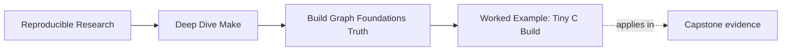
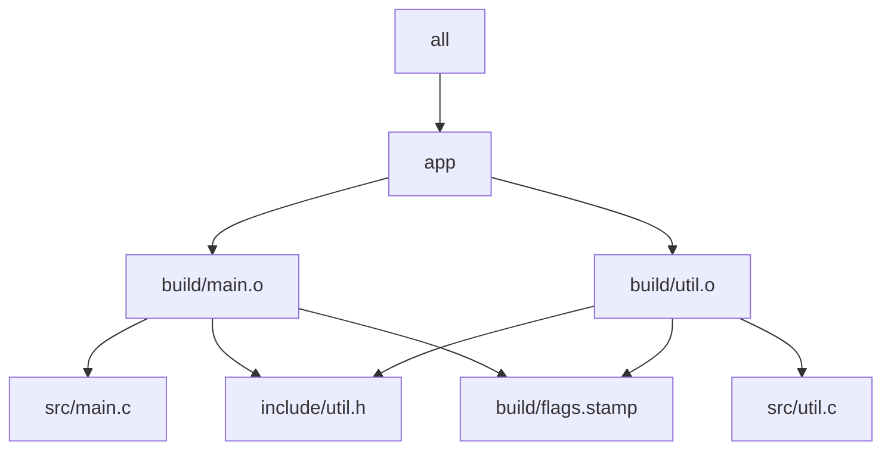
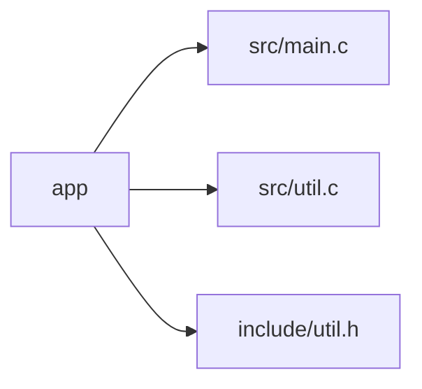
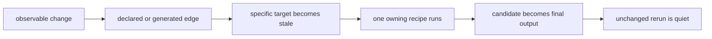

# Worked Example: Tiny C Build


<!-- page-maps:start -->
## Page Maps




<!-- page-maps:end -->

This lab ties the five core lessons together in one small project. Work in a disposable
copy: several demonstrations deliberately introduce compiler errors and change build
policy. The goal is not to obtain a binary once. The goal is to collect evidence that
the graph explains first builds, selective rebuilds, failures, and the final no-op.

## The claim you will test

> Every published file can be explained by a rule, every meaning-changing input is
> represented in the graph, a failed recipe preserves the last valid result, and an
> unchanged rerun performs no work.

Keep that claim beside your terminal. Each demonstration below tests one part of it.
If an observation contradicts the claim, investigate the graph before deleting outputs.

## Project layout

```text
project/
  Makefile
  include/
    util.h
  src/
    main.c
    util.c
```

Use this example because it is just large enough to expose the real issues:

- object files depend on both source files and headers
- compiler flags can become hidden inputs
- the link step publishes a real artifact
- a broken compile can leave poison behind if publication is careless

## Graph view of the example



The point of this graph is not decoration. It is to make three dependencies impossible to
ignore:

- both object files depend on the shared header
- both object files depend on the semantic flags stamp
- the final binary depends on both objects, not on the raw sources directly

## Minimal source files

`include/util.h`

```c
#pragma once
int util_add(int a, int b);
```

`src/util.c`

```c
#include "util.h"

int util_add(int a, int b) {
    return a + b;
}
```

`src/main.c`

```c
#include <stdio.h>
#include "util.h"

int main(void) {
    printf("%d\n", util_add(2, 3));
    return 0;
}
```

## What you should inspect while reading

Start with four questions:

1. what are the real file targets?
2. which inputs change object meaning?
3. which recipe has exclusive responsibility for each target?
4. what proves the build has converged?

As you work through the rest of the module, keep returning here and answer those
questions again with better precision.

## Build the Makefile in layers

The reference Makefile later on is intentionally defensive. Do not begin by copying it.
Build toward it so every line has a reason to exist.

### Begin with one output

Compile the program directly:

```make
app: src/main.c src/util.c include/util.h
	cc -Iinclude src/main.c src/util.c -o app
```

Run `make app` twice. The first run creates `app`; the second should report that it is up
to date. Change `src/util.c`, predict the result, then run `make --trace app`.

At this point the graph is:



This is a correct small build. It recompiles every source file after any change, but it
does not lie.

### Separate compilation from linking

Next, make the intermediate object files visible:

```make
app: build/main.o build/util.o
	cc $^ -o $@

build/main.o: src/main.c include/util.h | build/
	cc -Iinclude -c $< -o $@

build/util.o: src/util.c include/util.h | build/
	cc -Iinclude -c $< -o $@

build/:
	mkdir -p $@
```

The automatic variables remove repeated path names:

| Variable | Meaning in a recipe |
| --- | --- |
| `$@` | the target being updated |
| `$<` | the first prerequisite |
| `$^` | all normal prerequisites, without duplicates |

Change only `src/util.c`. Predict which compile rule runs and whether linking runs. Use
`make --trace app` to test the prediction.

### Replace repeated compile policy

The two compile recipes have the same shape, so one pattern rule can own both:

```make
build/%.o: src/%.c include/util.h | build/
	cc -Iinclude -c $< -o $@
```

`%` binds to `main` when Make needs `build/main.o` and to `util` when it needs
`build/util.o`. The rule is reusable because the input-output mapping is unambiguous.

Only after you can explain these three versions should you study the defensive reference
Makefile below.

## A reference Makefile

```make
MAKEFLAGS += -rR
.SUFFIXES:
.DELETE_ON_ERROR:

SHELL := /bin/sh
.SHELLFLAGS := -eu -c

CC ?= cc
CPPFLAGS ?= -Iinclude
CFLAGS ?= -O2
LDFLAGS ?=
LDLIBS ?=

SRC_DIR := src
BLD_DIR := build

SRCS := $(sort $(wildcard $(SRC_DIR)/*.c))
OBJS := $(patsubst $(SRC_DIR)/%.c,$(BLD_DIR)/%.o,$(SRCS))
DEPS := $(OBJS:.o=.d)
DEPFLAGS := -MMD -MP

FLAGS_LINE := CC=$(CC) CPPFLAGS=$(CPPFLAGS) CFLAGS=$(CFLAGS)
FLAGS_ID := $(shell printf '%s' "$(FLAGS_LINE)" | cksum | awk '{print $$1}')
FLAGS_STAMP := $(BLD_DIR)/flags.$(FLAGS_ID).stamp

.DEFAULT_GOAL := all
.PHONY: all clean

all: app

$(BLD_DIR)/:
	mkdir -p $@

$(FLAGS_STAMP): | $(BLD_DIR)/
	@candidate="$@.candidate.$$$$"; \
	printf '%s\n' "$(FLAGS_LINE)" > "$$candidate" && \
	rm -f "$(BLD_DIR)"/flags.*.stamp && \
	mv -f "$$candidate" "$@" || { rm -f "$$candidate"; exit 1; }

app: $(OBJS)
	tmp=$@.tmp.$$$$; \
	$(CC) $(LDFLAGS) $^ $(LDLIBS) -o $$tmp && mv -f $$tmp $@ || { rm -f $$tmp; exit 1; }

$(BLD_DIR)/%.o: $(SRC_DIR)/%.c $(FLAGS_STAMP) | $(BLD_DIR)/
	tmp=$@.tmp.$$$$; dtmp=$(@:.o=.d).tmp.$$$$; \
	$(CC) $(CPPFLAGS) $(CFLAGS) $(DEPFLAGS) -MF $$dtmp -MT $@ -c $< -o $$tmp && \
	mv -f $$dtmp $(@:.o=.d) && mv -f $$tmp $@ || { rm -f $$tmp $$dtmp; exit 1; }

-include $(DEPS)

clean:
	rm -rf $(BLD_DIR) app
```

This is not the last Makefile you will ever write. It is a deliberately small example
whose policy is visible enough to challenge:

- `-rR` and `.SUFFIXES:` prevent undeclared built-in rules from rescuing a missing edge.
- the content-addressed flag stamp turns compile policy into a prerequisite and removes
  the previously active stamp so returning to an older policy still rebuilds
- compiler-generated depfiles discover included headers after the first successful compile
- target-local, process-local candidate names avoid two concurrent recipes sharing a candidate
- the dependency file is published before the object, so a published object never points at
  dependency information that is older than that object
- the final object rename is the commit point; a failed compile cannot overwrite it

The object and dependency file still cannot be renamed as one filesystem transaction.
The ordering is a recovery policy, not a claim of two-file atomicity.

## Six demonstrations to run

Run the demonstrations in one lab directory. Do not clean between demonstrations unless
the instructions explicitly say so: incremental state is part of the evidence.

Before each demonstration, write one row in this ledger. Fill the observation and
verdict columns only after the command finishes.

| Test | Predicted recipe targets | Observed recipe targets | Decisive graph fact | Verdict |
| --- | --- | --- | --- | --- |
| first request |  |  |  |  |
| unchanged request |  |  |  |  |
| edit `src/util.c` |  |  |  |  |
| edit `include/util.h` |  |  |  |  |
| change `CFLAGS` |  |  |  |  |
| broken compile, then repair |  |  |  |  |

Do not write “it rebuilt everything” as an observation. Name the targets. Precision is
how you notice that one object rebuilt unnecessarily or failed to rebuild at all.

### Demonstration 1: First build

Run:

```sh
make --trace all
./app
find build -maxdepth 1 -type f -print | sort
```

The trace should show directory and stamp preparation before compilation, then linking.
The program should print `5`. The listing should contain two objects, two dependency
files, and one flags stamp. Open a `.d` file: it is graph data emitted by the compiler,
not an opaque cache.

### Demonstration 2: No-op rebuild

Capture the query status without letting a nonzero status terminate an `errexit` shell:

```sh
if make -q all; then
  query_status=0
else
  query_status=$?
fi
printf 'query_status=%s\n' "$query_status"
make --trace all
```

The query status should be `0`, and no compile or link recipe should run. This is
convergence, not merely speed. If the trace rebuilds a target, identify the edge that
keeps it stale; do not accept “timestamps are strange” without inspecting them.

### Demonstration 3: Source change

Record object timestamps, change only the implementation in `src/util.c`, and run:

```sh
make --trace all
```

`build/util.o` and `app` should rebuild; `build/main.o` should not. This is a rejection
test as well as an acceptance test: seeing `build/main.o` in the recipe trace would show
that the graph is conservative beyond the declared dependency.

### Demonstration 4: Header change

Add a harmless declaration or comment to `include/util.h` and rerun `make --trace all`.
Both object files should rebuild because each compiler-generated `.d` file names the
header. Inspect those files before the run if you are unsure:

```sh
sed -n '1,20p' build/main.d
sed -n '1,20p' build/util.d
```

This demonstration is stronger than merely seeing both recipes run: it identifies the
stored edges that caused the decision.

### Demonstration 5: Flag change

First note the current stamp name:

```sh
find build -name 'flags.*.stamp' -print
make CFLAGS=-O0 --trace all
find build -name 'flags.*.stamp' -print
make CFLAGS=-O2 --trace all
find build -name 'flags.*.stamp' -print
```

The command-line value changes `FLAGS_LINE`, which changes `FLAGS_ID`, which selects a
different prerequisite path. Both objects therefore rebuild even though no source file
changed. The rule retains only the active stamp, so returning to `-O2` selects a missing
path and rebuilds again. An unchanged request at either value must remain a no-op.

This lab intentionally supports one active configuration in `build/`. If two flag sets
must build concurrently, give them isolated output directories; shared object paths
would be competing publications regardless of the stamp design.

### Demonstration 6: Failure recovery and convergence

Preserve a checksum of the working executable, introduce a syntax error in `src/util.c`,
and attempt a rebuild:

```sh
before=$(cksum app)
if make all; then
  printf '%s\n' 'unexpected compile success' >&2
  exit 1
fi
after=$(cksum app)
test "$before" = "$after"
find build -name '*.tmp.*' -print
```

The old application must remain byte-for-byte unchanged, and the final command should
print no abandoned candidates. Repair the source, then run:

```sh
make --trace all
make all
if make -q all; then
  printf '%s\n' 'converged'
else
  status=$?
  printf 'not converged: make -q exited %s\n' "$status" >&2
  exit "$status"
fi
```

The repair must rebuild the affected object and application; the following build must do
nothing; the query must print `converged`. The three observations together prove
recovery and convergence. A clean rebuild alone would not.

## Read the result as a causal chain



For every ledger row, be able to point to all five links. A trace tells you what Make
did. The chain explains why the behavior was warranted.

## Explain one trace without Make vocabulary

Choose the header-change demonstration and explain it to someone who has never seen Make:

1. two compiled files both read the header
2. the header became newer than those files
3. both compiled files therefore became stale
4. the application depends on them, so it became stale afterward

Then translate the same explanation back into target and prerequisite language. Moving
between ordinary language and graph language is a core course skill. If you can repeat
the command but cannot explain the causal chain, the demonstration is not finished.

## Evidence packet

Keep these small artifacts from `project/`:

```sh
make -n all > dry-run.txt
make --trace all > trace.txt 2>&1
make -pn > database.txt
find build -maxdepth 1 -type f -print | sort > published-files.txt
```

Add the completed prediction ledger, one inspected depfile, and the failure/recovery
checksums. A reviewer should be able to determine:

- which recipes ran after each mutation
- which edge justified each run
- which unrelated target stayed untouched
- whether a failed build preserved the last valid executable
- whether the repaired build converged

`make -pn` is intentionally stored rather than read from top to bottom. Search it for one
target when you need to confirm rule selection or variable values.

## Review without rerunning the lab

A complete submission lets another learner answer these questions from the packet:

1. Why did changing `src/util.c` spare `build/main.o`?
2. Where did Make learn the `include/util.h` edges?
3. Why did a command-line `CFLAGS` value select a new target path?
4. What evidence proves the failed compile did not publish a partial result?
5. Which observation proves the graph reached a fixed point?

If an answer depends on “because Make knew,” the evidence is incomplete. Name the rule,
prerequisite, variable origin, candidate, or exit status that carried the knowledge.

## Common beginner mistakes

- **Spaces before recipes:** GNU Make normally requires a tab. If you see `missing
  separator`, inspect indentation first.
- **Running from the wrong directory:** Make looks for `Makefile` in the current
  directory unless told otherwise.
- **Creating `all` as a file:** declare action targets such as `all` and `clean` phony.
- **Guessing after the run:** write the prediction before using `--trace`.
- **Deleting everything to repair a graph:** `make clean` can hide missing dependencies.
  Use it for comparison, not as the normal solution.
- **Reading a long trace as a blur:** choose one requested target and follow only its
  prerequisite chain before trying to explain the entire build.

## What this example should teach you

By the time you finish this file, you should be able to point at the Makefile and say:

- where graph truth is declared
- where hidden inputs are made visible
- where output ownership is obvious
- where failed publication is prevented
