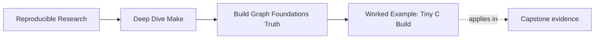
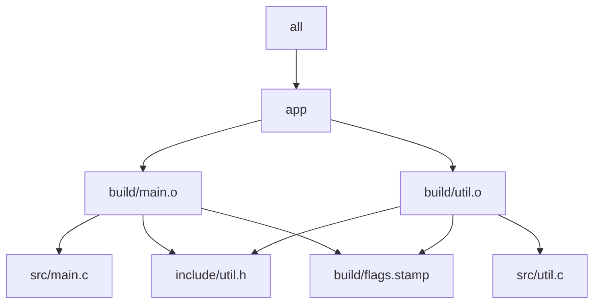
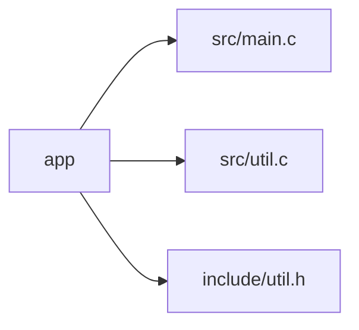

# Worked Example: Tiny C Build


<!-- page-maps:start -->
## Page Maps




<!-- page-maps:end -->

This file ties the five core lessons together in one small project.

## Project layout

```text
project/
  Makefile
  include/
    util.h
  src/
    main.c
    util.c
```

Use this example because it is just large enough to expose the real issues:

- object files depend on both source files and headers
- compiler flags can become hidden inputs
- the link step publishes a real artifact
- a broken compile can leave poison behind if publication is careless

## Graph view of the example



The point of this graph is not decoration. It is to make three dependencies impossible to
ignore:

- both object files depend on the shared header
- both object files depend on the semantic flags stamp
- the final binary depends on both objects, not on the raw sources directly

## Minimal source files

`include/util.h`

```c
#pragma once
int util_add(int a, int b);
```

`src/util.c`

```c
#include "util.h"

int util_add(int a, int b) {
    return a + b;
}
```

`src/main.c`

```c
#include <stdio.h>
#include "util.h"

int main(void) {
    printf("%d\n", util_add(2, 3));
    return 0;
}
```

## What you should inspect while reading

Start with three questions:

1. what are the real file targets?
2. which inputs change object meaning?
3. what proves the build has converged?

As you work through the rest of the module, keep returning here and answer those
questions again with better precision.

## Build the Makefile in layers

The reference Makefile later on is intentionally defensive. Do not begin by copying it.
Build toward it so every line has a reason to exist.

### Begin with one output

Compile the program directly:

```make
app: src/main.c src/util.c include/util.h
	cc -Iinclude src/main.c src/util.c -o app
```

Run `make app` twice. The first run creates `app`; the second should report that it is up
to date. Change `src/util.c`, predict the result, then run `make --trace app`.

At this point the graph is:



This is a correct small build. It recompiles every source file after any change, but it
does not lie.

### Separate compilation from linking

Next, make the intermediate object files visible:

```make
app: build/main.o build/util.o
	cc $^ -o $@

build/main.o: src/main.c include/util.h | build/
	cc -Iinclude -c $< -o $@

build/util.o: src/util.c include/util.h | build/
	cc -Iinclude -c $< -o $@

build/:
	mkdir -p $@
```

The automatic variables remove repeated path names:

| Variable | Meaning in a recipe |
| --- | --- |
| `$@` | the target being updated |
| `$<` | the first prerequisite |
| `$^` | all normal prerequisites, without duplicates |

Change only `src/util.c`. Predict which compile rule runs and whether linking runs. Use
`make --trace app` to test the prediction.

### Replace repeated compile policy

The two compile recipes have the same shape, so one pattern rule can own both:

```make
build/%.o: src/%.c include/util.h | build/
	cc -Iinclude -c $< -o $@
```

`%` binds to `main` when Make needs `build/main.o` and to `util` when it needs
`build/util.o`. The rule is reusable because the input-output mapping is unambiguous.

Only after you can explain these three versions should you study the defensive reference
Makefile below.

## A reference Makefile

```make
MAKEFLAGS += -rR
.SUFFIXES:
.DELETE_ON_ERROR:

SHELL := /bin/sh
.SHELLFLAGS := -eu -c

CC ?= cc
CPPFLAGS ?= -Iinclude
CFLAGS ?= -O2
LDFLAGS ?=
LDLIBS ?=

SRC_DIR := src
BLD_DIR := build

SRCS := $(sort $(wildcard $(SRC_DIR)/*.c))
OBJS := $(patsubst $(SRC_DIR)/%.c,$(BLD_DIR)/%.o,$(SRCS))
DEPS := $(OBJS:.o=.d)
DEPFLAGS := -MMD -MP

FLAGS_LINE := CC=$(CC) CPPFLAGS=$(CPPFLAGS) CFLAGS=$(CFLAGS)
FLAGS_ID := $(shell printf '%s' "$(FLAGS_LINE)" | cksum | awk '{print $$1}')
FLAGS_STAMP := $(BLD_DIR)/flags.$(FLAGS_ID).stamp

.DEFAULT_GOAL := all
.PHONY: all clean

all: app

$(BLD_DIR)/:
	mkdir -p $@

$(FLAGS_STAMP): | $(BLD_DIR)/
	@printf '%s\n' "$(FLAGS_LINE)" > $@

app: $(OBJS)
	tmp=$@.tmp; \
	$(CC) $(LDFLAGS) $^ $(LDLIBS) -o $$tmp && mv -f $$tmp $@ || { rm -f $$tmp; exit 1; }

$(BLD_DIR)/%.o: $(SRC_DIR)/%.c $(FLAGS_STAMP) | $(BLD_DIR)/
	tmp=$@.tmp; dtmp=$(@:.o=.d).tmp; \
	$(CC) $(CPPFLAGS) $(CFLAGS) $(DEPFLAGS) -MF $$dtmp -MT $@ -c $< -o $$tmp && \
	mv -f $$tmp $@ && mv -f $$dtmp $(@:.o=.d) || { rm -f $$tmp $$dtmp; exit 1; }

-include $(DEPS)

clean:
	rm -rf $(BLD_DIR) app
```

This is not the last Makefile you will ever write. It is a deliberately small example with
good instincts baked in.

## Six demonstrations to run

### Demonstration 1: First build

Run `make --trace all` and read which targets fire first and why.

### Demonstration 2: No-op rebuild

Run `make --trace all` again without changing anything. No compile or link recipe should
run. This is convergence, not merely speed.

### Demonstration 3: Source change

Change only `src/util.c`. `build/util.o` and `app` should rebuild; `build/main.o` should
not.

### Demonstration 4: Header change

Edit `include/util.h` and rerun `make --trace all`. Both object files should rebuild.

### Demonstration 5: Flag change

Run `make CFLAGS=-O0 --trace all`. The flags stamp should change, and the affected object
files should rebuild.

### Demonstration 6: Convergence check

Run:

```sh
make clean && make all
make -q all; echo $?
```

You want exit code `0`. That is the quiet resting state the rest of the course depends
on.

## Evidence loop

Run these commands in `project/`:

```sh
make -n all
make --trace all
make -p
make clean && make all
make -q all; echo $?
```

This file is not the whole module. It is the place where the lessons meet one build you
can reason about line by line.

## Common beginner mistakes

- **Spaces before recipes:** GNU Make normally requires a tab. If you see `missing
  separator`, inspect indentation first.
- **Running from the wrong directory:** Make looks for `Makefile` in the current
  directory unless told otherwise.
- **Creating `all` as a file:** declare action targets such as `all` and `clean` phony.
- **Guessing after the run:** write the prediction before using `--trace`.
- **Deleting everything to repair a graph:** `make clean` can hide missing dependencies.
  Use it for comparison, not as the normal solution.

## What this example should teach you

By the time you finish this file, you should be able to point at the Makefile and say:

- where graph truth is declared
- where hidden inputs are made visible
- where output ownership is obvious
- where failed publication is prevented
