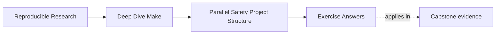

# Exercise Answers


<!-- page-maps:start -->
## Page Maps




<!-- page-maps:end -->

Use this after you have written your own answers. The point is comparison, not copying.

## How to use the answer page well

Do not read a model answer first and then retrofit your exercise to match its wording.

A better rhythm is:

1. finish the exercise with your own Makefile, notes, and runs
2. write one plain-language explanation of the concurrency claim
3. compare that explanation with the model answer
4. revise where the model answer exposes weak ownership language, missing proof, or vague
   ordering logic

The strongest Module 02 answers usually do four things:

- they name the written path or ordering fact directly
- they explain why overlap is safe or unsafe
- they point to one proof route
- they describe the repair as stronger ownership or more honest scheduling

The strongest self-study packets also leave behind six concrete artifacts:

- one ownership table
- one repaired shared-writer design
- one repaired temporary-path design
- one ordering-tool comparison
- one harmless overlap example and one failed-publication rejection
- one serial-versus-parallel governed artifact comparison

If your answers rely only on "parallel jobs can run at the same time," the reasoning is
still too shallow.

## Exercise 1: Name the runnable targets

For a clean capstone build, the requested closure reaches source files, generated inputs,
semantic stamps, object files, dynamic binaries, the application, and the final sentinel.
After source and setup prerequisites are ready, the object-file targets form part of the
runnable frontier.

A strong answer names the exact edges that justify the scheduling:

> `build/main.o` and `build/util.o` may overlap because they read separate source files and
> publish separate object paths. `app` must wait because it reads both object files and
> publishes one final binary path.

After all required objects complete, `app` enters the frontier. The public `all` target
remains blocked until its application and dynamic-binary prerequisites are ready. An
ownership table should show one object path per compiler recipe and one final application
path for the linker.

Why this is strong:

- it names runnable groups concretely
- it explains the blocked target in graph language
- it distinguishes overlap from publication

Weak answer pattern:

- “Compilation can happen in parallel and linking happens later.”

That is directionally true but too generic to defend a specific build.

## Exercise 2: Repair a shared-log race

The bug is that two recipes append to the same output path. A strong repair gives each
producer its own log and introduces one aggregator that owns the final combined log.

The key explanatory sentence is:

> The final shared log becomes trustworthy only when one target owns its publication and
> every worker publishes to a separate intermediate path.

Why this is strong:

- it names the actual race surface
- it repairs the ownership model instead of hoping append order stays stable
- it can be challenged by varying worker completion order while checking the final log’s
  governed record order and content

Weak answer pattern:

- "Use `sleep` to avoid interleaving"

That changes timing, not ownership.

## Exercise 3: Repair a temporary-file collision

The unsafe design writes a shared temporary path such as `tmp.out`. A safe repair derives
the candidate from `$@` and adds process uniqueness:

Example repair shape:

```make
build/%.out: inputs/%.txt
	@candidate="$@.candidate.$$$$"; \
	render "$<" > "$$candidate" && \
	validate "$$candidate" && \
	mv -f "$$candidate" "$@" || { rm -f "$$candidate"; exit 1; }
```

The important explanation is:

> Temporary paths are still owned outputs because overlapping writers can corrupt them
> before the final artifact is ever published.

The candidate lives beside the final path so rename does not cross a filesystem boundary.
Failure removes the candidate and does not publish rejected content.

Two independent Make invocations can still race to own the same final target. A complete
answer therefore chooses one policy: separate output roots, explicit whole-workspace
coordination, rejection of concurrent invocations, or a transactional external producer.
A unique candidate prevents staging collision but does not settle final ownership.

Weak answer pattern:

- "The final file is different, so the temp path does not matter"

That answer ignores the concurrency contract halfway through publication.

## Exercise 4: Choose the right ordering tool

A strong answer explains what truth each mechanism carries:

- real prerequisite:
  - content changes should trigger rebuilds
- order-only prerequisite:
  - setup must exist before the rule runs, but setup timestamp changes should not rebuild
- stamp:
  - a semantic event matters but has no natural direct file edge
- scoped serialization:
  - an otherwise independent operation uses a documented singleton that cannot be
    partitioned

The strongest answers also say what lie the wrong tool would introduce.

Example:

> Using an order-only prerequisite for a generated header would lie because header content
> changes really should rebuild the object file.

That sentence shows the learner understands why ordering tools are not interchangeable.

The changed-state challenges should demonstrate:

- normal edge: changing input meaning rebuilds the consumer;
- order-only edge: changing setup mtime alone does not rebuild;
- stamp: changed normalized value invalidates once, then converges;
- singleton: the unguarded fixture rejects with the expected resource signature, while
  the narrow supported guard restores accepted artifacts.

Global `.NOTPARALLEL` is too broad when only one resource is singular. `.WAIT` or scoped
`.NOTPARALLEL` also requires a declared supported GNU Make version.

## Exercise 5: Design a selftest

A defensible claim is:

> For the recorded fixture and tools, independent clean `-j1` and `-j8` builds publish
> the same governed artifact membership and accepted identities.

The harness should:

1. create equivalent isolated serial and parallel workspaces;
2. record source, variables, tools, and environment policy;
3. build serially and verify convergence;
4. build in parallel and verify convergence;
5. compare actual paths against an independent expected manifest;
6. classify missing, unexpected, and changed artifacts;
7. run product behavior checks separately;
8. activate a controlled shared-writer fault;
9. require rejection at the schedule-comparison boundary;
10. preserve both reports.

An accepted result has empty difference categories. A rejected result names the changed,
missing, or unexpected path and marks later checks not reached when the harness stops.

Weak answer pattern:

- “Run the build a few times and see if it looks okay.”

That samples execution without an oracle or rejection case.

## Exercise 6: Observe scheduling without a race

A minimal answer is:

```make
.PHONY: all alpha beta
all: alpha beta

alpha:
	@printf 'alpha start\n'; sleep 2; printf 'alpha end\n'

beta:
	@printf 'beta start\n'; sleep 2; printf 'beta end\n'
```

`-j1` takes roughly four seconds and `-j2` roughly two. Output lines may appear in
different orders because both targets are runnable. There is no shared file, directory,
or external publication path, so the overlap is visible but harmless.

The missing but important sentence is:

> Scheduling overlap is not a race until overlapping work contends for a shared semantic
> resource or published path.

## Exercise 7: Reject partial publication

The broken producer writes plausible bytes to the final path before returning nonzero:

```make
build/report.json: data/input.csv
	@mkdir -p "$(@D)"
	printf '{"status":"partial"}\n' > "$@"
	false
```

The failure exit is correct, but a later consumer or separate Make invocation can mistake
the remaining file for an accepted report.

The repair is:

```make
.DELETE_ON_ERROR:

build/report.json: data/input.csv scripts/render.py | build/
	@candidate="$(@D)/.$(@F).candidate.$$$$"; \
	python3 scripts/render.py "$<" "$$candidate" && \
	python3 scripts/check_report.py "$$candidate" && \
	mv -f "$$candidate" "$@" || { rm -f "$$candidate"; exit 1; }

build/:
	mkdir -p "$@"
```

In the controlled failure, the candidate may be created but must be removed, the rejected
new value must not replace the final path, and the consumer must not run from rejected
content. In the healthy case, validation precedes same-directory rename and the consumer
observes the complete report. The next unchanged query should return zero.

The accepted policy must say whether a prior accepted final artifact remains or the final
path is absent after failure. Either can be valid; plausible rejected content cannot.

## Exercise 8: Separate setup order from semantic freshness

The capstone comparison should produce:

| Model | Final input | Final output | Finding |
| --- | --- | --- | --- |
| order-only | `after` | `before` | `ORDER_ONLY_STALENESS_REPRODUCED` |
| semantic edge | `after` | `after` | `SEMANTIC_EDGE_REFRESHED` |

The broken model is expected to exit successfully. Its defect is not a failed recipe; it
is a graph that declares only ordering for a file whose content determines the output.

The honest report rule is:

```make
build/report.txt: source.txt | build/
	cp $< $@

build/:
	mkdir -p $@
```

The three observations should be:

| Change | Does the recipe run? | Why? |
| --- | --- | --- |
| touch `build/` | no | order-only prerequisites do not participate in target freshness |
| change `source.txt` | yes | a newer normal prerequisite invalidates the target |
| change order-only `source.txt` | no | the broken graph promises order, not invalidation |

The deliberate defect is:

```make
build/report.txt: | source.txt build/
	cp source.txt $@
```

After rebuilding from `before`, changing `source.txt` to `after` leaves the report at
`before`. A trace that says there is nothing to do confirms Make followed the declared
graph. Comparing the final file contents proves that graph was semantically dishonest.

The classification sentence should be precise:

> `build/` is setup state because the recipe needs the path to exist, while `source.txt`
> is semantic state because changing its content must change `build/report.txt`.

Putting `build/` on the left of `|` would create timestamp noise. Putting `source.txt` on
the right creates stale output. The two mistakes are not symmetric.

## Exercise 9: Expose a missing edge with delay

The broken version permits generation and compilation to overlap dishonestly:

```make
.PHONY: all
all: object.o generated.h

generated.h:
	@sleep 1
	@printf '#define VALUE 42\n' > $@

object.o:
	@grep VALUE generated.h > $@
```

The repair is:

```make
object.o: generated.h
	@grep VALUE $< > $@
```

The important explanation is:

> The sleep did not fix or create the graph defect. It widened the timing window so the
> missing edge became reproducible.

The expected signature is the consumer reaching `grep` before `generated.h` exists or is
complete. After adding the edge, three passing runs are useful samples, but the stronger
evidence is that the graph no longer permits the consumer frontier before the generator
completes and the artifact passes its content check.

Weak answer pattern:

- "Adding a delay makes the build unstable"

The build was already unstable. The delay only made the lie easier to catch.

## Exercise 10: Prove serial and parallel equivalence

A strong implementation creates two equivalent isolated workspaces and uses an expected
artifact manifest owned independently from the output discovery code.

The comparison report should resemble:

```json
{
  "result": "PASS",
  "missing_paths": [],
  "unexpected_paths": [],
  "changed_artifacts": []
}
```

For each expected path, record size and digest or the repository’s semantic identity
check. The serial and parallel commands, job counts, source identity, tool versions,
variables, and environment policy belong beside the inventories.

The controlled fault must reach the intended comparison category. For example, a
shared-writer mutation may produce one `changed_artifacts` entry. A missing compiler is
an environment failure and does not prove that schedule comparison rejects a race.

The result does not cover untested job counts, other toolchains, unsupported filesystems,
or artifacts outside the governed set.

The important sentence is:

> Both builds finishing is execution evidence; matching governed membership and accepted
> identities is bounded schedule-equivalence evidence.

## What a mastery-level answer set looks like

A mastery-level submission moves comfortably between:

- graph language:
  - runnable targets, ownership, honest edges, setup-only edges
- evidence:
  - runnable frontiers, `--trace`, elapsed time, governed inventories, rejection signatures
- repair language:
  - unique writers, atomic publish, truthful ordering, isolated artifact comparison

If your answers can move between those three levels without collapsing into "parallel is
tricky," you are learning Module 02 in the right direction.
