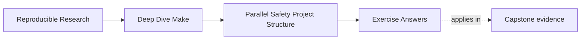

# Exercise Answers


<!-- page-maps:start -->
## Page Maps




<!-- page-maps:end -->

Use this after you have written your own answers. The point is comparison, not copying.

## How to use the answer page well

Do not read a model answer first and then retrofit your exercise to match its wording.

A better rhythm is:

1. finish the exercise with your own Makefile, notes, and runs
2. write one plain-language explanation of the concurrency claim
3. compare that explanation with the model answer
4. revise where the model answer exposes weak ownership language, missing proof, or vague
   ordering logic

The strongest Module 02 answers usually do four things:

- they name the written path or ordering fact directly
- they explain why overlap is safe or unsafe
- they point to one proof route
- they describe the repair as stronger ownership or more honest scheduling

The strongest self-study packets also leave behind six concrete artifacts:

- one ownership table
- one repaired shared-writer design
- one repaired temporary-path design
- one ordering-tool comparison
- one harmless overlap example and one real race example
- one serial-versus-parallel checksum comparison

If your answers rely only on "parallel jobs can run at the same time," the reasoning is
still too shallow.

## Exercise 1: Name the runnable targets

Independent object-file targets may run concurrently once their prerequisites are ready.
The final link target cannot run until those object files are complete.

A strong answer names the exact edges that justify the scheduling:

> `build/main.o` and `build/util.o` may overlap because they read separate source files and
> publish separate object paths. `app` must wait because it reads both object files and
> publishes one final binary path.

Why this is strong:

- it names runnable groups concretely
- it explains the blocked target in graph language
- it distinguishes overlap from publication

Weak answer pattern:

- "Compilation can happen in parallel and linking happens later"

That is directionally true but too generic to defend a specific build.

## Exercise 2: Repair a shared-log race

The bug is that two recipes append to the same output path. A strong repair gives each
producer its own log and introduces one aggregator that owns the final combined log.

The key explanatory sentence is:

> The final shared log becomes trustworthy only when one target owns its publication and
> every worker publishes to a separate intermediate path.

Why this is strong:

- it names the actual race surface
- it repairs the ownership model instead of hoping append order stays stable

Weak answer pattern:

- "Use `sleep` to avoid interleaving"

That changes timing, not ownership.

## Exercise 3: Repair a temporary-file collision

The unsafe design writes a shared temporary path such as `tmp.out`. A safe repair derives
the temporary name from `$@`, so each target publishes through its own private staging
path.

Example repair shape:

```make
target-a:
	@printf 'a\n' > $@.tmp
	@mv $@.tmp $@

target-b:
	@printf 'b\n' > $@.tmp
	@mv $@.tmp $@
```

The important explanation is:

> Temporary paths are still owned outputs because overlapping writers can corrupt them
> before the final artifact is ever published.

Weak answer pattern:

- "The final file is different, so the temp path does not matter"

That answer ignores the concurrency contract halfway through publication.

## Exercise 4: Choose the right ordering tool

A strong answer explains what truth each tool carries:

- real prerequisite:
  - content changes should trigger rebuilds
- order-only prerequisite:
  - setup must exist before the rule runs, but setup timestamp changes should not rebuild
- stamp:
  - a semantic event matters but has no natural direct file edge

The strongest answers also say what lie the wrong tool would introduce.

Example:

> Using an order-only prerequisite for a generated header would lie because header content
> changes really should rebuild the object file.

That sentence shows the learner understands why ordering tools are not interchangeable.

## Exercise 5: Design a selftest

A strong selftest includes convergence, serial/parallel equivalence, and a direct
comparison of the declared artifact set. It should fail on the first meaningful
divergence rather than printing vague reassurance.

The key explanatory sentence is:

> Terminal output can show overlap, but only artifact comparison can prove that overlap
> preserved meaning.

Weak answer pattern:

- "Run the build a few times and see if it looks okay"

That is observation without a contract.

## Exercise 6: Observe scheduling without a race

A minimal answer is:

```make
.PHONY: all alpha beta
all: alpha beta

alpha:
	@printf 'alpha start\n'; sleep 2; printf 'alpha end\n'

beta:
	@printf 'beta start\n'; sleep 2; printf 'beta end\n'
```

`-j1` takes roughly four seconds and `-j2` roughly two. Output lines may appear in
different orders because both targets are runnable. There is no shared file, directory,
or external publication path, so the overlap is visible but harmless.

The missing but important sentence is:

> Scheduling overlap is not a race until overlapping work contends for a shared semantic
> resource or published path.

## Exercise 7: Turn harmless concurrency into a race

The race begins when both workers write `result.txt`. The repair gives each worker one
path and gives the combined file one owner:

```make
.PHONY: all
all: result.txt

alpha.txt:
	@printf 'alpha\n' > $@

beta.txt:
	@printf 'beta\n' > $@

result.txt: alpha.txt beta.txt
	@cat $^ > $@
```

The important explanation is:

> The problem was never "two jobs ran together." The problem was that two jobs tried to
> publish the same semantic path.

Why this is strong:

- it names the broken path directly
- it repairs ownership before discussing performance

## Exercise 8: Use an order-only prerequisite correctly

```make
build/report.txt: source.txt | build/
	cp $< $@

build/:
	mkdir -p $@
```

Touching `build/` does not rebuild the report because the directory is to the right of
`|`. Changing `source.txt` does rebuild it because that prerequisite determines content.
If the directory were a normal prerequisite, incidental directory timestamp changes could
cause noisy rebuilds unrelated to report meaning.

This is strong because it separates setup existence from semantic freshness.

## Exercise 9: Expose a missing edge with delay

The broken version permits generation and compilation to overlap dishonestly:

```make
.PHONY: all
all: object.o generated.h

generated.h:
	@sleep 1
	@printf '#define VALUE 42\n' > $@

object.o:
	@grep VALUE generated.h > $@
```

The repair is:

```make
object.o: generated.h
	@grep VALUE $< > $@
```

The important explanation is:

> The sleep did not fix or create the graph defect. It widened the timing window so the
> missing edge became reproducible.

Weak answer pattern:

- "Adding a delay makes the build unstable"

The build was already unstable. The delay only made the lie easier to catch.

## Exercise 10: Prove serial and parallel equivalence

A strong implementation creates sorted checksum manifests from one declared output list:

```sh
set -eu
outputs='build/alpha.txt build/beta.txt result.txt'

make clean
make -j1 all
sha256sum $outputs | sort > serial.sha256

make clean
make -j8 all
sha256sum $outputs | sort > parallel.sha256

diff -u serial.sha256 parallel.sha256
```

The check is strong because it compares declared artifact meaning rather than console
appearance. A deliberate shared-writer race should either fail the build or change one of
the manifests.

The missing but important sentence is:

> A build is not proven parallel-safe because both runs finished; it is proven
> parallel-safe when both runs produced the same declared outputs.

## What a mastery-level answer set looks like

A mastery-level submission moves comfortably between:

- graph language:
  - runnable targets, ownership, honest edges, setup-only edges
- evidence:
  - `--trace`, repeated `-j` runs, elapsed time, checksum manifests
- repair language:
  - unique writers, atomic publish, truthful ordering, artifact comparison

If your answers can move between those three levels without collapsing into "parallel is
tricky," you are learning Module 02 in the right direction.
