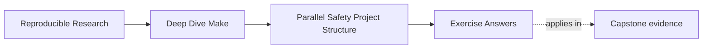

# Exercise Answers


<!-- page-maps:start -->
## Page Maps




<!-- page-maps:end -->

Use this after you have written your own answers. The point is comparison, not copying.

## Exercise 1: Name the runnable targets

Independent object-file targets may run concurrently once their prerequisites are ready.
The final link target cannot run until those object files are complete. A good answer
names the exact edges that justify the scheduling.

The strongest answers do not stop at "these can run together." They also name the target
that must wait and the prerequisite set that makes the wait legitimate.

## Exercise 2: Repair a shared-log race

The bug is that two recipes append to the same output path. A good repair gives each
target its own log and then introduces one aggregation target that deterministically
creates the shared log.

The key idea is ownership. The final shared log should have one owner, not two writers who
happen to append politely.

## Exercise 3: Repair a temporary-file collision

The bug is that `tmp.out` is a shared output path. A safe repair derives the temporary
path from `$@`, so each target publishes through its own temp file.

If you add that temporary paths are still part of the publication contract, that is
exactly the Module 02 lesson.

## Exercise 4: Choose the right ordering tool

A real prerequisite is correct when content changes should trigger rebuilds. An order-only
prerequisite is correct for setup such as directory existence. A stamp is correct when a
semantic input matters but has no natural file edge.

The strongest answers explain why the wrong tool would lie. For example, using an
order-only prerequisite where content really matters would hide a rebuild that should
happen.

## Exercise 5: Design a selftest

A strong answer includes convergence, serial/parallel equivalence, and a runtime check on
the declared artifacts. The selftest should fail on the first observed divergence rather
than printing vague reassurance.

## Exercise 6: Observe scheduling without a race

A minimal answer is:

```make
.PHONY: all alpha beta
all: alpha beta

alpha:
	@printf 'alpha start\n'; sleep 2; printf 'alpha end\n'

beta:
	@printf 'beta start\n'; sleep 2; printf 'beta end\n'
```

`-j1` takes roughly four seconds and `-j2` roughly two. Output lines may appear in
different orders because both targets are runnable. There is no shared file, directory,
or external resource, so interleaving alone does not establish a race.

## Exercise 7: Turn harmless concurrency into a race

The repaired graph gives each worker one output and gives the combined file one writer:

```make
.PHONY: all
all: result.txt

alpha.txt:
	@printf 'alpha\n' > $@

beta.txt:
	@printf 'beta\n' > $@

result.txt: alpha.txt beta.txt
	@cat $^ > $@
```

Make may build `alpha.txt` and `beta.txt` concurrently. `result.txt` cannot run until both
are complete, and only its recipe writes the combined path.

## Exercise 8: Use an order-only prerequisite correctly

```make
build/report.txt: source.txt | build/
	cp $< $@

build/:
	mkdir -p $@
```

Touching `build/` does not rebuild the report because the directory is to the right of
`|`. Changing `source.txt` does rebuild it because that prerequisite determines content.
Using a normal edge for the directory would create noisy rebuilds whenever entries change
the directory timestamp.

## Exercise 9: Expose a missing edge with delay

The broken version permits compilation and generation to run together:

```make
.PHONY: all
all: object.o generated.h

generated.h:
	@sleep 1
	@printf '#define VALUE 42\n' > $@

object.o:
	@grep VALUE generated.h > $@
```

The repair declares the fact the recipe already depends on:

```make
object.o: generated.h
	@grep VALUE $< > $@
```

The sleep does not fix or cause the graph defect. It widens the timing window so the
missing edge becomes reproducible.

## Exercise 10: Prove serial and parallel equivalence

A strong implementation creates sorted checksum manifests from the same declared output
list:

```sh
set -eu
outputs='build/alpha.txt build/beta.txt result.txt'

make clean
make -j1 all
sha256sum $outputs | sort > serial.sha256

make clean
make -j8 all
sha256sum $outputs | sort > parallel.sha256

diff -u serial.sha256 parallel.sha256
```

The test should compare content, not timestamps or terminal output. A deliberate
shared-writer race should make either the build fail or the manifests differ; otherwise
the test is not exercising the intended risk.

## What a mastery-level answer set looks like

A mastery-level submission moves comfortably between:

- graph language: runnable targets, ownership, honest edges
- evidence: `--trace`, `-q`, repeated `-j` runs, artifact comparison
- repair language: unique writers, atomic publish, truthful prerequisites, focused
  selftest checks
