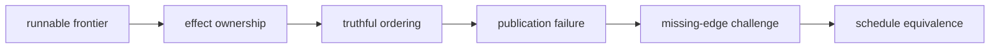
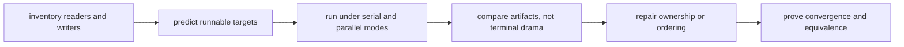

# Exercises

Use these after reading the five core lessons and the worked example. The goal is to make
your parallel-safety reasoning visible through owned paths, traces, and equivalence
checks, not through fear of `-j`.

## How to work through this set

Treat the ten exercises as one full lab day on truthful concurrency.

Before each answer:

1. name the path or resource whose ownership you are testing
2. predict which targets may overlap safely
3. keep one artifact or transcript that proves whether the overlap was honest

If you skip the ownership question, the day turns into vague advice about "parallel
builds being hard." Module 02 is about proving where parallelism is safe, where it is
unsafe, and how to repair the difference.

Do the exercises in order. The day is one progression:

- Exercises 1-3 teach you to inventory writers and expose obvious collisions
- Exercises 4-6 teach you to choose truthful ordering and observe harmless overlap
- Exercises 7-8 move into failed publication and semantic ordering
- Exercises 9-10 teach you to expose missing edges and prove serial/parallel equivalence



Keep one parallel-safety packet as you go. By the end of the day it should contain:

- one ownership table for a real build
- one repaired shared-writer design
- one repaired temporary-path collision
- one example that uses real, order-only, and stamp ordering honestly
- one harmless overlap example and one real race example
- one serial-versus-parallel equivalence check over declared artifacts

If those six artifacts are missing, you are probably discussing concurrency in general
instead of learning how Make schedules a specific graph truthfully.

## Recommended working layout

If you want one lab tree that can support the whole day, use something like:

```text
module02-lab/
├── Makefile
├── src/
├── build/
├── logs/
├── tmp/
├── repro/
└── artifacts/
```

Keep two records while you work.

First, an ownership table:

| Target or path | Reads | Writes | May overlap with | Why safe or unsafe |
| --- | --- | --- | --- | --- |

Second, an equivalence note:

| Run mode | Declared outputs | Checksum manifest | Same meaning as other run? |
| --- | --- | --- | --- |

If you cannot fill in the `Writes` column, you are not ready to add ordering. Logs,
temporary files, caches, staging directories, and manifests are outputs too.



Use that route on purpose. It keeps the day grounded in graph facts instead of in
superstitions about concurrency.

## Exercise 1: Name the runnable targets

Take the course `capstone/` and explain which object targets may run concurrently during
a clean build and why. Draw the runnable frontier before any object completes, then draw
the frontier after all objects complete.

What to hand in:

- the requested-goal closure
- both runnable-frontier sketches
- one sentence per concurrently runnable target group
- the exact edges that keep the final target blocked
- one ownership-table row for each object and the final target

Study note:
Do not answer this as "parallel means independent tasks." Name the exact prerequisites
that make a target runnable or blocked.

## Exercise 2: Repair a shared-log race

From the capstone directory, explain why `repro/shared-log-interleaving.mk` is
nondeterministic under `-j`, then redesign it so one target owns the final log.

What to hand in:

- the bug explanation in plain language
- the repaired target layout
- one command you would run to prove the repaired log is stable
- one sentence naming the single owner of the final published log

Study note:
Appending politely is still multi-writer behavior. The question is not whether it
"usually works." The question is who owns the path.

## Exercise 3: Repair a temporary-file collision

Explain why `repro/shared-staging-collision.mk` is unsafe, then redesign it so each
target uses its own temporary path. Extend the review to two independent Make
invocations that share one output root.

What to hand in:

- the shared path that causes the race
- the repaired temp-path pattern
- a short explanation of why temp files still count as output ownership
- one sentence explaining what failure should leave behind
- the policy that isolates, coordinates, or rejects independent invocations

Study note:
Learners often ignore temporary paths because they are not the final artifact. Module 02
asks you to treat every written path as part of the concurrency contract.

## Exercise 4: Choose the right ordering tool

Give one example that needs a real prerequisite, one that needs an order-only
prerequisite, one that needs a semantic stamp, and one genuine singleton resource that
requires bounded serialization.

What to hand in:

- four short rule or contract fragments
- one sentence per fragment explaining why the mechanism is honest
- a changed-state challenge for the real edge, setup edge, and stamp
- the supported GNU Make boundary for the serialization mechanism
- one sentence naming what lie a broader mechanism would introduce

Study note:
This is an honesty exercise, not a syntax exercise. The point is to describe what should
or should not trigger rebuilds.

## Exercise 5: Design a selftest

Design a `selftest` that compares independent clean serial and parallel workspaces. Its
expected artifact membership must come from a governed contract rather than from
whatever files the implementation happens to produce. Add one controlled shared-writer
fault that the same comparison must reject.

What to hand in:

- the bounded claim and non-claims
- the equivalent initial-state policy
- the governed artifact set and identity checks
- missing, unexpected, and changed result categories
- the controlled fault and expected stopping boundary
- one accepted and one rejected result shape

Study note:
A good selftest stops on the first meaningful divergence. It does not print encouragement
and hope the reader feels reassured.

## Midday self-check

Before you move into your own concurrency experiments, make sure your packet can already
answer these questions cleanly:

- which path in your lab currently has the highest risk of shared ownership
- which ordering edge in your build affects content and which affects setup only
- which artifact set your future serial-versus-parallel check will compare
- which overlapping targets are harmless because they publish to different paths

If you cannot answer those four questions in plain language, return to Exercises 1-5 and
make the packet more explicit before continuing.

## Exercise 6: Observe scheduling without a race

Create two phony targets that each print a start line, sleep for two seconds, and print
an end line. Make `all` depend on both.

Compare elapsed time under `-j1` and `-j2`. Explain why interleaved terminal output is
not enough to prove a data race.

What to hand in:

- the Makefile
- elapsed times from both runs
- a list of output paths owned by each target
- one sentence explaining why overlap without shared publication is safe

Study note:
This exercise exists to separate visible concurrency from unsafe concurrency. Those are
not the same thing.

## Exercise 7: Reject partial publication

Create one file target whose recipe writes directly to the final path and then fails.
Show that a nonzero exit can coexist with plausible partial output. Repair the producer
so it writes a target-specific candidate in the final directory, validates it, and
publishes by rename only after success.

Run the repaired producer with a controlled failure before publication, then with a
healthy input. Add a consumer and prove it never observes the rejected candidate.

What to hand in:

- the broken and repaired recipes
- the failed exit and partial-final observation from the broken case
- the repaired failure evidence showing no rejected final publication
- the healthy final artifact and consumer result
- the candidate path ownership and same-filesystem reasoning
- the next unchanged query exit

Study note:
Parallel safety includes failure visibility. A consumer must see an accepted previous
value or the new accepted value, never a half-published result.

## Exercise 8: Separate setup order from semantic freshness

Before writing a rule, run the capstone `semantic-fault-audit`. Predict whether
`output.txt` will still contain `before` after `input.txt` changes to `after` in each
order-only-edge model. Check your prediction against `summary.tsv` and the paired traces.

```sh
gmake -C programs/reproducible-research/deep-dive-make/capstone \
  semantic-fault-audit
```

Then write a rule that creates `build/report.txt` from `source.txt`. Make `source.txt` a
normal prerequisite and `build/` an order-only prerequisite.

After a successful build:

1. touch `build/` and run Make with `--trace`
2. change `source.txt` and run Make with `--trace`
3. move `source.txt` to the right of `|`, rebuild from `before`, change it to `after`,
   and prove that the successful output is stale

What to hand in:

- your prediction and the two capstone findings
- the honest and deliberately broken rules
- traces for the directory change, semantic change, and stale-output reproduction
- an observation table containing the final input and output values
- one sentence classifying `build/` as setup state and `source.txt` as semantic state

Study note:
Do not judge the edge by whether the build exits zero. The broken model succeeds while
preserving old content. The evidence must connect the declaration to freshness behavior.

## Exercise 9: Expose a missing edge with delay

Create a producer for `generated.h` and a compile target that reads it, but initially
omit the prerequisite edge. Add a short sleep to the generator and run with `-j2`.

Repair the graph and repeat.

What to hand in:

- the smallest broken reproduction
- the failure output
- the repaired rule and three successful repeated runs
- one sentence explaining why the sleep widened the proof window instead of fixing the
  graph

Study note:
Delay does not create the bug. Delay makes the hidden scheduling assumption visible.

## Exercise 10: Prove serial and parallel equivalence

Choose a small build with at least three independently runnable targets. Write a
`parallel-check` target or shell script that:

1. creates equivalent isolated serial and parallel workspaces
2. performs a clean `-j1` build
3. records the governed expected membership and accepted identities
4. performs a clean `-j8` build in the other workspace
5. records the same evidence
6. classifies missing, unexpected, and changed artifacts
7. fails if the declared contract differs

What to hand in:

- the declared artifact set
- the equivalent-state and environment record
- the comparison implementation
- one passing transcript
- one controlled race and its expected comparison category
- one rejected transcript at the intended boundary
- two schedules or environments the result does not cover

Study note:
The right question is not "did both builds finish?" The right question is "did both
builds produce the same declared meaning?"

## Before you check the answers

Do not open `exercise-answers.md` until you can point to:

- one concurrency example that is safe
- one concurrency example that is unsafe
- one repair that removes shared output ownership
- one proof route that compares serial and parallel meaning rather than terminal noise
- one example where a missing edge only becomes obvious under overlap
- one publication failure that cannot expose a plausible rejected final artifact

If you do not yet have those five things, the answer page will sound helpful but will not
teach the underlying discipline.

## Mastery standard for this exercise set

Across all ten answers, the module wants three things:

- you name the graph fact being tested
- you show which command or artifact proves it
- you explain the repair in terms of truth, ownership, or scheduling

If your answer only says "parallel builds are tricky," keep going.
