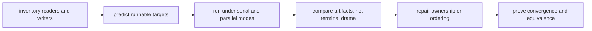

# Exercises

Use these after reading the five core lessons and the worked example. The goal is to make
your parallel-safety reasoning visible through owned paths, traces, and equivalence
checks, not through fear of `-j`.

## How to work through this set

Treat the ten exercises as one full lab day on truthful concurrency.

Before each answer:

1. name the path or resource whose ownership you are testing
2. predict which targets may overlap safely
3. keep one artifact or transcript that proves whether the overlap was honest

If you skip the ownership question, the day turns into vague advice about "parallel
builds being hard." Module 02 is about proving where parallelism is safe, where it is
unsafe, and how to repair the difference.

Do the exercises in order. The day is one progression:

- Exercises 1-3 teach you to inventory writers and expose obvious collisions
- Exercises 4-6 teach you to choose truthful ordering and observe harmless overlap
- Exercises 7-8 move into self-built race examples and directory ordering
- Exercises 9-10 teach you to expose missing edges and prove serial/parallel equivalence

Keep one parallel-safety packet as you go. By the end of the day it should contain:

- one ownership table for a real build
- one repaired shared-writer design
- one repaired temporary-path collision
- one example that uses real, order-only, and stamp ordering honestly
- one harmless overlap example and one real race example
- one serial-versus-parallel equivalence check over declared artifacts

If those six artifacts are missing, you are probably discussing concurrency in general
instead of learning how Make schedules a specific graph truthfully.

## Recommended working layout

If you want one lab tree that can support the whole day, use something like:

```text
module02-lab/
├── Makefile
├── src/
├── build/
├── logs/
├── tmp/
├── repro/
└── artifacts/
```

Keep two records while you work.

First, an ownership table:

| Target or path | Reads | Writes | May overlap with | Why safe or unsafe |
| --- | --- | --- | --- | --- |

Second, an equivalence note:

| Run mode | Declared outputs | Checksum manifest | Same meaning as other run? |
| --- | --- | --- | --- |

If you cannot fill in the `Writes` column, you are not ready to add ordering. Logs,
temporary files, caches, staging directories, and manifests are outputs too.



Use that route on purpose. It keeps the day grounded in graph facts instead of in
superstitions about concurrency.

## Exercise 1: Name the runnable targets

Take the course `capstone/` and explain which object targets may run concurrently during
a clean build and why.

What to hand in:

- a short graph sketch or target list
- one sentence per concurrently runnable target group
- one sentence naming which target must wait and why
- one ownership-table row for the final target

Study note:
Do not answer this as "parallel means independent tasks." Name the exact prerequisites
that make a target runnable or blocked.

## Exercise 2: Repair a shared-log race

From the capstone directory, explain why `repro/shared-log-interleaving.mk` is
nondeterministic under `-j`, then redesign it so one target owns the final log.

What to hand in:

- the bug explanation in plain language
- the repaired target layout
- one command you would run to prove the repaired log is stable
- one sentence naming the single owner of the final published log

Study note:
Appending politely is still multi-writer behavior. The question is not whether it
"usually works." The question is who owns the path.

## Exercise 3: Repair a temporary-file collision

Explain why `repro/shared-staging-collision.mk` is unsafe, then redesign it so each
target uses its own temporary path.

What to hand in:

- the shared path that causes the race
- the repaired temp-path pattern
- a short explanation of why temp files still count as output ownership
- one sentence explaining what failure should leave behind

Study note:
Learners often ignore temporary paths because they are not the final artifact. Module 02
asks you to treat every written path as part of the concurrency contract.

## Exercise 4: Choose the right ordering tool

Give one example that needs a real prerequisite, one that needs an order-only
prerequisite, and one that needs a stamp.

What to hand in:

- three short rule fragments
- one sentence per fragment explaining why that ordering tool is honest
- one sentence naming what lie the wrong ordering tool would introduce

Study note:
This is an honesty exercise, not a syntax exercise. The point is to describe what should
or should not trigger rebuilds.

## Exercise 5: Design a selftest

Describe the checks your `selftest` target must perform to prove parallel safety on the
declared artifact set.

What to hand in:

- the ordered checklist the selftest should run
- the artifact set it should compare
- the failure signal that would tell you the build still lies
- one sentence explaining why terminal output alone is not enough

Study note:
A good selftest stops on the first meaningful divergence. It does not print encouragement
and hope the reader feels reassured.

## Midday self-check

Before you move into your own concurrency experiments, make sure your packet can already
answer these questions cleanly:

- which path in your lab currently has the highest risk of shared ownership
- which ordering edge in your build affects content and which affects setup only
- which artifact set your future serial-versus-parallel check will compare
- which overlapping targets are harmless because they publish to different paths

If you cannot answer those four questions in plain language, return to Exercises 1-5 and
make the packet more explicit before continuing.

## Exercise 6: Observe scheduling without a race

Create two phony targets that each print a start line, sleep for two seconds, and print
an end line. Make `all` depend on both.

Compare elapsed time under `-j1` and `-j2`. Explain why interleaved terminal output is
not enough to prove a data race.

What to hand in:

- the Makefile
- elapsed times from both runs
- a list of output paths owned by each target
- one sentence explaining why overlap without shared publication is safe

Study note:
This exercise exists to separate visible concurrency from unsafe concurrency. Those are
not the same thing.

## Exercise 7: Turn harmless concurrency into a race

Modify Exercise 6 so both targets write `result.txt`. Run the build at least ten times
under `-j2` and record the final content.

Repair the build by giving each worker its own file and adding one aggregation target.

What to hand in:

- the broken and repaired graph shapes
- the ten observed results
- a trace showing that the aggregator waits for both worker files
- one sentence naming the published path that caused the race

Study note:
The important shift is not "two jobs became dangerous." The important shift is "one path
lost single-writer ownership."

## Exercise 8: Separate setup order from semantic freshness

Before writing a rule, run the capstone `semantic-fault-audit`. Predict whether
`output.txt` will still contain `before` after `input.txt` changes to `after` in each
order-only-edge model. Check your prediction against `summary.tsv` and the paired traces.

```sh
gmake -C programs/reproducible-research/deep-dive-make/capstone \
  semantic-fault-audit
```

Then write a rule that creates `build/report.txt` from `source.txt`. Make `source.txt` a
normal prerequisite and `build/` an order-only prerequisite.

After a successful build:

1. touch `build/` and run Make with `--trace`
2. change `source.txt` and run Make with `--trace`
3. move `source.txt` to the right of `|`, rebuild from `before`, change it to `after`,
   and prove that the successful output is stale

What to hand in:

- your prediction and the two capstone findings
- the honest and deliberately broken rules
- traces for the directory change, semantic change, and stale-output reproduction
- an observation table containing the final input and output values
- one sentence classifying `build/` as setup state and `source.txt` as semantic state

Study note:
Do not judge the edge by whether the build exits zero. The broken model succeeds while
preserving old content. The evidence must connect the declaration to freshness behavior.

## Exercise 9: Expose a missing edge with delay

Create a producer for `generated.h` and a compile target that reads it, but initially
omit the prerequisite edge. Add a short sleep to the generator and run with `-j2`.

Repair the graph and repeat.

What to hand in:

- the smallest broken reproduction
- the failure output
- the repaired rule and three successful repeated runs
- one sentence explaining why the sleep widened the proof window instead of fixing the
  graph

Study note:
Delay does not create the bug. Delay makes the hidden scheduling assumption visible.

## Exercise 10: Prove serial and parallel equivalence

Choose a small build with at least three independently runnable targets. Write a
`parallel-check` target or shell script that:

1. performs a clean `-j1` build
2. records checksums of declared outputs
3. performs a clean `-j8` build
4. records checksums again
5. fails if the manifests differ

What to hand in:

- the declared artifact set
- the comparison implementation
- one passing transcript
- one deliberate race that makes the check fail
- one sentence explaining why checksum comparison is a stronger proof than reading the
  console log

Study note:
The right question is not "did both builds finish?" The right question is "did both
builds produce the same declared meaning?"

## Before you check the answers

Do not open `exercise-answers.md` until you can point to:

- one concurrency example that is safe
- one concurrency example that is unsafe
- one repair that removes shared output ownership
- one proof route that compares serial and parallel meaning rather than terminal noise
- one example where a missing edge only becomes obvious under overlap

If you do not yet have those five things, the answer page will sound helpful but will not
teach the underlying discipline.

## Mastery standard for this exercise set

Across all ten answers, the module wants three things:

- you name the graph fact being tested
- you show which command or artifact proves it
- you explain the repair in terms of truth, ownership, or scheduling

If your answer only says "parallel builds are tricky," keep going.
