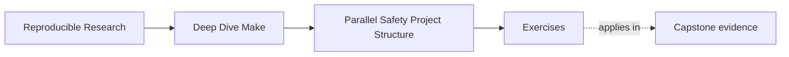

# Exercises

<!-- page-maps:start -->
## Page Maps

<!-- page-maps:end -->

Use these after reading the five core lessons and the worked example. The goal is to make
your reasoning visible, not to show off Make syntax.

For each repair, submit both an ownership table and a graph. A useful ownership table is:

| Target | Reads | Writes | May overlap with | Why safe or unsafe |
| --- | --- | --- | --- | --- |

If you cannot fill in the `Writes` column, you are not ready to add ordering. Remember
that logs, temporary files, cache entries, and staging directories are outputs too.

## Exercise 1: Name the runnable targets

Take the course `capstone/` and explain which object targets may run concurrently during
a clean build and why.

What to hand in:

- a short graph sketch or target list
- one sentence per concurrently runnable target group
- one sentence naming which target must wait and why

## Exercise 2: Repair a shared-log race

From the capstone directory, explain why `repro/shared-log-interleaving.mk` is nondeterministic
under `-j`, then redesign it so one target owns the final log.

What to hand in:

- the bug explanation in plain language
- the repaired target layout
- one command you would run to prove the repaired log is stable

## Exercise 3: Repair a temporary-file collision

Explain why `repro/shared-staging-collision.mk` is unsafe, then redesign it so each target uses
its own temporary path.

What to hand in:

- the shared path that causes the race
- the repaired temp-path pattern
- a short explanation of why temp files still count as output ownership

## Exercise 4: Choose the right ordering tool

Give one example that needs a real prerequisite, one that needs an order-only
prerequisite, and one that needs a stamp.

What to hand in:

- three short rule fragments
- one sentence per fragment explaining why that ordering tool is honest

## Exercise 5: Design a selftest

Describe the checks your `selftest` target must perform to prove parallel safety on the
declared artifact set.

What to hand in:

- the ordered checklist the selftest should run
- the artifact set it should compare
- the failure signal that would tell you the build still lies

## Exercise 6: Observe scheduling without a race

Create two phony targets that each print a start line, sleep for two seconds, and print an
end line. Make `all` depend on both.

Compare elapsed time under `-j1` and `-j2`. Explain why interleaved terminal output is not
enough to prove a data race.

What to hand in:

- the Makefile
- elapsed times from both runs
- a list of output paths owned by each target

## Exercise 7: Turn harmless concurrency into a race

Modify Exercise 6 so both targets write `result.txt`. Run the build at least ten times
under `-j2` and record the final content.

Repair the build by giving each worker its own file and adding one aggregation target.

What to hand in:

- the broken and repaired graph shapes
- the ten observed results
- a trace showing that the aggregator waits for both worker files

## Exercise 8: Use an order-only prerequisite correctly

Write a rule that creates `build/report.txt` from `source.txt`. Model `build/` as an
order-only prerequisite.

After a successful build, touch the directory, run Make again, then change `source.txt`
and run Make again.

What to hand in:

- the complete rule
- the trace for both changes
- an explanation of why directory existence affects order but not content freshness

## Exercise 9: Expose a missing edge with delay

Create a producer for `generated.h` and a compile target that reads it, but initially omit
the prerequisite edge. Add a short sleep to the generator and run with `-j2`.

Repair the graph and repeat.

What to hand in:

- the smallest broken reproduction
- the failure output
- the repaired rule and three successful repeated runs

## Exercise 10: Prove serial and parallel equivalence

Choose a small build with at least three independently runnable targets. Write a
`parallel-check` target or shell script that:

1. performs a clean `-j1` build
2. records checksums of declared outputs
3. performs a clean `-j8` build
4. records checksums again
5. fails if the manifests differ

What to hand in:

- the declared artifact set
- the comparison implementation
- one passing transcript
- one deliberate race that makes the check fail

## Mastery standard for this exercise set

Across all ten answers, the module wants three things:

- you name the graph fact being tested
- you show which command or artifact proves it
- you explain the repair in terms of truth, ownership, or scheduling

If your answer only says "parallel builds are tricky," keep going.
