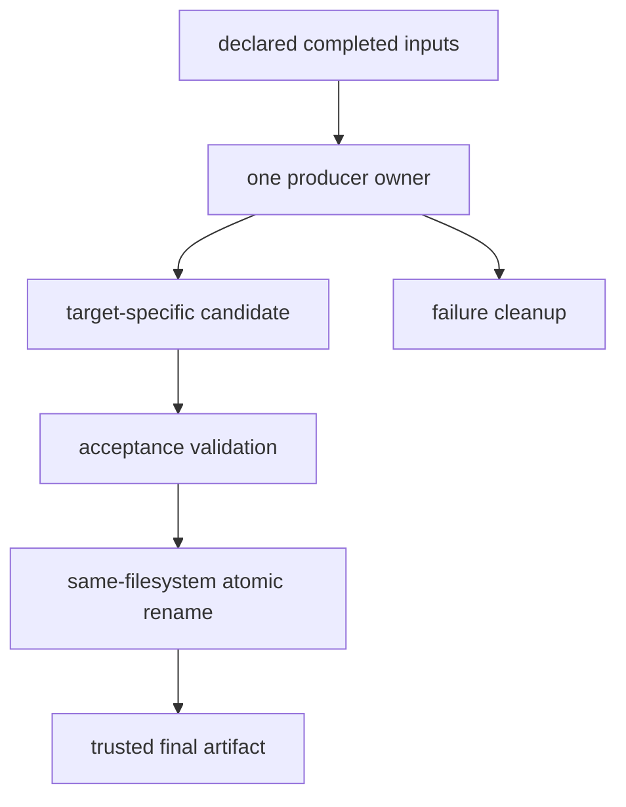

# Parallel Safety Vocabulary

Use this reference when a build discussion collapses scheduling, overlap, races, and
ordering into one vague claim. Each term is tied to an observation or design decision.

## Page maps


```mermaid
flowchart LR
  graph["declared graph"] --> eligible["eligible targets"]
  eligible --> overlap["observed overlap"]
  overlap --> effects["read/write effects"]
  effects --> outcome["artifact outcome"]
  outcome --> decision["accept or reject"]
```

One observed schedule is evidence about execution. The graph defines the schedules Make
is allowed to choose.

## Scheduling terms

| Term | Meaning in this module | Useful evidence |
| --- | --- | --- |
| requested goal | target named by the consumer or selected as default | invocation and working directory |
| prerequisite closure | targets and files required by the requested goal | bounded graph sketch or database |
| eligible target | target whose required prerequisite updates have completed and whose update is needed | target state and declared edges |
| runnable frontier | eligible target updates available at one moment | predicted graph state and trace events |
| job slot | capacity permitted by GNU Make’s parallel scheduling policy | invocation flags and recorded job count |
| legal schedule | any execution order consistent with declared edges and scheduler limits | graph, not textual rule order |
| observed overlap | two target recipes were active during intersecting time | timestamped events or elapsed-time experiment |
| serial schedule | legal schedule with one recipe job at a time | `-j1` invocation |
| parallel schedule | legal schedule permitting multiple recipe jobs | recorded `-jN` invocation |
| jobserver | GNU Make coordination mechanism for recursive parallel job capacity | recursive `$(MAKE)` invocation and environment |

Eligibility does not imply safety. It means the graph has not declared a reason to wait.

## Interference terms

| Term | Meaning | Review question |
| --- | --- | --- |
| effect inventory | all reads, writes, appends, replacements, deletes, and external mutations | what can overlap beyond `$@` |
| interference | overlapping effects can change one another’s observed state or outcome | which shared resource is involved |
| race | correctness depends on relative timing of operations allowed to overlap | which contract can be violated |
| shared writer | more than one recipe or invocation can mutate one semantic path | who should own the final value |
| shared append | multiple producers extend one stream or file | who owns ordering and record integrity |
| candidate path | non-final path holding unaccepted producer output | is it target-specific and failure-clean |
| final path | artifact name consumers are allowed to trust | when does it become visible |
| external singleton | resource that cannot safely serve overlapping clients and cannot be partitioned | what narrow serialization contract exists |
| acceleration cache | shared state that may improve speed but must not change accepted meaning | does a cold/missing cache preserve artifacts |

Interleaved terminal lines prove overlap, not a race. A race needs shared effects and a
possible contract violation.

## Ownership and publication terms



| Term | Meaning |
| --- | --- |
| graph owner | rule responsible for producing one declared target path |
| workspace owner | invocation or process entitled to mutate an output root |
| target-local candidate | candidate name derived from final target and isolated from other producers |
| atomic publication | consumer observes prior accepted value or new accepted value, not partial transition |
| failure hygiene | rejected work does not leave plausible final or reusable poison state |
| idempotent setup | repeating or overlapping setup preserves the same accepted state |
| deterministic merge | one owner combines worker outputs under a declared membership and ordering policy |
| output namespace | path boundary assigned to one target family, layer, or proof run |

One graph owner does not automatically protect two independent Make invocations sharing
the same output root.

## Edge and ordering terms

| Term | Semantic claim | Typical example |
| --- | --- | --- |
| normal prerequisite | prerequisite changes can invalidate target meaning | source, generated header, script, semantic stamp |
| order-only prerequisite | prerequisite must be ready first but its mtime does not invalidate target | output directory |
| recipe sequence | operations belong to one target update | render, validate, publish |
| semantic stamp | normalized file evidence for a non-file fact affecting output | flags or tool identity |
| `.WAIT` | supported GNU Make scheduler boundary between prerequisite groups | bounded ordering without content claim |
| scoped `.NOTPARALLEL` | prerequisites of named targets are serialized under supported semantics | genuine singleton |
| global `.NOTPARALLEL` | broad concurrency suppression | containment with explicit removal plan |
| missing edge | real producer/consumer relationship absent from graph | generated header read but undeclared |
| false edge | declared dependency does not reflect meaning | unrelated target used only to force order |

Moving a content input to the right of `|` removes freshness semantics. It does not
optimize the same relationship.

## Architecture terms

| Term | Meaning in this module |
| --- | --- |
| one DAG | one Make process can evaluate file-level dependencies across included fragments |
| include layer | file grouping syntax by stable responsibility without creating a scheduler boundary |
| public entry | top-level supported target and documented inputs |
| cross-layer edge | prerequisite relation whose declaration and producer live in different includes |
| recursive boundary | parent target invokes another Make process with a private internal graph |
| sub-build contract | explicit inputs, outputs, variables, environment, failure, and consumer acceptance for a child build |
| local override | optional configuration input with documented precedence and semantic modeling |
| output partition | durable namespace assigning write ownership to a layer or target family |

`$(MAKE)` propagates recursive intent and jobserver coordination. It does not give the
parent visibility into the child’s internal file graph.

## Proof terms

| Term | Meaning |
| --- | --- |
| convergence proof | unchanged successful request requires no further work |
| schedule equivalence | bounded serial and parallel runs publish matching governed artifacts |
| governed artifact set | independently expected paths and identity rules under comparison |
| race specimen | minimal fixture containing one intentional ownership defect |
| controlled delay | mechanism widening a timing window for observation |
| failure signature | specific missing, changed, corrupted, or error outcome expected from the specimen |
| truthful control | fixture or mode without the intentional defect |
| detector sensitivity | oracle accepts healthy state and rejects the named violation |
| inconclusive run | bounded attempt produced neither accepted proof nor expected rejection |
| stopping boundary | first claim the harness could not accept |

Delay can expose a race. Removing delay does not repair ownership.

## Confusable pairs

| Do not collapse | Distinction |
| --- | --- |
| eligibility and safety | graph permits an update; recipe effects may still interfere |
| possible overlap and observed overlap | graph allows timing; one run demonstrates timing |
| overlap and race | concurrent work can have disjoint safe effects |
| race and failure | a race can silently publish wrong success; unrelated failure can occur without a race |
| one graph owner and one invocation | separate Make processes can still compete for the same final path |
| candidate uniqueness and final ownership | unique candidates do not choose which process owns final publication |
| ordering and freshness | execution-before does not always mean content invalidation |
| serialization and dependency | shared resource order is not a data edge |
| successful schedules and equivalent artifacts | both exits can be zero while outputs differ |
| repeated passes and proof | sampling needs a governed oracle and stated limits |
| include boundary and graph boundary | included syntax stays in one DAG; recursion creates another graph |
| checksum equality and complete contract | omitted expected outputs can disappear from both compared sets |

## Rewrite vague concurrency language

| Vague statement | Evidence-ready replacement |
| --- | --- |
| “Parallel Make is flaky.” | “Two eligible recipes reuse one staging path; the incident fixture rejects with a missing final artifact.” |
| “These targets are independent.” | “The graph has no edge and the effect inventory shows disjoint reads/writes except stable shared inputs.” |
| “Add an order.” | “The consumer reads the generated header, so it needs a normal prerequisite edge.” |
| “The directory causes rebuilds.” | “A normal directory prerequisite changes mtime from unrelated entries; setup-only ownership should be order-only or recipe-local.” |
| “The lock fixes it.” | “A bounded guard serializes one documented singleton; final artifact equivalence passes under the recorded tool version.” |
| “Serial and parallel passed.” | “Equivalent isolated `-j1` and `-j8` fixtures produced matching governed membership and identities.” |
| “The repro failed.” | “The shared-staging specimen reached its expected changed-artifact signature; the missing-tool control remained a distinct environment failure.” |

Precision can localize a violated contract without claiming a complete root cause.

## Decision language

- **accept overlap** — graph and effect ownership support concurrent execution;
- **add semantic edge** — consumer meaning depends on producer content;
- **assign one publisher** — worker outputs need deterministic aggregation;
- **make setup order-only** — existence matters but mtime does not;
- **model semantic state** — non-file fact needs normalized graph evidence;
- **serialize narrowly** — a real singleton cannot be partitioned;
- **abstain** — evidence does not distinguish schedule, environment, or artifact cause;
- **reject** — observed evidence contradicts the stated parallel contract.

## Vocabulary checkpoint

You can use this reference when you can:

- derive a runnable frontier without depending on textual order;
- distinguish overlap, interference, race, and failure;
- inventory candidate, final, append, delete, and external effects;
- choose normal, order-only, stamp, or serialization semantics;
- explain what included files and recursive builds do to scheduler visibility;
- design paired healthy and faulted fixtures with specific artifact signatures;
- state the limits of one serial/parallel comparison.
