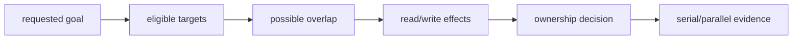
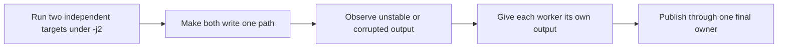
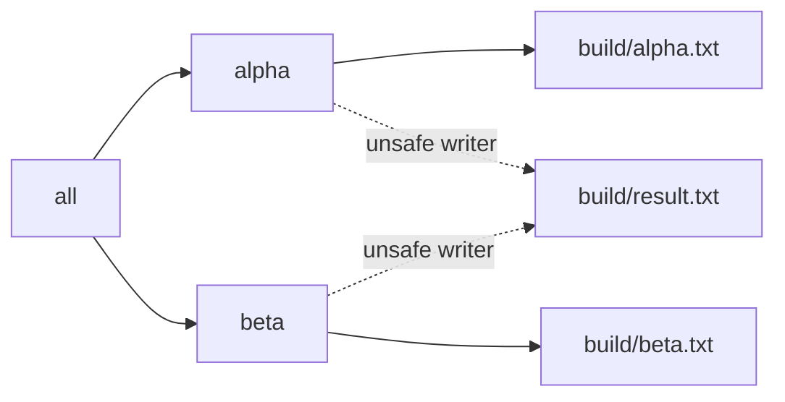
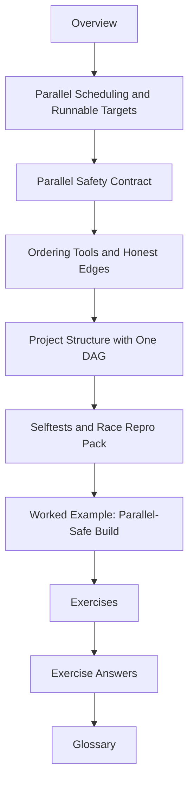

# Module 02: Parallel Safety and Project Structure
Module 01 taught you how to keep one small build graph truthful. Module 02 asks the next
question:

> Does that truth survive when Make can run several eligible targets at the same time?

This module treats parallelism as a correctness test, not a speed trick. If `make -j`
changes the meaning of the build, the graph was already lying. Parallel execution merely
made the lie easier to see.

## The module promise

At the end of this session, you will have a concurrency review packet that explains:

1. which targets were eligible to run together;
2. which paths each recipe read, wrote, appended, replaced, or removed;
3. which edge or ownership rule made overlap safe;
4. how one controlled race violated that rule;
5. why the repair restores truth instead of merely forcing an order;
6. whether serial and parallel builds publish the same declared artifacts.



The scheduler chooses among eligible targets. It does not know about undeclared reads,
shared temporary paths, or a human expectation that one recipe “normally goes first.”

## Why this day matters

Many learners first meet `-j` as a performance flag. In practice, it is one of the best
ways to expose dishonesty in a build. A build that only works when work happens in one
fortunate order is already broken.

## What this module is for

By the end of Module 02, you should be able to explain three things in plain language:

- what Make is actually allowed to run concurrently
- what recipe and graph shapes keep parallel builds safe
- how a larger repository can stay readable without splitting into hidden private DAGs

## Entry diagnostic

Start with the first row you cannot defend:

| Claim | Evidence | Return route |
| --- | --- | --- |
| a target rebuilds from truthful prerequisites | one target/prerequisite explanation | Module 01 |
| two prerequisites are independent in the graph | a small subgraph | this module |
| their filesystem effects do not interfere | read/write ownership table | this module |
| a generated artifact appears only when complete | publication and failure evidence | this module |
| serial and parallel results are equivalent | governed artifact inventories | this module |

If the first row is uncertain, revisit Module 01. Parallel reasoning assumes you can
already explain ordinary target freshness.

## The live demo for this module

Run this sequence before you generalize:



That demo teaches the whole module:

- overlap is not the same thing as a race
- shared output ownership is the real danger
- ordering is not a substitute for truthful graph design
- one final publisher is often the clean repair

## Separate overlap from interference

Two recipes running at the same time are not automatically unsafe. The question is
whether they read and write state that can interfere.



The solid paths are safe when each target owns its output. The dotted paths are unsafe
because two independently scheduled recipes can publish the same file.

Before adding an ordering edge, ask:

1. Are these targets truly dependent, or merely concurrent?
2. Which paths does each recipe read, create, replace, or append?
3. Can one target own the shared result and depend on separate worker outputs?

Most repairs should change ownership or add a missing data edge. Adding an arbitrary
order may make one run pass while leaving the graph unable to explain the real
relationship.

## Plan for the day

| Block | Activity | Evidence you should produce |
| --- | --- | --- |
| Scheduling | Run two independent targets serially and in parallel | timestamps showing overlap under `-j2` |
| Race reproduction | Make two recipes write the same path | a repeatable failure or unstable output |
| Graph repair | assign one writer and add only truthful edges | stable output across repeated `-j8` runs |
| Structure | trace the top-level capstone DAG through included files | a map from public target to recipe owner |
| Proof | compare declared outputs from `-j1` and `-j8` | checksums or a recursive directory diff |
| Practice | complete all ten exercises | predictions, traces, repairs, and one selftest |

### Suggested independent-study timing

| Work | Approximate time | Stop when |
| --- | ---: | --- |
| scheduling and eligibility | 45 minutes | you can draw the runnable frontier for a small graph |
| ownership and ordering | 65 minutes | every overlap has a read/write and edge explanation |
| architecture and selftests | 60 minutes | the proof has an isolated oracle and controlled race |
| worked example | 45 minutes | one failure is predicted, localized, repaired, and replayed |
| exercises and answer review | 90 minutes | the packet supports a review without terminal history |

Store learning evidence under
`artifacts/learning/deep-dive-make/module-02-parallel-safety/`. Resume from the first
unsupported claim, not from the last page you remember opening.

Parallelism is observable even on a laptop. The exercises use short sleeps and small text
files so you can see scheduling without compiling a large project.

When terminal lines interleave, record that as evidence of overlap only. Prove a race
with corrupted, missing, unstable, or prematurely consumed state.

## Keep four questions separate

| Question | Evidence |
| --- | --- |
| Could these targets overlap? | graph and scheduler eligibility |
| Did they overlap in this run? | timestamps or bounded execution events |
| Did their effects interfere? | shared-path or consumer observation |
| Did interference violate the contract? | artifact acceptance or rejection oracle |

Interleaved console output answers only the second question. A slow run does not by
itself prove contention, and a fast parallel run does not prove artifact equivalence.

## A question to keep asking

Every time you are tempted to add an ordering edge, stop and ask:

> Am I modeling a real dependency, or am I trying to hide a shared-state bug?

That question prevents a large amount of brittle Make design.

## Study route



Read the module in that order the first time through. When you return later, go straight
to the file that matches the failure or design question in front of you.

## The ten files in this module

1. Overview (`index.md`)
2. [Parallel Scheduling and Runnable Targets](parallel-scheduling-and-runnable-targets.md)
3. [Parallel Safety Contract](parallel-safety-contract.md)
4. [Ordering Tools and Honest Edges](ordering-tools-and-honest-edges.md)
5. [Project Structure with One DAG](project-structure-with-one-dag.md)
6. [Selftests and Race Repro Pack](selftests-and-race-repro-pack.md)
7. [Worked Example: Parallel-Safe Build](worked-example-parallel-safe-build.md)
8. [Exercises](exercises.md)
9. [Exercise Answers](exercise-answers.md)
10. [Glossary](glossary.md)

## How to use the file set

| If you need to... | Start here |
| --- | --- |
| understand what Make is allowed to run together | [Parallel Scheduling and Runnable Targets](parallel-scheduling-and-runnable-targets.md) |
| review whether outputs are safe under `-j` | [Parallel Safety Contract](parallel-safety-contract.md) |
| choose between real edges, order-only edges, and stamps | [Ordering Tools and Honest Edges](ordering-tools-and-honest-edges.md) |
| scale the build without hiding dependencies | [Project Structure with One DAG](project-structure-with-one-dag.md) |
| prove the build instead of trusting it | [Selftests and Race Repro Pack](selftests-and-race-repro-pack.md) |
| see the ideas gathered in one simulator | [Worked Example: Parallel-Safe Build](worked-example-parallel-safe-build.md) |
| test your own understanding | [Exercises](exercises.md) |
| compare your reasoning against a reference answer | [Exercise Answers](exercise-answers.md) |
| stabilize the module vocabulary | [Glossary](glossary.md) |

## The running example

This module uses the runnable build under `deep-dive-make/capstone/` with:

- one top-level `Makefile`
- layered `mk/*.mk` files
- a tiny C program
- a repro pack of intentionally broken Makefiles

The intentionally broken examples live under `capstone/repro/`. That gives you two
learning surfaces:

- a build you want to keep correct
- several builds you expect to fail until you explain and repair them

## What a strong Module 02 day looks like

By the end of the day, you should have:

- shown harmless concurrency with two separate outputs
- created one reproducible race on purpose
- repaired the race by changing ownership, not by disabling parallelism
- compared one serial and one parallel artifact set
- explained one case where an order-only prerequisite is honest and another where it is not

Package those results as:

```text
parallel-safety/
├── runnable-frontier.md
├── ownership-table.md
├── accepted-overlap/
├── rejected-race/
├── repair-replay.md
└── schedule-comparison/
```

A reviewer should be able to distinguish scheduling evidence, interference evidence,
and artifact evidence without reconstructing your shell history.

## Recovery route after a missed class

If you are studying alone:

1. complete the entry diagnostic;
2. read scheduling and parallel-safety before choosing an ordering tool;
3. reproduce one named race in the capstone pack;
4. write the ownership table before reading its repair;
5. read the one-DAG and selftest lessons;
6. run the worked example’s serial/parallel comparison;
7. complete the exercises before opening their answers.

Do not begin with `.NOTPARALLEL`, `.WAIT`, locks, or sleeps. Those mechanisms are only
meaningful after the graph and ownership problem is named.

## The central review question

Carry this question through the whole module:

> If two targets run at the same time, what exactly makes that safe?

Good Module 02 answers usually mention one or more of these:

- truthful prerequisite edges
- one writer per output path
- atomic publication
- honest setup boundaries
- a selftest that proves the result

## Commands to keep open

These commands form the evidence loop for Module 02:

```sh
make selftest
make -n <target>
make --trace <target>
make -p
make -j8 all
```

Use them constantly. Module 02 is not done when the build merely "works." It is done when
you can defend why it remains correct under concurrency.

## Learning outcomes

By the end of this module, you should be able to:

- predict which targets Make may run at the same time
- explain why one writer per output path is a hard rule
- choose between real prerequisites, order-only prerequisites, and stamps without lying
- structure a larger build as one top-level DAG with readable layers
- prove serial and parallel builds are equivalent on the declared artifact set

## Exit standard

Do not move on until all of these are true:

- you can explain one local race without guessing
- you can fix a race by repairing the graph or the publication contract, not by hiding it
- you can run a selftest that checks convergence and serial/parallel equivalence
- you can explain why recursive make is not the default architecture here
- you completed ten exercises and can distinguish scheduling from output ownership

When those become routine, Module 02 has done its job.
