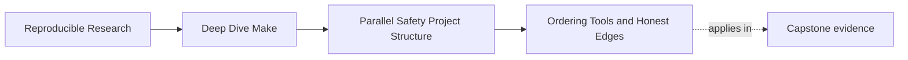
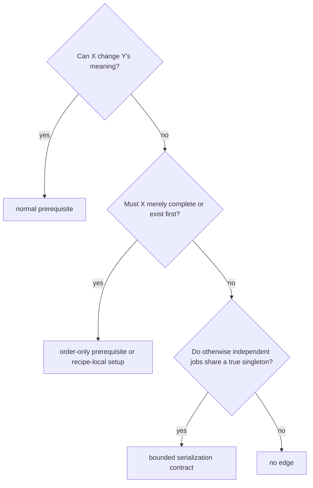
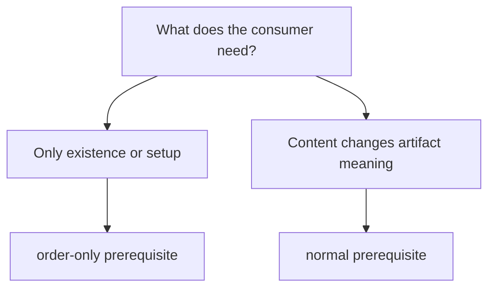

# Ordering Tools and Honest Edges


<!-- page-maps:start -->
## Page Maps




<!-- page-maps:end -->

Make gives you several ways to impose order. The only acceptable ordering is ordering
that tells the truth.

## The core rule

Use the smallest tool that matches the real dependency.

If target `Y` needs the content of `X`, write:

```make
Y: X
```

If `Y` merely needs `X` to exist, but changes to `X` should not trigger rebuilds, use an
order-only prerequisite:

```make
Y: | X
```

The difference is not cosmetic. It changes what Make is allowed to infer from a changed
mtime.

## A small chooser table

| Situation | Correct tool | Reason |
| --- | --- | --- |
| Output meaning changes when `X` changes | real prerequisite | content dependency is real |
| `Y` needs a directory or setup path to exist | order-only prerequisite or `mkdir -p "$(@D)"` | existence matters, not mtime churn |
| Flags or build mode change output meaning | stamp or manifest | semantic input needs durable evidence |
| You cannot yet model a clean boundary | redesign first, serialize last | hidden truth is still hidden under `.NOTPARALLEL` |

## Classify the relationship before choosing syntax

Ask these questions in order:



An edge claims a relationship between target meanings. Do not add one only because two
commands happen to touch the same badly owned path; repair the ownership first.

## Know what each ordering mechanism says

| Mechanism | Claim | Freshness behavior | Typical use |
| --- | --- | --- | --- |
| `Y: X` | Y consumes the state or meaning of X | changed X can make Y stale | data, generated header, script, semantic stamp |
| `Y: \| X` | X must be ready before Y, but its mtime is not Y’s meaning | changed X alone does not make Y stale | directory or setup path |
| commands on one recipe line/recipe | operations form one target update | target owns their sequence | render, validate, publish |
| `.WAIT` between prerequisites | later group waits for earlier group | does not create content semantics | supported GNU Make scheduling boundary |
| scoped `.NOTPARALLEL` | prerequisites of named target are serialized | does not repair missing semantic edges | genuine singleton resource boundary |
| global `.NOTPARALLEL` | broad recipe concurrency disabled | graph defects can remain hidden | exceptional containment, not ordinary design |

`.WAIT` and detailed `.NOTPARALLEL` behavior depend on the supported GNU Make version.
Probe or declare that version instead of publishing syntax the environment cannot parse.

## Prove what an order-only edge does not promise

It is easy to memorize the syntax and still misuse it. The capstone semantic audit gives
the same changed input to two graph models:

```make
# Broken: input.txt must exist, but its content is not allowed to invalidate output.txt.
output.txt: | input.txt
	cp $< $@
```

```make
# Control: output.txt means "the current content of input.txt."
output.txt: input.txt
	cp $< $@
```

Run the paired models:

```sh
gmake -C programs/reproducible-research/deep-dive-make/capstone \
  semantic-fault-audit
```

Open `summary.tsv` and the two order-only traces under:

```text
artifacts/audit/reproducible-research/deep-dive-make/semantic-faults/
```

Before reading them, predict both second builds. Each workspace first builds from an
input containing `before`. The audit then changes the input to `after`, makes that input
newer than the output, and invokes Make again.

| Model | Does the input exist? | Does the changed input invalidate the output? | Expected output |
| --- | --- | --- | --- |
| order-only edge | yes | no | `before` |
| semantic edge | yes | yes | `after` |

The broken trace reports that there is nothing to do. Make is not ignoring a declared
content dependency. The graph never declared one. The resulting evidence should read:

```text
order-only    input=after    output=before
semantic-edge input=after    output=after
```

That contrast separates two questions that are often collapsed:



An order-only prerequisite can establish that a path is available before a recipe runs.
It cannot carry semantic freshness. Moving a real input to the right of `|` therefore
does not optimize the graph; it removes an invalidation rule.

### Read the trace as a graph decision

For the broken model, answer:

1. which file changed
2. whether Make scheduled the recipe after that change
3. which old value survived in the output
4. which declaration prevented the change from participating in freshness

For the control, locate the trace line that names `input.txt` as newer than `output.txt`.
The useful proof is not merely that the recipe ran. It is that the graph explains why it
ran.

## Directory targets are the classic case

Directories are often setup requirements rather than semantic inputs. That is why a build
directory is usually better handled through `mkdir -p "$(@D)"` inside the recipe or
through a carefully chosen order-only prerequisite.

If you use a normal prerequisite for a directory, you often create rebuild noise rather
than truth.

That rebuild noise matters because it trains you to distrust Make for the wrong reason.
The real bug is not "Make is noisy." The real bug is that the graph treated a setup path
as if it were semantic content.

Use this review table before moving a prerequisite across `|`:

| Review question | If yes | If no |
| --- | --- | --- |
| Could changing this path change the bytes or meaning of the target? | keep a normal prerequisite | continue |
| Does the recipe only need the path to exist before it starts? | use an order-only prerequisite | the edge may not belong |
| Can a changed path leave a stale but successful target? | the order-only form is dishonest | verify the setup contract |

A recipe-local setup is often simpler:

```make
build/reports/%.json: data/%.csv scripts/report.py
	@mkdir -p "$(@D)"
	python3 scripts/report.py "$<" "$@"
```

Use a directory target when several rules benefit from one visible setup node. Use
recipe-local `mkdir -p` when directory creation is cheap, idempotent, and clearer than a
large family of directory rules. Do not let an ordinary producer remove a shared
directory.

## Stamps exist to model hidden semantic state

Sometimes a fact matters but is not naturally a file input:

- compiler flags
- configuration mode
- toolchain identity

That is when a stamp or manifest becomes useful. The point is not the filename. The point
is that the graph gets durable evidence about a semantic change.

The most common mistake here is an always-changing stamp such as:

```make
stamp:
	date > $@
```

That does model change, but it models change constantly. The result is non-convergence.
The right question is whether the stamp changes when the semantic fact changes, not
whether the stamp changes at all.

Publish a semantic stamp only when its content changes:

```make
build/flags.stamp: FORCE | build/
	@candidate="$@.candidate.$$$$"; \
	printf '%s\n' '$(CC)|$(CPPFLAGS)|$(CFLAGS)' > "$$candidate"; \
	if test -r "$@" && cmp -s "$$candidate" "$@"; then \
	  rm -f "$$candidate"; \
	else \
	  mv -f "$$candidate" "$@"; \
	fi

.PHONY: FORCE
FORCE:
```

`FORCE` causes the check to run; content-preserving publication prevents timestamp churn
when the semantic value is unchanged. Consumers use the stamp as a normal prerequisite
because changed flag meaning must invalidate them.

The stamp should record a normalized semantic value. Recording current time, random
identifiers, or irrelevant environment noise creates non-convergence.

## Serialization is the last resort

`.NOTPARALLEL` and `.WAIT` are real tools, but they are not first-choice fixes. If you
reach for them before understanding the missing or false edge, you are probably hiding a
lying DAG instead of repairing it.

### Review a genuine singleton

Serialization can be honest when two otherwise independent targets must use a tool that
cannot safely serve concurrent requests and cannot be given isolated state.

Record:

```text
singleton resource:
targets that use it:
why partitioning is unavailable:
scope of serialization:
timeout or failure behavior:
supported GNU Make version:
artifact equivalence after serialization:
removal condition:
```

Keep the serialization boundary narrower than the whole build. The contract is about the
resource, not about distrust of parallelism.

### Do not confuse recipe sequence with graph order

Commands in one target recipe are part of that target’s update:

```make
build/report.json: data/input.csv
	python3 scripts/render.py "$<" "$@.candidate"
	python3 scripts/check.py "$@.candidate"
	mv -f "$@.candidate" "$@"
```

They do not create relationships with another independently runnable target. Likewise,
putting two recipes in adjacent source locations does not order their targets.

## Challenge the chosen tool

| Claimed relationship | Challenge | Accepted observation |
| --- | --- | --- |
| normal content edge | change X meaning | Y rebuilds and accepted result changes |
| order-only setup | change setup mtime only | setup is ready; Y does not rebuild needlessly |
| semantic stamp | change normalized fact, then repeat unchanged | one invalidation followed by convergence |
| scoped singleton | overlap users without guard in a controlled fixture | detector rejects; bounded guard restores accepted artifacts |
| no relationship | vary completion order repeatedly | artifacts remain equivalent |

A decision is stronger when the challenge could have disproved it.

## A good review sentence

When you choose an ordering tool, try to say the decision out loud:

- "`Y: X` because `Y` depends on the content of `X`."
- "`Y: | dir/` because `Y` needs the directory to exist, but directory mtimes should not
  force rebuilds."
- "`Y: flags.stamp` because compiler mode changes `Y` even when source files do not."

If the sentence sounds vague, the rule probably is too.

## End-of-page checkpoint

Before leaving this page, you should be able to:

- explain the difference between a real and order-only prerequisite
- use the paired trace and output to prove why a semantic input cannot be order-only
- describe one situation where a stamp is the honest tool
- explain why directory mtimes often create noise rather than signal
- say why serialization is not the first repair for a lying graph
- distinguish graph edges, recipe sequence, and scheduler serialization
- state the version and resource contract required by `.WAIT` or scoped `.NOTPARALLEL`
