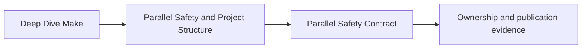
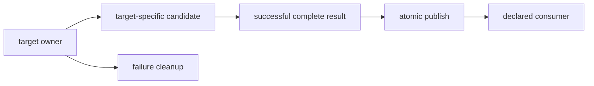

# Parallel Safety Contract

Parallel safety is an ownership problem expressed through filesystem effects. A graph may
correctly allow two targets to overlap while their recipes still collide on a shared
path, process, port, database, or mutable cache.

## Page maps





The final path must not look valid before the producer has completed and accepted its
work.

## State the contract

For every target update:

1. one graph owner controls each declared final path;
2. temporary and side-effect paths also have owners;
3. every meaningful read has a truthful dependency or documented external contract;
4. publication exposes a complete accepted result;
5. failure does not leave a plausible final artifact;
6. independently runnable recipes do not mutate shared state unsafely;
7. a repeated or concurrent invocation has an explicit workspace policy.

The first five are necessary even under `-j1`. Parallelism increases the number of
interleavings that reveal their absence.

## Build an effect inventory

Do not review only `$@`. Inspect every path and service touched:

| Effect | Questions |
| --- | --- |
| read | is it declared, stable while read, and owned by a completed producer |
| create | is the path unique to this target or safely idempotent |
| replace | does one recipe own the final name and publish atomically |
| append | who defines record integrity and ordering |
| delete | can another runnable target still need the path |
| directory mutation | can concurrent creation/removal or globbing change behavior |
| external service | are namespace, transaction, and cleanup boundaries explicit |
| cache | is it acceleration-only, or can its state change output meaning |

A target that writes one final file can still own several hidden side effects.

## One graph owner per final path

This is unsafe:

```make
.PHONY: alpha bravo

alpha:
	printf 'alpha\n' > build/result.txt

bravo:
	printf 'bravo\n' > build/result.txt
```

Both recipes claim the same final path. Possible results depend on timing, and Make
cannot infer that collision from shell text.

Repair by giving workers distinct outputs and one publisher:

```make
.PHONY: all

all: build/result.txt

build/alpha.txt:
	@mkdir -p "$(@D)"
	printf 'alpha\n' > "$@"

build/bravo.txt:
	@mkdir -p "$(@D)"
	printf 'bravo\n' > "$@"

build/result.txt: build/alpha.txt build/bravo.txt
	@candidate="$@.candidate.$$$$"; \
	cat $^ > "$$candidate" && \
	mv -f "$$candidate" "$@" || { rm -f "$$candidate"; exit 1; }
```

Now alpha and bravo may overlap, while result publication has one owner and waits for
both inputs.

## Shared append is a format contract

Two recipes appending to one log can produce:

- unstable record order;
- interleaved records larger than one atomic write boundary;
- truncated or partially encoded data after failure;
- a file whose completion cannot be inferred.

If order does not matter and an external logging system explicitly provides record
atomicity, that service owns the contract. A plain shared file usually does not.

Prefer one per-target log followed by one deterministic merge:

```make
LOGS := build/logs/alpha.log build/logs/bravo.log

build/run.log: $(LOGS)
	@candidate="$@.candidate.$$$$"; \
	cat $(sort $^) > "$$candidate" && \
	mv -f "$$candidate" "$@" || { rm -f "$$candidate"; exit 1; }
```

Sorting prerequisite names gives the merge an explicit ordering policy. It does not sort
records inside each worker log.

## Temporary names belong to the contract

This looks target-specific but collides across recipes:

```make
alpha:
	render alpha > build/output.tmp
	mv build/output.tmp build/alpha.out

bravo:
	render bravo > build/output.tmp
	mv build/output.tmp build/bravo.out
```

Derive candidates from the final target and add process uniqueness when separate Make
invocations may share the workspace:

```make
build/%.out: inputs/%.txt
	@candidate="$@.candidate.$$$$"; \
	render "$<" > "$$candidate" && \
	validate "$$candidate" && \
	mv -f "$$candidate" "$@" || { rm -f "$$candidate"; exit 1; }
```

Within one Make invocation, Make normally updates one target once. Two independent Make
processes can still update the same target concurrently. A repository must either:

- isolate their output roots;
- coordinate the whole workspace explicitly;
- reject concurrent invocations;
- use a producer with transactional semantics.

A PID-suffixed candidate prevents candidate collision but does not decide which
independent invocation owns the final result.

## Atomic publication has a filesystem boundary

Rename-based publication is atomic when candidate and final path are on the same
filesystem and the platform supports the required rename semantics. A candidate in a
global scratch directory may cross filesystems and lose that property.

Use the final directory:

```make
build/report.json: data/input.csv scripts/report.py | build/
	@candidate="$(@D)/.$(@F).candidate.$$$$"; \
	python3 scripts/report.py "$<" "$$candidate" && \
	python3 scripts/check_report.py "$$candidate" && \
	mv -f "$$candidate" "$@" || { rm -f "$$candidate"; exit 1; }
```

The consumer sees the previous complete result or the new complete result, not the
candidate.

## Failure hygiene is observable

Use `.DELETE_ON_ERROR` as baseline protection for targets whose recipe fails after
modifying `$@`:

```make
.DELETE_ON_ERROR:
```

It does not know every side-effect path. Recipes still need to remove their candidates
and avoid publishing the final path before validation.

Test failure deliberately:

1. preserve any accepted existing artifact;
2. make the producer fail after writing candidate content;
3. confirm the final artifact is absent or retains the prior accepted value according to
   policy;
4. confirm no candidate is mistaken for a final artifact;
5. repair the fault and replay;
6. verify the next unchanged request converges.

“The command returned nonzero” is not enough when poison output remains.

## Directories have shared ownership risks

Concurrent `mkdir -p build/reports` is normally an idempotent setup operation. Concurrent
unconditional `mkdir build/reports` can cause one recipe to fail after another creates
the directory. Concurrent cleanup is more dangerous:

```make
report:
	rm -rf build
	mkdir -p build
	...
```

This target can erase another target’s output. Cleaning a shared root belongs to an
explicit lifecycle request that is not a prerequisite of ordinary producers.

Prefer target-local directories or idempotent creation of the narrow parent directory.

## Locks are not the first repair

A lock can be appropriate when an external singleton resource truly permits only one
user. Before adding one, answer:

- what resource is singular;
- why outputs cannot be partitioned;
- who owns lock acquisition, timeout, stale-lock recovery, and release;
- whether the lock is visible in the public environment contract;
- whether waiting preserves Make’s failure and cancellation behavior.

Do not use a lock to preserve two-writer output design that should become worker outputs
plus one publisher.

## Review an ownership table

Complete this before running `-j`:

| Target | Reads | Final writes | Candidate writes | Appends | Deletes | External state | Owner conflict |
| --- | --- | --- | --- | --- | --- | --- | --- |

Then classify every pair that may overlap:

- **independent** — no meaningful shared effects;
- **read-sharing** — both read stable completed state;
- **producer/consumer** — needs a graph edge;
- **multi-writer** — needs ownership redesign;
- **singleton resource** — needs an explicit serialization contract.

This is more precise than marking the whole build “parallel-safe” or “unsafe.”

## Controlled challenge matrix

| Suspected weakness | Controlled challenge | Accepted repair evidence |
| --- | --- | --- |
| shared final path | delay one writer after opening the path | distinct workers and one deterministic publisher |
| shared candidate | delay between candidate write and rename | target-local candidates with no collision |
| partial publication | fail after candidate generation | final path never exposes rejected content |
| shared append | emit multi-line tagged records repeatedly | per-target logs and governed merge |
| unsafe directory lifecycle | overlap creation and removal | narrow idempotent setup and separate cleanup |
| independent invocation collision | run isolated output roots concurrently | explicit workspace policy and stable artifacts |

Delays expose timing windows; they are never the repair.

## End-of-page checkpoint

Before leaving this page, you should be able to:

- inventory reads, writes, appends, deletes, candidates, and external state;
- distinguish one graph owner from one operating-system process;
- repair multi-writer output with worker artifacts and one publisher;
- explain the filesystem boundary of rename-based atomic publication;
- test failure hygiene without treating nonzero exit as sufficient;
- identify when a lock represents a real singleton contract rather than hidden bad
  ownership.
