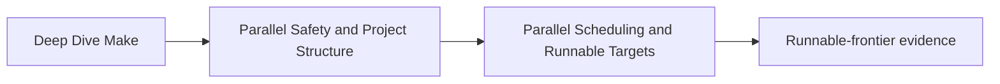
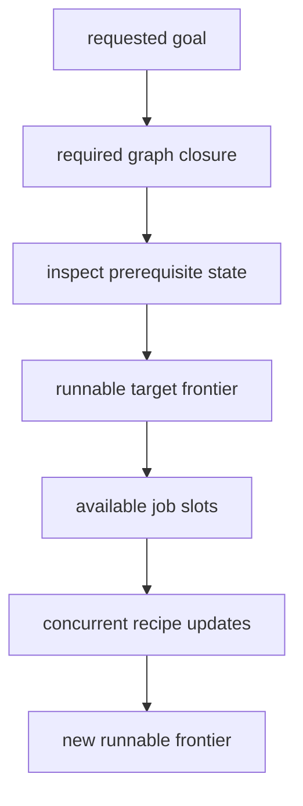
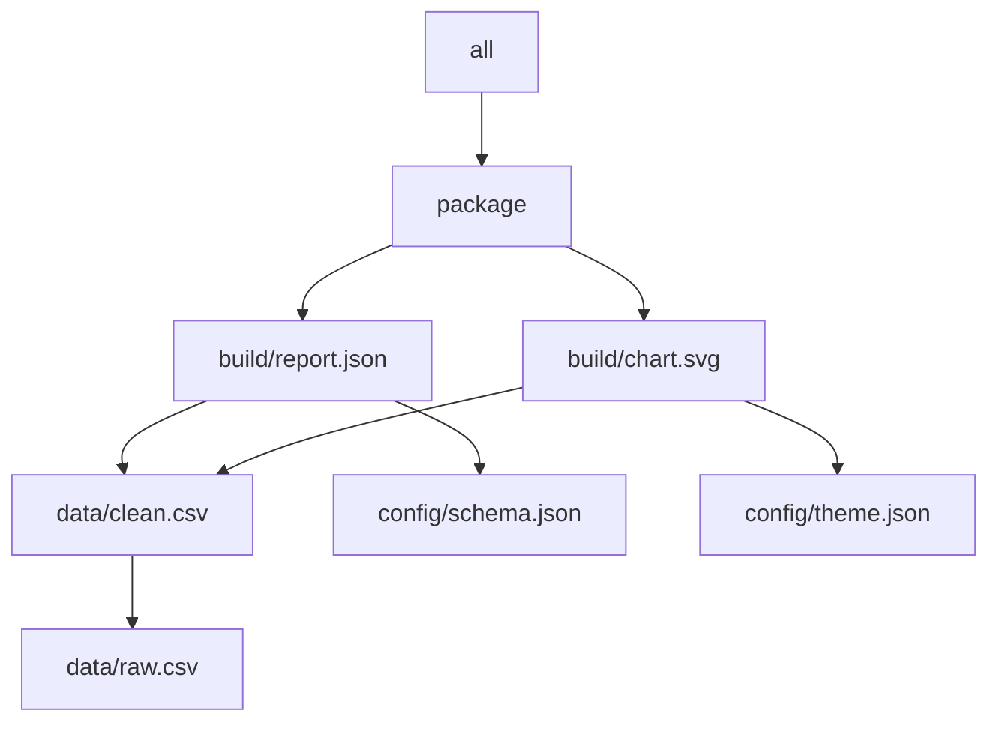

# Parallel Scheduling and Runnable Targets

GNU Make parallelizes eligible target updates, not lines, directories, or arbitrary shell
commands. To predict a schedule, start from the requested goal and follow declared edges
until you can name the current runnable frontier.

## Page maps





The frontier changes as prerequisites finish. A terminal transcript shows one schedule;
the graph describes every schedule Make is allowed to choose.

## Define runnable precisely

A target update can become runnable when:

- the target lies in the requested goal’s prerequisite closure;
- Make has resolved an applicable rule;
- every prerequisite that must be updated first has completed successfully;
- the target still needs an update;
- a job slot is available when its recipe must run.

An up-to-date target participates in graph reasoning without running a recipe. A target
with no recipe may still connect prerequisites to consumers. “Runnable target” therefore
means a possible update action, not simply a filename mentioned in the Makefile.

## Read a frontier by hand

Consider:



For a clean build:

1. `data/clean.csv` can update only after `data/raw.csv` is ready.
2. `build/report.json` and `build/chart.svg` wait for `data/clean.csv`.
3. Once the clean data is complete, report and chart may update together if schema and
   theme are ready.
4. `package` waits for both artifacts.
5. `all` completes after package.

The graph declares no order between report and chart because neither consumes the other.
Adding one would reduce legal schedules without expressing a real dependency.

## Make can choose any legal order

Among runnable targets, do not depend on:

- textual order of prerequisite names;
- include-file order;
- which recipe printed first last time;
- alphabetical target names;
- one machine’s process timing;
- an unrecorded belief that a short recipe always finishes first.

`-j1` chooses one legal serial schedule. `-j8` permits a wider set. A correct graph and
artifact design must tolerate every schedule allowed by its declared edges.

## Job count limits overlap, not correctness

`-jN` allows up to `N` recipe jobs, subject to GNU Make’s scheduling and recursive
jobserver behavior. Lowering `N` can make a race harder to observe without repairing it.

These observations mean different things:

| Observation | Supported conclusion |
| --- | --- |
| `-j1` passes | one serial schedule passed |
| `-j2` fails | one permitted overlapping schedule exposed a violation |
| repeated `-j8` passes | sampled parallel schedules passed |
| `-j1` and `-j8` inventories match | declared artifacts matched for those runs |

None proves every possible timing or environment.

## Separate overlap from interference

Two recipes overlap safely when their effects satisfy the ownership contract:

| Target | Reads | Writes | Removes | Shared state |
| --- | --- | --- | --- | --- |
| report | clean data, schema | report-specific candidate and final path | own failed candidate | none |
| chart | clean data, theme | chart-specific candidate and final path | own failed candidate | none |

The same schedule becomes unsafe if both write `build/output.tmp`, append to one log, or
mutate an undeclared cache whose state affects outputs.

Overlap is an execution fact. Interference is a shared-state fact. Race is a
contract-violating outcome whose possibility depends on both.

## A harmless-overlap lab

Create:

```make
.PHONY: all alpha bravo

all: alpha bravo

alpha:
	@sleep 1
	@printf 'alpha\n' > alpha.txt

bravo:
	@sleep 1
	@printf 'bravo\n' > bravo.txt
```

Run serially and in parallel:

```sh
time gmake -j1 all
rm -f alpha.txt bravo.txt
time gmake -j2 all
```

The shorter elapsed time suggests overlap, while the separate accepted outputs show why
the overlap is safe. Console ordering is incidental. Preserve output content and
ownership as the correctness evidence.

## Missing edges create premature eligibility

Suppose the chart recipe reads `config/palette.json` but the rule says:

```make
build/chart.svg: data/clean.csv scripts/chart.py
	python3 scripts/chart.py data/clean.csv config/palette.json $@
```

Make cannot wait for a generated palette it does not know about, and a later palette
change cannot invalidate the chart. The truthful declaration is:

```make
build/chart.svg: data/clean.csv config/palette.json scripts/chart.py
	python3 scripts/chart.py data/clean.csv config/palette.json $@
```

The repair adds semantic truth. An arbitrary edge from chart to report might delay the
chart in one graph while leaving the real palette dependency hidden.

## Generated prerequisites need one graph owner

```make
build/report.json build/chart.svg: build/generated-config.json

build/generated-config.json: config/base.json scripts/render_config.py
	@candidate="$@.candidate"; \
	python3 scripts/render_config.py "$<" "$$candidate" && \
	mv -f "$$candidate" "$@"
```

Make updates the generated prerequisite before either consumer. After successful atomic
publication, both consumers may run concurrently. Review:

- whether one recipe owns the generated path;
- whether all generator inputs are declared;
- whether consumers have direct or inherited truthful edges;
- whether a failed generator leaves no plausible final artifact.

One owner does not by itself make unsafe direct writes atomic.

## Observe one schedule without mistaking it for the graph

Useful commands:

```sh
gmake -n all
gmake --trace -j2 all
```

Dry run describes planned recipes for current state. Trace describes selected target
updates and their declared reasons. Neither proves recipe effects or artifact identity.

For a small lab, recipe events can help demonstrate overlap:

```make
alpha:
	@printf 'alpha start\n'
	@sleep 1
	@printf 'alpha end\n'
```

Event order is teaching evidence, not a stable output contract. Do not make correctness
depend on console line order.

## Recursive Make and the scheduler boundary

A recipe that invokes another Make process creates a scheduling boundary. Use `$(MAKE)`
rather than plain `make` so GNU Make can propagate flags and jobserver coordination:

```make
thirdparty:
	+$(MAKE) -C vendor/component all
```

Even with jobserver coordination, the parent cannot see the child’s internal file graph.
Cross-boundary inputs and outputs must be explicit. Module 05 develops recursion and
environment contracts; this module’s rule is to keep one DAG when the dependencies
belong to one build.

## Diagnose an illegal-looking schedule

When a consumer ran “too early”:

1. name the requested goal;
2. draw the prerequisite closure around the consumer;
3. list the real files and state its recipe reads;
4. compare that list with declared prerequisites;
5. identify which missing edge made the consumer eligible;
6. add the semantic edge;
7. replay the triggering schedule or input change;
8. verify serial and parallel artifact equivalence.

When two independent targets collide, the graph may be correct about independence while
their recipe ownership is wrong. Repair shared paths instead of inventing a data edge.

## Scheduler evidence traps

| Trap | Correction |
| --- | --- |
| “They printed together, so there is a race.” | prove a shared effect and violated artifact contract |
| “It passes with fewer jobs.” | preserve the failing schedule and repair truth |
| “Put the faster target first.” | prerequisite text order is not a schedule contract |
| “Add a sleep.” | use delay to expose a boundary, never as the repair |
| “Make should know this file is read.” | declare the edge; recipes are opaque to Make |
| “One successful `-j8` run proves safety.” | compare governed artifacts and retain a controlled rejection |

## End-of-page checkpoint

Before leaving this page, you should be able to:

- derive the runnable frontier from a requested goal and target state;
- explain why textual order does not constrain independent prerequisites;
- distinguish possible overlap, observed overlap, interference, and contract violation;
- identify a missing edge that makes a consumer eligible too early;
- explain why reducing job count hides rather than repairs a race;
- state what parent and recursive Make processes can and cannot schedule globally.
