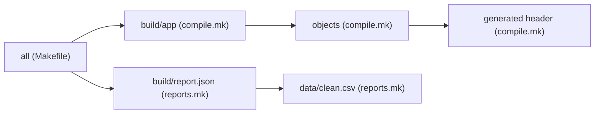

# Project Structure with One DAG

Splitting Make syntax across files does not require splitting the dependency graph.
Included fragments are parsed into one Make process, allowing global prerequisite
reasoning and scheduling while giving human readers clear ownership boundaries.

## Page maps


```mermaid
flowchart TD
  entry["top-level Makefile"] --> policy["policy/config includes"]
  entry --> discovery["source/output mapping"]
  entry --> rules["producer rules"]
  entry --> public["public targets"]
  discovery --> rules
  policy --> rules
  rules --> graph["one evaluated DAG"]
  public --> graph
```

File boundaries help readers. Target and prerequisite edges remain the scheduling truth.

## Organize by responsibility

A small durable layout:

```text
Makefile
mk/
├── policy.mk
├── discovery.mk
├── compile.mk
├── reports.mk
└── verification.mk
```

| Owner | Responsibility | Should not own |
| --- | --- | --- |
| top-level `Makefile` | supported public targets, default goal, include assembly | domain recipe details |
| `policy.mk` | documented defaults and supported configuration | hidden local correctness patches |
| `discovery.mk` | rooted membership and source-to-output mapping | artifact publication |
| `compile.mk` | compile producers and dependency inclusion | report targets |
| `reports.mk` | report producers and their owned outputs | public CI orchestration |
| `verification.mk` | selftest and audit entry points | alternate product graph |

The names should describe stable responsibility, not the order in which files were
created.

## Includes assemble one evaluated graph

```make
include mk/policy.mk
include mk/discovery.mk
include mk/compile.mk
include mk/reports.mk
include mk/verification.mk
```

After parsing, Make reasons about rules from all included files together. A report target
can depend on an object target owned in another fragment without creating a scheduler
boundary.

Include order can affect variable assignments, conditionals, and generated syntax. Make
the order intentional:

- policy defaults before rules that consume them;
- discovery before mappings that derive outputs;
- generated dependency files after base rules are known;
- optional local overrides at one documented precedence point;
- no circular include ownership.

“One DAG” does not mean include order is semantically irrelevant.

## Keep public requests at the entry

The top-level file should let a reader find supported requests quickly:

```make
.DEFAULT_GOAL := all

.PHONY: help test selftest

all: build/app build/report.json

test: all
	./scripts/test_product.sh

selftest:
	./scripts/test_build.sh

include mk/policy.mk
include mk/discovery.mk
include mk/compile.mk
include mk/reports.mk
include mk/verification.mk
```

If included fragments contribute prerequisites to a public target, keep that extension
easy to discover and avoid multiple fragments redefining its recipe.

## Map ownership through the graph

For one public target, create:

| Target or path | Declared owner | Inputs | Writes | Consumers |
| --- | --- | --- | --- | --- |

Then draw the cross-fragment edges:



A path has one producing owner even when several fragments refer to it. Multiple textual
mentions are not multiple ownership.

## Avoid catch-all fragments

Files such as `misc.mk`, `common-rules.mk`, or `extras.mk` tend to collect unrelated
targets. Prefer a domain or boundary that tells a reader:

- which outputs are owned;
- which public requests are extended;
- which variables form the interface;
- which other layer may depend on it.

When one fragment grows several unrelated responsibilities, split by ownership rather
than by arbitrary file size.

## Why recursive Make hides scheduling truth

Suppose:

```make
.PHONY: frontend backend

frontend:
	$(MAKE) -C frontend all

backend:
	$(MAKE) -C backend all
```

The parent sees two targets. It does not see internal file edges in the child graphs. If
frontend consumes a generated backend schema, the parent needs an explicit cross-boundary
artifact contract. Otherwise the dependency remains private knowledge.

Costs include:

- the global scheduler cannot coordinate internal file targets;
- cross-directory dependencies become wrapper-target edges or hidden recipe reads;
- incremental decisions are split across processes;
- traces and databases show only one graph at a time;
- separate child output roots may still collide in shared parent locations;
- configuration and jobserver propagation need explicit care.

Use `$(MAKE)`, not plain `make`, for genuine recursive boundaries so GNU Make can
propagate invocation flags and coordinate job tokens. That improves coordination but
does not merge the graphs.

## Decide whether recursion is a real boundary

| Question | Favor one DAG | Favor explicit sub-build boundary |
| --- | --- | --- |
| do components share file-level prerequisites | yes | no |
| should one scheduler see all producers | yes | no |
| are artifacts consumed directly across components | yes | only through versioned interface |
| can component build independently from declared inputs | not yet | yes |
| does component use another build tool or release lifecycle | not necessarily | often |
| can parent name exact input/output handoff | required either way | essential |

Directory layout alone is not a reason for recursion.

## Treat a sub-build like a tool

When recursion is justified, define:

```text
input paths and versions:
output paths and schema:
supported variables:
environment policy:
parallel/jobserver behavior:
failure and cleanup:
consumer acceptance:
```

The parent target should depend on the inputs that determine the sub-build result and
publish an output or manifest it can reason about. “Run make over there” is not a file
contract.

## Local overrides need an interface

An optional include:

```make
-include config.mk
```

raises several questions:

- Is absence supported?
- Which variables may it set?
- Can command-line values override it?
- Do its values affect artifact meaning?
- How are semantic changes represented in freshness?
- Does CI run without it?
- Can it add private sources or rules?

Good local uses are ergonomic tool paths or documented developer modes. If an override
changes compiler flags, source membership, or output meaning, record that state through
the graph and proof evidence. An untracked override must not be the only reason a build is
correct.

## Keep outputs partitioned by owner

Readable includes do not prevent output collisions. Define durable roots:

```text
build/objects/       compile.mk
build/generated/     generator owner
build/reports/       reports.mk
artifacts/tests/     verification.mk
```

Separate roots make ownership review easier, but the actual recipes must still obey the
partition. A helper that writes a global `build/output.tmp` violates it.

## Review the capstone assembly

From the capstone directory:

```sh
gmake help
gmake architecture-contract-audit
```

Read the top-level `Makefile`, then `mk/contract.mk`, `mk/common.mk`, `mk/objects.mk`,
`mk/macros.mk`, and `mk/stamps.mk`. For one public target, locate:

1. public declaration;
2. prerequisite expansion;
3. producing rule;
4. output root;
5. configuration inputs;
6. audit or selftest route.

The architecture audit can support an ownership claim. It does not replace reading the
actual cross-layer graph.

## Architecture warning signs

- several fragments define recipes for the same public target;
- include order silently changes output ownership;
- recursive components read one another’s private outputs;
- local overrides add correctness rules unavailable to CI;
- one helper writes across several domain roots;
- public targets are scattered and undocumented;
- child builds receive plain `make` without jobserver or variable intent;
- cleaning one layer deletes another layer’s outputs.

## Architecture review record

```text
Public request:
Entry declaration:
Included owners:
Cross-layer edges:
Output ownership:
Configuration boundary:
Recursive boundaries:
Parallel collision review:
Verification route:
Decision and limit:
```

## End-of-page checkpoint

Before leaving this page, you should be able to:

- explain how included fragments form one evaluated DAG;
- assign public interface, policy, discovery, producer, and verification ownership;
- map a public request across fragment boundaries;
- identify when recursion hides a real file dependency;
- define a justified sub-build through inputs, outputs, environment, and failure;
- review local overrides and output roots for parallel correctness.
