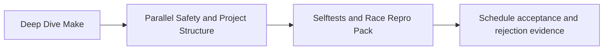
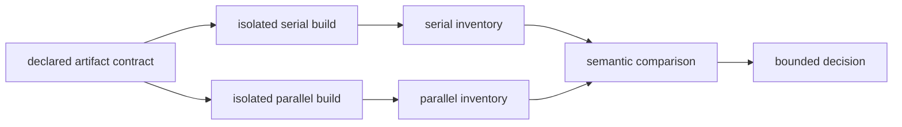

# Selftests and Race Repro Pack

A parallel build earns trust through paired evidence: healthy schedules produce accepted
equivalent artifacts, and controlled ownership violations are rejected with the expected
signature. Repetition alone is not a detector.

## Page maps





Both builds need equivalent source, configuration, tools, and environment. Otherwise the
comparison mixes schedule with another variable.

## Define the parallel claim

Use:

```text
For the recorded source and environment, clean serial and bounded parallel builds
produce the same declared artifact membership and accepted identities.
```

Name:

- source revision or fixture digest;
- Make and tool versions;
- documented variables;
- serial and parallel commands;
- job count;
- declared artifact set;
- identity or semantic comparison;
- explicit non-claims.

One `-j8` success does not prove all schedules, filesystems, job counts, or external
resource behavior.

## Isolate schedule runs

Do not build serially and then run parallel Make over the same already-complete outputs.
That compares a build with a no-op.

Use independent output roots or reset an isolated fixture between runs:

```text
schedule-proof/
├── source/
├── serial-workspace/
├── parallel-workspace/
├── serial-inventory.json
├── parallel-inventory.json
└── comparison.json
```

Record what reset means. A clean target that omits caches or generated includes may leave
the schedules with unequal initial state.

## Govern the artifact set

An inventory should begin from expected outputs:

| Role | Expected path | Identity rule |
| --- | --- | --- |
| executable | `app` | SHA-256 and runtime acceptance |
| object | `build/main.o` | SHA-256 within fixed toolchain |
| generated header | `build/include/dynamic.h` | SHA-256 and syntax check |
| semantic stamp | `build/flags.stamp` | normalized content |

Report separately:

- missing expected paths;
- unexpected governed paths;
- changed content or size;
- semantic acceptance failures.

Do not define correctness as “hash every file currently under build.” That can compare
volatile logs while allowing an omitted required output to vanish from both expectation
and result.

## Prove convergence separately

After a successful build:

```sh
set +e
gmake -q all
query_exit=$?
set -e
```

Exit zero says Make sees no work for the unchanged request. It does not prove artifact
identity across schedules. Conversely, matching serial/parallel artifacts do not prove
the graph converges on the next run.

Preserve both claims:

| Claim | Oracle |
| --- | --- |
| convergence | no-op trace plus query exit zero |
| schedule equivalence | governed inventory comparison |
| product behavior | runtime assertions |
| detector sensitivity | controlled violation rejected |

## Build a deterministic race repro

A useful race specimen is:

- small enough to read completely;
- limited to one ownership defect;
- amplified by a controlled delay or barrier;
- bounded by a timeout;
- checked for a specific failure signature;
- paired with a truthful control or repair.

Example shared candidate:

```make
.PHONY: all
all: alpha.out bravo.out

alpha.out:
	printf 'alpha\n' > shared.candidate
	sleep 0.2
	mv shared.candidate $@

bravo.out:
	printf 'bravo\n' > shared.candidate
	sleep 0.1
	mv shared.candidate $@
```

The delay widens the collision window. The defect is shared candidate ownership. The
repair uses target-specific candidates; removing the delay without changing ownership is
not a repair.

## Require the expected signature

A nonzero exit can come from:

- the intended collision;
- a missing tool;
- a bad working directory;
- unsupported syntax;
- timeout infrastructure;
- an unrelated stale artifact.

The repro should assert a signature such as:

- missing expected final path;
- wrong tagged content;
- changed artifact identity;
- known error text at the intended operation;
- successful command paired with corrupted output.

Reject a run whose failure does not match the claimed boundary. “It failed somehow” does
not validate the detector.

## Read the capstone repro pack

From the capstone directory:

```sh
gmake repro
gmake incident-audit
```

The pack includes:

| Specimen | Ownership defect | Evidence question |
| --- | --- | --- |
| `shared-log-interleaving.mk` | multiple appenders to one record stream | are records or ordering outside the contract |
| `shared-staging-collision.mk` | workers reuse one staging path | which writer loses or publishes the wrong value |
| `directory-creation-race.mk` | non-idempotent shared directory setup | which creator observes already-existing state |

Predict the defect, path, and expected signature before reading the saved incident
evidence. The audit verifies known signatures and preserves them under the repository
artifact boundary.

## Separate teaching repro from production seam

Race repros should live in named fixtures, not as undocumented switches in the ordinary
build. A controlled fault seam used by harness tests must:

- default to disabled;
- accept a finite validated value;
- be unreachable through normal proof commands;
- name the expected stopping boundary;
- avoid changing the public product contract;
- remain covered by a harness test.

The specimen teaches a failure. It must not make the reference build dishonest.

## Test the detector

Use a matrix:

| Fixture | Expected | Observed | Decision |
| --- | --- | --- | --- |
| truthful serial | accept |  |  |
| truthful parallel | accept |  |  |
| shared-writer fault | reject at ownership comparison |  |  |
| missing-tool control | reject as environment failure |  |  |

If the shared-writer fixture passes, the oracle is too weak. If the truthful fixture
fails, the ordinary contract or fixture is broken. If the fault fails at an unrelated
environment check, the intended race detector was not exercised.

## Use repetition proportionately

Some schedules are probabilistic even with a widened timing window. Record:

```text
attempt count:
job count:
timeout:
accepted signatures:
observed signature counts:
inconclusive runs:
```

The test should stop after a bounded number of attempts and report inconclusive evidence
honestly. An unbounded loop that waits for failure is not suitable for CI.

A deterministic barrier or explicit controlled post-build mutation is preferable when it
tests the same contract without timing luck.

## Preserve the first rejected run

Store:

```text
result and stopping boundary:
source/fixture identity:
serial and parallel commands:
job count and timeout:
event or command logs:
expected and actual inventories:
signature classification:
preserved workspace:
later checks not reached:
```

Do not immediately rerun into the same report path. The failed workspace may contain the
most direct evidence of shared-state ownership.

## Design a concurrency selftest

For a new repository:

1. name the declared artifact and environment contract;
2. create equivalent isolated serial and parallel fixtures;
3. build and verify convergence within each fixture;
4. inventory expected artifacts independently;
5. compare membership and accepted identity;
6. run product assertions separately;
7. activate one controlled ownership defect;
8. require rejection at the intended comparison boundary;
9. preserve accepted and rejected evidence;
10. state the schedules and environments not covered.

## Evidence traps

| Trap | Correction |
| --- | --- |
| run `-j8` repeatedly and call that proof | define an oracle and declared artifacts |
| compare one warm serial tree with one parallel no-op | isolate equivalent clean states |
| accept any nonzero repro result | require the intended signature |
| hash a convenient directory | govern expected membership first |
| use sleep as the repair | change ownership or edges |
| rerun before reviewing | preserve first stopping state |
| call product tests parallel-safety tests | compare graph and artifact claims separately |

## End-of-page checkpoint

Before leaving this page, you should be able to:

- define a bounded serial/parallel equivalence claim;
- isolate schedule runs and govern expected artifact membership;
- separate convergence, equivalence, product behavior, and detector sensitivity;
- design a small race repro with a specific signature and truthful control;
- test that an oracle accepts healthy fixtures and rejects the intended defect;
- use bounded repetition without hiding inconclusive results;
- preserve a rejected concurrency run for review.
