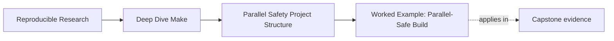
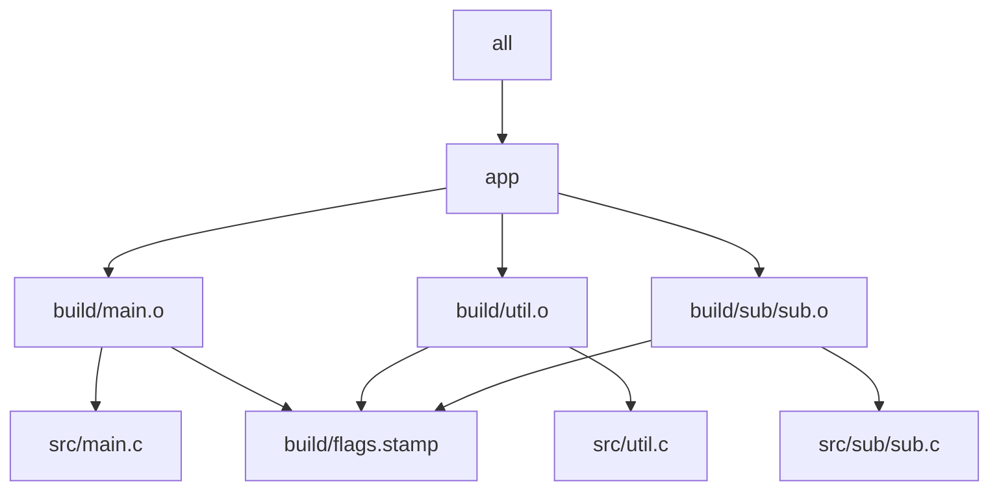

# Worked Example: Parallel-Safe Build


<!-- page-maps:start -->
## Page Maps




<!-- page-maps:end -->

This file begins with a tiny scheduling demonstration, then ties the module together
around the real course capstone.

## Choose the invocation boundary

From the repository root:

```sh
make PROGRAM=reproducible-research/deep-dive-make capstone-selftest
```

From `programs/reproducible-research/deep-dive-make/capstone/`:

```sh
gmake help
gmake selftest
```

Record the working directory and executable. Do not alternate between root wrapper and
capstone commands inside one evidence note.

## See parallel scheduling in one minute

Create this Makefile in an empty practice directory:

```make
.PHONY: all alpha beta

all: alpha beta

alpha:
	@printf 'alpha start\n'
	@sleep 2
	@printf 'alpha end\n'

beta:
	@printf 'beta start\n'
	@sleep 2
	@printf 'beta end\n'
```

Compare:

```sh
time gmake -j1 all
time gmake -j2 all
```

The serial run takes about four seconds. The parallel run takes about two because `alpha`
and `beta` have no edge between them. Their printed lines may interleave. That is not
automatically a race: the targets do not share output state.

Now add a shared output to both recipes:

```make
alpha:
	@printf 'alpha\n' > combined.txt

beta:
	@printf 'beta\n' > combined.txt
```

Run `gmake -j2 all` repeatedly. The final file depends on which recipe writes last. The
graph allows concurrent work, but the recipes violate one-writer ownership.

## Layout

```text
capstone/
  Makefile
  mk/
    common.mk
    objects.mk
    rules.mk
  include/
    util.h
    sub.h
  src/
    main.c
    util.c
    sub/sub.c
  repro/
    shared-log-interleaving.mk
    shared-staging-collision.mk
    directory-creation-race.mk
    incremental-edges/
      authored-header/
      generated-producer/
    semantic-faults/
      clock-state/
      order-only-edge/
      pattern-selection/
```

This example matters because it combines three things at once:

- a layered build you want to keep correct
- enough targets that parallel scheduling becomes visible
- several intentionally broken repro files that teach race diagnosis

## A graph view of the simulator



This graph matters because it shows the two kinds of parallelism you want:

- object-file targets can become runnable together
- the final link target must wait for all of them

It also shows one hidden-input repair from Module 01 carrying forward: the semantic flags
stamp is now part of the object-file contract.

## What to inspect first

Start with these questions:

1. which targets can become runnable together?
2. which outputs have one clear writer?
3. what would `selftest` need to prove before you trust `-j8`?

This worked example is the concrete home for the rest of the module.

## Layer responsibilities in this build

Read the capstone in this order:

1. `Makefile` for the public interface and selftest entry point
2. `mk/common.mk` for stable policy knobs
3. `mk/objects.mk` for rooted, sorted discovery and output mapping
4. `mk/rules.mk` for atomic publication and dependency edges

That reading order helps you see structure before you see implementation detail.

## Six experiments to run

For every experiment, list the paths each runnable recipe may write. That list is more
useful than a screenshot of interleaved output because it exposes collisions even when a
particular run happens to finish successfully.

### Demonstration 1: Inspect the schedule

Predict the initial runnable frontier for `all`, then run:

```sh
gmake -n all
gmake --trace -j2 all
```

The first command shows planned recipes for current state. The second shows selected
updates and reasons for one observed schedule. Draw the object targets that can overlap
and the final target that waits. Do not infer output safety from the trace alone.

### Demonstration 2: Prove convergence

Run:

```sh
gmake selftest
```

Use the harness-owned workspace rather than cleaning the live capstone. In the saved
report, locate the successful serial build, query command, and query exit zero. Explain
why this proves convergence for the fixture but not serial/parallel equivalence.

### Demonstration 3: Compare serial and parallel

Run:

```sh
gmake selftest-report
```

Open the serial and parallel inventories under:

```text
artifacts/proof/reproducible-research/deep-dive-make/selftest/
```

Confirm:

- both clean schedules used equivalent fixture state;
- each inventory has the governed expected paths;
- missing, unexpected, and changed categories are empty;
- aggregate identities match;
- product behavior remains a separate check.

Write two limits: only the recorded schedules and declared artifacts were compared.

### Demonstration 4: Use the repro pack as contrast

Run the bounded incident route:

```sh
gmake incident-audit
```

Read:

```text
artifacts/audit/reproducible-research/deep-dive-make/incident/
```

Choose the shared-staging collision. Before reading its evidence, predict:

```text
runnable targets:
shared path:
expected signature:
why one successful run would be inconclusive:
ownership repair:
```

Then compare the prediction with the preserved signature. The healthy capstone derives
candidates from final targets and assigns one owner to each final artifact.

### Demonstration 5: Observe an order-only directory

Run:

```sh
gmake semantic-fault-audit
```

Use the paired order-only and semantic-edge fixtures. Both inputs exist; only the normal
edge treats changed content as an invalidation. Read `summary.tsv`, both traces, and both
outputs. State why a directory setup edge can be order-only while a content input cannot.

### Demonstration 6: Map one DAG

Run:

```sh
gmake architecture-contract-audit
```

Trace one public target from the top-level Makefile through included `mk/*.mk` owners to
its final paths. Record:

- public request owner;
- discovery/mapping owner;
- producer rule owner;
- output namespace;
- cross-layer prerequisites;
- any recursive boundary.

The audit supports the map; it does not replace reading the declarations.

## Build the experiment ledger

| Demonstration | Claim | Selection evidence | Artifact evidence | Rejection evidence | Limit |
| --- | --- | --- | --- | --- | --- |
| runnable frontier |  |  |  |  |  |
| convergence |  |  |  |  |  |
| schedule equivalence |  |  |  |  |  |
| shared-staging race |  |  |  |  |  |
| order-only semantics |  |  |  |  |  |
| one-DAG architecture |  |  |  |  |  |

Leave cells empty when an experiment does not produce that evidence type. A dry run does
not become artifact evidence merely because it is convenient.

## Diagnose the broken repro without guessing

When a repro fails intermittently, use this order:

1. run `gmake -n` to identify recipes Make considers independent
2. read those recipes and list every written path, including temporary files and logs
3. run the smallest reproduction repeatedly under `-j8`
4. inspect the shared path after each run
5. redesign the graph so each worker owns one path and one target owns aggregation
6. compare serial and parallel manifests after the repair

Do not begin with `.NOTPARALLEL`, a global lock, or a chain of order-only prerequisites.
Those can suppress overlap without describing the data relationship. The repaired graph
should explain why work waits, not merely force it to wait.

Use this short incident note:

| Question | Evidence |
| --- | --- |
| Which targets were runnable together? | dry-run or trace |
| Which path had multiple writers? | recipe inspection |
| What failure did repeated parallel runs expose? | output transcript or manifest |
| Which ownership change repaired it? | before-and-after graph |
| Why is the result now equivalent under `-j1` and `-j8`? | artifact comparison |

## Review without rerunning

After the incident audit, work only from its saved bundle:

1. identify the fixture and expected signature;
2. name the overlapping target effects;
3. locate the first contract violation;
4. distinguish observed failure from inferred root cause;
5. name the ownership repair;
6. state which evidence a repaired run must produce;
7. preserve the bundle before any rerun replaces it.

If the diagnosis requires memory of console output, the bundle or your handoff is
incomplete.

## What this example should teach you

By the time you finish this file, you should be able to point at the simulator and say:

- where runnable targets come from
- where output ownership is enforced
- where hidden semantic state is modeled honestly
- where selftest proves the build instead of merely running it
- why the documented paths and commands correspond to files that actually exist
- how incident signatures distinguish the intended race from unrelated failure
- how one-DAG layering preserves scheduler visibility across source files
