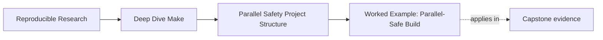
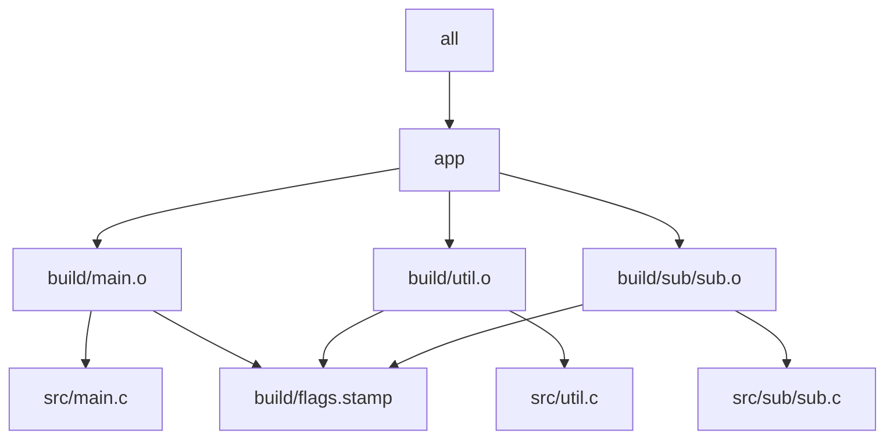

# Worked Example: Parallel-Safe Build


<!-- page-maps:start -->
## Page Maps




<!-- page-maps:end -->

This file begins with a tiny scheduling demonstration, then ties the module together
around the real course capstone.

## See parallel scheduling in one minute

Create this Makefile in an empty practice directory:

```make
.PHONY: all alpha beta

all: alpha beta

alpha:
	@printf 'alpha start\n'
	@sleep 2
	@printf 'alpha end\n'

beta:
	@printf 'beta start\n'
	@sleep 2
	@printf 'beta end\n'
```

Compare:

```sh
time make -j1 all
time make -j2 all
```

The serial run takes about four seconds. The parallel run takes about two because `alpha`
and `beta` have no edge between them. Their printed lines may interleave. That is not
automatically a race: the targets do not share output state.

Now add a shared output to both recipes:

```make
alpha:
	@printf 'alpha\n' > combined.txt

beta:
	@printf 'beta\n' > combined.txt
```

Run `make -j2 all` repeatedly. The final file depends on which recipe writes last. The
graph allows concurrent work, but the recipes violate one-writer ownership.

## Layout

```text
capstone/
  Makefile
  mk/
    common.mk
    objects.mk
    rules.mk
  include/
    util.h
    sub.h
  src/
    main.c
    util.c
    sub/sub.c
  repro/
    shared-log-interleaving.mk
    shared-staging-collision.mk
    clock-based-stamp.mk
    generated-header-edge.mk
    directory-creation-race.mk
```

From the repository root, run capstone commands through:

```sh
make PROGRAM=reproducible-research/deep-dive-make capstone-selftest
```

From `programs/reproducible-research/deep-dive-make/capstone/`, use GNU Make directly:

```sh
make selftest
```

On macOS that second command may be `gmake selftest`.

This example matters because it combines three things at once:

- a layered build you want to keep correct
- enough targets that parallel scheduling becomes visible
- several intentionally broken repro files that teach race diagnosis

## A graph view of the simulator



This graph matters because it shows the two kinds of parallelism you want:

- object-file targets can become runnable together
- the final link target must wait for all of them

It also shows one hidden-input repair from Module 01 carrying forward: the semantic flags
stamp is now part of the object-file contract.

## What to inspect first

Start with these questions:

1. which targets can become runnable together?
2. which outputs have one clear writer?
3. what would `selftest` need to prove before you trust `-j8`?

This worked example is the concrete home for the rest of the module.

## Layer responsibilities in this build

Read the capstone in this order:

1. `Makefile` for the public interface and selftest entry point
2. `mk/common.mk` for stable policy knobs
3. `mk/objects.mk` for rooted, sorted discovery and output mapping
4. `mk/rules.mk` for atomic publication and dependency edges

That reading order helps you see structure before you see implementation detail.

## Four experiments to run

### Demonstration 1: Inspect the schedule

Run:

```sh
make -n all
make --trace all
```

The first command shows the candidate work. The second shows why each target is needed.

### Demonstration 2: Prove convergence

Run:

```sh
make clean && make all
make -q all; echo $?
```

You want exit code `0` after the successful build.

### Demonstration 3: Compare serial and parallel

Run:

```sh
make clean && make -j1 all
make clean && make -j8 all
```

The simulator should produce equivalent declared artifacts across both runs.

### Demonstration 4: Use the repro pack as contrast

Run one broken repro, for example:

```sh
make -f repro/shared-staging-collision.mk clean
make -f repro/shared-staging-collision.mk -j8 all
```

Then explain why the healthy capstone does not suffer from the same problem.

### Demonstration 5: Observe an order-only directory

Find a target that uses `| $(BUILD_DIR)/` or another directory prerequisite. Touch the
directory and run the build again. The directory must exist before the recipe runs, but a
directory timestamp change should not force content rebuilds.

### Demonstration 6: Trace one object

Choose one object file, delete only that file, and run:

```sh
make --trace all
```

Explain why that object and its downstream link rebuild while independent objects stay
untouched.

## What this example should teach you

By the time you finish this file, you should be able to point at the simulator and say:

- where runnable targets come from
- where output ownership is enforced
- where hidden semantic state is modeled honestly
- where selftest proves the build instead of merely running it
- why the documented paths and commands correspond to files that actually exist
