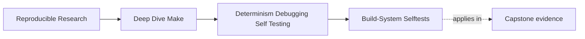
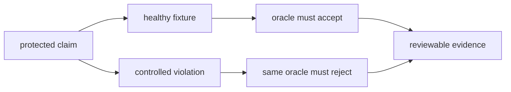

# Build-System Selftests


<!-- page-maps:start -->
## Page Maps




<!-- page-maps:end -->

This lesson is where the build stops asking for trust and starts producing evidence.
A useful selftest must do more than exit zero. It must separate its claims, record what
it ran, explain differences, and leave a failed run inspectable.

## Separate product behavior from build behavior

`test` and `selftest` answer different questions:

| Target | Question | Typical evidence |
| --- | --- | --- |
| `test` | does the built program produce the expected behavior | assertions over executable output |
| `selftest` | did the build graph converge and preserve meaning across schedules | query status, artifact inventories, negative checks |
| `selftest-harness-tests` | does the selftest reject a known violation | an intentionally rejected report |

A program can pass its runtime tests after a stale or schedule-dependent build. Conversely,
a truthful build can compile a program with a product defect. Do not combine those claims
into one vague green check.

## Define the proof contract before writing the harness

For this module, the selftest contract contains five claims:

1. A clean serial build reaches an up-to-date state.
2. Clean serial and parallel builds publish the same declared artifacts.
3. The dry-run trace stays below a review guardrail.
4. A deliberately hidden parse-time input prevents false convergence.
5. Optional `eval` machinery remains executable without controlling the core graph.

These claims are related, but they are not interchangeable. A result should show which
claim failed and which later claims never ran.

```mermaid
flowchart LR
  sandbox["isolated workspace"] --> converge["serial build + query"]
  converge --> serial["serial inventory"]
  serial --> parallel["parallel inventory"]
  parallel --> compare["semantic comparison"]
  compare --> trace["trace guardrail"]
  trace --> hidden["hidden-input rejection"]
  hidden --> optional["quarantined eval check"]
  optional --> verdict["durable outcome"]
```



The order is diagnostic. If schedule equivalence fails, the trace and hidden-input checks
are `NOT_RUN`; they are not silently treated as passes.

## Design claims with an acceptance and rejection route

Before implementing another selftest section, complete this table:

| Protected claim | Healthy fixture | Controlled violation | Independent oracle | Preserved evidence |
| --- | --- | --- | --- | --- |
| unchanged build converges | declared graph | parse-time input changes on every read | query exit after successful build | build log, query log, exit |
| schedules publish equivalent artifacts | isolated clean builds | controlled post-parallel artifact drift | declared inventory comparison | both inventories and semantic diff |
| generated source is consumed | generator input and consumer | remove the consumer edge | mutate generator input and inspect dependent artifact | trace, artifact identities |
| public target propagates failure | known passing checker | checker returns a named nonzero exit | target exit and stopping log | command, exit, reached checks |

Each row needs both directions:

- a healthy case that the harness accepts;
- a deliberate defect that the harness rejects at the named boundary.

Without the rejection route, the selftest may be green because its oracle is disconnected
from the claimed invariant.



The controlled violation belongs to the selftest’s own test suite, not to the normal
learner or production configuration surface.

## Keep the oracle independent

A selftest can accidentally prove its own assumptions. Consider an inventory generated
from the same variable that defines the build outputs. If an expected output disappears
from that variable, both the build and inventory omit it, and comparison still passes.

Strengthen the oracle by deriving expectations from the contract rather than the
implementation under test:

- maintain an explicit governed output list for a small fixture;
- compare against a checked schema or manifest;
- assert required roles, not only whatever files happen to exist;
- validate membership before computing hashes;
- make the controlled defect violate a requirement the oracle reads independently.

Independence does not require a second build system. It requires the test not to ask the
same faulty declaration what “correct” means.

## Own the workspace

The harness copies source into:

```text
artifacts/proof/reproducible-research/deep-dive-make/selftest/workspace/
```

That location matters for three reasons:

- generated state stays under the repository's artifact boundary
- the live checkout cannot lend old objects to the test
- a failure leaves the exact sandbox available for review

An operating-system scratch directory that is deleted on exit may isolate execution, but
it does not support review. A workspace is part of the proof when another person needs
to inspect the stopping state.

The harness replaces this fixed workspace on its next run. If the failure is part of an
incident, preserve the report before rerunning.

## Make fixture state attributable

An isolated directory is necessary but insufficient. Record the state that enters it:

```text
source revision or tracked-file digest:
copied paths:
excluded paths:
tool commands and versions:
documented variable overrides:
sanitized environment policy:
network policy:
workspace path:
```

If the harness copies the current worktree, say whether tracked modifications and
untracked files are included. A rejected run cannot be reproduced from a revision alone
when its fixture included local changes.

Also bound time and external dependencies. A hung recursive build should produce a named
timeout failure, not occupy CI indefinitely. A network fetch should either be part of a
documented contract or rejected from the selftest fixture.

## Prove convergence as an exit-code contract

The convergence check performs:

```sh
gmake clean
gmake -j1 all
gmake -q all
```

The final command is not another build. GNU Make returns:

- `0` when no target needs updating
- `1` when work would be required
- `2` when Make encounters an error

A successful build followed by query exit `1` has not converged. Hiding that result
behind a second ordinary build would weaken the proof because the second build could
repair the symptom.

The report preserves the build and query output separately under `logs/`.

## Compare a declared artifact set

Schedule equivalence is not "both commands exited zero." The harness builds once with
`-j1`, once with `-j2`, and inventories the outputs after each clean build.

Each inventory records:

```json
{
  "path": "build/include/dynamic.h",
  "bytes": 78,
  "sha256": "..."
}
```

The declared set includes:

- the application binary
- generated dynamic binaries and header
- object files
- dependency files
- the modeled flag stamp

It excludes logs, caches, attestations, and timestamps because those are not outputs whose
identity the schedule-equivalence claim promises.

"Hash everything" is not a proof policy. It can include irrelevant volatility and still
miss an important output outside the chosen directory. Name the artifact contract first;
then hash that contract.

## Diagnose meaning, not just textual difference

The comparison report separates three cases:

| Diagnostic | Meaning | Likely ownership question |
| --- | --- | --- |
| `missing_paths` | serial produced a declared path that parallel omitted | is an edge or writer schedule-dependent |
| `unexpected_paths` | parallel published an extra path | did discovery or a recipe widen under concurrency |
| `changed_artifacts` | both schedules produced the path with different bytes or size | did a writer observe hidden state or shared ordering |

A generic `diff failed` message forces the reviewer to reconstruct this classification.
The selftest should perform the classification while both inventories are available.

## Make the negative proof deterministic

The capstone's hidden-input check appends a deliberately dishonest flag:

```make
CPPFLAGS += -DHIDDEN_COUNTER=$(shell $(PYTHON) scripts/advance_hidden_input.py \
  --state .selftest/hidden-counter)
```

Every Make parse advances state outside the declared graph. The build records one flag
value; the later `make -q all` sees another. Query exit `1` is therefore the expected
success condition for this negative check.

This is better than waiting for the wall clock to cross a second boundary:

- no sleep determines test duration
- fast and slow machines exercise the same mechanism
- the report can name the counter and query exit
- the hidden input is visible enough to teach, while remaining deliberately dishonest

The selftest is not recommending parse-time side effects. It is constructing one so the
harness must detect the resulting non-convergence.

## Diagnose the detector, not only the build

For every controlled fault, review four outcomes:

| Healthy result | Faulted result | Interpretation |
| --- | --- | --- |
| pass | reject at expected boundary | detector is connected for this case |
| fail | reject | fixture or ordinary contract is already broken |
| pass | pass | detector does not close the claimed gate |
| fail | accept | harness outcome handling is untrustworthy |

A different failure is not automatically a successful negative test. If a schedule fault
causes an earlier clean-build error, the harness has not demonstrated its
schedule-comparison oracle. The stopping boundary must match the injected violation.

Record the fault seam, expected boundary, observed boundary, and later checks not reached.
This lets a reviewer distinguish detector quality from general failure.

## Require the tester to fail correctly

A selftest seen only in its passing state may be disconnected from the contract it claims
to protect. The capstone therefore has:

```sh
gmake selftest-harness-tests
```

One case runs truthful serial and parallel builds. Another activates the controlled
`parallel-artifact-drift` seam, which changes the generated header after the parallel
build. The expected result is:

- nonzero harness exit
- `failed_check=serial_parallel_equivalence`
- `build/include/dynamic.h` under `changed_artifacts`
- later checks marked `NOT_RUN`
- the changed file preserved in `workspace/`

This is mutation testing with a named boundary. The fault is not an ordinary learner
knob and must remain disabled during genuine proof.

## Read the report in causal order

Run the complete report route from `capstone/`:

```sh
gmake selftest-report
```

Then read:

1. `summary.txt`
2. `settings.env`
3. `commands.txt`
4. the relevant file under `logs/`
5. `schedule-comparison.json` when schedule equivalence is involved
6. the two inventories when the comparison needs explanation
7. `workspace/` only when recorded evidence is insufficient

The report is complete on failure as well as success. A failed `selftest-report` still
returns nonzero, but it attaches the reading guide and manifest before exiting.

## Interpret outcome states precisely

Consider:

```text
result=FAIL
failed_check=serial_parallel_equivalence
convergence=PASS
serial_parallel_equivalence=FAIL
trace_guardrail=NOT_RUN
hidden_input_detection=NOT_RUN
```

This does not mean the trace or hidden-input checks failed. It means the harness stopped
before reaching them. That distinction prevents a reviewer from claiming evidence that
was never produced.

Likewise, `result=PASS` is bounded by the recorded settings and artifact set. It does not
prove cross-compiler reproducibility, every possible parallel schedule, or product
correctness.

## Extend the harness without weakening it

When adding a new claim:

1. write its bounded contract and non-claims;
2. choose a fixture that can exercise it without live-worktree dependence;
3. choose an oracle independent of the implementation under test;
4. add the healthy acceptance case;
5. add one deterministic controlled violation;
6. require rejection at the intended stopping boundary;
7. preserve evidence for both outcomes;
8. update report-state handling so later checks remain `NOT_RUN` after failure;
9. run the selftest’s own test suite before trusting the new green result.

Do not increase a trace-count threshold or widen an ignored-path list merely to recover a
pass. First determine whether the contract changed, the fixture changed, or the harness
lost sensitivity.

## Review a real rejected case

After running `gmake selftest-harness-tests`, inspect:

```text
artifacts/tests/reproducible-research/deep-dive-make/selftest-harness/
└── parallel-artifact-drift/
    ├── summary.txt
    ├── schedule-comparison.json
    ├── logs/
    └── workspace/
```

Answer these in order:

1. Which earlier check passed?
2. Which check failed?
3. Which path changed?
4. Did the path disappear, appear unexpectedly, or change content?
5. Which command produced the parallel build?
6. Which later checks were not reached?
7. What claim would be dishonest to make from this run?

If you can answer all seven from saved evidence, the failure is reviewable.

## End-of-page checkpoint

Before leaving this page, you should be able to explain:

- why runtime tests and build-system selftests are separate contracts
- why a repository-owned workspace improves failure review
- how an artifact inventory differs from hashing a convenient directory
- how missing, unexpected, and changed artifacts point to different defects
- why the negative proof uses explicit state drift instead of sleeping
- why `NOT_RUN` is materially different from `FAIL`
- how controlled fault injection proves that the harness closes its rejection gate
- why an oracle must not derive its entire expectation from the implementation under test
- how to extend the harness with paired acceptance and rejection evidence
