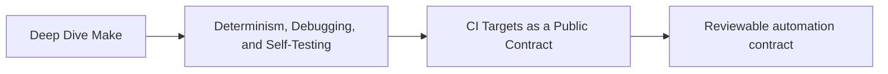
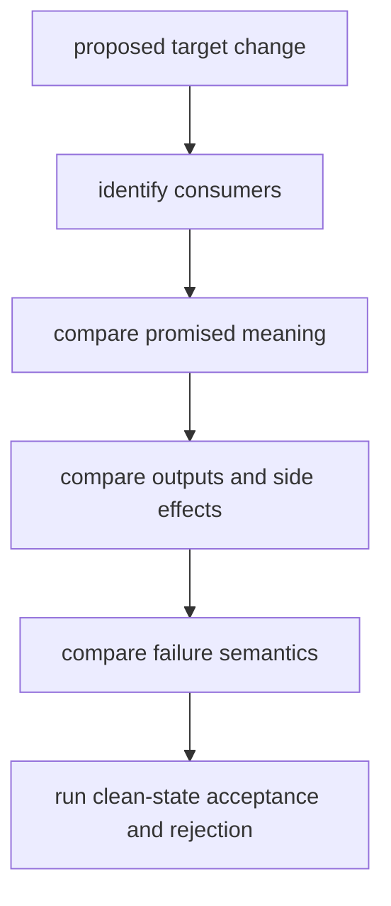

# CI Targets as a Public Contract

Continuous integration does not consume a maintainer’s private understanding of the
Makefile. It invokes a target with variables and environment state. That invocation is
an interface contract even when the repository has never written the contract down.

## Page maps



```mermaid
flowchart LR
  consumer["CI job or contributor"] --> request["public target + inputs"]
  request --> graph["declared prerequisites"]
  graph --> checks["build and checks"]
  checks --> exit["exit semantics"]
  checks --> outputs["governed outputs"]
```

The target name is only one part of the interface. Inputs, effects, outputs, and failure
behavior are equally important.

## Inventory consumers before targets

Begin with who relies on the build:

| Consumer | Request | Expected effect | Accepted outputs | Failure meaning |
| --- | --- | --- | --- | --- |
| contributor | `help` | list supported entry points | terminal text | help surface is unavailable |
| CI verification | `ci` | compose required verification contracts | logs and governed reports | at least one required contract failed |
| product tester | `test` | build what tests need and run assertions | test report if governed | product behavior failed |
| build maintainer | `selftest` | test graph invariants | selftest report | build-system claim failed |
| release job | release target | create and validate candidate | named package and manifest | candidate is not acceptable |

Do not declare every target public. Internal file targets can change as long as public
behavior and artifact contracts remain intact.

## Write a complete target contract

For each public target, record:

```text
Name:
Consumer:
Purpose:
Required inputs:
Supported variables:
Prerequisite public contracts:
Allowed writes:
Success exit:
Failure exits:
Incremental behavior:
Parallel behavior:
Explicit non-claims:
```

Example:

```text
Name: selftest
Consumer: build maintainer and CI
Purpose: test convergence and serial/parallel artifact equivalence
Required inputs: tracked capstone source and supported GNU Make/Python tools
Supported variables: documented tool overrides
Allowed writes: repository artifact proof directory
Success exit: zero only when every reached claim passes
Failure exits: nonzero with stopping boundary preserved
Incremental behavior: owns and replaces its isolated test workspace
Parallel behavior: internally compares bounded serial and parallel builds
Explicit non-claims: product correctness and cross-toolchain reproducibility
```

This is more useful than “runs build tests.”

## Separate action targets from file targets

Public requests that represent actions normally need `.PHONY`:

```make
.PHONY: help test selftest ci
```

Without it, a file named `test` or `ci` can make Make skip the action. File-producing
targets should not be marked phony merely to force them:

```make
build/report.json: inputs/data.csv scripts/report.py
	python3 scripts/report.py --input $< --output $@
```

If the file target rebuilds incorrectly, repair its graph instead of discarding
incrementality.

## Compose contracts instead of copying recipes

A stable CI entry point should compose named contracts:

```make
.PHONY: lint test selftest ci

ci: lint test selftest
```

This shape means local and CI users exercise the same target meanings. Duplicating the
recipes inside `ci` creates a second implementation that can drift:

```make
# Avoid: this can diverge from the public test and selftest contracts.
ci:
	python3 -m pytest
	./scripts/build_checks.sh
```

Composition does not require one giant target. Separate CI jobs may still invoke
`lint`, `test`, and `selftest` independently for scheduling or reporting, provided those
are the same documented contracts contributors can run.

## Make prerequisite scheduling explicit

Prerequisites of one phony target may run concurrently under `-j`:

```make
ci: lint test selftest
```

That is correct only when their writes do not conflict. If `test` and `selftest` both
replace the same report directory, the composition owns a race.

Choose a truthful design:

- give each contract its own artifact namespace;
- add a real edge when one consumes another’s output;
- invoke separate CI jobs when orchestration owns the ordering;
- serialize only the narrow resource that cannot be shared.

Do not add global `.NOTPARALLEL` as an undocumented fix for colliding ownership.

## Preserve failure semantics

A public verification target succeeds only when its promised checks pass. These patterns
weaken the contract:

```make
test:
	python3 -m pytest || true

audit:
	-python3 scripts/audit.py
```

The ignored failure can leave CI green while the named contract failed.

If a diagnostic is advisory, name and report it as advisory. If it is required, propagate
failure. Make’s recipe-line and shell behavior also matter:

```make
verify:
	command_one
	command_two
```

Each line is normally a separate shell, and Make stops after a failing line. A pipeline,
compound command, or helper script must preserve failures according to its own shell
contract.

## Distinguish fail-fast and complete reporting

Two useful policies are:

| Policy | Benefit | Cost |
| --- | --- | --- |
| fail at first broken prerequisite | preserves a clear causal boundary and saves work | later checks are not run |
| run independent checks and aggregate | returns a broader review report | harness must preserve individual exits truthfully |

Neither permits relabeling `NOT_RUN` as `PASS`. Document which policy the target owns.
The Module 03 selftest intentionally stops at a failed causal boundary and records later
checks as not run.

## Keep volatile diagnostics outside correctness

This target is likely never up to date:

```make
.PHONY: attest
attest:
	printf 'checked_at=%s\n' "$$(date -u +%FT%TZ)" > artifacts/attestation.txt
```

That may be acceptable as an explicit diagnostic action. Making `all` depend on it would
make the correctness request execute volatile work every time.

Classify outputs:

| Output | Contract |
| --- | --- |
| binary, generated source, package | correctness or release artifact |
| deterministic manifest | governed evidence artifact |
| timestamped timing report | diagnostic artifact |
| console trace | observation, not usually a product |
| cache | acceleration state, not correctness evidence |

CI can preserve diagnostics without redefining what the build means.

## Treat variables as interface inputs

If CI runs:

```sh
gmake ci CC=clang MODE=release
```

then `CC` and `MODE` are part of the request. A public variable needs:

- supported values;
- default behavior;
- override precedence;
- effect on artifact paths or identity;
- validation and failure behavior;
- recording when it affects evidence.

An undocumented environment variable that silently changes discovery or flags is a
hidden interface, not convenient flexibility.

## Prove the contract in a clean state

A local green target may borrow:

- untracked generated files;
- a warm cache;
- user configuration;
- inherited environment variables;
- artifacts from a different toolchain;
- credentials or network access.

Use an isolated tracked-source copy or repository-provided clean-room harness. Record:

```text
revision:
worktree source:
command:
documented variables:
sanitized environment policy:
allowed writes:
exit:
artifact inventory:
```

Do not run destructive cleaning in a user’s working tree merely to imitate CI.

## Review semantic compatibility

These can break consumers without renaming the target:

- `test` stops building required test inputs;
- `all` begins producing volatile reports;
- `selftest` drops its negative case;
- `ci` ignores a failed prerequisite;
- a supported variable changes meaning;
- output paths move without a transition for consumers;
- success no longer means all promised checks passed.

Review a target change like an API change:



## A public-target review table

Complete this for the repository under review:

| Target | Public consumer | Promise | Allowed writes | Converges? | Parallel-safe? | Rejection proof |
| --- | --- | --- | --- | --- | --- | --- |

Then answer:

- Is the default goal intentional?
- Does `help` match the supported surface?
- Can every required target run from documented state?
- Are local convenience targets clearly outside CI?
- Does each verification target fail on a controlled violation?
- Can artifacts from independent targets coexist?

## End-of-page checkpoint

Before leaving this page, you should be able to:

- describe a target contract beyond its name;
- separate public action targets from internal file targets;
- compose CI from public contracts without duplicating recipes;
- review prerequisite concurrency and output ownership;
- preserve fail-fast or aggregate failure semantics honestly;
- keep volatile diagnostics outside correctness;
- identify variables and environment state that form part of the interface;
- test semantic compatibility from an isolated state.
