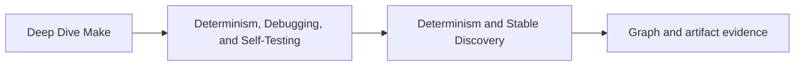
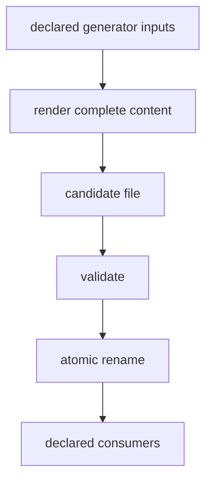

# Determinism and Stable Discovery

Determinism in Make starts before a recipe runs. Make must first discover files, expand
variables, read includes, and construct a graph. If the same semantic repository state
can produce a different graph, later recipe discipline cannot recover a stable build.

## Page maps



```mermaid
flowchart LR
  state["semantic input state"] --> membership["input membership"]
  membership --> order["canonical order"]
  order --> graph["evaluated graph"]
  graph --> decisions["rebuild decisions"]
  decisions --> bytes["declared artifacts"]
```

Each arrow is a separate claim. “The final file matched once” does not prove stable graph
membership. “The source list was sorted” does not prove stable artifact bytes.

## Four determinism claims

| Claim | What must stay stable | Useful observation |
| --- | --- | --- |
| discovery determinism | eligible paths and their canonical order | evaluated source list |
| graph determinism | targets, prerequisites, recipes, and relevant variable values | bounded Make database or explicit graph report |
| decision determinism | rebuild/no-op choice for the same target state | trace plus query exit |
| artifact determinism | declared output identity for the same semantic inputs | governed inventory and semantic checks |

State the claim before choosing the command. Otherwise a checksum comparison can be
misreported as proof of the entire build.

## Membership is a policy

Consider:

```make
SRCS := $(wildcard src/*.c)
```

GNU Make returns sorted matches for each wildcard expression. That gives this single
expression a stable order, but it does not decide whether every matching file belongs in
the product. A developer’s `src/scratch.c` would silently become a build input.

Three common membership policies are:

```make
# Every C source directly under src is owned by this program.
SRCS := $(wildcard src/*.c)

# Only reviewed public sources are owned by this program.
SRCS := src/main.c src/report.c

# Generated discovery is allowed, but known non-product families are excluded.
SRCS := $(filter-out src/scratch_%.c,$(wildcard src/*.c))
```

None is universally correct. The repository needs to state which policy it owns.
Canonical ordering cannot repair accidental membership.

## Root discovery deliberately

These searches do not have the same boundary:

```make
REPO_SRCS := $(shell find . -name '*.c' -print)
DOMAIN_SRCS := $(shell find src/analysis -name '*.c' -print)
```

The first can absorb fixtures, vendored code, generated workspaces, or exercise files.
The second says which domain owns the discovery. Prefer the narrowest root that matches
the target contract.

When shell discovery is unavoidable, control both ordering and interpretation:

```make
ANALYSIS_SRCS := $(shell LC_ALL=C find src/analysis -type f -name '*.c' -print | LC_ALL=C sort)
```

This still has limits:

- newline characters in filenames are not represented safely;
- availability and behavior of `find`, `sort`, and the shell are environment contracts;
- parse-time shell failure may be easy to overlook;
- every parse repeats the observation unless the value is modeled elsewhere.

A short expression is not automatically a small dependency boundary.

## Immediate and deferred discovery differ

Compare:

```make
NOW_SRCS := $(wildcard src/*.c)
LATER_SRCS = $(wildcard src/*.c)
```

`NOW_SRCS` is expanded when Make reads the assignment. `LATER_SRCS` is expanded whenever
the variable is referenced. During an ordinary invocation, both often appear identical.
They differ when includes, generated files, recursive expansion, or repeated references
change what is observable.

For an input set intended to describe one evaluated graph, immediate assignment is
usually easier to review:

```make
SRCS := $(sort $(wildcard src/*.c))
OBJS := $(patsubst src/%.c,build/%.o,$(SRCS))
```

The explicit `sort` documents canonical ordering and also normalizes a list assembled
from several sources. Do not rely on it to fix an unclear membership policy.

## Demonstrate membership drift

Use an isolated directory:

```text
discovery-lab/
├── Makefile
└── src/
    ├── alpha.c
    └── report.c
```

Create this Makefile:

```make
SRCS := $(sort $(wildcard src/*.c))

.PHONY: show
show:
	@printf '%s\n' $(SRCS)
```

Run:

```sh
make show
touch src/scratch.c
make show
```

The order remains canonical while membership changes. Decide whether this is:

- intended repository evolution;
- an unreviewed input leak;
- a file that belongs outside the discovery root;
- a reason to replace discovery with an allowlist.

The experiment is about ownership, not about blaming wildcards.

## Parse-time state can move the graph

This variable is not a normal file dependency:

```make
BUILD_LABEL := $(shell date +%s)
```

It observes time while Make parses the file. If the value affects a recipe, target name,
or prerequisite list, identical tracked files can produce different behavior.

Classify external observations:

| Observation | Better ownership |
| --- | --- |
| compiler identity affecting output | explicit tool variable plus recorded signature |
| configuration content | prerequisite file or semantic stamp |
| Git revision embedded in release | deliberate release input with dirty-state policy |
| current time in diagnostic report | volatile diagnostic target, outside correctness graph |
| machine-local path | normalized configuration or rejected unsupported state |

The goal is not to remove every environment observation. It is to make semantic
observations explicit and keep volatile diagnostics from controlling correctness.

## Generated artifacts need two forms of determinism

A generator must publish stable content and publish it safely:



Content determinism asks whether the same inputs yield the same accepted bytes or
semantics. Publication determinism asks whether consumers ever observe a partial or
mixed state. A generator that produces stable bytes but writes directly to the final
path can still fail under interruption or concurrency.

Review generated outputs for:

- one graph owner;
- all semantic inputs declared;
- canonical ordering inside the file;
- volatile metadata excluded or deliberately bounded;
- write-validate-rename publication;
- every consumer connected by an edge.

## Compare the right artifact set

Do not hash an entire build directory by reflex. First name the outputs whose identity
the claim covers:

| Include | Usually exclude unless claimed |
| --- | --- |
| executable or library | command logs |
| generated source/header | timing reports |
| governed manifest | caches |
| packaged release member | diagnostic timestamps |
| semantic stamp | local tool telemetry |

An overbroad inventory creates false differences. An underbroad inventory gives false
confidence. The declared set is part of the proof contract.

## A review route

For one target:

1. identify its discovery root and membership policy;
2. capture the evaluated ordered input list;
3. run a clean serial build and inventory declared outputs;
4. repeat from an equivalent clean state;
5. compare membership, graph-relevant values, and artifact identities separately;
6. add one irrelevant file inside or near the discovery boundary;
7. decide whether the resulting behavior matches the stated policy.

Record the environment boundary. Two matching local runs do not prove every supported
platform, toolchain, locale, or filesystem.

## Common false conclusions

| Observation | Unsupported conclusion |
| --- | --- |
| wildcard output is sorted | membership is correct |
| two builds exit zero | outputs are equivalent |
| output hashes match | rebuild decisions are deterministic |
| a no-op run is quiet | hidden inputs cannot exist |
| clean builds match | incremental graph is complete |
| serial builds match | parallel schedules are safe |

Use the smallest honest claim.

## End-of-page checkpoint

Before leaving this page, you should be able to:

- separate discovery, graph, decision, and artifact determinism;
- explain why canonical order and correct membership are different properties;
- choose between explicit and discovered source lists by ownership policy;
- identify a parse-time observation that needs a modeled boundary;
- review a generated artifact for content and publication determinism;
- define an artifact comparison set without hashing unrelated volatility.
