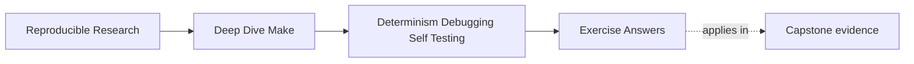

# Exercise Answers


<!-- page-maps:start -->
## Page Maps




<!-- page-maps:end -->

Use this after writing your own answers. The point is to compare reasoning, not copy it.

## Exercise 1: Stabilize discovery

A strong answer uses rooted discovery, canonical ordering, and explicit filtering when
needed. The key idea is that discovery should produce the same semantic file set in the
same order given the same repository state.

The strongest answers also explain what would happen if membership drifted, for example by
pulling in temporary files or by allowing system-dependent ordering.

## Exercise 2: Trace a rebuild properly

A strong answer quotes the actual `--trace` line that names the prerequisite reason rather
than paraphrasing from memory. The point is to let Make supply the explanation.

If you add the target name and the causal relationship in plain language, that is
exactly the right level of understanding for this module.

## Exercise 3: Define the CI contract

Good public targets usually include `help`, `all`, `test`, and `selftest`. The strong
answer explains what each guarantees and why silently changing that meaning would be a
contract break.

The key lesson is that CI consumes meaning, not just names. A stable target name with an
unstable promise is still a broken contract.

## Exercise 4: Design the selftest

A strong answer includes convergence, serial/parallel equivalence, a meaningful negative
test, and isolation from helpful local state. It also names which artifact set should be
compared and why.

The strongest answers distinguish build-system proof from runtime proof instead of mixing
them together under one vague "tests pass" statement.

## Exercise 5: Quarantine eval

The acceptable conditions are that `eval` stays bounded, auditable, switchable, and
non-essential to the core build. A strong answer explains how to prove that disabling it
still leaves `selftest` meaningful.

## Exercise 6: Detect accidental discovery

A broad expression such as:

```make
SRCS := $(sort $(wildcard src/*.c))
```

is correct only if every matching C file is intentionally a build input. If scratch files
are allowed in the directory, use an explicit policy:

```make
SRCS := src/real.c
```

or a durable naming boundary:

```make
SRCS := $(sort $(filter-out src/scratch-%.c,$(wildcard src/*.c)))
```

The important answer is not that explicit lists are always superior. It is that
membership must match a repository rule learners and maintainers can state.

## Exercise 7: Explain a no-op build

After a converged build, `make --trace all` should show no recipes selected for rebuilding.
`make -q all` returns zero when the requested graph is up to date, one when work would be
required, and a value greater than one for an error.

Convergence means that a successful build reaches a state where repeating the same request
with unchanged inputs performs no build work.

## Exercise 8: Separate product tests from build tests

A useful division is:

```make
.PHONY: test selftest

test: app
	@./app --check

selftest:
	@tests/build-system.sh
```

The product may run correctly after a clean build even when a header edge is missing.
Changing that header after the first build exposes stale objects. A product test run only
after `clean` misses the defect; an incremental selftest catches it.

## Exercise 9: Make a CI target boring

```make
.PHONY: ci lint test selftest

ci: lint test selftest
```

The recipe bodies belong to the specific public targets. `ci` composes their contracts
without copying commands. A clean-room run can use a fresh clone, a temporary copy of
tracked files, or a container, provided no untracked configuration or prebuilt artifacts
leak in.

A local target such as `watch` or `serve` should stay outside CI because it is interactive
and does not terminate with a verification result.

## Exercise 10: Build a diagnostic report

A strong report is short enough to read and precise enough to reproduce:

```text
Command: make --trace report.pdf
GNU Make: 4.4.1
Observed reason: data.csv is newer than report.pdf
Relevant variable: FORMAT=pdf (origin: command line)
Diagnosis: report.pdf rebuilt because its declared data prerequisite changed.
Repair: none; the rebuild is correct.
```

For a defect, the before report should identify missing or unstable evidence, and the
after report should quote the trace that now follows the repaired edge. Avoid dumping the
entire `make -p` database when three variables and one rule answer the question.

## What a mastery-level answer set looks like

A mastery-level submission moves comfortably between:

- determinism language: stable discovery, hidden inputs, convergent stamps
- debugging evidence: `--trace`, `-p`, deliberate negative cases
- interface thinking: public targets and explicit guarantees
- abstraction discipline: optional, bounded, auditable metaprogramming
