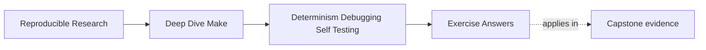

# Exercise Answers


<!-- page-maps:start -->
## Page Maps




<!-- page-maps:end -->

Use this after writing your own answers. The point is comparison, not copying.

## How to use the answer page well

Do not read a model answer first and then reshape your lab so it sounds similar.

A better rhythm is:

1. finish the exercise with your own commands, artifacts, and notes
2. write one plain-language statement of the protected claim
3. compare that statement with the model answer
4. revise where the model answer exposes missing evidence, a weak contract, or a vague
   repair

The strongest Module 03 answers usually do four things:

- they name the protected contract directly
- they point to one concrete proof route
- they keep a meaningful failing case near the healthy case
- they explain the repair as stronger graph truth or stronger interface discipline

The strongest self-study packets also leave behind six concrete artifacts:

- one claim table
- one rebuild explanation tied to a real trace line
- one CI contract list
- one passing selftest report and one rejected harness-test report
- one example where product tests miss a graph defect
- one bounded diagnostic report

If your answers rely only on "the build feels stable now," the reasoning is still too
weak.

## Exercise 1: Stabilize discovery

A strong answer combines three things:

- rooted discovery:
  - search only under the declared input boundary
- canonical ordering:
  - sort or otherwise stabilize the discovered set
- explicit membership policy:
  - define which files are eligible to count as inputs

The key explanatory sentence is:

> Discovery is deterministic only when the same repository state produces the same
> semantic membership and the same ordering of that membership.

Why this is strong:

- it treats membership drift as a build defect
- it explains both "which files" and "in what order"

Weak answer pattern:

- "Use `sort` on the wildcard"

That helps ordering, but it does not define a trustworthy input boundary.

## Exercise 2: Trace a rebuild properly

A strong answer quotes the actual `--trace` line that explains the rebuild, rather than
paraphrasing from memory.

Example answer shape:

> `make: 'report.txt' is newer than 'summary.txt'` shows that `summary.txt` rebuilt
> because one declared prerequisite was newer than the target.

The important lesson is that Make can often supply the causal edge directly. That makes
the trace stronger than "I changed something nearby, so it probably made sense."

Weak answer pattern:

- "The target rebuilt because the dependency chain changed somehow"

That is too vague to teach or debug.

## Exercise 3: Define the CI contract

Good public targets often include `help`, `all`, `test`, and `selftest`, but the
strongest answers go further and state what each target promises.

For example:

- `all`:
  - produces the declared primary artifacts
- `test`:
  - checks product behavior on the declared runtime surface
- `selftest`:
  - checks build convergence and serial/parallel equivalence
- `help`:
  - documents supported public entry points

The key explanatory sentence is:

> CI depends on target meaning, not target names alone, so a semantic change in a public
> target is a contract change even if the name stays the same.

## Exercise 4: Audit a complete selftest report

A strong answer starts from `summary.txt` and reconstructs this route:

| Summary check | Command or mechanism | Evidence |
| --- | --- | --- |
| convergence | clean serial build, then `gmake -q all` | `convergence.txt`, convergence logs |
| serial/parallel equivalence | independent clean builds and governed inventories | `schedule-comparison.json`, both inventory files |
| trace guardrail | `gmake --trace -n all` | `trace-count.txt`, `logs/trace-plan.log` |
| hidden-input detection | parse-time counter changes outside the graph | `hidden-input.txt`, hidden-input logs |
| quarantined eval | explicit `USE_EVAL=yes eval-demo` | `eval-demo.txt`, its log |

The two inventories should each declare 13 paths: `app`; two dynamic binaries; the
generated header; three object files; five dependency files; and `build/flags.stamp`.
Grouping by role matters because it shows that the comparison policy is intentional,
not a directory dump.

For a truthful run, `schedule-comparison.json` should contain:

```json
{
  "result": "PASS",
  "missing_paths": [],
  "unexpected_paths": [],
  "changed_artifacts": []
}
```

The serial and parallel aggregate identities should match. The hidden-input evidence
should report query exit `1`: that is a pass because the deliberately changing counter
makes work necessary, proving the harness detects false convergence.

Two honest non-claims are:

- the report does not prove equivalence for artifacts outside the declared inventory
- the report does not prove cross-compiler or cross-platform reproducibility

Weak answer pattern:

- "`summary.txt` says PASS, so the build is deterministic"

That skips the command and evidence chain and overstates one recorded environment.

## Exercise 5: Quarantine `eval`

An `eval` surface is acceptable only when it stays bounded, switchable, auditable, and
non-essential to the core build contract.

A strong answer usually shows:

- a switch:
  - one variable or target that enables the surface intentionally
- a boundary:
  - a limited, reviewable generated target set
- a proof route:
  - `selftest` still proves the core graph honestly when the surface is disabled

The important explanation is:

> `eval` is acceptable only when removing it does not destroy the ability to reason about
> the core build contract.

Weak answer pattern:

- "`eval` is fine if used carefully"

That says nothing about how another maintainer would verify the boundary.

## Exercise 6: Detect accidental discovery

A broad expression such as:

```make
SRCS := $(sort $(wildcard src/*.c))
```

is only honest when every matching file is intentionally part of the build. If scratch
files live in the same directory, the build needs a membership policy such as:

```make
SRCS := src/real.c
```

or a durable filter:

```make
SRCS := $(sort $(filter-out src/scratch%.c,$(wildcard src/*.c)))
```

The key explanatory sentence is:

> Accidental membership is a determinism defect because different worktrees can produce
> different semantic input sets without any intended change to the build contract.

## Exercise 7: Explain a no-op build

After a converged build, `make --trace all` should show no selected rebuild work, and
`make -q all` should return zero because the requested graph is already up to date.

The important explanation is:

> Convergence means that the same successful request, repeated against unchanged inputs,
> gives Make no honest reason to execute more recipes.

The strongest answers also inspect one target/prerequisite pair directly so "no work"
does not remain a mysterious global feeling.

## Exercise 8: Separate product tests from build tests

The three target contracts are:

- `test` checks output from the application and generated binaries.
- `selftest` checks convergence, schedule equivalence, trace cost, hidden-input
  detection, and the optional eval boundary.
- `selftest-harness-tests` proves that the selftest accepts truthful schedules and
  rejects controlled schedule drift.

In the rejected case, `summary.txt` should name
`serial_parallel_equivalence`; `schedule-comparison.json` should classify
`build/include/dynamic.h` under `changed_artifacts`. Trace, hidden-input, and eval checks
should be `NOT_RUN` because the harness stopped at the first broken contract.

A clean product test cannot detect this injected drift: the binaries were built before
the header was altered, and their runtime assertions can still pass. A comparable real
defect is a missing header prerequisite that remains invisible after a clean build but
leaves stale objects after an incremental header change.

The core lesson is:

> Product behavior and build truth are separate claims, and the proof harness needs its
> own rejection test.

## Exercise 9: Make a CI target boring

A good `ci` target composes existing public contracts instead of duplicating their
recipes:

```make
.PHONY: ci lint test selftest

ci: lint test selftest
```

The important explanation is:

> "Boring" is good here because the target is not inventing new behavior; it is invoking
> stable, documented contracts in one predictable place.

The strongest answers also show a clean-room run such as a fresh clone, tracked-files
copy, or isolated working directory, so no hidden local state can make CI look stronger
than it is.

## Exercise 10: Review a rejected selftest without rerunning

A strong review note follows evidence causally:

Example shape:

```text
Result: FAIL
Stopping boundary: serial_parallel_equivalence
Parallel command: gmake -j2 all (or the recorded timeout wrapper)
Diagnostic: changed_artifacts
Changed path: build/include/dynamic.h
Serial identity: 78 bytes, recorded SHA-256
Parallel identity: 119 bytes, recorded SHA-256
Preserved state: workspace/build/include/dynamic.h
Supported conclusion: the two schedules did not preserve the declared artifact identity.
Unsupported: the compiler is nondeterministic.
Unsupported: every parallel build is unsafe.
```

The handoff should say that convergence passed before schedule comparison failed, name
the changed generated header, state that later checks did not run, point to the comparison
and workspace, and recommend inspecting the controlled writer before broadening the
investigation.

The next narrow experiment could compare the header immediately before and after the
fault seam or rerun the truthful harness after preserving the rejected bundle. Immediate
rerun would replace the fixed report directory and destroy the easiest path back to the
observed stopping state.

Weak answer pattern:

- copying the whole manifest and workspace listing into the handoff
- claiming a root cause from the changed path alone

The report localizes the failed contract. Root-cause work begins there; it is not already
finished.

## What a mastery-level answer set looks like

A mastery-level submission moves comfortably between:

- contract language:
  - public targets, protected claims, convergence
- debugging evidence:
  - `--trace`, `-q`, timestamps, negative cases
- design discipline:
  - bounded metaprogramming, stable discovery, clean CI composition

If your answers can move between those three levels without collapsing into "CI should be
stable," you are learning Module 03 in the right direction.
