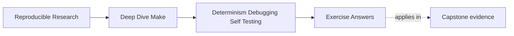

# Exercise Answers


<!-- page-maps:start -->
## Page Maps




<!-- page-maps:end -->

Use this after writing your own answers. The point is comparison, not copying.

## How to use the answer page well

Do not read a model answer first and then reshape your lab so it sounds similar.

A better rhythm is:

1. finish the exercise with your own commands, artifacts, and notes
2. write one plain-language statement of the protected claim
3. compare that statement with the model answer
4. revise where the model answer exposes missing evidence, a weak contract, or a vague
   repair

The strongest Module 03 answers usually do four things:

- they name the protected contract directly
- they point to one concrete proof route
- they keep a meaningful failing case near the healthy case
- they explain the repair as stronger graph truth or stronger interface discipline

The strongest self-study packets also leave behind six concrete artifacts:

- one claim table
- one rebuild explanation tied to a real trace line
- one CI contract list
- one passing selftest report and one rejected harness-test report
- one example where product tests miss a graph defect
- one bounded diagnostic report

If your answers rely only on "the build feels stable now," the reasoning is still too
weak.

## Exercise 1: Separate discovery claims

Suppose the first evaluated list is:

```text
src/alpha.c
src/report.c
```

After adding `src/scratch.c`, a broad wildcard yields:

```text
src/alpha.c
src/report.c
src/scratch.c
```

A strong classification is:

| Claim | Decision |
| --- | --- |
| membership | changed; correctness depends on whether every matching file is owned |
| order | remains canonical for this expression |
| graph | changes because a new source-derived target enters the graph |
| artifact | not established until governed outputs are built and compared |

If the contract owns only reviewed product sources, an explicit list is honest:

```make
SRCS := src/alpha.c src/report.c
```

If the contract owns every source in a dedicated directory, move scratch material
outside that root rather than maintaining an exclusion that will grow indefinitely.

The experiment does not establish cross-machine artifact reproducibility. It observes
membership and ordering in one declared environment, then predicts graph consequences.

Weak answer pattern:

- “Add `sort`.”

That addresses order while leaving ownership unanswered.

## Exercise 2: Trace a rebuild properly

A strong answer predicts one edge, quotes the actual `--trace` line, joins it to target
state, inspects the artifact, and proves the unchanged replay converges.

Example answer shape:

```text
Prediction: summary.txt will rebuild because report.txt is newer.
Selection: the trace names report.txt as the prerequisite that updates summary.txt.
State: report.txt has the later recorded modification time.
Artifact: summary.txt passes its semantic content check after the recipe exits zero.
Replay: gmake -q summary.txt returns 0 with no further input change.
```

The trace supports selection. The content check supports the result. Query exit zero
supports convergence. No one observation replaces the other two.

Weak answer pattern:

- “The target rebuilt because the dependency chain changed somehow.”

That is too vague to teach or debug.

## Exercise 3: Define the CI contract

One acceptable design is:

| Target | Consumer and promise | Allowed writes | Failure |
| --- | --- | --- | --- |
| `help` | contributors receive the supported public surface | terminal only | nonzero when help cannot be rendered |
| `test` | product consumers receive runtime assertions over a declared build | product test report | nonzero on build or assertion failure |
| `selftest` | maintainers receive convergence and schedule-equivalence proof | isolated selftest report | nonzero at first broken build claim |
| `ci` | automation composes the required public checks | union of disjoint prerequisite outputs | propagates any required failure |

Example composition:

```make
.PHONY: help test selftest ci

ci: test selftest
```

This permits prerequisite concurrency only if `test` and `selftest` own disjoint
workspaces or have truthful edges between shared state. A strong submission names those
paths rather than assuming phony prerequisites serialize.

A controlled failing product assertion should make `test` nonzero and therefore make
`ci` nonzero. Swallowing that exit would break the contract without renaming a target.
Another semantic break would be making `test` skip required runtime assertions while
still exiting zero.

A local timing or editor-convenience target can remain outside the public contract when
no automation or downstream consumer depends on its behavior.

## Exercise 4: Audit a complete selftest report

A strong answer starts from `summary.txt` and reconstructs this route:

| Summary check | Command or mechanism | Evidence |
| --- | --- | --- |
| convergence | clean serial build, then `gmake -q all` | `convergence.txt`, convergence logs |
| serial/parallel equivalence | independent clean builds and governed inventories | `schedule-comparison.json`, both inventory files |
| trace guardrail | `gmake --trace -n all` | `trace-count.txt`, `logs/trace-plan.log` |
| hidden-input detection | parse-time counter changes outside the graph | `hidden-input.txt`, hidden-input logs |
| quarantined eval | explicit `USE_EVAL=yes eval-demo` | `eval-demo.txt`, its log |

The two inventories should each declare 13 paths: `app`; two dynamic binaries; the
generated header; three object files; five dependency files; and `build/flags.stamp`.
Grouping by role matters because it shows that the comparison policy is intentional,
not a directory dump.

For a truthful run, `schedule-comparison.json` should contain:

```json
{
  "result": "PASS",
  "missing_paths": [],
  "unexpected_paths": [],
  "changed_artifacts": []
}
```

The serial and parallel aggregate identities should match. The hidden-input evidence
should report query exit `1`: that is a pass because the deliberately changing counter
makes work necessary, proving the harness detects false convergence.

Two honest non-claims are:

- the report does not prove equivalence for artifacts outside the declared inventory
- the report does not prove cross-compiler or cross-platform reproducibility

The inventory oracle would grade itself if its expected paths came only from the same
`OBJS` and `DYN_BINS` variables used to produce them. Removing one source from those
variables would remove both the output and the expectation. An independent requirement
can be a governed manifest of required artifact roles and paths, validated before hashes
are compared.

Weak answer pattern:

- "`summary.txt` says PASS, so the build is deterministic"

That skips the command and evidence chain and overstates one recorded environment.

## Exercise 5: Quarantine `eval`

For one generated member, the answer should show the ordinary rule that a reviewer would
otherwise write. It should then identify two expansion moments:

```text
call/eval time: member name and template parameters become rule text
recipe time: automatic variables identify the selected target and prerequisite
```

Automatic variables therefore need dollar escaping in text that passes through `eval`.
The accepted evidence set includes:

- core selftest passing with the switch disabled;
- a finite enabled target inventory;
- dry-run or bounded database evidence for one generated rule;
- equivalent declared artifacts from explicit and generated implementations;
- rejection of the dishonest fixture by the abstraction audit.

Keeping `eval` is reasonable only if that evidence is cheaper to review than the explicit
family. A static pattern rule or ordinary macro is the better decision when it preserves
the invariant without a second parse.

Weak answer pattern:

- "`eval` is fine if used carefully"

That says nothing about how another maintainer would verify the boundary.

## Exercise 6: Design an independent selftest oracle

Suppose the governed contract file contains:

```text
build/alpha.txt
build/bravo.txt
build/charlie.txt
```

The implementation may derive rules from:

```make
REPORTS := alpha bravo charlie
```

The healthy build produces all three paths, and the oracle compares the sorted actual
inventory against the separately governed contract. Now remove `bravo` from `REPORTS`.
The expected rejection names `build/bravo.txt` as missing.

An inventory derived from `REPORTS` would shrink to the same two paths as the faulty
build and pass. The independent manifest retains the consumer’s requirement when the
implementation forgets it.

The manifest still needs ownership and review. Independence prevents one false-pass
class; it does not make the expected contract automatically correct.

## Exercise 7: Explain a no-op build

After a converged build, `gmake --trace all` should show no selected rebuild work, and
`gmake -q all` should return zero because the requested graph is already up to date.

The important explanation is:

> Convergence means that the same successful request, repeated against unchanged inputs,
> gives Make no honest reason to execute more recipes.

The strongest answers also inspect one target/prerequisite pair directly so "no work"
does not remain a mysterious global feeling.

Query exit `1` means work is required; exit `2` means Make encountered an error. Neither
should be relabeled “not converged” without preserving that distinction. The query says
whether Make would update the request, not whether the existing artifact is semantically
correct.

## Exercise 8: Separate product tests from build tests

The three target contracts are:

- `test` checks output from the application and generated binaries.
- `selftest` checks convergence, schedule equivalence, trace cost, hidden-input
  detection, and the optional eval boundary.
- `selftest-harness-tests` proves that the selftest accepts truthful schedules and
  rejects controlled schedule drift.

In the rejected case, `summary.txt` should name
`serial_parallel_equivalence`; `schedule-comparison.json` should classify
`build/include/dynamic.h` under `changed_artifacts`. Trace, hidden-input, and eval checks
should be `NOT_RUN` because the harness stopped at the first broken contract.

A clean product test cannot detect this injected drift: the binaries were built before
the header was altered, and their runtime assertions can still pass. A comparable real
defect is a missing header prerequisite that remains invisible after a clean build but
leaves stale objects after an incremental header change.

The core lesson is:

> Product behavior and build truth are separate claims, and the proof harness needs its
> own rejection test.

## Exercise 9: Make a CI target boring

A good `ci` target composes existing public contracts instead of duplicating their
recipes:

```make
.PHONY: ci lint test selftest

ci: lint test selftest
```

One acceptable ownership table is:

| Prerequisite | Allowed output |
| --- | --- |
| `lint` | lint report namespace only |
| `test` | product-test report and product fixture workspace |
| `selftest` | build-proof report and isolated build workspace |

Because these namespaces are disjoint, `gmake -j ci` does not create a report-path race.
If one prerequisite returns nonzero, `ci` must return nonzero. A controlled failing lint
fixture or product assertion should demonstrate that propagation; reading the recipe is
not rejection evidence.

The important explanation is:

> "Boring" is good here because the target is not inventing new behavior; it is invoking
> stable, documented contracts in one predictable place.

The clean-room run should record its source revision, included tracked changes,
documented variables, environment policy, command, exits, and allowed writes. A local
timing target stays outside the composition because it is diagnostic rather than a
required correctness contract.

## Exercise 10: Review a rejected selftest without rerunning

A strong review note follows evidence causally:

Example shape:

```text
Result: FAIL
Stopping boundary: serial_parallel_equivalence
Parallel command: gmake -j2 all (or the recorded timeout wrapper)
Diagnostic: changed_artifacts
Changed path: build/include/dynamic.h
Serial identity: 78 bytes, recorded SHA-256
Parallel identity: 119 bytes, recorded SHA-256
Preserved state: workspace/build/include/dynamic.h
Supported conclusion: the two schedules did not preserve the declared artifact identity.
Unsupported: the compiler is nondeterministic.
Unsupported: every parallel build is unsafe.
```

The handoff should say that convergence passed before schedule comparison failed, name
the changed generated header, state that later checks did not run, point to the comparison
and workspace, and recommend inspecting the controlled writer before broadening the
investigation.

The next narrow experiment could compare the header immediately before and after the
fault seam or rerun the truthful harness after preserving the rejected bundle. Immediate
rerun would replace the fixed report directory and destroy the easiest path back to the
observed stopping state.

Weak answer pattern:

- copying the whole manifest and workspace listing into the handoff
- claiming a root cause from the changed path alone

The report localizes the failed contract. Root-cause work begins there; it is not already
finished.

## What a mastery-level answer set looks like

A mastery-level submission moves comfortably between:

- contract language:
  - public targets, protected claims, convergence
- debugging evidence:
  - `--trace`, `-q`, timestamps, negative cases
- design discipline:
  - bounded metaprogramming, stable discovery, independent oracles, clean CI composition

If your answers can move between those three levels without collapsing into "CI should be
stable," you are learning Module 03 in the right direction.
