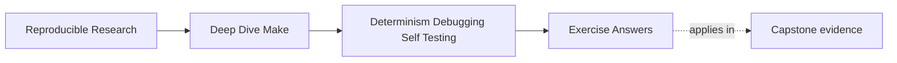

# Exercise Answers


<!-- page-maps:start -->
## Page Maps




<!-- page-maps:end -->

Use this after writing your own answers. The point is comparison, not copying.

## How to use the answer page well

Do not read a model answer first and then reshape your lab so it sounds similar.

A better rhythm is:

1. finish the exercise with your own commands, artifacts, and notes
2. write one plain-language statement of the protected claim
3. compare that statement with the model answer
4. revise where the model answer exposes missing evidence, a weak contract, or a vague
   repair

The strongest Module 03 answers usually do four things:

- they name the protected contract directly
- they point to one concrete proof route
- they keep a meaningful failing case near the healthy case
- they explain the repair as stronger graph truth or stronger interface discipline

The strongest self-study packets also leave behind six concrete artifacts:

- one claim table
- one rebuild explanation tied to a real trace line
- one CI contract list
- one selftest with a meaningful negative case
- one example where product tests miss a graph defect
- one bounded diagnostic report

If your answers rely only on "the build feels stable now," the reasoning is still too
weak.

## Exercise 1: Stabilize discovery

A strong answer combines three things:

- rooted discovery:
  - search only under the declared input boundary
- canonical ordering:
  - sort or otherwise stabilize the discovered set
- explicit membership policy:
  - define which files are eligible to count as inputs

The key explanatory sentence is:

> Discovery is deterministic only when the same repository state produces the same
> semantic membership and the same ordering of that membership.

Why this is strong:

- it treats membership drift as a build defect
- it explains both "which files" and "in what order"

Weak answer pattern:

- "Use `sort` on the wildcard"

That helps ordering, but it does not define a trustworthy input boundary.

## Exercise 2: Trace a rebuild properly

A strong answer quotes the actual `--trace` line that explains the rebuild, rather than
paraphrasing from memory.

Example answer shape:

> `make: 'report.txt' is newer than 'summary.txt'` shows that `summary.txt` rebuilt
> because one declared prerequisite was newer than the target.

The important lesson is that Make can often supply the causal edge directly. That makes
the trace stronger than "I changed something nearby, so it probably made sense."

Weak answer pattern:

- "The target rebuilt because the dependency chain changed somehow"

That is too vague to teach or debug.

## Exercise 3: Define the CI contract

Good public targets often include `help`, `all`, `test`, and `selftest`, but the
strongest answers go further and state what each target promises.

For example:

- `all`:
  - produces the declared primary artifacts
- `test`:
  - checks product behavior on the declared runtime surface
- `selftest`:
  - checks build convergence and serial/parallel equivalence
- `help`:
  - documents supported public entry points

The key explanatory sentence is:

> CI depends on target meaning, not target names alone, so a semantic change in a public
> target is a contract change even if the name stays the same.

## Exercise 4: Design the selftest

A strong selftest includes:

- convergence:
  - a successful second run performs no build work
- serial/parallel equivalence:
  - declared outputs match under `-j1` and `-jN`
- negative proof:
  - one injected defect makes the check fail
- isolation:
  - the result does not depend on untracked local state

The strongest answers also name the artifact set explicitly instead of saying "compare the
build outputs."

Weak answer pattern:

- "Run the build again and make sure it still passes"

That is too soft. What exactly is being compared, and what failure would count?

## Exercise 5: Quarantine `eval`

An `eval` surface is acceptable only when it stays bounded, switchable, auditable, and
non-essential to the core build contract.

A strong answer usually shows:

- a switch:
  - one variable or target that enables the surface intentionally
- a boundary:
  - a limited, reviewable generated target set
- a proof route:
  - `selftest` still proves the core graph honestly when the surface is disabled

The important explanation is:

> `eval` is acceptable only when removing it does not destroy the ability to reason about
> the core build contract.

Weak answer pattern:

- "`eval` is fine if used carefully"

That says nothing about how another maintainer would verify the boundary.

## Exercise 6: Detect accidental discovery

A broad expression such as:

```make
SRCS := $(sort $(wildcard src/*.c))
```

is only honest when every matching file is intentionally part of the build. If scratch
files live in the same directory, the build needs a membership policy such as:

```make
SRCS := src/real.c
```

or a durable filter:

```make
SRCS := $(sort $(filter-out src/scratch%.c,$(wildcard src/*.c)))
```

The key explanatory sentence is:

> Accidental membership is a determinism defect because different worktrees can produce
> different semantic input sets without any intended change to the build contract.

## Exercise 7: Explain a no-op build

After a converged build, `make --trace all` should show no selected rebuild work, and
`make -q all` should return zero because the requested graph is already up to date.

The important explanation is:

> Convergence means that the same successful request, repeated against unchanged inputs,
> gives Make no honest reason to execute more recipes.

The strongest answers also inspect one target/prerequisite pair directly so "no work"
does not remain a mysterious global feeling.

## Exercise 8: Separate product tests from build tests

A useful split is:

```make
.PHONY: test selftest

test: app
	@./app --check

selftest:
	@tests/build-system.sh
```

The core lesson is:

> A product test can pass after a clean rebuild even when the incremental graph is
> missing an edge and therefore dishonest.

For example, a missing header prerequisite may be invisible after `clean`, but it will
surface once the header changes and stale objects remain in place. That is why the module
separates runtime proof from build-system proof.

## Exercise 9: Make a CI target boring

A good `ci` target composes existing public contracts instead of duplicating their
recipes:

```make
.PHONY: ci lint test selftest

ci: lint test selftest
```

The important explanation is:

> "Boring" is good here because the target is not inventing new behavior; it is invoking
> stable, documented contracts in one predictable place.

The strongest answers also show a clean-room run such as a fresh clone, tracked-files
copy, or isolated working directory, so no hidden local state can make CI look stronger
than it is.

## Exercise 10: Build a diagnostic report

A strong report is bounded, reproducible, and calm.

Example shape:

```text
Command: make --trace report.pdf
GNU Make: 4.4.1
Observed reason: data.csv is newer than report.pdf
Relevant variable: FORMAT=pdf (origin: command line)
Diagnosis: report.pdf rebuilt because a declared data prerequisite changed.
Repair: none; the rebuild is correct.
```

For a real defect, the before report should expose missing or unstable evidence, and the
after report should show the repaired edge or stabilized variable behavior.

The missing but important sentence is:

> The report is bounded because only the rule, variables, timestamps, and trace lines that
> answer the question are included.

That sentence protects learners from dumping the whole `make -p` world when three facts
would do.

## What a mastery-level answer set looks like

A mastery-level submission moves comfortably between:

- contract language:
  - public targets, protected claims, convergence
- debugging evidence:
  - `--trace`, `-q`, timestamps, negative cases
- design discipline:
  - bounded metaprogramming, stable discovery, clean CI composition

If your answers can move between those three levels without collapsing into "CI should be
stable," you are learning Module 03 in the right direction.
