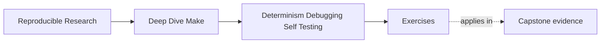

# Exercises


<!-- page-maps:start -->
## Page Maps




<!-- page-maps:end -->

Use these after reading the five core lessons and the worked example. The goal is to make
your reasoning explicit.

For every proposed selftest, include a deliberate defect that should make it fail. State
the protected claim before showing the test implementation. A check that cannot detect a
small relevant defect is activity, not evidence.

Keep the positive and negative runs together:

| Protected claim | Healthy observation | Injected defect | Expected failure |
| --- | --- | --- | --- |

## Exercise 1: Stabilize discovery

Take one discovery step in the simulator and explain how you would guarantee stable order
and membership across runs and machines.

What to hand in:

- the discovery fragment
- one sentence on root choice
- one sentence on ordering
- one sentence on membership control

## Exercise 2: Trace a rebuild properly

Choose one target and explain which `--trace` line proves why it rebuilt.

What to hand in:

- the exact trace line
- the target name
- the plain-language explanation of the causal edge or timestamp relationship

## Exercise 3: Define the CI contract

Name which targets belong in the public contract and state what each one guarantees.

What to hand in:

- the target list
- one promise per target
- one note about what would count as a contract-breaking semantic change

## Exercise 4: Design the selftest

Describe the exact checks your selftest should run to prove convergence and
serial/parallel equivalence.

What to hand in:

- the ordered selftest checklist
- the artifact set it compares
- one negative test and why it is meaningful

## Exercise 5: Quarantine eval

Explain what conditions make an `eval` surface acceptable in this module and how you would
prove it is not controlling the core build.

What to hand in:

- the switch that enables or disables the surface
- the bounded generated target set
- the proof that `selftest` still matters when `eval` is off

## Exercise 6: Detect accidental discovery

Create `src/real.c` and `src/scratch.c`. Use a broad wildcard that discovers both, then
replace it with an explicit allowlist or a rooted filter that excludes the scratch file.

What to hand in:

- both discovery expressions
- `make` output showing the discovered list
- a rule for deciding which repository files are build inputs

## Exercise 7: Explain a no-op build

Run a successful build twice. On the second run, collect:

```sh
make --trace all
make -q all
printf '%s\n' "$?"
```

Explain both the absence of recipe work and the query exit status.

What to hand in:

- the exact commands and outputs
- the newest target and prerequisite timestamps for one rule
- one sentence defining convergence

## Exercise 8: Separate product tests from build tests

Design two targets:

- `test`, which checks the built program’s behavior
- `selftest`, which checks incremental convergence and serial/parallel equivalence

Introduce a graph defect that product tests miss but `selftest` catches.

What to hand in:

- the target contracts
- the deliberate defect
- transcripts showing the different outcomes

## Exercise 9: Make a CI target boring

Define a `ci` target for a small repository. It must depend on named public targets rather
than duplicating their recipes.

Run it from a clean checkout or isolated directory with no local configuration files.

What to hand in:

- the `ci` rule
- the public target dependency chain
- the clean-room command and result
- one local convenience target deliberately excluded from CI

## Exercise 10: Build a diagnostic report

For one surprising rebuild, collect a bounded report containing:

- the command and GNU Make version
- `make --trace TARGET`
- relevant target and prerequisite timestamps
- the variable values that shape the rule
- your causal explanation

Then repair the defect and collect the same evidence again.

What to hand in:

- before and after reports
- the Makefile change
- a two-sentence explanation suitable for a teammate who did not witness the failure

## Mastery standard for this exercise set

Across all ten answers, the module wants you to show three things:

- you can name the contract being protected
- you can point to evidence for that contract
- you can explain the repair or design choice in graph terms, not vibes

If your answer only says "CI should be stable" or "eval should be careful," keep going.
