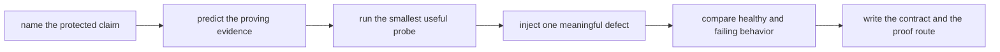

# Exercises

Use these after reading the five core lessons and the worked example. The goal is to turn
vague instability stories into protected claims, proof routes, and durable selftests.

## How to work through this set

Treat the ten exercises as one full lab day on determinism and diagnostic discipline.

Before each answer:

1. state the exact build claim you are trying to protect
2. predict what evidence would prove or disprove that claim
3. keep both a healthy run and a deliberately broken run whenever possible

If you skip the claim and go straight to "run more commands," the module turns into busy
debugging theater instead of disciplined proof.

Do the exercises in order. The day is one progression:

- Exercises 1-3 stabilize discovery, rebuild explanations, and public CI promises
- Exercises 4-6 design selftests and expose hidden sources of nondeterminism
- Exercises 7-8 separate convergence proof from product correctness
- Exercises 9-10 turn all of that into maintainable CI and incident reports

Keep one determinism packet as you go. By the end of the day it should contain:

- one claim table with healthy and failing observations
- one rooted discovery policy
- one rebuild explanation anchored to a real trace line
- one passing selftest report and one rejected harness-test report
- one example where product tests pass but the build graph still lies
- one bounded diagnostic report another maintainer could trust

If those six artifacts are missing, you are probably gathering output rather than
learning how to prove that the build converges honestly.

## Recommended working layout

If you want one lab tree that can support the whole day, use something like:

```text
module03-lab/
├── Makefile
├── src/
├── build/
├── ci/
├── notes/
├── reports/
└── artifacts/
```

Keep one claim table while you work:

| Protected claim | Healthy observation | Injected defect | Expected failure |
| --- | --- | --- | --- |

Also keep one evidence register:

| Question | Command | Key line or artifact | Why this is enough |
| --- | --- | --- | --- |

That second table matters because learners often run good commands and still fail to say
what those commands actually proved.



Use that route on purpose. It keeps the day centered on falsifiable claims instead of on
general frustration with CI or nondeterminism.

## Exercise 1: Stabilize discovery

Take one discovery step in the simulator and explain how you would guarantee stable order
and membership across runs and machines.

What to hand in:

- the discovery fragment
- one sentence on root choice
- one sentence on ordering
- one sentence on membership control
- one sentence explaining what kind of drift would break determinism first

Study note:
Do not answer this as "sort the wildcard output." A good answer also explains what kinds
of files are allowed to participate in discovery at all.

## Exercise 2: Trace a rebuild properly

Choose one target and explain which `--trace` line proves why it rebuilt.

What to hand in:

- the exact trace line
- the target name
- the plain-language explanation of the causal edge or timestamp relationship
- one sentence explaining why this line is stronger evidence than memory or guesswork

Study note:
If the explanation sounds like "Make probably noticed something changed," it is still too
weak. The trace should name the reason precisely enough that another person can follow it.

## Exercise 3: Define the CI contract

Name which targets belong in the public contract and state what each one guarantees.

What to hand in:

- the target list
- one promise per target
- one note about what would count as a contract-breaking semantic change
- one sentence naming a local convenience target that should stay outside the contract

Study note:
CI does not consume target names alone. It consumes the promises those names carry.

## Exercise 4: Audit a complete selftest report

From the capstone directory, run:

```sh
gmake selftest-report
```

Read the saved evidence without opening `tests/run.sh` first. Reconstruct what the
harness proved from the report, then compare your reconstruction with the script.

What to hand in:

- a table mapping each summary check to its command transcript and evidence file
- the 13 paths in the declared artifact inventory, grouped by role
- the schedule-comparison result and aggregate identities
- the hidden-input mechanism, query exit, and why that exit counts as a pass
- two claims the report does not support

Study note:
A green summary is the start of review, not the whole answer. If you cannot connect each
claim to a command and evidence file, you are still trusting the harness by reputation.

## Exercise 5: Quarantine `eval`

Explain what conditions make an `eval` surface acceptable in this module and how you
would prove it is not controlling the core build.

What to hand in:

- the switch that enables or disables the surface
- the bounded generated target set
- the proof that `selftest` still matters when `eval` is off
- one sentence explaining when you would reject `eval` entirely

Study note:
The important question is not "is metaprogramming clever?" The important question is
whether the build remains auditable without it.

## Midday self-check

Before you move into convergence and CI behavior, make sure your packet can already
answer these questions cleanly:

- which build claim you are protecting first and how you would falsify it
- which discovery surface in your lab could drift silently without an explicit rule
- which public target promises matter to CI consumers
- which rejected case proves that the current selftest closes a real gate

If you cannot answer those four questions in plain language, return to Exercises 1-5 and
make the packet more explicit before continuing.

## Exercise 6: Detect accidental discovery

Create `src/real.c` and `src/scratch.c`. Use a broad wildcard that discovers both, then
replace it with an explicit allowlist or a rooted filter that excludes the scratch file.

What to hand in:

- both discovery expressions
- `make` output showing the discovered list
- a rule for deciding which repository files are build inputs
- one sentence explaining why accidental membership is a determinism defect, not just a
  style defect

Study note:
Discovery errors often look harmless until they surface only in one developer tree or one
CI workspace. That is why membership policy matters.

## Exercise 7: Explain a no-op build

Run a successful build twice. On the second run, collect:

```sh
make --trace all
make -q all
printf '%s\n' "$?"
```

Explain both the absence of recipe work and the query exit status.

What to hand in:

- the exact commands and outputs
- the newest target and prerequisite timestamps for one rule
- one sentence defining convergence
- one sentence explaining what observation would prove the build had not converged

Study note:
A quiet second build is useful, but the real lesson is why the graph now has no honest
reason to run again.

## Exercise 8: Separate product tests from build tests

Run these separately:

```sh
gmake test
gmake selftest
gmake selftest-harness-tests
```

The final command includes a controlled `parallel-artifact-drift` case. Inspect its saved
report and explain why the product test cannot answer the same question.

What to hand in:

- one contract sentence for each target
- the result of the truthful product and build-system routes
- the failed check and changed path from the rejected harness case
- the checks marked `NOT_RUN` and why that state matters
- one graph defect that a clean product test could miss

Study note:
This is one of the most important distinctions in the whole course. A product can be
correct after a clean rebuild while the incremental graph is still dishonest.

## Exercise 9: Make a CI target boring

Define a `ci` target for a small repository. It must depend on named public targets
rather than duplicating their recipes.

Run it from a clean checkout or isolated directory with no local configuration files.

What to hand in:

- the `ci` rule
- the public target dependency chain
- the clean-room command and result
- one local convenience target deliberately excluded from CI
- one sentence explaining why "boring" is a compliment for this target

Study note:
The best `ci` target does not contain cleverness. It composes already-documented
contracts and makes them easy to invoke consistently.

## Exercise 10: Review a rejected selftest without rerunning

Run `gmake selftest-harness-tests`, then work only from the saved
`parallel-artifact-drift` report. Do not rerun while reviewing it.

Build a bounded review note containing:

- the result and stopping boundary from `summary.txt`
- the exact parallel-build command from `commands.txt`
- the semantic diagnostic category from `schedule-comparison.json`
- the serial and parallel digest and byte count for the changed path
- the relevant command log
- the preserved workspace path
- one supported conclusion and two unsupported conclusions

What to hand in:

- the review note
- a five-sentence handoff to a maintainer who did not witness the run
- the next narrow experiment you would run after preserving this report
- one sentence explaining why immediate rerun would weaken the review

Study note:
The report already contains more evidence than your handoff needs. Select the files that
support the stopping-boundary diagnosis; do not dump the whole workspace.

## Before you open the answers

Stop before `exercise-answers.md` and check that you can already point to:

- one claim about determinism stated in precise terms
- one trace line that explains a rebuild
- one defect that product tests missed
- one selftest that would have caught it
- one rejected selftest review you would be willing to send to a teammate

If you do not yet have those five things, the answer page will feel useful but will not
teach much.

## Mastery standard for this exercise set

Across all ten answers, the module wants you to show three things:

- you can name the contract being protected
- you can point to evidence for that contract
- you can explain the repair or design choice in graph terms, not vibes

If your answer only says "CI should be stable" or "`eval` should be careful," keep going.
