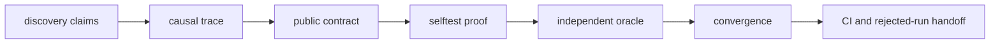
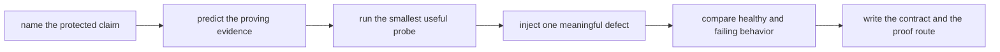

# Exercises

Use these after reading the five core lessons and the worked example. The goal is to turn
vague instability stories into protected claims, proof routes, and durable selftests.

## How to work through this set

Treat the ten exercises as one full lab day on determinism and diagnostic discipline.

Before each answer:

1. state the exact build claim you are trying to protect
2. predict what evidence would prove or disprove that claim
3. keep both a healthy run and a deliberately broken run whenever possible

If you skip the claim and go straight to "run more commands," the module turns into busy
debugging theater instead of disciplined proof.

Do the exercises in order. The day is one progression:

- Exercises 1-3 separate discovery, rebuild explanations, and public CI promises
- Exercises 4-6 audit proof, bound generated rules, and design an independent oracle
- Exercises 7-8 separate convergence proof from product correctness
- Exercises 9-10 turn all of that into maintainable CI and incident reports



Keep one determinism packet as you go. By the end of the day it should contain:

- one claim table with healthy and failing observations
- one rooted discovery policy
- one rebuild explanation anchored to a real trace line
- one passing selftest report and one rejected harness-test report
- one example where product tests pass but the build graph still lies
- one bounded diagnostic report another maintainer could trust

If those six artifacts are missing, you are probably gathering output rather than
learning how to prove that the build converges honestly.

## Recommended working layout

If you want one lab tree that can support the whole day, use something like:

```text
module03-lab/
├── Makefile
├── src/
├── build/
├── ci/
├── notes/
├── reports/
└── artifacts/
```

Keep one claim table while you work:

| Protected claim | Healthy observation | Injected defect | Expected failure |
| --- | --- | --- | --- |

Also keep one evidence register:

| Question | Command | Key line or artifact | Why this is enough |
| --- | --- | --- | --- |

That second table matters because learners often run good commands and still fail to say
what those commands actually proved.



Use that route on purpose. It keeps the day centered on falsifiable claims instead of on
general frustration with CI or nondeterminism.

## Exercise 1: Separate discovery claims

Create an isolated Makefile with `src/alpha.c`, `src/report.c`, and a discovered source
list. Capture the evaluated list, then add `src/scratch.c` without editing the Makefile
and capture it again.

Classify membership policy, canonical order, graph stability, and artifact identity
separately. Repair the membership policy with an explicit list, owned directory, or
durable filter. Do not choose a repair until you have written which files the target is
supposed to own.

What to hand in:

- the initial and changed evaluated lists
- a four-row table covering membership, order, graph, and artifact claims
- the original and repaired discovery fragments
- the ownership rule that justifies the repair
- one claim the experiment does not prove across machines

Study note:
GNU Make’s wildcard result can be ordered while its membership is still wrong. Sorting
and filtering answer different questions.

## Exercise 2: Trace a rebuild properly

In an isolated build, choose one target with at least two prerequisites. Complete a
successful build, change exactly one declared prerequisite, and predict the rebuild
before running:

```sh
gmake --trace TARGET
```

Replace `TARGET` with the real file target. Join the decisive trace line to timestamp or
signature evidence. Replay without another change and record the query exit.

What to hand in:

- the pre-run prediction
- the exact trace line and target
- the relevant target/prerequisite state
- the artifact acceptance observation
- the unchanged replay query exit
- a causal sentence bounded by those observations

Study note:
Trace proves selection, not artifact correctness. Your answer needs both evidence layers.

## Exercise 3: Define the CI contract

Choose four public targets for a small repository: help, product build/test, build-system
selftest, and CI composition. Define each using consumer, inputs, allowed writes,
success/failure meaning, incremental behavior, parallel behavior, and non-claims.

Draw the CI prerequisite graph. Decide whether its prerequisites may run concurrently
and prove their artifact namespaces do not collide.

What to hand in:

- the four complete target contracts
- the CI prerequisite graph
- an output-ownership table
- one controlled failure showing nonzero propagation
- one semantic break that does not rename a target
- one local convenience target deliberately excluded

Study note:
The target name, variables, effects, outputs, and failure behavior form one interface.

## Exercise 4: Audit a complete selftest report

From the capstone directory, run:

```sh
gmake selftest-report
```

Read the saved evidence without opening `tests/run.sh` first. Reconstruct what the
harness proved from the report, then compare your reconstruction with the script.

What to hand in:

- a table mapping each summary check to its command transcript and evidence file
- the 13 paths in the declared artifact inventory, grouped by role
- the schedule-comparison result and aggregate identities
- the hidden-input mechanism, query exit, and why that exit counts as a pass
- one way the inventory oracle could grade itself if expected membership came only from
  the build implementation
- one independent requirement that prevents that false pass
- two claims the report does not support

Study note:
A green summary is the start of review, not the whole answer. If you cannot connect each
claim to a command and evidence file, you are still trusting the harness by reputation.

## Exercise 5: Quarantine `eval`

Read `mk/rules_eval.mk`. Choose one generated target and write its explicit-rule
equivalent. Annotate which values expand during `call` and `eval`, and which automatic
variables must survive until recipe execution.

Run the disabled core selftest, inspect the enabled target through dry-run or database
evidence, and run the abstraction contract audit. Include the audit’s rejection case,
not only its healthy comparison.

What to hand in:

- the explicit-rule equivalent
- the expansion annotation
- the switch and bounded generated target inventory
- disabled-core evidence
- enabled selection evidence
- the accepted comparison and rejected abstraction case
- a decision to keep, simplify, or remove the abstraction

Study note:
Separate include location does not prove optionality. Disabled core behavior and bounded
enabled behavior do.

## Midday self-check

Before you move into convergence and CI behavior, make sure your packet can already
answer these questions cleanly:

- which build claim you are protecting first and how you would falsify it
- how membership and ordering can disagree without either observation being mislabeled
- which public target promises matter to CI consumers
- which rejected case proves that the current selftest closes a real gate
- why the generated-rule family is or is not cheaper to review than its explicit form

If you cannot answer those four questions in plain language, return to Exercises 1-5 and
make the packet more explicit before continuing.

## Exercise 6: Design an independent selftest oracle

Design a small build that declares three required outputs. Its implementation should
derive recipes from one source list. Create a selftest whose expected output membership
comes from an independent contract manifest rather than from that implementation list.

Remove one member from the implementation list. The build and an
implementation-derived inventory would agree on the same wrong omission; your
independent oracle must reject it.

What to hand in:

- the three-output contract manifest
- the implementation list
- the healthy accepted inventory
- the omitted-member fault
- the rejected comparison naming the missing path
- one explanation of why deriving expectations from the implementation would produce a
  false pass

Study note:
The selftest does not need another build system. It needs an expectation that does not
disappear when the implementation makes the same mistake.

## Exercise 7: Explain a no-op build

Run a successful build twice. On the second run, collect:

```sh
gmake --trace all
set +e
gmake -q all
query_exit=$?
set -e
printf '%s\n' "$query_exit"
```

Explain both the absence of recipe work and the query exit status.

What to hand in:

- the exact commands and outputs
- the newest target and prerequisite timestamps for one rule
- one sentence defining convergence
- one sentence explaining what observation would prove the build had not converged
- one explanation of the difference among query exits `0`, `1`, and `2`

Study note:
A quiet second build is useful, but the real lesson is why the graph now has no honest
reason to run again.

## Exercise 8: Separate product tests from build tests

Run these separately:

```sh
gmake test
gmake selftest
gmake selftest-harness-tests
```

The final command includes a controlled `parallel-artifact-drift` case. Inspect its saved
report and explain why the product test cannot answer the same question.

What to hand in:

- one contract sentence for each target
- the result of the truthful product and build-system routes
- the failed check and changed path from the rejected harness case
- the checks marked `NOT_RUN` and why that state matters
- one graph defect that a clean product test could miss

Study note:
This is one of the most important distinctions in the whole course. A product can be
correct after a clean rebuild while the incremental graph is still dishonest.

## Exercise 9: Make a CI target boring

Define a `ci` target for a small repository. It must depend on named public targets
rather than duplicating their recipes.

Run it from a clean checkout or isolated directory with no local configuration files.

What to hand in:

- the `ci` rule
- the public target dependency chain
- the allowed output namespace for each prerequisite
- evidence that one injected prerequisite failure reaches the CI exit
- the clean-room command and result
- one local convenience target deliberately excluded from CI
- one sentence explaining why "boring" is a compliment for this target

Study note:
The best `ci` target does not contain cleverness. It composes already-documented
contracts and makes them easy to invoke consistently.

## Exercise 10: Review a rejected selftest without rerunning

Run `gmake selftest-harness-tests`, then work only from the saved
`parallel-artifact-drift` report. Do not rerun while reviewing it.

Build a bounded review note containing:

- the result and stopping boundary from `summary.txt`
- the exact parallel-build command from `commands.txt`
- the semantic diagnostic category from `schedule-comparison.json`
- the serial and parallel digest and byte count for the changed path
- the relevant command log
- the preserved workspace path
- one supported conclusion and two unsupported conclusions

What to hand in:

- the review note
- a five-sentence handoff to a maintainer who did not witness the run
- the next narrow experiment you would run after preserving this report
- one sentence explaining why immediate rerun would weaken the review

Study note:
The report already contains more evidence than your handoff needs. Select the files that
support the stopping-boundary diagnosis; do not dump the whole workspace.

## Before you open the answers

Stop before `exercise-answers.md` and check that you can already point to:

- one claim about determinism stated in precise terms
- one trace line that explains a rebuild
- one defect that product tests missed
- one selftest that would have caught it
- one oracle whose expectation is independent from the implementation under test
- one rejected selftest review you would be willing to send to a teammate

If you do not yet have those five things, the answer page will feel useful but will not
teach much.

## Mastery standard for this exercise set

Across all ten answers, the module wants you to show three things:

- you can name the contract being protected
- you can point to acceptance and rejection evidence for that contract
- you can explain the repair or design choice in graph terms

If your answer only says "CI should be stable" or "`eval` should be careful," keep going.
