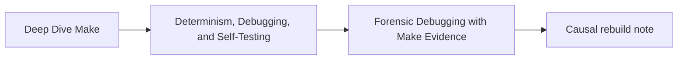
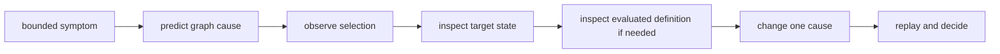
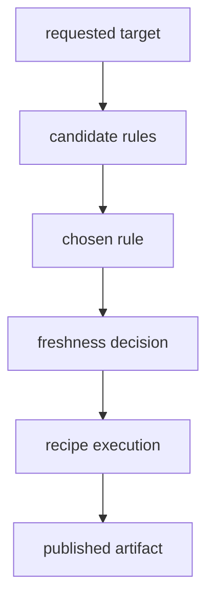

# Forensic Debugging with Make Evidence

Make debugging becomes tractable when each command answers one bounded question. The
goal is not to collect the largest transcript. It is to explain one decision using
evidence that another person can connect to the evaluated graph.

## Page maps





Do not begin by editing the recipe. Preserve the state that made the symptom observable.

## Name the question before the command

These are different investigations:

- Why would Make run this recipe?
- Why did Make choose this rule?
- What value did this variable have after parsing?
- Why does Make consider this target up to date?
- Why did the recipe succeed but publish the wrong artifact?
- Why does a second invocation still require work?

A command useful for one question may be weak evidence for another.

## Command boundaries

| Command | Primary question | Important limit |
| --- | --- | --- |
| `make -n TARGET` | what recipes does Make plan to run | it does not execute ordinary recipes or prove their result |
| `make --trace TARGET` | which targets update and which prerequisite fact triggered them | it does not reveal undeclared recipe reads |
| `make -q TARGET` | would this request require work | exit `1` means work is needed; it does not explain why |
| `make -pn TARGET` | what database did Make evaluate while suppressing ordinary execution | output is large and includes built-in material |
| `make -pRrq TARGET` | what explicit database remains without built-in rules and variables | exit can be nonzero because query mode reports stale work |
| `make --debug=b TARGET` | what basic target-remake decisions occurred | verbosity grows quickly and still needs interpretation |
| `make -W FILE -n TARGET` | what would rebuild if one prerequisite were treated as new | hypothetical selection is not an actual state change |

Use the repository’s supported Make executable. In this course the capstone explicitly
uses GNU Make, commonly invoked as `gmake`.

## Dry run is not guaranteed inert

`-n` suppresses ordinary recipe execution, but Make still parses files, expands
variables, evaluates shell functions used during parsing, and may execute recursive
recipe lines involving `$(MAKE)`. A build with parse-time side effects can mutate state
during a “dry” inspection.

Before treating a dry run as safe:

- inspect parse-time `$(shell ...)` uses;
- inspect generated includes;
- look for recursive `$(MAKE)` recipes;
- use a copied workspace when the repository is unfamiliar;
- preserve the initial worktree state.

Dry run evidence describes Make’s plan within those limits.

## Read query exits correctly

GNU Make query mode uses three outcome classes:

| Exit | Meaning |
| ---: | --- |
| `0` | requested targets are up to date |
| `1` | at least one requested target needs updating |
| `2` | Make encountered an error |

Capture the exit without accidentally replacing it:

```sh
set +e
gmake -q all
query_exit=$?
set -e
printf 'query_exit=%s\n' "$query_exit"
```

In a convergence proof, `0` is the accepted result after a successful build. In a
negative test that deliberately introduces a hidden changing input, `1` may be the
expected detection result. The same number means nothing without the claim.

## Work one target, not the whole console

Suppose `build/report.json` rebuilds unexpectedly. Write the hypothesis first:

```text
Requested target: report
Observed symptom: build/report.json rebuilt on the second invocation
Predicted cause: config/schema.json is newer than build/report.json
Expected trace: report target names config/schema.json as the update reason
```

Then run the narrow target:

```sh
gmake --trace build/report.json
```

Capture only the lines that explain this target and its causal prerequisites. A
thousand-line top-level trace can obscure the useful edge.

## Join trace evidence to filesystem state

A trace line names Make’s decision. Confirm the relevant state:

```sh
stat -c '%n %Y %s' config/schema.json build/report.json
```

On systems with a different `stat` interface, use the repository’s supported inspection
helper rather than assuming flags are portable.

Record:

| Path | Role | Modification evidence | Content evidence |
| --- | --- | --- | --- |
| `config/schema.json` | prerequisite | timestamp or governed signature | relevant schema change |
| `build/report.json` | target | timestamp before and after | semantic acceptance check |

Timestamps explain Make’s ordinary freshness model. They do not prove the output is
semantically correct.

## Escalate to the evaluated database deliberately

Use database output when the Makefile text and observed graph appear to disagree:

- an include appends a prerequisite;
- a target-specific variable changes flags;
- a pattern rule wins instead of the expected explicit rule;
- command-line or environment origin changes a value;
- `eval` generates a rule not visible as ordinary syntax.

Prefer a bounded extraction:

```sh
gmake -pRrq build/report.json > artifacts/learning/deep-dive-make/module-03/database.txt
```

Query mode may return `1` when work is needed, so do not chain this command with `&&` and
mistake the useful database for a failed inspection. Search the saved result for the
exact target or variable under review.

Useful probes inside the Makefile, added only after normal evidence is insufficient:

```make
$(info REPORT_SRCS=$(REPORT_SRCS))
$(info REPORT_MODE origin=$(origin REPORT_MODE) flavor=$(flavor REPORT_MODE) value=$(REPORT_MODE))
```

Remove probes after the investigation. A permanent diagnostic target is better when the
question recurs.

## Distinguish rule selection from recipe correctness



Evidence at one boundary cannot settle all later boundaries:

- the correct rule can run a faulty recipe;
- the recipe can exit zero after writing incomplete content;
- a correct artifact can be rebuilt for a false edge;
- a no-op decision can preserve stale output when an input is undeclared.

State which boundary the evidence addresses.

## Diagnose an unexpected rebuild

Use this route:

1. preserve the target and prerequisite timestamps;
2. predict the one edge likely to make the target stale;
3. run a bounded trace;
4. confirm whether the named prerequisite exists in the declared graph;
5. inspect variable/rule evaluation only if selection remains unclear;
6. repair the edge, producer, or semantic stamp rather than suppressing execution;
7. replay the triggering change;
8. verify the unchanged next run converges.

Common causes include:

| Symptom | Candidate cause | Stronger next observation |
| --- | --- | --- |
| rebuild every invocation | phony prerequisite or volatile generated content | target/prerequisite trace and content identity |
| rebuild after irrelevant edit | overbroad normal prerequisite | change relevance and edge classification |
| different rule on CI | include, environment, or built-in rule difference | bounded database and variable origins |
| quiet build with stale result | missing prerequisite | mutate real input and inspect selection |
| clean build works, incremental fails | incomplete dependency graph | targeted input mutation without cleaning |

## Diagnose an unexpected no-op

An unexpected no-op is often more dangerous because Make emits little evidence.

1. name the input that should affect the target;
2. confirm the input actually changed;
3. inspect whether the input is a declared prerequisite or represented by a semantic
   stamp;
4. use `-W` with a dry run to test the proposed edge without altering timestamps;
5. add or repair the truthful edge;
6. replay the real input mutation;
7. verify the target changes and the following run converges.

Do not solve a missing edge with permanent `-B`, habitual cleaning, or touching the
target. Those actions force work without making the graph more truthful.

## Write a causal note

Use this bounded format:

```text
Claim:
Initial target state:
Predicted cause:
Observed selection:
Evaluated rule or variable:
Artifact observation:
Controlled change:
Replay result:
Decision:
Limit:
```

A defensible sentence is:

> `build/report.json` rebuilt because the declared prerequisite
> `config/schema.json` was newer, as shown by the bounded trace and matching timestamp
> evidence; after rebuilding, the semantic report check passed and the next query
> returned zero.

That statement separates selection, artifact acceptance, and convergence.

## Evidence traps

| Trap | Why it fails |
| --- | --- |
| “Make rebuilt for no reason” | no target, edge, or state is named |
| adding `echo` before prediction | the observation changes before the question is bounded |
| using complete debug logs as a handoff | reviewers cannot locate the decisive evidence |
| treating `-n` as execution proof | planned commands did not produce an artifact |
| treating `-p` as source truth | it is evaluated state and may include built-ins or overrides |
| cleaning before reproduction | the incremental failure state is destroyed |
| rerunning immediately | fixed report paths or volatile state may overwrite the evidence |

## End-of-page checkpoint

Before leaving this page, you should be able to:

- choose among dry-run, trace, query, database, and debug evidence;
- state the side-effect limits of dry-run inspection;
- interpret query exits within a positive or negative claim;
- debug unexpected rebuilds and unexpected no-ops differently;
- join Make’s selection evidence to filesystem and artifact evidence;
- hand off one causal explanation without dumping an entire console log.
