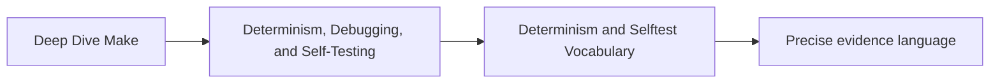
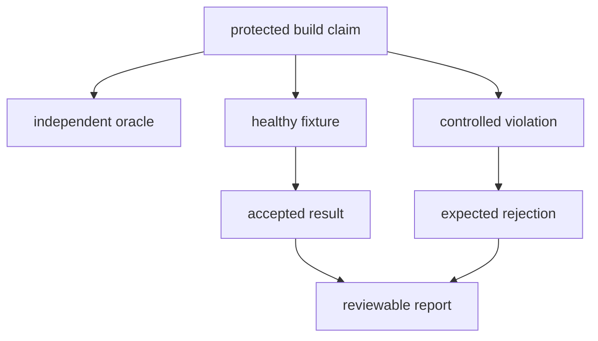

# Determinism and Selftest Vocabulary

Use this reference when a debugging note, CI contract, or selftest report uses one word
for several different claims. The vocabulary is deliberately tied to evidence and
decisions so it can improve an investigation rather than merely define terms.

## Page maps



```mermaid
flowchart LR
  state["semantic state"] --> discovery["discovery"]
  discovery --> graph["evaluated graph"]
  graph --> selection["target selection"]
  selection --> execution["recipe execution"]
  execution --> artifact["artifact"]
  artifact --> acceptance["acceptance decision"]
```

Name the boundary you observed. “The build passed” hides all six.

## Graph and determinism terms

| Term | Meaning in this module | Evidence that fits |
| --- | --- | --- |
| semantic input | a fact whose change is allowed to change output meaning | declared file, validated variable, tool signature, semantic stamp |
| discovery root | directory boundary a discovery expression is allowed to inspect | Makefile expression and evaluated list |
| membership policy | rule deciding which discovered paths are legitimate inputs | explicit list, owned-directory contract, governed filter |
| canonical order | one defined ordering for a given member set | captured evaluated list and ordering check |
| discovery determinism | same semantic repository state yields the same eligible ordered members | repeated or cross-environment membership evidence |
| graph determinism | same semantic state yields the same targets, prerequisites, recipes, and relevant values | bounded database or graph report |
| decision determinism | same graph and target state yield the same rebuild decisions | trace and query results |
| artifact determinism | same semantic inputs yield equivalent declared artifacts | governed inventory plus semantic acceptance |
| hidden input | semantic observation that can affect behavior without truthful graph evidence | controlled mutation with missing rebuild or false convergence |
| volatile diagnostic | intentionally varying observation outside correctness identity | timestamped trace, timing report, environment report |
| semantic stamp | file evidence representing a normalized non-file input | stamp content, prerequisite edge, changed-input replay |
| convergence | unchanged successful request leaves no further work required | no-op trace and query exit zero |

Determinism is always bounded. State the supported tools, platform, environment policy,
artifact set, and schedules that were actually compared.

## Make observation terms

| Term | Question answered | What it does not establish |
| --- | --- | --- |
| dry run | what ordinary recipes Make plans to run | recipe success or artifact validity |
| trace | why Make updates selected targets | undeclared reads inside recipes |
| query | whether requested targets need work | causal explanation or semantic correctness |
| evaluated database | which rules and variables exist after Make parses inputs | safety or correctness of execution |
| debug output | detailed remake and rule-search activity | a bounded causal conclusion by itself |
| target state | file existence, time, and other freshness-relevant facts | content acceptance |
| selection evidence | why a rule or target was chosen for update | what the recipe eventually published |
| execution evidence | command, environment boundary, and exit | correct artifact semantics |
| artifact evidence | path, membership, size, digest, or semantic validation | why Make selected the recipe |

Useful query outcome language:

| Exit | Say | Do not say |
| ---: | --- | --- |
| `0` | requested targets are up to date | every hidden input is modeled |
| `1` | at least one requested target needs work | Make failed |
| `2` | Make encountered an error | the graph merely needs rebuilding |

In a deliberate hidden-input test, exit `1` can be the expected successful detection.
Always pair the number with the claim.

## Target-contract terms

| Term | Meaning |
| --- | --- |
| public target | supported request whose behavior has human or automation consumers |
| target guarantee | promised inputs, effect, outputs, exits, incremental behavior, and parallel behavior |
| action target | request representing an operation rather than a timestamped artifact; commonly phony |
| file target | path whose freshness and production belong to the graph |
| diagnostic target | request that produces observations without redefining correctness artifacts |
| allowed writes | output namespace a target may mutate |
| semantic compatibility | preservation of target meaning for existing consumers |
| clean-state proof | target run without borrowing undeclared local artifacts or configuration |
| failure propagation | required failed check causes the public request to fail |
| `NOT_RUN` | check was not reached after an earlier stopping boundary |

`NOT_RUN` is neither pass nor failure. It prevents a report from claiming evidence that
was never produced.

## Selftest terms



| Term | Meaning in this module | Review question |
| --- | --- | --- |
| build-system selftest | executable proof of graph, rebuild, schedule, or interface invariants | which build claim differs from product behavior |
| oracle | rule that decides whether observed evidence satisfies the claim | can it retain the expectation when implementation is faulty |
| healthy fixture | bounded state the oracle must accept | does it exercise the promised contract |
| controlled violation | deterministic defect inserted to test rejection | does it violate exactly one intended boundary |
| negative test | run where rejecting the controlled defect counts as success | did rejection occur for the expected reason |
| stopping boundary | first claim the harness could not accept | which later checks must be `NOT_RUN` |
| equivalence set | declared artifacts compared across schedules or implementations | are required paths independent of incidental directory contents |
| accepted run | every reached required claim passed within recorded limits | what remains outside scope |
| rejected run | evidence contradicts a required claim at a named boundary | does the report localize without guessing root cause |
| harness test | test that proves the selftest accepts truth and rejects a known violation | is the detector connected to its promise |
| fault seam | tightly controlled mechanism used only to activate a harness-test defect | can ordinary proof activate it accidentally |

An oracle is independent when the expectation survives the implementation mistake under
test. It need not reimplement the product or build system.

## Generated-rule terms

| Term | Meaning |
| --- | --- |
| macro | reusable Make text or function invoked through expansion |
| template parameter | value bound by `call`, such as `$(1)` |
| generated rule | Make syntax produced as text and parsed into the graph |
| `eval` expansion | expansion of generated text followed by parsing; the function itself yields empty text |
| automatic variable lifetime | `$@`, `$<`, and related values exist when a selected recipe or rule context is evaluated |
| dollar escaping | preserving a dollar layer through earlier text expansion |
| finite family | generated target membership has an explicit bounded source |
| explicit equivalent | ordinary rule expressing the contract of one generated member |
| quarantined surface | generated rules have one owner, explicit activation, bounded membership, and no control over the core graph |
| abstraction budget | review complexity the removed duplication justifies |

Separate file location does not establish quarantine. Disabled core proof, enabled
inventory, explicit equivalence, and an invalid-input rejection do.

## Confusable pairs

| Do not collapse | Distinction |
| --- | --- |
| membership and order | the right files can be unordered; the wrong files can be perfectly sorted |
| clean success and convergence | a build can succeed and still require work immediately |
| convergence and graph completeness | a missing edge can preserve a quiet stale result |
| recipe exit and artifact acceptance | exit zero does not validate published meaning |
| trace and root cause | trace localizes Make’s declared reason, not every undeclared influence |
| dry run and execution | planned commands did not establish real effects |
| file hash and semantic equivalence | formats may permit irrelevant byte differences or meaningful equal-sized changes |
| serial/parallel success and equivalence | both schedules can exit zero with different artifacts |
| public name and public contract | meaning can break while the target name stays fixed |
| selftest pass and universal proof | the result is bounded to its fixture, oracle, environment, and artifact set |
| negative failure and successful rejection | the harness must reject at the intended boundary |
| abstraction and opacity | repetition can shrink while review cost grows |

## Rewrite vague incident language

| Vague statement | Evidence-ready replacement |
| --- | --- |
| “The build is flaky.” | “Two clean schedule runs published different identity for the declared generated header.” |
| “Make rebuilt for no reason.” | “The trace selected the report because its phony diagnostic prerequisite is always out of date.” |
| “CI passed.” | “The documented CI target returned zero; product test and selftest reports both record pass within their stated limits.” |
| “The selftest failed.” | “Convergence passed, schedule equivalence rejected a changed artifact, and later checks were not run.” |
| “Discovery is deterministic.” | “The evaluated list has governed membership and canonical ordering for the recorded repository state.” |
| “`eval` is safe.” | “The finite generated family matches its explicit contract, remains disabled for core proof, and rejects an invalid member.” |

Precise language does not require certainty about root cause. It requires honesty about
the observed boundary.

## Decision terms

- **accept** — evidence supports the bounded claim;
- **reject** — evidence contradicts the claim;
- **repair** — a named defect has a truthful correction and replay route;
- **abstain** — evidence is insufficient, with the missing observation named;
- **simplify** — a less costly rule shape preserves the same contract;
- **retire** — a public or diagnostic surface no longer has a consumer.

Avoid “looks deterministic,” “probably fixed,” and “green enough.” They hide the claim
and stop condition.

## Vocabulary checkpoint

You can use this reference when you can:

- classify an observation as discovery, graph, selection, execution, artifact, or
  acceptance evidence;
- distinguish membership from ordering and convergence from completeness;
- interpret dry-run, trace, database, and query results within their limits;
- describe a public target using effects and failure semantics;
- explain why an independent oracle needs both acceptance and rejection cases;
- distinguish an expected negative-test rejection from an unrelated failure;
- compare generated rules to an explicit contract before accepting abstraction.
