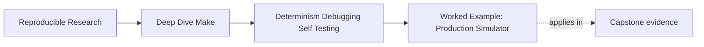
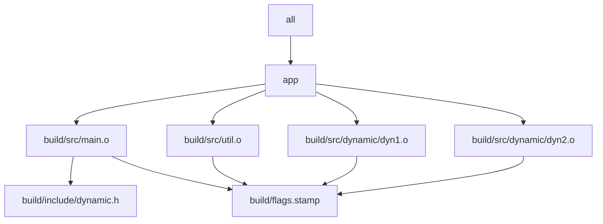

# Worked Example: Production Simulator


<!-- page-maps:start -->
## Page Maps




<!-- page-maps:end -->

This file gathers the module around the runnable course capstone.

## Choose one command boundary

From the repository root, use the program wrapper:

```sh
make PROGRAM=reproducible-research/deep-dive-make capstone-selftest
```

From `programs/reproducible-research/deep-dive-make/capstone/`, use the capstone’s GNU
Make targets directly:

```sh
gmake help
gmake selftest-report
```

Do not mix the two working directories in one evidence note. Record the command,
directory, revision, and initial worktree so another learner can replay the same request.

## Predict the evidence route

Before running a demonstration, complete one row:

| Claim | Request | Expected evidence | Controlled challenge | Explicit limit |
| --- | --- | --- | --- | --- |
| discovery order is canonical | `discovery-audit` | sorted-list checks exit zero | inspect membership separately | does not prove membership policy |
| unchanged build converges | `selftest-report` | convergence pass and query exit | hidden changing input | bounded to fixture and tools |
| schedules preserve declared artifacts | `selftest-report` | matching governed inventories | controlled artifact drift | bounded to two tested schedules |
| generated rules remain optional | `abstraction-contract-audit` | explicit/generated contract bundle | dishonest abstraction fixture | does not endorse every `eval` use |

The prediction keeps a large capstone from becoming a tour of commands without claims.

## First see unstable discovery in isolation

Create three files in an empty directory:

```sh
mkdir -p src
touch src/charlie.c src/alpha.c src/bravo.c
```

Compare two Make variables:

```make
SHELL_SRCS = $(shell find src -name '*.c')
STABLE_SRCS := $(sort $(wildcard src/*.c))

.PHONY: show
show:
	@printf 'shell:  %s\n' "$(SHELL_SRCS)"
	@printf 'stable: %s\n' "$(STABLE_SRCS)"
```

The `find` command’s order is not a portable contract. Sorting a rooted file set gives
the build a canonical order. Stable order matters when the list influences link order,
manifests, generated source, or evidence comparisons.

## Layout

```text
capstone/
  Makefile
  mk/
    common.mk
    objects.mk
    stamps.mk
    macros.mk
    rules_eval.mk
  src/
    main.c
    dynamic/
      dyn1.c
      dyn2.c
  include/
    util.h
  scripts/
    gen_dynamic_h.py
  tests/
    run.sh
```

This simulator matters because it combines deterministic discovery, generation,
selftesting, and an optional `eval` surface in one place you can actually inspect.

The tree above is not hypothetical. It is
`programs/reproducible-research/deep-dive-make/capstone/` in this repository.

## A graph view of the simulator



This graph is useful because it makes three Module 03 concerns visible at once:

- discovery affects which object targets exist at all
- generated headers must be trustworthy inputs, not fragile side effects
- semantic flags still belong in the object-file contract

## What to inspect first

Start with these questions:

1. which lists are rooted and sorted
2. which generated artifacts are published atomically
3. which hidden inputs are modeled
4. which targets form the public build contract

This worked example is the concrete home for the rest of the module.

## Read the simulator in this order

1. `Makefile` for public targets and top-level intent
2. `mk/common.mk` for stable knobs
3. `mk/objects.mk` for rooted and sorted discovery
4. `mk/stamps.mk` for modeled hidden inputs
5. `mk/macros.mk` for small reusable invariants
6. `mk/rules_eval.mk` only after the core build is already understood

That order matters because it keeps the graph visible before you look at optional
abstraction.

## Six demonstrations to run

### Demonstration 1: Prove stable discovery

Read `mk/objects.mk`, then run:

```sh
gmake discovery-audit
mkdir -p ../../../../artifacts/learning/deep-dive-make/module-03
gmake -pRrq all > ../../../../artifacts/learning/deep-dive-make/module-03/capstone.database.txt
```

Query mode can return `1` when a target needs work; preserve that exit separately rather
than assuming the database was not written. In the saved database, find `SRCS`,
`DYN_SRCS`, `OBJS`, and `DYN_BINS`.

Write two conclusions:

1. The lists are rooted and canonically ordered.
2. The audit does **not** prove every matching `src/dynamic/*.c` file is an intended
   member.

Then read the repository layout and target contract to decide whether “every matching
dynamic source is owned” is the actual policy. This separates ordering proof from
membership review.

### Demonstration 2: Prove a no-op run

Use a copied workspace or the selftest harness rather than cleaning a working tree that
contains user state. After the first successful build, run:

```sh
gmake --trace all
set +e
gmake -q all
query_exit=$?
set -e
printf 'query exit: %s\n' "$query_exit"
```

The trace should contain no rebuilding work, and query exit should be zero. If it is
`1`, preserve the trace before another build changes the state. If it is `2`, diagnose a
Make error rather than calling the graph non-convergent.

### Demonstration 3: Trace one rebuild properly

Use an isolated copy. Change one declared source without changing its filename, predict
the affected targets, and run:

```sh
gmake --trace all > trace.log
```

Build a five-line causality note:

```text
requested target:
changed prerequisite:
trace line naming the update:
downstream artifact inspected:
unchanged replay query exit:
```

Do not hand in the complete trace as the explanation. Select the line that joins the
changed input to one rebuilt target, then show that the next unchanged request converges.

### Demonstration 4: Prove the build system with `selftest`

Run:

```sh
gmake selftest-report
```

This should prove convergence, serial/parallel equivalence over 13 declared artifacts,
the trace guardrail, hidden-input detection, and the quarantined `eval` check. It does
not prove runtime correctness; `gmake test` owns that separate claim.

Open the report under:

```text
artifacts/proof/reproducible-research/deep-dive-make/selftest/
```

Read `summary.txt` before `commands.txt`, logs, inventories, or the workspace. The summary
tells you which deeper evidence is relevant.

Complete this ledger while reading:

| Check | Reached state | Command evidence | Result evidence | Honest non-claim |
| --- | --- | --- | --- | --- |
| convergence |  |  |  |  |
| serial/parallel equivalence |  |  |  |  |
| trace guardrail |  |  |  |  |
| hidden-input detection |  |  |  |  |
| quarantined eval |  |  |  |  |

If a row is `NOT_RUN`, leave its evidence cells empty. Do not borrow evidence from a
different run.

### Demonstration 5: Check that optional eval stays optional

Run:

```sh
gmake USE_EVAL=no selftest
gmake USE_EVAL=yes -n eval-demo
gmake abstraction-contract-audit
```

Read `mk/rules_eval.mk` and write the explicit rule equivalent for one generated target.
Then inspect the abstraction audit under the repository artifact directory. The point is
to prove that:

- the core build does not depend on the generated demo surface;
- the enabled target family is finite and attributable;
- explicit and generated implementations preserve the governed contract;
- a dishonest generated surface is rejected by the audit’s own tests.

### Demonstration 6: Read the negative test

Open `tests/run.sh` and find the hidden-input check. Before running it, explain what defect
the test introduces and what observation should make the test pass. A negative test is
useful only when you understand why failure is expected.

Write the detector logic in four lines:

```text
healthy state accepted:
fault mechanism:
expected stopping boundary:
observation that counts as successful rejection:
```

If the fault triggers a different earlier error, it did not prove the intended detector.

## Prove that the proof rejects dishonesty

Run:

```sh
gmake selftest-harness-tests
```

The test suite runs one truthful case and one controlled schedule-drift case. It does not
ask you to edit the live Makefile or remember to restore a defect. Inspect:

```text
artifacts/tests/reproducible-research/deep-dive-make/selftest-harness/
└── parallel-artifact-drift/
```

Start with `summary.txt`. It should name schedule equivalence as the stopping boundary.
Then read `schedule-comparison.json`; the changed path should be
`build/include/dynamic.h`. Confirm that trace, hidden-input, and eval checks are
`NOT_RUN`, not `FAIL`.

Finally, compare the two inventory entries for that path and inspect the preserved
parallel file under `workspace/`. This is mutation testing at a human scale: the test
proves that the schedule-equivalence gate is connected to the artifact contract it
claims to protect.

If you later design another controlled defect, require the same evidence shape:

```text
Claim violated:
Expected stopping boundary:
Expected diagnostic category:
Observed report:
Later checks not reached:
Preserved evidence:
```

## Build a causality note from one trace

Choose one rebuilt target and write no more than five lines:

1. requested target
2. prerequisite that changed
3. trace line that names the reason
4. downstream target made stale by that rebuild
5. whether the next identical run converged

This bounded note is more useful in review than a complete terminal transcript. It turns
diagnostic output into an explanation another learner can check.

## Review the example without rerunning

After completing the demonstrations, pretend you received only the saved evidence. Ask:

- Can you identify the source revision and invocation directory?
- Can you tell which claims were reached?
- Can you distinguish a command log from an artifact inventory?
- Can you locate the first failed boundary in a rejected run?
- Can you tell which later checks did not run?
- Can you state why the negative case counts as a successful detector test?
- Can you name at least two unsupported conclusions?

If the answers require terminal history or memory, the evidence packet is incomplete.

## Completion record

```text
Discovery policy and observed list:
No-op query result:
One causal rebuild note:
Accepted selftest summary:
Rejected harness-test boundary:
Generated-rule explicit equivalent:
Abstraction audit decision:
Known environment and schedule limits:
```

This record is the handoff from the worked example to the exercise set.

## What this example should teach you

By the time you finish this file, you should be able to point at the simulator and say:

- where determinism is enforced
- where debugging evidence comes from
- where the CI-facing target surface begins
- where selftest proves the build
- where abstraction is kept under control instead of controlling the build
- which claim is proved by each selftest section
- how a rejected selftest remains reviewable without rerunning it
- why the discovery audit proves order but still requires membership review
- how explicit/generated comparison bounds an abstraction claim
