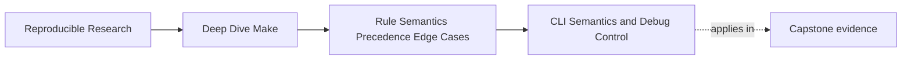
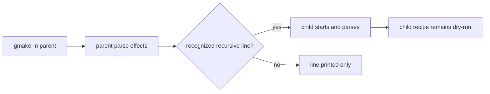

# CLI Semantics and Debug Control


<!-- page-maps:start -->
## Page Maps




<!-- page-maps:end -->

When a Make build behaves strangely, many engineers reach for flags in the wrong order.
They add `-B`, sprinkle `-j1`, or run `clean` until the symptom disappears.

That feels productive because the build changes. It is usually the opposite of evidence.

The first goal of this page is to replace that reflex with a better one:

> choose the flag that reveals the graph fact you need, not the flag that makes the pain
> go away for one run.

That is why Module 04 starts with the CLI. Before you can reason about variables,
includes, or rule edge cases, you need a disciplined way to ask Make what it thinks.

## The three kinds of CLI switches

Most of the Make CLI fits into three practical groups:

- switches that reveal information
- switches that simulate a condition
- switches that change behavior so much that they can hide the underlying bug

Keeping those groups separate prevents a lot of wasted time.

| Kind | Examples | What they are for |
| --- | --- | --- |
| reveal | `--trace`, `-p`, `-q`, `-n` | showing why Make made a decision |
| simulate | `-W file`, `-B` | asking "what if this input were stale?" |
| alter build behavior | `-j`, `-rR`, `-C`, `-f` | changing scheduling, built-ins, or entrypoint |

The mistake is not using the third group. The mistake is using it before you understand
what question you are actually asking.

## The small set of flags that matter constantly

### `--trace`: the rebuild explanation tool

If you only keep one Module 04 habit from this page, keep this one:

```sh
gmake --trace <target>
```

`--trace` is your fastest route to a plain-language answer to "why did this run?" It
prints the target, the rule location, and the prerequisite relationship that made the
recipe eligible.

That matters because most Make incidents are not mysterious shell failures. They are
causality failures. Something ran because the graph said it should.

### `-n`: preview without recipe execution

```sh
gmake -n <target>
```

This is useful when you want to preview what Make intends to run. It is not a frozen
simulation of reality. Make still parses the files, expands variables, and may still
evaluate things like `$(shell ...)` and `$(file ...)`.

So `-n` is a preview of recipe execution, not a promise that nothing meaningful happened
during evaluation.

That distinction becomes important later in the module when includes or shell assignments
show up at parse time.

There is another exception: recipe lines marked with `+` or recognized as recursive Make
invocations may execute even under `-n`, `-t`, or `-q`. GNU Make preserves this behavior
so a parent can pass the selected mode to its child.

Treat a dry run as a semantic mode with documented exceptions, not a sandbox.

### `-p`: the evaluated world

```sh
gmake -p
```

`-p` prints the database Make is actually using after parsing and evaluation. It is noisy,
but the noise is useful when you have a variable or rule-selection dispute:

- which value did a variable end up with
- which built-in rule still exists
- which implicit behavior is present even though nobody wrote it explicitly

If `--trace` explains one decision, `-p` explains the world that made that decision
possible.

`-p` does not suppress the ordinary build by itself. Pair it with query mode when you want
the database without running an eligible recipe:

```sh
gmake -pRrq <target> > artifacts/semantics/make-database.txt
```

This still reads and expands makefiles. Parse-time effects and makefile remakes remain
possible.

### `-q`: convergence as an exit code

```sh
gmake -q <target>
```

Query mode is simple and easy to misuse:

- exit `0`: the target is up to date
- exit `1`: the target would rebuild
- exit `2`: Make encountered an actual error

Many teams accidentally treat exit `1` as a build crash. It is not a crash. It is the
signal that the current graph says work remains.

That makes `-q` valuable for selftests, CI checks, and "did the second run converge?"
style assertions.

Capture the status before another shell command overwrites it:

```sh
gmake -q report.txt
status=$?
printf 'query_status=%s\n' "$status"
```

### `-W file`: simulate staleness honestly

```sh
gmake -W path/to/input --trace <target>
```

`-W` tells Make to pretend one file is newer than it really is. This is one of the best
ways to test whether a dependency edge is honest because it changes the staleness model
without forcing you to edit files or corrupt timestamps by hand.

It is a diagnostic tool, not a repair.

If `-W include/config.h app` reveals that `app` does not rebuild, the answer is not "keep
running with `-W`." The answer is "the graph is missing an input edge."

### `-B`: useful, but suspicious

```sh
gmake -B <target>
```

`-B` forces everything to be treated as out of date. That can be useful when you want a
quick full rebuild or want to see whether an incremental bug disappears under a total
rebuild.

But if `-B` "fixes" the build, do not celebrate. Treat that as a clue that incremental
truth is broken.

## Know which boundary each switch changes

| Switch | Boundary changed or observed | Claim it cannot prove alone |
| --- | --- | --- |
| `--trace` | selected target and triggering prerequisite | why an undeclared input changed |
| `-n` | suppresses most recipe execution | absence of parse-time or recursive side effects |
| `-q` | reports whether governed work remains | that output bytes match semantic inputs |
| `-p` | prints evaluated database | that the selected recipe ran correctly |
| `-W file` | simulates one file as newly changed | actual output correctness after the recipe |
| `-B` | makes targets unconditionally stale | incremental graph truth |
| `-rR` | removes built-in rules and variables | that repository-authored implicit rules are unambiguous |
| `-f file` | selects an entry makefile | equivalence with the repository’s public entrypoint |
| `-C dir` | changes Make’s working directory before reading | equivalence of relative paths and included files |
| `-jN` | changes scheduling pressure | correctness under independent Make processes |

Choose the smallest switch that changes the boundary you intend to test. Record every
switch in the evidence packet; otherwise a later reviewer cannot reproduce the semantic
world you observed.

## Prove the dry-run exceptions

Use an isolated fixture whose only purpose is to expose evaluation:

```make
$(file >>artifacts/semantics/parse-events.log,parent parsed)

.PHONY: observe-child
observe-child:
	+$(MAKE) --no-print-directory -f child.mk observe
```

And `child.mk`:

```make
$(file >>artifacts/semantics/parse-events.log,child parsed)

.PHONY: observe
observe:
	@printf '%s\n' 'child recipe executed'
```

Run:

```sh
gmake -n observe-child
```

Expected observations:

- the parent parse record is written
- the recursive line executes despite `-n`
- the child parses and writes its record
- the child recipe is printed under inherited dry-run mode rather than executed

Now remove the `+` and spell the child command without `$(MAKE)`. GNU Make no longer
recognizes it as recursive, so `-n` only prints the line and the child parse record is
absent.

This is why a dry-run test needs filesystem and subprocess evidence, not just terminal
output.



## A better incident loop

When you say "Make is being weird," the usual issue is not weirdness. The issue is
that the investigation has no order. Use this loop instead:

1. Record the entrypoint, directory, goals, assignments, and inherited `MAKEFLAGS`.
2. Prove causality with `gmake --trace <target>`.
3. Inspect the evaluated state with `gmake -pRrq <target>`.
4. Preview eligible recipes with `gmake -n`, while auditing parse and recursive effects.
5. Simulate one suspected change with `gmake -W file --trace <target>`.
6. Only then decide whether a clean rebuild, serial run, or built-in rule audit answers a
   remaining question.

That order forces you to gather evidence before changing the conditions too aggressively.

## An isolated staleness probe

Use this Makefile:

```make
.PHONY: clean

report.txt: data.txt template.txt
	@printf 'report from %s and %s\n' data.txt template.txt > $@

data.txt:
	@printf 'data\n' > $@

template.txt:
	@printf 'template\n' > $@

clean:
	rm -f report.txt data.txt template.txt
```

Now run:

```sh
gmake clean
gmake report.txt
gmake --trace report.txt
gmake -q report.txt; printf 'status=%s\n' "$?"
gmake -W template.txt --trace report.txt
gmake -q report.txt; printf 'status=%s\n' "$?"
```

What this teaches:

- after the first build, `-q` should return `0`
- `-W template.txt` should make `report.txt` eligible again
- `--trace` shows the exact prerequisite relationship that explains the rebuild

This is a tiny example, but the reasoning scales to real builds.

## Failure signatures worth recognizing

### "It only behaves when I run `clean` first"

That usually means the incremental graph is wrong. `clean` is not the evidence. `clean`
simply hides the distinction between a correct incremental build and a brute-force full
rebuild.

### "It works under `-j1`"

That is not a resolution. It tells you parallel scheduling exposed a real bug, often a
missing edge or a multi-writer output.

### "It looked fine under `-n`"

That can still happen if the problem depends on actual recipe execution, timestamp
publication, or concurrent writers. It can also hide in the opposite direction: parse-time
functions and recognized recursive recipes may still act. `-n` is useful, but it is not
the same thing as a side-effect-free simulation or a successful build.

### "`-B` makes the issue disappear"

That usually points at stale-state logic, not a healthy build.

## The beginner trap: using flags as superstition

Bad Make debugging often sounds like this:

- "I always run `make clean all`."
- "Try `-B`."
- "Try `-j1`."
- "Maybe the cache is weird."

None of those statements explains anything.

Good Make debugging sounds like this:

- "`--trace` shows `app` rebuilt because `config.mk` was remade."
- "`-q` returned `1`, so the second run did not converge."
- "`-W include/api.h` produced no rebuild, which proves the edge is missing."

That is the level of explanation this module wants.

## What to practice from this page

Take one small target in the capstone or your own project and answer all four questions:

1. Which single flag would you run first to explain a rebuild?
2. Which flag would tell you whether the target is up to date without executing the recipe?
3. Which flag would simulate one stale prerequisite honestly?
4. Which flag would be dangerous to use too early because it might hide the incremental bug?
5. Which parse-time and recursive effects could still occur under the chosen mode?
6. Which inherited switches reach a recursive Make through `MAKEFLAGS`?

If you can answer those without hand-waving, the CLI has stopped being a bag of tricks and
become an instrument.

## End-of-page checkpoint

Before leaving this lesson, make sure you can explain:

- why `--trace` is the default starting point for rebuild investigations
- why `-q` exit code `1` means "would rebuild," not "broken build"
- why `-W` is a cleaner probe than touching files by hand
- why `-B` can be useful while still being a warning sign
- why `-n` previews recipe execution but does not erase parse-time effects
- why recognized recursive recipe lines are an explicit dry-run exception
- why `-p` needs a non-executing companion mode for database-only inspection
- why every diagnostic record must include entrypoint, directory, assignments, and flags
