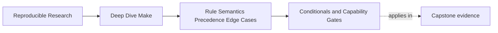
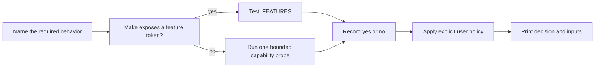

# Conditionals and Capability Gates


<!-- page-maps:start -->
## Page Maps




<!-- page-maps:end -->

Make conditionals are evaluated while Make reads makefiles. They do not wait for a target
to run, and they do not execute inside a recipe shell. That single fact explains many
broken capability gates.

Consider this tempting rule:

```make
report: FORMAT := json

ifeq ($(FORMAT),json)
report:
	@render --json
else
report:
	@render --text
endif
```

The conditional is decided during parsing, outside the target-specific context for
`report`. It therefore sees the global value of `FORMAT`, not the target-specific value.
Automatic variables such as `$@` are also unavailable to an ordinary parse-time
conditional.

Use conditionals to choose graph structure from stable configuration. Use recipes or
separate targets when a decision belongs to execution time.

## Ask for a capability, not a machine label

If a rule needs grouped targets, the relevant question is not whether the machine runs
Linux. It is whether this Make advertises grouped-target support:

```make
HAVE_GROUPED_TARGETS := $(if $(filter grouped-target,$(.FEATURES)),yes,no)
```

`$(.FEATURES)` is better evidence than an operating-system name or a hand-written version
range because Make states the capability directly. Use `$(MAKE_VERSION)` only when the
needed behavior has no feature token, and test the version comparison at the range
boundaries. A filter such as `4.4% 4.5% 5.%` silently rejects a future `6.0`.



Platform checks remain appropriate when platform identity is itself part of the contract.
They are weak proxies for tool behavior.

## Separate discovery, policy, and implementation

A reviewable gate has three layers:

| Layer | Question | Example value |
| --- | --- | --- |
| discovery | what can this environment do? | `HAVE_ZSTD := yes` |
| policy | what did the caller request? | `COMPRESSION := auto` |
| implementation | which rule path will run? | `COMPRESSION_ENGINE := zstd` |

Mixing these layers produces ambiguous booleans. `ENABLE_ZSTD=no` might mean "the caller
forbade it," "the probe failed," or "a default chose something else."

Use a three-state user interface:

```make
COMPRESSION ?= auto
VALID_COMPRESSION_MODES := auto enabled disabled

ifneq ($(words $(COMPRESSION)),1)
$(error COMPRESSION must be exactly one of: $(VALID_COMPRESSION_MODES))
endif
ifeq ($(filter $(COMPRESSION),$(VALID_COMPRESSION_MODES)),)
$(error COMPRESSION must be one of: $(VALID_COMPRESSION_MODES))
endif

HAVE_ZSTD := $(if $(shell command -v zstd >/dev/null 2>&1 && printf yes),yes,no)

ifeq ($(COMPRESSION),enabled)
  ifneq ($(HAVE_ZSTD),yes)
    $(error COMPRESSION=enabled requires zstd)
  endif
  COMPRESSION_ENGINE := zstd
else ifeq ($(COMPRESSION),disabled)
  COMPRESSION_ENGINE := none
else ifeq ($(HAVE_ZSTD),yes)
  COMPRESSION_ENGINE := zstd
else
  COMPRESSION_ENGINE := none
endif
```

The input validation is intentionally strict. Empty, `true`, and `on` are rejected rather
than silently interpreted.

## A fallback needs an equivalence contract

`auto` is safe only when both branches satisfy the promised output contract. Before
calling one branch a fallback, compare:

| Property | Native path | Fallback path | Required evidence |
| --- | --- | --- | --- |
| output names | same declared paths | same declared paths | manifest diff |
| content meaning | compressed archive | uncompressed archive | not equivalent unless contract permits both |
| validation | schema checked | schema skipped | not equivalent |
| determinism | normalized metadata | host timestamps | not equivalent |
| failure behavior | nonzero on invalid input | succeeds | not equivalent |

If a missing tool changes artifact meaning, the choices are:

- require it and fail during parsing with `$(error ...)`
- make the differing artifact mode an explicit user choice
- or provide a tested implementation with equivalent outputs

"Continue somehow" is not a reproducibility policy.

## Parse-time probes are effects

`$(shell ...)` runs when its expansion is evaluated. In a simply expanded assignment at
top level, that means parsing:

```make
HAVE_ZSTD := $(if $(shell command -v zstd >/dev/null 2>&1 && printf yes),yes,no)
```

This probe may run during:

- `gmake`
- `gmake -n`
- `gmake -q`
- `gmake -p`
- every reparse after Make remakes an included makefile

The command must therefore be read-only, bounded, quiet, and deterministic for the inputs
you claim. Never put installation, network access, file mutation, or credential lookup in
a parse-time probe.

For a costly or environment-sensitive check, make discovery an explicit target that writes
a governed configuration file. Review and attest that file as an input rather than
reprobing invisibly on every parse.

## Centralize once, observe once

Store capability discovery in one included fragment:

```make
# mk/capabilities.mk
HAVE_GROUPED_TARGETS := $(if $(filter grouped-target,$(.FEATURES)),yes,no)
HAVE_ZSTD := $(if $(shell command -v zstd >/dev/null 2>&1 && printf yes),yes,no)
```

Consume the named result elsewhere:

```make
include mk/capabilities.mk

ifeq ($(HAVE_GROUPED_TARGETS),yes)
include mk/grouped-output-rules.mk
else
include mk/stamp-output-rules.mk
endif
```

Do not repeat the probe in both included rule files. Duplicated discovery can disagree
across parse restarts and gives reviewers several sources of policy.

Add an evidence target:

```make
.PHONY: show-capabilities
show-capabilities:
	@printf 'MAKE_VERSION=%s\n' '$(MAKE_VERSION)'
	@printf 'FEATURES=%s\n' '$(.FEATURES)'
	@printf 'HAVE_GROUPED_TARGETS=%s\n' '$(HAVE_GROUPED_TARGETS)'
	@printf 'COMPRESSION origin=%s value=%s\n' \
	  '$(origin COMPRESSION)' '$(COMPRESSION)'
	@printf 'HAVE_ZSTD=%s engine=%s\n' \
	  '$(HAVE_ZSTD)' '$(COMPRESSION_ENGINE)'
```

`gmake -pRrq :` is useful for database inspection, but a focused evidence target is easier
to compare in a review and less likely to bury the deciding facts.

## Build a falsifiable decision table

Test the gate as a matrix, not as one successful local run:

| Caller input | Discovered capability | Expected decision |
| --- | --- | --- |
| `enabled` | yes | use the capability |
| `enabled` | no | reject before recipes run |
| `disabled` | yes | do not use the capability |
| `disabled` | no | do not use the capability |
| `auto` | yes | use it only under the equivalence contract |
| `auto` | no | use an equivalent fallback |
| invalid or empty | either | reject with allowed values |

To test both discovery outcomes without uninstalling tools, give the probe a narrow
test seam:

```make
CAPABILITY_PROBE ?= command -v zstd >/dev/null 2>&1
HAVE_ZSTD := $(if $(shell $(CAPABILITY_PROBE) && printf yes),yes,no)
```

Production keeps the default. A harness can invoke:

```sh
gmake CAPABILITY_PROBE=true COMPRESSION=enabled show-capabilities
gmake CAPABILITY_PROBE=false COMPRESSION=enabled show-capabilities
gmake CAPABILITY_PROBE=false COMPRESSION=disabled show-capabilities
```

The second command must fail. The third must succeed without selecting `zstd`. Keep this
test seam local to the capability fragment; do not turn arbitrary shell text into a broad
public interface.

## Failure signatures and the evidence they need

| Symptom | Likely mistake | Evidence |
| --- | --- | --- |
| branch ignores a target-specific value | parse-time conditional expected target context | print the global origin/value while parsing |
| dry run changes state | `$(shell ...)` or `$(file ...)` has a parse effect | compare filesystem before and after `gmake -n` |
| machines choose different branches | undeclared environment capability | capability evidence target plus tool identity |
| enabled mode quietly degrades | policy and discovery were merged | decision-matrix rejection case |
| fallback bytes differ | no equivalence contract | manifests and digest comparison |
| future Make release takes old path | brittle version filter | boundary tests or `.FEATURES` token |

## Practice before moving on

Choose one capstone conditional and produce all of the following:

1. a sentence naming the required behavior without naming an operating system
2. one centralized discovery variable
3. a validated `auto|enabled|disabled` caller policy
4. a decision table including invalid input and unavailable-capability cases
5. an evidence target that prints source inputs and the selected implementation
6. proof that `gmake -n` performs no mutation during discovery
7. either an output-equivalence proof or an explicit rejection of fallback

The work is incomplete if only the happy branch has been run.

## End-of-page checkpoint

Before leaving, make sure you can explain:

- why ordinary Make conditionals cannot see `$@` or target-specific context
- when `.FEATURES` is stronger evidence than `MAKE_VERSION`
- why discovery, caller policy, and implementation choice need different variables
- why parse-time shell probes must remain read-only under diagnostic modes and restarts
- why `auto` is safe only when the alternate paths satisfy one output contract
- how a rejection case makes a capability gate falsifiable
