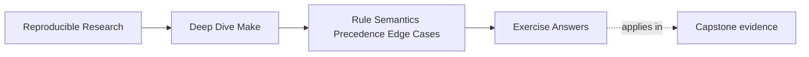

# Exercise Answers


<!-- page-maps:start -->
## Page Maps




<!-- page-maps:end -->

Use these as reasoning models after completing your own evidence packet. Exact output
varies with tool versions and file times; the semantic conclusions should not.

## Exercise 1: Choose the right CLI probe

A useful harness has one parse effect and two recipe classes:

```make
$(info parsed)
PARSE_RESULT := $(shell printf 'parse\n' >> parse-events.log)

.PHONY: inspect child
inspect:
	@printf 'ordinary\n' >> recipe-events.log
	+$(MAKE) --no-print-directory child

child:
	@printf 'recursive\n' >> recipe-events.log
```

The expected boundary matrix is:

| Mode | parse log | ordinary recipe | recursive Make line | Primary meaning |
| --- | --- | --- | --- | --- |
| `-n` | changes | printed, not run | runs under recursive option propagation | preview recipes, not parsing |
| `-q` | changes | not run | recursive line may still be processed as recursive Make | query freshness |
| `-t` | changes | replaced by target touching where applicable | runs under recursive option propagation | mark targets current |

The exact child outcome depends on whether the child goal is already current, so record
its exit status and state instead of claiming every recursive recipe writes. The durable
conclusion is that parse-time functions run before these modes suppress or replace
ordinary recipes, and recursive Make recipe lines receive special treatment.

The repair removes the mutating top-level shell call. If the event log is a required
artifact, give it an explicit file target with declared inputs. The acceptance assertion
is that a before/after inventory around each diagnostic mode contains no unexpected file
change.

## Exercise 2: Prove where a variable value came from

A child probe should expose every channel:

```make
.PHONY: show
show:
	@printf 'level=%s origin=%s flavor=%s raw=%s value=%s env=%s overrides=%s\n' \
	  '$(MAKELEVEL)' '$(origin CFLAGS)' '$(flavor CFLAGS)' \
	  '$(value CFLAGS)' '$(CFLAGS)' "$${CFLAGS-unset}" '$(MAKEOVERRIDES)'
```

The supported strongest-to-weakest order is `override`, command line, ordinary file,
environment, built-in default. `-e` promotes the environment above an ordinary file
assignment, but not above command line or `override`.

| Parent channel | Child origin | Why |
| --- | --- | --- |
| unexported file assignment | `undefined` | Make state is not automatically process state |
| exported file assignment | `environment` | child imports the recipe environment |
| parent command-line assignment | `command line` | recursive Make forwards it through its protocol |
| explicit `$(MAKE) CFLAGS=value` | `command line` | child invocation defines it directly |
| parent `override` only | `undefined` unless exported or forwarded | precedence inside parent is not transmission |

This rejects the claim that "visible in the child" implies export. The origins distinguish
environment import from recursive command-line forwarding.

## Exercise 3: Make generated include publication recoverable

Direct redirection can leave a truncated file that Make will parse on the next invocation.
A recoverable owner writes and validates a process-local candidate:

```make
mk/generated-config.mk: config/mode.txt tools/render-config
	@set -eu; \
	candidate="$@.candidate.$$$$"; \
	trap 'rm -f "$$candidate"' EXIT HUP INT TERM; \
	tools/render-config $< > "$$candidate"; \
	grep -Eq '^MODE := (release|debug)$$' "$$candidate"; \
	if test -r "$@" && cmp -s "$$candidate" "$@"; then \
	  :; \
	else \
	  mv "$$candidate" "$@"; \
	fi
```

On bootstrap, the first parse reports restart `0`; after the rule publishes the include,
the restarted parse reports `1`. A separate settled invocation reports `0`, because
`MAKE_RESTARTS` counts restarts in the current process rather than historical restarts.

The proof must also show that the settled digest and modification time remain unchanged.
Interruption leaves the last valid final file intact and the trap removes the candidate.
`gmake -n` must not create either path.

## Exercise 4: Replace a platform branch with a capability gate

A complete answer separates three variables:

```make
ARCHIVE_MODE ?= auto
VALID_ARCHIVE_MODES := auto enabled disabled
ifneq ($(words $(ARCHIVE_MODE)),1)
$(error ARCHIVE_MODE must be exactly one of: $(VALID_ARCHIVE_MODES))
endif
ifeq ($(filter $(ARCHIVE_MODE),$(VALID_ARCHIVE_MODES)),)
$(error ARCHIVE_MODE must be one of: $(VALID_ARCHIVE_MODES))
endif

ARCHIVE_PROBE ?= tar --help 2>/dev/null | grep -q -- '--sort'
HAVE_SORTED_ARCHIVE := $(if $(shell $(ARCHIVE_PROBE) && printf yes),yes,no)

ifeq ($(ARCHIVE_MODE),enabled)
  ifneq ($(HAVE_SORTED_ARCHIVE),yes)
    $(error deterministic archive ordering was requested but is unavailable)
  endif
  ARCHIVE_ENGINE := sorted
else ifeq ($(ARCHIVE_MODE),disabled)
  ARCHIVE_ENGINE := unsorted
else ifeq ($(HAVE_SORTED_ARCHIVE),yes)
  ARCHIVE_ENGINE := sorted
else
  ARCHIVE_ENGINE := unsorted
endif
```

`ARCHIVE_MODE` is caller policy, `HAVE_SORTED_ARCHIVE` is discovery, and
`ARCHIVE_ENGINE` is the decision. Test `ARCHIVE_PROBE=true` and `false` against all three
valid modes. Test empty, `maybe`, and `auto enabled` as rejected inputs.

If sorted versus unsorted entry order changes artifact bytes, the two paths are not
equivalent. In that contract, `auto` must either select a canonical alternate
implementation or fail; quietly producing host-dependent archives is not a fallback.

## Exercise 5: Repair a multi-output generator honestly

Grouped targets express the real owner:

```make
ifeq ($(filter grouped-target,$(.FEATURES)),)
$(error grouped-target support is required)
endif

api.h api.json &: gen_api.py schema.yml
	python3 gen_api.py
	test -s api.h
	test -s api.json
```

A parallel trace should show one invocation. After settling, `gmake -q api.h api.json`
returns `0`; deleting either member triggers one grouped regeneration.

A stamp can model "the generator completed and both members passed validation," but it
does not automatically repair a missing member while the stamp remains. A valid
compatibility design must make consumers depend on the stamp as the publication event and
define a missing-member rejection or recovery route. Listing missing output targets as
recipe-less dependents of an existing stamp does not recreate them.

## Exercise 6: Compare assignment flavors

One revealing harness is:

```make
BASE = first
RECURSIVE = $(BASE)
SIMPLE := $(BASE)
BASE = second
OPTIONAL ?= fallback
EMPTY :=
EMPTY ?= ignored
LIST := alpha
LIST += beta
SHELL_VALUE != printf observed
```

`RECURSIVE` stores `$(BASE)` and expands to `second`; `SIMPLE` captured `first`.
`EMPTY` remains empty because `?=` tests definedness, not non-emptiness. `+=` preserves the
existing variable's flavor. `!=` invokes the shell while Make parses the assignment, even
under `-n`.

Printing `value` distinguishes stored expression from eventual expansion. The repair for a
mutating or environment-sensitive `!=` is an explicit file target whose output becomes a
declared input; changing `!=` to `:= $(shell ...)` does not move the observation out of
parsing.

## Exercise 7: Prove target-specific scope propagation

With:

```make
debug: MODE := debug
release: MODE := release
debug release: shared
```

`shared` inherits the target-specific value from the top-level target that first causes it
to be built. Requesting `debug release` versus `release debug` can therefore change the
context of a once-built prerequisite.

`private` prevents inheritance:

```make
debug: private MODE := debug
```

It does not create a debug variant of `shared`. If the bytes genuinely depend on mode, the
graph needs distinct identities such as `build/debug/shared` and
`build/release/shared`. Export changes process visibility, and recursive forwarding
changes child-Make precedence; neither repairs one path representing two artifacts.

## Exercise 8: Audit parse effects across include restarts

The inventory should classify:

| Construct | Evaluation boundary | Restart behavior |
| --- | --- | --- |
| top-level `$(shell ...)` inside `:=` | parse | repeats after a makefile remake |
| top-level `$(file ...)` | parse | repeats and mutates in diagnostic modes |
| `!=` assignment | parse | repeats after a makefile remake |
| ordinary recipe command | target update | does not run merely because parsing restarted |
| generated-include recipe | makefile-remake boundary | may cause one restart |

A sound repair removes every mutation from the first three rows. Guarding one with
`MAKE_RESTARTS` still permits mutation during the initial parse and diagnostic modes.
After repair, bootstrap has parse counts `0` then `1`, a settled invocation has only `0`,
and `-n` leaves the filesystem unchanged.

## Exercise 9: Prove rule and prerequisite selection

The prediction and observation table should converge on:

| Model | Requested target | Selected prerequisite | Published content |
| --- | --- | --- | --- |
| generated rule first | `build/a.choice` | `generated/a.src` | `selected=generated` |
| root rule first | `build/a.choice` | `root/a.src` | `selected=root` |
| namespaced targets | two explicit paths | one prerequisite per namespace | both selections |

The two ambiguous Makefiles differ only in which of these candidate rules appears first:

```make
build/%.choice: generated/%.src
	printf 'selected=%s\n' "$$(cat $<)" > $@

build/%.choice: root/%.src
	printf 'selected=%s\n' "$$(cat $<)" > $@
```

Reversing the rules reverses the content of `build/a.choice`. The trace should be used to
show both the selected recipe location and the prerequisite bound to `$<`. The output then
shows the semantic consequence of that selection.

The control separates the namespaces:

```make
build/generated/%.choice: generated/%.src
	printf 'selected=%s\n' "$$(cat $<)" > $@

build/root/%.choice: root/%.src
	printf 'selected=%s\n' "$$(cat $<)" > $@
```

The resulting paths are:

```text
build/generated/a.choice
build/root/a.choice
```

They can coexist because each path has one reviewable source domain. An explicit rule
would be better if only one exceptional target existed; a static pattern rule would be
appropriate for a known finite target set.

The review rule should express the contract rather than outlawing syntax:

> Reject overlapping patterns when a change in Makefile text order can change the meaning
> of one target path; keep patterns when the target namespace makes source ownership
> unambiguous.

Weak answer pattern:

- "The first rule wins, so put the preferred rule first"

That preserves hidden policy. It does not make a future edit safe or make target ownership
visible.

The secondary-expansion half should show:

```make
.SECONDEXPANSION:
report_INPUTS := data.csv render.py
report: $$($$@_INPUTS)
```

Without escaping, `$@` is empty during initial expansion and `gmake -np report` shows the
computed inputs are absent. With escaping, target context exists during secondary
expansion and the database shows both prerequisites. Rule selection decides which recipe
owns a target; secondary expansion decides target-context prerequisite text. They are
different graph-construction boundaries.

## Exercise 10: Diagnose a compound semantic incident

A strong report uses one evidence route per boundary:

| Defect | Falsifiable evidence | Repair |
| --- | --- | --- |
| parse mutation | before/after inventory around `-n` | move effect to explicit target |
| provenance disagreement | parent/child origin and forwarding state | choose export or command-line contract |
| target-context expansion loss | bounded database entry | escape for secondary expansion or write explicit edge |
| duplicate output ownership | parallel trace and invocation log | grouped publication owner |

Reject the decoy with evidence—for example, prove that shell choice does not explain a
prerequisite missing from Make's database. Then rerun the original probes, not only the
happy build. Completion requires: no dry-run mutation, one grouped generator invocation,
the intended child origin, restored prerequisite edges, and query status `0` after a
settled build.

## Review standard

A complete model answer says when an observation occurred, what single controlled change
distinguished the cause, which competing explanation was rejected, and how the same proof
changed after repair. Feature names and successful commands without that reasoning are
not enough.
