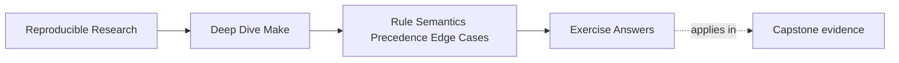

# Exercise Answers


<!-- page-maps:start -->
## Page Maps




<!-- page-maps:end -->

Use this after you have written your own answers. The point is comparison, not copying.

## How to use the answer page well

Do not read a model answer first and then retrofit your investigation to match it.

A better rhythm is:

1. finish the exercise with your own stage map, probes, and notes
2. write one plain-language explanation of the semantic rule involved
3. compare that explanation with the model answer
4. revise where the model answer exposes missing stage boundaries, weak evidence, or a
   noisier repair than necessary

Strong answers in Module 04 do not merely name a feature. They usually do four things:

- they identify the semantic rule in play
- they choose the least disruptive evidence first
- they explain the repair as a clearer truth contract
- they verify convergence after the repair

The strongest self-study packets also leave behind six concrete artifacts:

- one stage map
- one variable-origin probe
- one convergent include generator
- one honest multi-output repair
- one precedence matrix
- one bounded compound incident report

If your answers rely only on "Make can be tricky," the reasoning is still too weak.

## Exercise 1: Choose the right CLI probe

The strongest answer starts with `make --trace app` because the immediate question is
"why did this run?" `--trace` is the cleanest first route to the causal edge or rule
location.

A strong second command is `make -p` or `make -q app`, depending on what you are trying
to settle next:

- `-p`:
  - use it when the dispute is about the evaluated rule or variable world
- `-q`:
  - use it when the dispute is whether the requested graph has actually converged

The important explanation is:

> `clean`, `-B`, and `-j1` all change conditions more aggressively, so they are weaker as
> first evidence when the goal is diagnosis rather than forced progress.

Weak answer pattern:

- "Run `clean` first so everything is fresh"

That may help later, but it destroys the evidence you were trying to inspect.

## Exercise 2: Prove where a variable value came from

A good answer introduces a small probe such as:

```make
.PHONY: show-cflags

show-cflags:
	@printf 'origin=%s flavor=%s raw=%s expanded=%s\n' \
	  '$(origin CFLAGS)' '$(flavor CFLAGS)' '$(value CFLAGS)' '$(CFLAGS)'
```

That answer is strong because it separates:

- origin:
  - who won
- flavor:
  - how the value is stored
- raw text:
  - what expression was assigned
- expanded text:
  - what recipes actually see

A strong repair usually simplifies one of two things:

- precedence:
  - reduce accidental environment wins such as routine `-e`
- expansion timing:
  - use `:=` when delayed expansion is not part of the contract

The key explanatory sentence is:

> Until origin, flavor, raw text, and expanded text are separated, two different problems
> can look like the same strange flag value.

## Exercise 3: Repair a generated-include loop

The essential explanation is:

> Make includes the generated file during evaluation. If the rule rewrites that file on
> every run, Make keeps seeing a changed build definition and never settles on a stable
> evaluated state.

A strong repair writes deterministic content from a real input and publishes atomically.

Example:

```make
mk/generated-config.mk: config/mode.env
	@printf 'MODE := %s\n' "$$(cat $<)" > $@.tmp
	@mv $@.tmp $@
```

The strongest answers also say what proves convergence:

> Repeated invocations stop changing the include content and `MAKE_RESTARTS` no longer
> grows after the stable update.

Weak answer pattern:

- "Regenerate the include less often"

That does not address why the build definition itself never settles.

## Exercise 4: Replace a platform branch with a capability gate

A strong answer says the build should branch on the feature it needs, not on an operating
system label that only loosely predicts that feature.

For example:

```make
HAVE_GNU_TAR := $(if $(shell tar --version 2>/dev/null | grep -q 'GNU tar' && printf yes),yes,)

ifeq ($(HAVE_GNU_TAR),yes)
  ARCHIVE := tar
else
  $(error need GNU tar-compatible archive behavior)
endif
```

The exact capability can vary. The important architectural move is:

- compute the capability once
- give it a stable name
- make later branches depend on that name

The key explanatory sentence is:

> The platform guess assumed the operating-system label was the real requirement, when
> the real requirement was a specific tool behavior.

## Exercise 5: Repair a multi-output generator honestly

The two valid repairs are:

### Grouped targets

```make
api.h api.json &: gen_api.py schema.yml
	python3 gen_api.py
```

Choose this when the supported Make version includes grouped-target semantics. It is the
closest match to the real event: one generator invocation publishes multiple outputs.

### Stamp-governed generation

```make
API_STAMP := build/api.stamp

$(API_STAMP): gen_api.py schema.yml | build/
	python3 gen_api.py
	touch $@

api.h api.json: $(API_STAMP)
```

Choose this when you need a broader compatibility story or when the team finds the stamp
clearer to audit.

The real publication event both repairs are modeling is:

> one generator run publishes a coordinated set of artifacts, not two independent output
> stories.

## Exercise 6: Compare assignment flavors

One revealing example is:

```make
BASE = first
RECURSIVE = $(BASE)
SIMPLE := $(BASE)
BASE = second
OPTIONAL ?= fallback
LIST := alpha
LIST += beta
```

The key observations are:

- `RECURSIVE`:
  - recursively expanded and yields `second`
- `SIMPLE`:
  - expanded at assignment time and yields `first`
- `OPTIONAL`:
  - assigned only when it was not defined earlier
- `LIST += beta`:
  - appends according to the variable’s existing flavor
- `$(value RECURSIVE)`:
  - shows the stored text `$(BASE)` rather than expanding it

The important explanation is:

> Raw text and expanded text are both worth printing because they answer different
> debugging questions: what was stored, and what the build eventually used.

Recursive expansion is useful when a value intentionally depends on later configuration.
It is risky for graph-shaping discovery because delayed meaning can make timing harder to
reason about.

## Exercise 7: Build a precedence matrix

Expected results for a Makefile containing only `MODE ?= release`:

| Invocation | Value | Typical origin |
| --- | --- | --- |
| `make show` | `release` | `file` |
| `MODE=debug make show` | `debug` | `environment` |
| `make MODE=debug show` | `debug` | `command line` |
| `MODE=debug make -e show` | `debug` | `environment override` |
| Makefile uses `override MODE := hardened` | `hardened` | `override` |

A clear project contract is:

- provide a documented default
- allow intentional command-line overrides
- avoid routine `-e` in CI or daily use

The key explanatory sentence is:

> "Works on my shell" is weak evidence because shell-exported variables create a hidden
> configuration channel unless the precedence contract is explicit.

## Exercise 8: Observe a generated include restart

A stable shape is:

```make
-include build/config.mk

build/config.mk: config.txt | build/
	@value=$$(cat $<); \
	printf 'MODE := %s\n' "$$value" > $@.new; \
	if ! cmp -s $@.new $@; then mv $@.new $@; else rm -f $@.new; fi

build/:
	mkdir -p $@

.PHONY: show
show:
	@printf 'MODE=%s restarts=%s\n' "$(MODE)" "$(MAKE_RESTARTS)"
```

Make may restart after first creating or semantically changing the include. Once the file
content stabilizes, repeated invocations converge. Adding the current time guarantees
different content and creates needless remake/restart behavior.

The important explanation is:

> Content-stable publication preserves semantic convergence; timestamp-only rewriting does
> not, because the evaluated build definition keeps changing.

## Exercise 9: Remove pattern-rule ambiguity

The prediction and observation table should converge on:

| Model | Requested target | Selected prerequisite | Published content |
| --- | --- | --- | --- |
| generated rule first | `build/a.choice` | `generated/a.src` | `selected=generated` |
| root rule first | `build/a.choice` | `root/a.src` | `selected=root` |
| namespaced targets | two explicit paths | one prerequisite per namespace | both selections |

The two ambiguous Makefiles differ only in which of these candidate rules appears first:

```make
build/%.choice: generated/%.src
	printf 'selected=%s\n' "$$(cat $<)" > $@

build/%.choice: root/%.src
	printf 'selected=%s\n' "$$(cat $<)" > $@
```

Reversing the rules reverses the content of `build/a.choice`. The trace should be used to
show both the selected recipe location and the prerequisite bound to `$<`. The output then
shows the semantic consequence of that selection.

The control separates the namespaces:

```make
build/generated/%.choice: generated/%.src
	printf 'selected=%s\n' "$$(cat $<)" > $@

build/root/%.choice: root/%.src
	printf 'selected=%s\n' "$$(cat $<)" > $@
```

The resulting paths are:

```text
build/generated/a.choice
build/root/a.choice
```

They can coexist because each path has one reviewable source domain. An explicit rule
would be better if only one exceptional target existed; a static pattern rule would be
appropriate for a known finite target set.

The review rule should express the contract rather than outlawing syntax:

> Reject overlapping patterns when a change in Makefile text order can change the meaning
> of one target path; keep patterns when the target namespace makes source ownership
> unambiguous.

Weak answer pattern:

- "The first rule wins, so put the preferred rule first"

That preserves hidden policy. It does not make a future edit safe or make target ownership
visible.

## Exercise 10: Diagnose a compound semantic incident

A strong report uses one evidence route per symptom:

| Symptom | Evidence | Typical repair |
| --- | --- | --- |
| wrong variable value | `origin`, `flavor`, `value`, expanded value | simplify precedence or expansion |
| unstable generated include | `--trace`, `MAKE_RESTARTS`, content diff | deterministic, atomic, change-only publication |
| unexpected rule selection | `make -d` or bounded `make -p` inspection | remove ambiguity or add explicit ownership |

The final convergence query matters because three locally plausible repairs can still
interact. The build is not repaired until the requested graph reaches a stable state.

The missing but important sentence is:

> Naming the semantic stage first reduced the debugging scope by turning one big "Make
> problem" into three smaller, testable questions.

## What mastery-level answers sound like

A mastery-level answer set in this module does three things well:

- it names semantic rules precisely instead of saying "Make is weird"
- it picks evidence before it picks a repair
- it explains the repair as a better truth contract, not just a different syntax choice

If your answers do those three things consistently, you are learning Module 04 in the
right direction.
