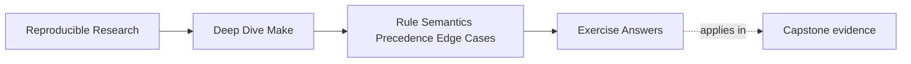

# Exercise Answers


<!-- page-maps:start -->
## Page Maps




<!-- page-maps:end -->

Use this after you have written your own answers. The point is comparison, not copying.

Strong answers in Module 04 do not merely name a feature. They explain:

- what semantic rule is in play
- what evidence would expose it
- why the repair is more honest than the broken version

## Exercise 1: Choose the right CLI probe

The strongest answer starts with `make --trace app` because the immediate question is "why
did this run?" `--trace` is the cleanest first route to the causal edge or rule location.

A strong second command is `make -p` or `make -q app`, depending on what you are
trying to settle next:

- `-p` if the dispute is about the evaluated rule or variable world
- `-q` if the dispute is whether the build has actually converged

The important reasoning is that `clean`, `-B`, and `-j1` all change conditions more
aggressively. They may still be useful later, but they are weaker as first evidence.

## Exercise 2: Prove where a variable value came from

A good answer introduces a small probe such as:

```make
.PHONY: show-cflags

show-cflags:
	@printf 'origin=%s flavor=%s raw=%s expanded=%s\n' \
	  '$(origin CFLAGS)' '$(flavor CFLAGS)' '$(value CFLAGS)' '$(CFLAGS)'
```

That answer is strong because it separates:

- origin: who won
- flavor: how the value is stored
- raw text: what expression was assigned
- expanded text: what the recipe eventually sees

A good repair usually simplifies one of two things:

- precedence, by removing accidental environment wins such as `-e`
- expansion timing, by replacing recursive assignment with `:=` when laziness is not needed

## Exercise 3: Repair a generated-include loop

The essential explanation is:

> Make includes the generated file as part of evaluation. If the rule rewrites that file
> on every run, Make keeps seeing a changed build definition and never settles on a stable
> evaluated state.

A strong repair writes deterministic content from a real input and publishes atomically.

Example:

```make
mk/generated-config.mk: config/mode.env
	@printf 'MODE := %s\n' "$$(cat $<)" > $@.tmp
	@mv $@.tmp $@
```

Atomic publication matters because included files participate in evaluation. A partially
written file is not just a broken artifact. It is a broken build definition.

## Exercise 4: Replace a platform branch with a capability gate

A strong answer says the build should branch on the feature it needs, not on an operating
system label that only loosely predicts that feature.

For example:

```make
HAVE_GNU_TAR := $(if $(shell tar --version 2>/dev/null | grep -q 'GNU tar' && printf yes),yes,)

ifeq ($(HAVE_GNU_TAR),yes)
  ARCHIVE := tar
else
$(error need GNU tar-compatible archive behavior)
endif
```

The exact capability can vary. The important move is architectural:

- compute the capability once
- give it a stable name
- make later branches depend on that name

That is easier to audit because the reason for the branch is explicit and inspectable.

## Exercise 5: Repair a multi-output generator honestly

The two valid repairs are:

### Grouped targets

```make
api.h api.json &: gen_api.py schema.yml
	python3 gen_api.py
```

Choose this when the supported Make version includes grouped-target semantics. It is the
closest match to the real event: one generator invocation publishes multiple outputs.

### Stamp-governed generation

```make
API_STAMP := build/api.stamp

$(API_STAMP): gen_api.py schema.yml | build/
	python3 gen_api.py
	touch $@

api.h api.json: $(API_STAMP)
```

Choose this when you need a fallback that is easier to support across broader Make
versions or when the stamp makes the publication event clearer to the team.

The tradeoff is simple:

- grouped targets are semantically cleaner when available
- stamps are a durable fallback when grouped targets are not part of the contract

## Exercise 6: Compare assignment flavors

One revealing example is:

```make
BASE = first
RECURSIVE = $(BASE)
SIMPLE := $(BASE)
BASE = second
OPTIONAL ?= fallback
LIST := alpha
LIST += beta
```

The key observations are:

- `RECURSIVE` is recursively expanded and yields `second`.
- `SIMPLE` was expanded at assignment time and yields `first`.
- `OPTIONAL` is assigned only when it was not defined earlier.
- `LIST += beta` appends according to the variable’s existing flavor.
- `$(value RECURSIVE)` shows the stored text `$(BASE)` rather than expanding it.

Recursive expansion is useful when a value intentionally depends on later configuration.
It is risky for graph-shaping discovery because repeated or delayed expansion can make
timing harder to reason about.

## Exercise 7: Build a precedence matrix

Expected results for a Makefile containing only `MODE ?= release`:

| Invocation | Value | Typical origin |
| --- | --- | --- |
| `make show` | `release` | `file` |
| `MODE=debug make show` | `debug` | `environment` |
| `make MODE=debug show` | `debug` | `command line` |
| `MODE=debug make -e show` | `debug` | `environment override` |
| Makefile uses `override MODE := hardened` | `hardened` | `override` |

A clear project contract is: provide a documented default, allow intentional command-line
overrides, and do not use `-e` in routine CI. Environment precedence is too broad because
every exported name becomes a possible configuration channel.

## Exercise 8: Observe a generated include restart

A stable shape is:

```make
-include build/config.mk

build/config.mk: config.txt | build/
	@value=$$(cat $<); \
	printf 'MODE := %s\n' "$$value" > $@.new; \
	if ! cmp -s $@.new $@; then mv $@.new $@; else rm -f $@.new; fi

build/:
	mkdir -p $@

.PHONY: show
show:
	@printf 'MODE=%s restarts=%s\n' "$(MODE)" "$(MAKE_RESTARTS)"
```

Make may restart after first creating or semantically changing the include. Once the file
content stabilizes, repeated invocations converge. Adding the current time guarantees
different content and creates needless remake/restart behavior.

## Exercise 9: Remove pattern-rule ambiguity

The exact selected rule depends on the stems, prerequisites, and implicit-rule search.
That is why the answer must include evidence rather than a guess. A repair can separate
the namespaces:

```make
build/generated/%.o: generated/%.c
	$(CC) -c $< -o $@

build/source/%.o: src/%.c
	$(CC) -c $< -o $@
```

The output path now communicates which source domain owns the rule. An explicit rule is
even better when only one exceptional file exists.

## Exercise 10: Diagnose a compound semantic incident

A strong report uses one evidence route per claim:

| Symptom | Evidence | Typical repair |
| --- | --- | --- |
| wrong variable value | `origin`, `flavor`, `value`, expanded value | simplify precedence or expansion |
| unstable generated include | `--trace`, `MAKE_RESTARTS`, content diff | deterministic, atomic, change-only publication |
| unexpected rule selection | `make -d` or bounded `make -p` inspection | remove ambiguity or add explicit ownership |

The final convergence query matters because three locally plausible repairs can still
interact. The build is not repaired until the requested graph reaches a stable state.

## What mastery-level answers sound like

A mastery-level answer set in this module does three things well:

- it names semantic rules precisely instead of speaking in vague "Make is weird" language
- it picks evidence before it picks a repair
- it explains the repair as a better truth contract, not just a different syntax choice

That is the standard this module is trying to build.
