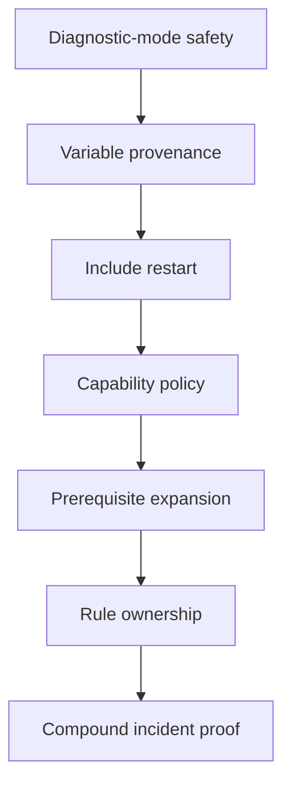

# Exercises

Treat these exercises as one investigation that grows from observation to repair. Work in
an isolated `semantic-evidence-lab/` tree so deliberate failures cannot alter another
build:

```text
semantic-evidence-lab/
├── Makefile
├── child/
├── config/
├── generated/
├── mk/
├── scripts/
└── evidence/
```

For every exercise, preserve a four-column record:

| Claim | Controlled change | Observation | Conclusion |
| --- | --- | --- | --- |

A command transcript is not yet evidence. State what changed between runs and why the
result supports one semantic explanation.


The progression is cumulative:



Do not begin with `clean`, `-B`, `-j1`, or `.NOTPARALLEL`. Those actions erase or suppress
evidence before you know which boundary failed.

## Exercise 1: Choose the right CLI probe

Build a Makefile with:

- a top-level `$(info ...)`
- a top-level `$(shell ...)` that appends to `parse-events.log`
- an ordinary recipe that appends to `recipe-events.log`
- a recursive `$(MAKE)` recipe line that invokes a child target

Run the same goal with `-n`, `-q`, and `-t`. Record which parse effects occur and whether
the recursive recipe line executes despite the diagnostic option.

What to hand in:

- the Makefile and a before/after file inventory for each mode
- exit status and focused output for all three commands
- an explanation of parse-time effects versus recipe suppression
- a repair that makes every diagnostic invocation non-mutating
- a warning explaining the special recursive-Make exception

## Exercise 2: Prove where a variable value came from

You inherit a Makefile where `MODE`, `CFLAGS`, and `LDFLAGS` can all be influenced by the
environment, the command line, and the file itself. A teammate says:

> "CI is using different optimization flags, but the Makefile looks the same."

Create parent and child Makefiles. Exercise these parent definitions:

- ordinary file assignment
- exported file assignment
- parent command-line assignment
- explicit `$(MAKE) CFLAGS=...` child assignment
- `override` directive

The child must print `origin`, `flavor`, raw text, expanded value, environment value,
`MAKELEVEL`, and `MAKEOVERRIDES`.

What to hand in:

- a prediction and observation matrix
- the strongest-to-weakest precedence order supported by your results
- proof that export and recursive command-line forwarding produce different child origins
- one recommended configuration contract and one rejected channel

## Exercise 3: Make generated include publication recoverable

Generate `mk/generated-config.mk` from `config/mode.txt`. Print `MAKE_RESTARTS` and
`MAKEFILE_LIST` during parsing. Begin with direct publication to the final path, then
interrupt the generator after it writes incomplete Make syntax. Repair it with a
process-local candidate, cleanup trap, validation, compare-before-replace, and rename.

What to hand in:

- bootstrap evidence showing restart `0` followed by restart `1`
- the failure residue from direct publication
- the repaired rule and recovery result
- a settled run showing restart `0` with unchanged digest and modification time
- a dry-run proof that parsing performs no mutation

## Exercise 4: Replace a platform branch with a capability gate

You find this in a repository:

```make
ifeq ($(shell uname),Darwin)
  ARCHIVE := gtar
else
  ARCHIVE := tar
endif
```

Replace it with discovery, caller policy, and implementation variables. The caller policy
must accept exactly `auto`, `enabled`, or `disabled`. Add a bounded probe seam so all
capability outcomes can be tested without installing or removing software.

What to hand in:

- the named behavioral requirement
- strict rejection of empty, multiword, and unknown policy values
- the six valid policy/capability cases and at least two invalid cases
- proof that `enabled` plus unavailable fails before recipes
- either output-equivalence evidence for `auto` or a reason `auto` must reject fallback

## Exercise 5: Repair a multi-output generator honestly

One generator produces both `api.h` and `api.json`, but a naive independent-target rule
can invoke it twice under `-j`. First repair it with grouped targets. Then design a
stamp-governed compatibility shape and identify what happens if one output is deleted
while the stamp remains.

What to hand in:

- grouped-target capability evidence from `.FEATURES`
- parallel traces and invocation counts before and after repair
- validation that both outputs exist before successful publication
- the stamp design's missing-member failure and an explicit recovery policy
- a decision stating which Make version contract you would support

## Exercise 6: Compare assignment flavors

Create variables with `=`, `:=`, `?=`, `+=`, and `!=`. Change a referenced variable
between assignments and print:

```make
$(origin NAME)
$(flavor NAME)
$(value NAME)
$(NAME)
```

Predict every line before running Make.

What to hand in:

- the Makefile and prediction
- the observed output
- the time at which each right side is observed
- proof that empty-but-defined prevents `?=` from assigning
- proof that `!=` invokes a shell during parsing, including under `-n`
- a rewrite that confines parse observations to declared, read-only inputs

## Exercise 7: Prove target-specific scope propagation

Extend Exercise 2 with target-specific and `private` values. Make two top-level targets
share one prerequisite while supplying different target-specific `MODE` values. Request
both goals in both orders, then add `private`.

What to hand in:

- the shared prerequisite's observed value for both goal orders
- an explanation of why a once-built shared artifact cannot depend safely on that context
- the observed effect of `private`
- an output-path design that represents both variants honestly
- a comparison with export and recursive forwarding

## Exercise 8: Audit parse effects across include restarts

Audit every top-level `$(shell ...)`, `$(file ...)`, `!=`, and included fragment in your
lab. Construct an event ledger for an initial parse, one include restart, a settled run,
and `-n`. Move all mutations into explicit targets.

What to hand in:

- the audit inventory with evaluation times
- expected and actual event counts across all four cases
- one removed parse mutation and its replacement target
- proof that the generated include remains convergent
- an explanation of why guarding a mutation with `MAKE_RESTARTS` is insufficient

## Exercise 9: Prove rule and prerequisite selection

Run the capstone `semantic-fault-audit` and isolate the pattern-selection rows:

```sh
gmake -C programs/reproducible-research/deep-dive-make/capstone \
  semantic-fault-audit
```

The first two models contain the same sources, the same requested target, and the same two
pattern-rule candidates. Only rule order changes. Before reading the report, predict
which source will produce `build/a.choice` in each model.

Read the traces to identify the selected recipe and `$<`. Then add an isolated
`.SECONDEXPANSION` harness that computes prerequisite lists from `$@`, first without
escaping and then with escaping.

What to hand in:

- a prediction table for all three models
- the actual target content and selected prerequisite from each trace
- a one-line diff summary of the two ambiguous Makefiles
- the two target paths published by the namespaced control
- a review rule that rejects hidden text-order policy without banning useful pattern rules
- database evidence showing the missing and restored computed prerequisites
- a boundary table for initial expansion, secondary expansion, rule selection, and recipe
  expansion

## Exercise 10: Diagnose a compound semantic incident

Combine at least four defects from the earlier exercises in one build. Include one
parse-time effect, one provenance disagreement, one target-context expansion error, and
one output-ownership error. Add a decoy symptom that is nearby but not causal.

What to hand in:

- a time-ordered event ledger
- one falsifiable claim and controlled probe per defect
- the rejected decoy explanation and evidence against it
- one reviewable repair per semantic boundary
- dry-run immutability, parallel ownership, child-provenance, and settled-query results
- a final incident explanation that distinguishes expected restart behavior from defects

## Before you read the answers

Do not open `exercise-answers.md` until your evidence packet contains failed assertions as
well as successful commands. A capability gate without an unavailable-capability failure,
or a generator repair without a parallel stress run, is incomplete.

## Mastery standard for this exercise set

Across all ten answers, you should be able to locate an observation on the evaluation
timeline, state the controlling semantic rule, reject one plausible alternative, and
demonstrate the repaired behavior twice: once at the failure boundary and once in a settled
run.
