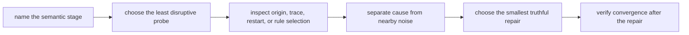

# Exercises

Use these after reading the five core lessons and the worked example. The goal is not to
show off syntax. The goal is to make rule semantics, variable precedence, and edge-case
debugging calm and inspectable.

## How to work through this set

Treat the ten exercises as one full lab day on semantic incident handling.

Before each answer:

1. name the semantic stage where you think the problem lives
2. choose the first command that would expose that stage cleanly
3. state what repair would become plausible if that evidence comes back the way you expect

If you skip stage naming, every confusing behavior starts to feel like "Make is weird."
This module is here to replace that feeling with sharper boundaries.

Do the exercises in order. The day is one progression:

- Exercises 1-3 teach you to inspect probes, variable origin, and generated includes
- Exercises 4-6 teach you to reason about capability gates, multi-output generation, and
  assignment flavor
- Exercises 7-9 teach you to model precedence, restarts, and rule selection precisely
- Exercise 10 turns all of that into one bounded compound investigation

Keep one semantics packet as you go. By the end of the day it should contain:

- one semantic-stage map for a real incident
- one variable-origin probe and recommended precedence contract
- one stable include generator and one intentionally unstable one
- one honest multi-output repair
- one precedence matrix
- one compound incident report that stays bounded and reproducible

If those six artifacts are missing, you are probably learning commands in isolation
instead of learning how the semantics connect.

## Recommended working layout

If you want one lab tree that can support the whole day, use something like:

```text
module04-lab/
├── Makefile
├── mk/
├── config/
├── generated/
├── src/
├── notes/
└── artifacts/
```

Keep two working tables.

First, a stage map:

| Symptom | Semantic stage | First probe | What that probe should reveal |
| --- | --- | --- | --- |

Second, a variable report:

| Variable | Origin | Flavor | Raw value | Expanded value | Why it matters |
| --- | --- | --- | --- | --- | --- |

Those tables matter because Module 04 is where learners often drown in details they have
not sorted by stage.



Use that route on purpose. It keeps the day bounded and stops you from using `clean`,
`-B`, or `.NOTPARALLEL` as first reactions.

## Exercise 1: Choose the right CLI probe

Suppose you say:

> "`app` rebuilt, and I do not know whether the reason was a stale input, a phony target,
> or a generated include."

Explain which Make command you would run first, which one you would run second, and what
you expect each to tell you.

What to hand in:

- the first command
- the second command
- one sentence explaining why those two commands come before `clean`, `-B`, or `-j1`
- one sentence naming the semantic stage each command is inspecting

Study note:
This is a probe-selection exercise, not a command memorization exercise. The main lesson
is to choose the least disruptive evidence first.

## Exercise 2: Prove where a variable value came from

You inherit a Makefile where `MODE`, `CFLAGS`, and `LDFLAGS` can all be influenced by the
environment, the command line, and the file itself. A teammate says:

> "CI is using different optimization flags, but the Makefile looks the same."

Describe how you would prove the winning origin and flavor of `CFLAGS`, and explain one
repair that would make the variable behavior easier to reason about.

What to hand in:

- the introspection lines or target you would add
- the exact facts you want to capture about `CFLAGS`
- one repair using clearer precedence or expansion rules
- one sentence explaining when you would document command-line override as part of the
  project contract

Study note:
Do not stop at the expanded value. Module 04 wants you to separate origin, flavor, raw
text, and expanded text deliberately.

## Exercise 3: Repair a generated-include loop

A build generates `mk/generated-config.mk`, includes it, and rewrites it on every run
with a fresh timestamp. You report that the build never seems to settle.

Explain why that happens and redesign the rule so the included file converges.

What to hand in:

- a plain-language explanation of the restart problem
- the repaired rule shape
- one sentence explaining why atomic publication matters here
- one sentence explaining what observation would prove the include now converges

Study note:
Generated includes are not just artifacts. They are part of the evaluated build
definition, so instability here has wider consequences than an ordinary stale file.

## Exercise 4: Replace a platform branch with a capability gate

You find this in a repository:

```make
ifeq ($(shell uname),Darwin)
  ARCHIVE := gtar
else
  ARCHIVE := tar
endif
```

Rewrite the idea as a capability gate instead of a platform guess. You do not need to use
this exact tool example if another capability makes the lesson clearer.

What to hand in:

- the named capability you would compute
- the single place you would compute it
- one sentence explaining why the new branch is easier to audit
- one sentence explaining what bad assumption the platform guess made

Study note:
This exercise is about naming the actual requirement. Platform labels are only proxies,
and often weak ones.

## Exercise 5: Repair a multi-output generator honestly

One generator produces both `api.h` and `api.json`, but the Makefile currently uses a
naive multi-target rule and occasionally runs the generator twice under `-j`.

Describe two valid repairs and explain when you would choose each one.

What to hand in:

- a grouped-target repair
- a stamp-based repair
- one sentence on the capability or portability tradeoff between them
- one sentence naming the real publication event both repairs are trying to model

Study note:
The right repair starts by stating the truth: one generator invocation publishes multiple
artifacts.

## Midday self-check

Before you move into assignment flavor, precedence, and restart behavior, make sure your
packet can already answer these questions cleanly:

- which semantic stage you would inspect first for a surprising rebuild
- which facts about a variable must be separated before you can explain its behavior
- which observation would prove a generated include has converged
- which capability your build actually needs instead of which platform name you hope
  implies it

If you cannot answer those four questions in plain language, return to Exercises 1-5 and
make the packet more explicit before continuing.

## Exercise 6: Compare assignment flavors

Create variables with `=`, `:=`, `?=`, and `+=`. Change a referenced variable between
assignments and print:

```make
$(origin NAME)
$(flavor NAME)
$(value NAME)
$(NAME)
```

Predict every line before running Make.

What to hand in:

- the Makefile and prediction
- the observed output
- one practical use and one risk for recursive expansion
- one sentence explaining why raw text and expanded text are both worth printing

Study note:
This is where many learners stop treating variable flavor as trivia and start treating it
as part of semantic debugging.

## Exercise 7: Build a precedence matrix

Define `MODE ?= release` and print its origin. Invoke the target with:

1. no override
2. `MODE=debug make show`
3. `make MODE=debug show`
4. `MODE=debug make -e show`
5. `override MODE := hardened` in the Makefile

What to hand in:

- a table of value and origin for every invocation
- a recommended project contract for configuring `MODE`
- one reason to avoid routine use of `-e`
- one sentence explaining why "works on my shell" is weak evidence in a precedence dispute

Study note:
This exercise matters because ambiguous configuration channels create hidden inputs at the
semantic layer, even when the file graph looks fine.

## Exercise 8: Observe a generated include restart

Generate `build/config.mk` from `config.txt`, include it, and print `$(MAKE_RESTARTS)`.
Publish the include only when its content changes.

Then deliberately add a timestamp so it changes every run and observe the behavior.

What to hand in:

- the stable and unstable generator rules
- restart counts or trace evidence
- the repair that restores convergence
- one sentence explaining why content-stable publication is different from timestamp-only
  rewriting

Study note:
Module 04 wants you to see restart behavior as a consequence of semantics, not as random
Make mood swings.

## Exercise 9: Remove pattern-rule ambiguity

Run the capstone `semantic-fault-audit` and isolate the three pattern-selection rows:

```sh
gmake -C programs/reproducible-research/deep-dive-make/capstone \
  semantic-fault-audit
```

The first two models contain the same sources, the same requested target, and the same two
pattern-rule candidates. Only rule order changes. Before reading the report, predict
which source will produce `build/a.choice` in each model.

Read the traces to identify the selected recipe and `$<`. Then inspect the namespaced
control and explain why both source families can publish without competing for one target
meaning.

What to hand in:

- a prediction table for all three models
- the actual target content and selected prerequisite from each trace
- a one-line diff summary of the two ambiguous Makefiles
- the two target paths published by the namespaced control
- a review rule that rejects hidden text-order policy without banning useful pattern rules

Study note:
Both ambiguous models succeed. Exit status cannot detect that text order changed target
meaning. Your evidence must connect a candidate rule, its prerequisite, and the bytes it
published.

## Exercise 10: Diagnose a compound semantic incident

Construct or select a build with at least three symptoms:

- a surprising variable value
- a generated include that changes the graph
- a rule selected differently than expected

Investigate without beginning with `clean`, `-B`, or `.NOTPARALLEL`.

What to hand in:

- a short symptom list
- the evidence command chosen for each symptom
- the semantic cause and repair for each
- a final `make -q` or equivalent convergence result
- one sentence explaining how naming stages reduced the debugging scope

Study note:
This is the exercise where the whole module should start feeling calmer. You are not
solving "Make weirdness." You are solving three smaller stage-specific problems.

## Before you read the answers

Do not open `exercise-answers.md` until you can already point to:

- one variable whose origin you proved
- one restart behavior you can explain
- one ambiguous rule you made predictable
- one incident where naming the semantic stage reduced the debugging scope
- one repair you chose only after evidence ruled out easier guesses

If you do not yet have those five things, the answer page will feel sharper than it can
teach.

## Mastery standard for this exercise set

Across all ten answers, the module wants the same habit:

- you name the semantic rule involved
- you choose evidence before you choose a repair
- you explain the repair in terms of truth, convergence, precedence, or ownership

If an answer says only "Make is tricky," keep going.
