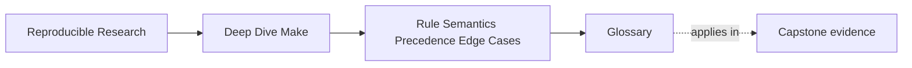
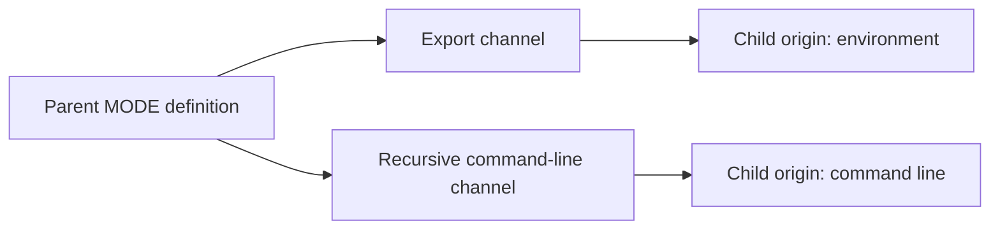

# Glossary


<!-- page-maps:start -->
## Page Maps




<!-- page-maps:end -->

Use this glossary when two explanations sound similar but imply different evidence. Terms
are grouped by the boundary where they matter.

## Evaluation timeline

```mermaid
flowchart LR
  startup["Invocation and environment"]
  parse["Parse makefiles"]
  remake["Remake stale makefiles"]
  restart["Restart parsing"]
  graph["Select rules and expand prerequisites"]
  recipe["Expand recipe"]
  shell["Run shell or child Make"]

  startup --> parse --> remake
  remake -->|makefile changed| restart --> parse
  remake -->|settled| graph --> recipe --> shell
```

| Term | Meaning | Useful evidence |
| --- | --- | --- |
| parse time | When Make reads definitions, expands immediate constructs, and evaluates conditionals. | `$(info ...)`, controlled `-n` state comparison |
| makefile-remake boundary | The point after parsing where Make checks makefiles as targets. | `--trace`, makefile rule prerequisites |
| restart | A fresh read from the top after one or more makefiles were remade. | `MAKE_RESTARTS` |
| secondary expansion | A second expansion of escaped prerequisite text in automatic-variable context after `.SECONDEXPANSION`. | bounded `gmake -np` target entry |
| rule selection | Make's choice among explicit, static pattern, and implicit candidates. | `--trace`, `--debug=implicit` |
| recipe expansion | Make's substitution of variables and automatic variables before handing commands to a shell. | recipe echo or focused trace |
| recipe execution | The shell or direct process work that updates a target. | process log, exit status, output state |
| recursive Make boundary | A recipe invocation of `$(MAKE)` that creates a child Make process. | `MAKELEVEL`, child origin, `MAKEFLAGS` |

## Diagnostic modes

| Term | Exact meaning |
| --- | --- |
| dry-run mode (`-n`) | Print most recipes without running them; parsing still occurs, and recursive Make recipe lines receive special treatment. |
| query mode (`-q`) | Run no ordinary recipes and report freshness through status: `0` current, `1` work needed, `2` error. |
| touch mode (`-t`) | Mark applicable targets current instead of running ordinary recipes; it is a mutation, not a diagnostic transcript. |
| database print (`-p`) | Print Make's evaluated database; combine with other flags deliberately because requested goals and parsing still matter. |
| trace | Focused explanation of why Make updates targets and which rule location it chose. |
| parse effect | External observation or mutation caused by constructs such as `$(shell ...)`, `$(file ...)`, or `!=` while parsing. |

`-n` means "do not execute ordinary recipes," not "evaluate nothing":

```mermaid
flowchart TD
  invoke["gmake -n target"]
  parse["Parse functions still evaluate"]
  graph["Graph and makefile remakes still matter"]
  ordinary["Ordinary recipe is printed"]
  recursive["Recursive Make line may execute"]

  invoke --> parse --> graph
  graph --> ordinary
  graph --> recursive
```

## Variable provenance

| Term | Meaning |
| --- | --- |
| origin | The winning source reported by `$(origin NAME)`, such as `file`, `environment`, `command line`, or `override`. |
| precedence | The rule deciding which origin wins when several sources define one name. |
| flavor | Storage behavior reported by `$(flavor NAME)`: `simple`, `recursive`, or `undefined`. |
| raw value | Stored, unexpanded text returned by `$(value NAME)`. |
| expanded value | Text after Make resolves the stored expression in the current context. |
| simple variable | A `:=` definition whose right side is evaluated immediately. |
| recursive variable | An `=` definition whose right side is retained for later expansion. "Recursive" here describes expansion, not child Make. |
| command-line definition | A name supplied with the Make invocation; normally forwarded to child Make with command-line origin. |
| `override` directive | A makefile definition that outranks command-line definitions. It is an enforcement mechanism, not a stronger default. |
| environment override | The origin reported when `-e` promotes an environment definition above an ordinary file definition. |
| target-specific variable | A value installed for one target context and normally inherited by prerequisites built in that context. |
| `private` | A modifier preventing a target-specific value from propagating to prerequisites. |
| export | Transmission of a Make variable into recipe process environments. |
| `unexport` | Explicit removal of a variable from that process-environment channel. |
| recursive forwarding | GNU Make's propagation of command-line definitions to child Make through `MAKEOVERRIDES` and `MAKEFLAGS`. |
| `MAKELEVEL` | Recursion depth: parent starts at `0`, and a child observes a larger value. |



## Capability decisions

| Term | Meaning |
| --- | --- |
| capability | A behavior the build requires, stated without using platform identity as a proxy. |
| discovery | Observation of whether the environment provides a capability. |
| caller policy | The user's explicit choice, commonly `auto`, `enabled`, or `disabled`. |
| implementation decision | The concrete tool or rule path selected after combining discovery and policy. |
| capability gate | The conditional that enforces that decision and rejects unsupported combinations. |
| feature token | A capability advertised directly in `$(.FEATURES)`, such as grouped-target support. |
| probe seam | A narrow input that lets tests force available and unavailable discovery outcomes. |
| equivalence contract | Evidence that native and fallback paths satisfy the same output and failure promises. |
| fail closed | Reject a required unavailable capability instead of silently weakening behavior. |

## Included makefiles and identity

| Term | Meaning |
| --- | --- |
| required include | `include file`, which treats unresolved absence as an incomplete build definition. |
| optional include | `-include file` or `sinclude file`, whose absence has explicitly defined behavior. |
| generated include | A makefile produced by a rule and then parsed as build definition. |
| convergence | Repeating the same settled invocation produces no further justified work or semantic change. |
| compare-before-replace | Publish a generated file only if candidate content differs, preserving identity when meaning is unchanged. |
| `MAKE_RESTARTS` | Count of makefile-remake restarts within the current Make process; undefined before any restart. |
| `MAKEFILE_LIST` | Ordered names of makefiles read so far, appended immediately before each is parsed. |
| include search | Resolution of include names through the current directory and configured `-I` directories. |
| prerequisite search | Resolution through `VPATH` or selective `vpath`; distinct from include search. |
| include order | Definition order that participates in file-origin precedence and rule visibility. |

## Rule ownership and publication

| Term | Meaning |
| --- | --- |
| explicit rule | A rule naming a concrete target path. |
| implicit pattern rule | A generally eligible `%` rule considered during implicit search. |
| static pattern rule | A pattern transformation restricted to an explicit target set. |
| overlapping rule space | Several candidates can claim one target path, making selection policy nonlocal. |
| automatic variable | Context supplied for a selected rule, such as `$@`, `$<`, `$^`, or `$*`. |
| grouped targets | The GNU Make `&:` form declaring that one recipe invocation updates every named member. |
| independent multi-target rule | A rule with several targets under `:` whose targets can represent independent update events. |
| publication event | The transition after which a complete validated artifact or coordinated set becomes visible. |
| stamp | A file representing successful completion of an event; it does not automatically restore a deleted side output. |
| candidate publication | Write a process-local complete candidate, validate it, then rename it to the final path. |


## Special targets

| Term | Narrow guarantee |
| --- | --- |
| `.PHONY` | Names orchestration targets that are always considered; it must not erase real file identity. |
| `.DELETE_ON_ERROR` | Removes a changed declared target after recipe failure unless `.PRECIOUS` protects it. |
| `.PRECIOUS` | Preserves named targets across interruption and failure. |
| `.SECONDARY` | Retains selected intermediate files. It is unrelated to `.SECONDEXPANSION`. |
| `.SECONDEXPANSION` | Enables the second prerequisite-expansion boundary; it is unrelated to file retention. |
| `.NOTPARALLEL` | Serializes its defined scope; it does not establish missing content edges. |
| `.WAIT` | Places a scheduling barrier in a prerequisite list on supported Make versions. |
| `.ONESHELL` | Runs all lines of each recipe in one shell, changing state sharing and failure observation. |

## Confusable pairs

| Do not conflate | Distinction |
| --- | --- |
| recursive variable / recursive Make | delayed variable expansion / child Make process |
| export / command-line forwarding | child environment origin / child command-line origin |
| include search / `VPATH` | makefile lookup / prerequisite lookup |
| restart / rebuild | reparse after makefile remake / target update based on freshness |
| `.SECONDARY` / `.SECONDEXPANSION` | file retention / prerequisite evaluation |
| grouped target / stamp | native member-aware ownership / event marker with explicit recovery limits |
| successful recipe / valid publication | zero exit status / complete outputs satisfying the contract |
| serialization / dependency | scheduling restriction / semantic input edge |

## Incident language

Prefer explanations that identify a boundary and its evidence:

- "The dry run mutated state during parsing through `$(shell ...)`."
- "The child saw `MODE` with command-line origin through recursive forwarding."
- "The generated include was remade once, so parsing restarted with `MAKE_RESTARTS=1`."
- "The prerequisite expression needed target context and was consumed before secondary
  expansion."
- "Two implicit candidates gave one target path order-dependent ownership."
- "The stamp remained current after a group member was deleted, so the compatibility
  design lacked missing-member recovery."

These statements can be tested. "Make got confused" cannot.
