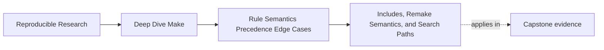

# Includes, Remake Semantics, and Search Paths


<!-- page-maps:start -->
## Page Maps




<!-- page-maps:end -->

An included makefile is executable build definition. If Make rebuilds one, it discards the
old parsed graph and reads the makefiles again. A learner who expects "parse once, then run
recipes" will misdiagnose the second parse as duplicate execution.

The right mental model is:

```mermaid
flowchart LR
  read["Read makefiles"]
  graph["Construct candidate graph"]
  check["Check every makefile as a target"]
  remake["Remake stale makefiles"]
  restart["Restart and read from the top"]
  goals["Update requested goals"]

  read --> graph --> check
  check -->|none remade| goals
  check -->|one or more remade| remake --> restart --> read
```

`MAKE_RESTARTS` is undefined during the first parse. After a successful makefile remake,
its value is the number of restarts so far. That makes restart behavior observable without
guessing from duplicated log lines.

## Required and optional includes make different promises

```make
include mk/contracts.mk
-include mk/local-overrides.mk
```

The required include says the build definition is incomplete without `mk/contracts.mk`.
The optional form—also spelled `sinclude`—suppresses the missing-file diagnostic. It does
not mean "ignore syntax errors" or "ignore a failed recipe that was supposed to generate
the file."

Use an optional include only when its absence has defined semantics. A private developer
convenience may qualify. A fragment that declares production prerequisites does not.

| File role | Form | Missing-file meaning |
| --- | --- | --- |
| public rules or artifact contract | `include` | configuration error unless Make can build it |
| generated dependency fragment | often `-include` | first build may legitimately begin without it |
| local developer preferences | `-include` | shared behavior remains complete |
| security or release policy | `include` | never silently absent |

## Observe a real restart

Use this isolated `Makefile`:

```make
$(info parse restart=$(or $(MAKE_RESTARTS),0) files=$(MAKEFILE_LIST))

include generated.mk

generated.mk: message.txt
	@printf 'MESSAGE := %s\n' "$$(cat $<)" > $@

.PHONY: show
show:
	@printf 'MESSAGE=%s restarts=%s\n' \
	  '$(MESSAGE)' '$(or $(MAKE_RESTARTS),0)'
```

Create `message.txt`, remove `generated.mk`, and run `gmake show`. The expected event
sequence is:

1. the first parse reports restart `0`
2. Make discovers that `generated.mk` is missing and has a rule
3. the recipe creates it
4. Make restarts, so parsing reports restart `1`
5. the second parse imports `MESSAGE`
6. only then does the `show` recipe run

On a settled second invocation, parsing reports restart `0`: no makefile was remade during
that process.

## Parse-time behavior must tolerate re-reading

Every top-level expansion can happen again after a remake:

```make
$(info reading build definition)
TOOL := $(shell command -v python3)
$(file >parse-marker,parsed)
```

The `info` diagnostic is merely repeated. The shell probe is repeated and may observe a
different environment. The `file` function mutates state during parsing and is unsafe
under ordinary runs, `-n`, `-q`, `-p`, and restarts.

A sound parse is:

- read-only except for Make's explicit makefile-remake recipes
- deterministic for declared inputs
- safe to evaluate more than once
- free of network, installation, and credential side effects

Do not guard a side effect with `MAKE_RESTARTS` and call it safe. That hides the symptom
while leaving diagnostic modes capable of mutation. Move the effect into an explicit
target.

## Generate included makefiles convergently

A generator should publish a complete file and avoid changing its identity when content
is unchanged:

```make
generated.mk: config/options.txt tools/render-config
	@set -eu; \
	candidate="$@.candidate.$$$$"; \
	trap 'rm -f "$$candidate"' EXIT HUP INT TERM; \
	tools/render-config $< > "$$candidate"; \
	if test -r "$@" && cmp -s "$$candidate" "$@"; then \
	  :; \
	else \
	  mv "$$candidate" "$@"; \
	fi
```

This recipe gives the included file:

- declared source and tool prerequisites
- process-local candidate naming
- cleanup after interruption
- complete-file publication by rename
- compare-before-replace behavior

The comparison preserves the modification time when semantics have not changed. That
helps the build converge instead of manufacturing another stale signal.

The generated content must also be canonical. Sort unordered inputs, exclude wall-clock
time and host identity, and quote values so the result remains valid Make syntax.

## Do not mark generated makefiles phony

`.PHONY` is correct for actions such as `check` that do not denote files. It is wrong for
an included makefile:

```make
.PHONY: generated.mk
include generated.mk
```

GNU Make avoids restarting when a phony included makefile is rebuilt; otherwise it could
loop forever. The result is worse than a loop: the current invocation can continue with
the graph parsed before the new content was available.

An included makefile needs real freshness prerequisites and file identity. Do not use a
force prerequisite either unless the generator and restart behavior have a bounded,
demonstrated convergence argument.

## Include identity is part of provenance

`MAKEFILE_LIST` records each makefile name immediately before Make parses it:

```make
$(info makefiles=$(MAKEFILE_LIST))
```

Use it to confirm order, not merely presence. Later assignments can replace earlier ones,
and included rule definitions can alter the graph.

The include search also affects identity. For a name without a directory component, Make
checks the current directory and configured include directories, including those supplied
with `-I`. Two directories containing `policy.mk` make this command context-sensitive:

```sh
gmake -I vendor/one -I vendor/two show
```

Prefer repository-rooted names:

```make
ROOT := $(abspath $(dir $(lastword $(MAKEFILE_LIST))))
include $(ROOT)/mk/policy.mk
```

If the main makefile may be reached through a symbolic link or from several working
directories, define and test the intended canonicalization policy rather than assuming
`CURDIR` identifies the makefile's owner.

## Include order is precedence policy

These orders are not equivalent:

```make
include mk/defaults.mk
-include mk/local-overrides.mk
```

```make
-include mk/local-overrides.mk
include mk/defaults.mk
```

With ordinary assignments, the latter file can replace an earlier value. Command-line
variables and `override` directives still follow their own precedence rules, so include
order is one part of provenance rather than the whole answer.

Record the intended layering in domain terms:

```make
include mk/toolchain-defaults.mk
include mk/artifact-contract.mk
-include mk/developer-preferences.mk
include mk/rules.mk
```

Then use `origin`, `value`, and `MAKEFILE_LIST` together when a setting surprises you.

## Keep prerequisite search separate from include search

`-I` controls include discovery. `VPATH` and `vpath` control prerequisite discovery. Both
can make an unqualified name resolve differently, but they act at different boundaries.

```make
VPATH := generated src

build/app.o: app.c config.h
	$(CC) -c $< -o $@
```

If both roots contain `config.h`, the dependency line no longer identifies the input.
Changing search order can change artifact bytes without changing the rule.

Prefer explicit paths:

```make
build/app.o: src/app.c include/config.h
	$(CC) -c $< -o $@
```

Use search paths only when roots are bounded, duplicate basenames are rejected, and an
audit can report the resolved prerequisite. Convenience is not sufficient evidence.

## Diagnose restart and identity failures

| Symptom | Evidence route | Likely cause |
| --- | --- | --- |
| parse message appears twice | print `MAKE_RESTARTS` | a makefile was remade |
| every invocation restarts | compare generated content and timestamps | generator is non-convergent or always forced |
| new generated rules are ignored | inspect `.PHONY`, force prerequisites, and restart count | Make did not safely re-exec |
| CI misses local behavior | inspect required/optional forms and `MAKEFILE_LIST` | optional private include |
| wrong fragment supplies a value | print `MAKEFILE_LIST`, `origin`, and raw value | include order or `-I` ambiguity |
| wrong prerequisite supplies bytes | remove `VPATH` ambiguity or trace resolution | search-path collision |
| `gmake -n` changes a file | audit top-level functions and probes | parse-time mutation |

## Prove convergence

For one generated include, preserve this evidence:

1. start without the generated file
2. run the target and record restart count `1`
3. hash the generated file and record its modification time
4. run the same target again and record restart count `0`
5. prove that hash and modification time stayed unchanged
6. change one declared source input
7. prove exactly one new restart and a justified content change
8. run `gmake -n` and prove no file changes

This route demonstrates bootstrap, settling, invalidation, and diagnostic safety. A single
successful first build proves only bootstrap.

## End-of-page checkpoint

Before leaving, make sure you can explain:

- why Make checks makefiles as targets before updating requested goals
- what `MAKE_RESTARTS` reports on initial, restarted, and settled invocations
- why parse-time effects may run several times
- how candidate publication and compare-before-replace support convergence
- why `.PHONY` destroys the file semantics an included makefile needs
- how `MAKEFILE_LIST`, `-I`, and include order expose definition provenance
- why include search and prerequisite search are related but distinct policies
