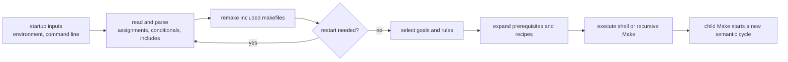
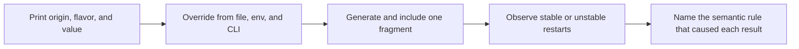
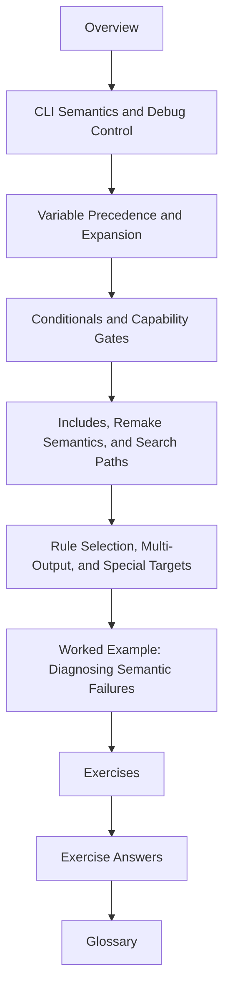

# Module 04: Rule Semantics, Precedence, and Edge Cases
Modules 01 to 03 teach graph truth, parallel safety, and deterministic operation. Module
04 is where you slow down and learn how GNU Make actually decides.

This module exists for the moments when a build surprises you and the old explanations are
too vague to help:

- a target rebuilds and nobody can say why
- a variable value changes somewhere between the shell and the recipe
- an included file changes Make's behavior in a way that feels invisible
- a clever rule works once, then flakes under `-j` or incremental rebuilds

The goal is not to memorize trivia. The goal is to leave with a durable mental model of
Make semantics so you can tell the difference between a legitimate advanced feature and a
bug disguised as one.

## Why this day matters

Without a semantic model, advanced Make usage turns into folklore. Learners end up with
phrases like "sometimes Make gets weird" instead of being able to say which rule,
precedence boundary, or include behavior caused the result.

The same text can be evaluated at different times:



Most “Make surprises” are boundary mistakes:

- expecting a parse-time conditional to see a recipe-time automatic variable
- treating an environment value as if it were a command-line override
- assuming a generated include is read only once
- trusting `-n` as side-effect-free even when parsing or recursive recipes do work
- assuming rule selection and prerequisite expansion happen in one undifferentiated step

This module teaches you to locate the boundary before changing syntax.

## Entry diagnostic

For one surprising target in a Make repository, record:

1. the requested goal and command-line assignments
2. the effective variable’s value, origin, flavor, scope, and export status
3. every included makefile and `MAKE_RESTARTS`
4. the selected explicit or implicit rule
5. the prerequisite set before and after any secondary expansion
6. the exact recipe Make expands and the command the shell receives
7. any recursive Make command and the variables it forwards

Do not repair the target yet. The missing row in this record usually identifies the
semantic boundary that needs work.

## What this module is for

By the end of Module 04, you should be able to explain five things with confidence:

- which command-line flags reveal a problem instead of hiding it
- how variable precedence, expansion, and export interact
- how to gate capabilities without scattering hidden inputs
- why included makefiles can trigger restart behavior and how to keep that safe
- which rule features preserve correctness and which ones quietly damage it

## The live demo for this module

Use one small variable-introspection target and one generated-include example as the
anchors for the day:



If you can do that calmly, the rest of the module becomes far easier to absorb.

## Ask Make where a value came from

Do not debug variable precedence by staring at assignments. Create this Makefile:

```make
MODE ?= local

.PHONY: show
show:
	@printf 'MODE=%s origin=%s flavor=%s\n' \
	  "$(MODE)" "$(origin MODE)" "$(flavor MODE)"
```

Predict and run:

```sh
gmake show
MODE=environment gmake show
gmake MODE=command show
```

The output teaches more than a precedence list:

- `?=` accepts an environment value because the variable is already defined
- a command-line value outranks both
- `origin` tells you which boundary supplied the value
- `flavor` tells you when the stored expression expands

When a value surprises you later, reduce the question to this form before changing
operators or adding `override`. First establish origin and flavor; then decide whether
the current ownership contract is correct.

## Plan for the day

| Focus | Activity | Evidence you should produce |
| --- | --- | --- |
| expansion | compare `=`, `:=`, `?=`, and `+=` in one file | raw, expanded, flavor, and origin values |
| precedence | invoke defaults, environment, command line, and recursive Make | a provenance matrix with forwarding evidence |
| conditionals | compare parse-time choice with recipe-time observation | capability decision and output-equivalence proof |
| includes | generate and include one stable fragment | restart count, parse-side-effect count, converged rerun |
| rule choice | compare explicit, implicit, static-pattern, and secondary expansion | database and debug evidence for the selected rule |
| diagnosis | follow a compound failure across semantic boundaries | an event ledger and bounded repair |
| practice | complete all ten exercises | accepted and rejected observations, not feature definitions |

This module is dense. Run each small experiment before reading the compound worked
example; otherwise several semantic rules arrive at once.

## The question to keep asking

Every time the build surprises you, ask:

> Which semantic boundary owns this surprise: startup, read time, makefile remake,
> rule selection, expansion, recipe execution, or recursive invocation?

That question keeps the incident small enough to debug.

## Study route



Read the module in that order the first time. Later, come back to the page that matches
the kind of failure or design decision you are facing.

## The ten files in this module

1. Overview (`index.md`)
2. [CLI Semantics and Debug Control](cli-semantics-and-debug-control.md)
3. [Variable Precedence and Expansion](variable-precedence-and-expansion.md)
4. [Conditionals and Capability Gates](conditionals-and-capability-gates.md)
5. [Includes, Remake Semantics, and Search Paths](includes-remake-semantics-and-search-paths.md)
6. [Rule Selection, Multi-Output, and Special Targets](rule-selection-multi-output-and-special-targets.md)
7. [Worked Example: Diagnosing Semantic Failures](worked-example-diagnosing-semantic-failures.md)
8. [Exercises](exercises.md)
9. [Exercise Answers](exercise-answers.md)
10. [Glossary](glossary.md)

## How to use the file set

| If you need to... | Start here |
| --- | --- |
| choose the right Make flag for an incident | [CLI Semantics and Debug Control](cli-semantics-and-debug-control.md) |
| prove where a variable value came from | [Variable Precedence and Expansion](variable-precedence-and-expansion.md) |
| centralize capability checks without folklore | [Conditionals and Capability Gates](conditionals-and-capability-gates.md) |
| understand include layering and restart behavior | [Includes, Remake Semantics, and Search Paths](includes-remake-semantics-and-search-paths.md) |
| model multi-output rules and sharp special targets safely | [Rule Selection, Multi-Output, and Special Targets](rule-selection-multi-output-and-special-targets.md) |
| see the whole module in one realistic review path | [Worked Example: Diagnosing Semantic Failures](worked-example-diagnosing-semantic-failures.md) |
| test your own understanding | [Exercises](exercises.md) |
| compare your answers against a reference | [Exercise Answers](exercise-answers.md) |
| stabilize vocabulary while reading | [Glossary](glossary.md) |

## The running question

Carry this question through every page:

> When Make behaves in a surprising way, which exact semantic rule explains the behavior?

Good Module 04 answers usually mention one or more of these:

- the difference between preview and execution
- a variable origin or expansion decision
- a capability check that was spread across too many places
- an include that changed evaluation order or restart behavior
- an advanced rule form that was used without a matching correctness contract

## What a strong Module 04 day looks like

By the end of the day, you should have:

- shown the value, origin, flavor, scope, export status, and forwarding route of a
  surprising variable
- observed one stable generated-include restart and one unstable one
- proved that parse-time diagnostics do not create undeclared work during a restart
- diagnosed one rule-selection ambiguity with Make-native evidence
- traced one secondary-expansion prerequisite from escaped text to concrete edge
- replaced one vague platform branch with a clearer capability gate
- explained one incident by naming the semantic stage that caused it

## Commands to keep close

These commands form the evidence loop for Module 04:

```sh
gmake -n <target>
gmake --trace <target>
gmake -pRrq <target> 2>/dev/null
gmake -q <target>
gmake -rR <target>
gmake --debug=implicit <target>
```

You do not need every one on every incident. You do need the habit of choosing them on
purpose.

## Learning outcomes

By the end of this module, you should be able to:

- use Make's CLI as a diagnostic instrument instead of a bag of random switches
- prove variable origin, flavor, and timing instead of guessing
- explain how `MAKEFLAGS`, `MAKEOVERRIDES`, export state, and explicit forwarding affect a
  child Make
- design conditionals that express capabilities without smuggling in hidden state
- reason about generated includes, include order, and search paths as part of architecture
- keep parse-time work restart-safe and distinguish include intent from accepted runtime evidence
- choose rule forms and special targets that preserve convergence and parallel safety

## Exit standard

Do not move on until all of these are true:

- you can explain a rebuild using `--trace` rather than story-telling
- you can show why a variable won by naming its origin and expansion mode
- you can predict which value reaches a recursive Make and why
- you can centralize one capability gate instead of repeating shell probes everywhere
- you can explain when an included makefile causes Make to restart
- you can prove whether a dry run executed a recursive recipe or hidden parse-time writer
- you can explain one secondary-expansion edge using the first and second expansion views
- you can repair one unsafe advanced-rule pattern without resorting to `.NOTPARALLEL`
- you completed ten exercises and can prove variable origin without inspecting CI folklore

When those feel ordinary, Module 04 has done its job.
