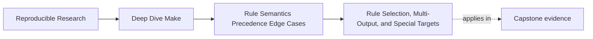
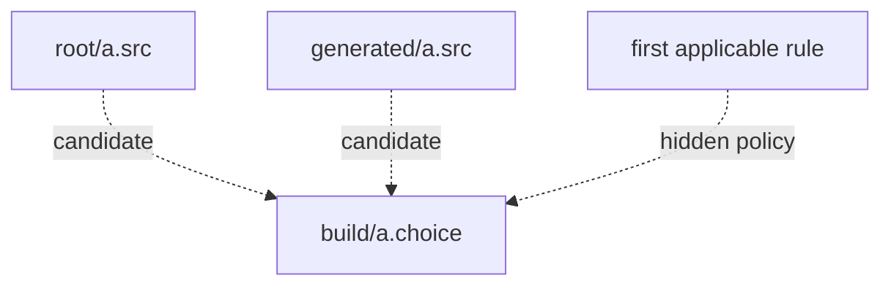

# Rule Selection, Multi-Output, and Special Targets


<!-- page-maps:start -->
## Page Maps




<!-- page-maps:end -->

By the time engineers reach this part of Make, they often know enough syntax to be
dangerous.

They have learned pattern rules, special targets, and maybe a few features from blog
posts or old repositories. The trouble is that advanced Make features are not impressive
because they are obscure. They are useful only when they preserve the same correctness
principles the earlier modules taught:

- one owner per output
- honest edges
- deterministic publication
- convergence under repeated runs
- parallel safety when the graph allows parallelism

This page is about the sharp features that tempt people to cut corners.

## The sentence to keep

When a rule feature feels powerful, ask one question immediately:

> what correctness contract does this feature require me to uphold?

If you cannot answer that, the feature is probably not ready to be used in the build.

## Pattern rules are good until they overlap

Pattern rules are often the first advanced feature people use:

```make
build/%.o: src/%.c
	$(CC) -c $< -o $@
```

This is healthy because it is easy to explain:

- every `build/name.o` comes from `src/name.c`
- the ownership is clear
- the expansion is local and inspectable

Trouble starts when multiple pattern rules can plausibly claim the same target.

Example:

```make
%.o: %.c
	$(CC) -c $< -o $@

%.o: generated/%.c
	$(CC) -c $< -o $@
```

Now you have to ask which rule Make will choose and why. If the answer is "I think it
uses the second one," the design is already too murky.

The healthy fix is usually to make the patterns non-overlapping or to use explicit/static
pattern rules for the ambiguous cases.

## Prove selection instability instead of guessing

The capstone semantic audit contains two Makefiles with:

- the same requested target, `build/a.choice`
- the same root and generated source files
- the same two overlapping target patterns
- only the order of the pattern rules changed

Run:

```sh
gmake -C programs/reproducible-research/deep-dive-make/capstone \
  semantic-fault-audit
```

Open:

```text
artifacts/audit/reproducible-research/deep-dive-make/semantic-faults/
├── summary.tsv
├── report.json
├── traces/
├── specimens/pattern-selection/
└── workspace/pattern-selection/
```

Predict the matrix before reading it:

| Model | Same requested target | Expected selected content |
| --- | --- | --- |
| generated rule appears first | `build/a.choice` | generated |
| root rule appears first | `build/a.choice` | root |
| namespaced targets | two distinct paths | both source families |

The first two builds both succeed. That is why this is a semantic selection problem rather
than an ordinary failure. Reordering Makefile text changes the meaning of one target:



The report should show:

```text
generated-rule-first -> selected=generated
root-rule-first      -> selected=root
```

Read the trace for each model. Identify:

1. the rule location Make selected
2. the prerequisite bound to `$<`
3. the output content published by that recipe

Do not stop at “Make chooses the first rule.” The design problem is that a distant text
reordering can change target meaning without changing the target path or source set.

The control gives each source family a target namespace:

```make
build/root/%.choice: root/%.src
	printf 'selected=%s\n' "$$(cat $<)" > $@

build/generated/%.choice: generated/%.src
	printf 'selected=%s\n' "$$(cat $<)" > $@
```

Now the graph contains:

```text
build/root/a.choice
build/generated/a.choice
```

Both outputs coexist, and a reviewer can infer source ownership from the target path.

Use this decision table during review:

| Observation | Interpretation | Repair direction |
| --- | --- | --- |
| one target has one applicable pattern rule | selection is locally explainable | retain and test |
| rule order changes which source family wins | text order is hidden policy | separate namespaces or write an explicit rule |
| only a bounded target list needs the pattern | global eligibility is unnecessary | use a static pattern rule |
| two source families intentionally converge | combination is part of the contract | add one explicit merge or selection owner |

An explanatory comment is not a repair for overlap. The graph should express the policy
that the comment claims.

## Static pattern rules are often clearer than clever generality

Static pattern rules let you define a small controlled set of targets:

```make
OBJECTS := build/main.o build/util.o

$(OBJECTS): build/%.o: src/%.c
	$(CC) -c $< -o $@
```

This is less magical than a very broad implicit rule set. It says exactly which targets are
in scope.

Use static pattern rules when:

- you want the convenience of pattern substitution
- but you do not want the whole tree to become eligible for the rule

That is a good trade when you are teaching or maintaining a repository meant to stay
readable.

## Secondary expansion builds prerequisites from target context

Ordinary prerequisite lists expand while Make reads the rule. At that point `$@` has no
target value:

```make
main_OBJS := build/main.o build/report.o
audit_OBJS := build/audit.o build/report.o

main audit: $($@_OBJS)
```

The computed reference collapses too early, so neither target receives the intended
prerequisites.

`.SECONDEXPANSION` asks Make to expand escaped prerequisites again in automatic-variable
context:

```make
.SECONDEXPANSION:

main_OBJS := build/main.o build/report.o
audit_OBJS := build/audit.o build/report.o

main audit: $$($$@_OBJS)
	$(LINK.o) $^ -o $@
```

Read the rule in two passes:

| Boundary | Text Make observes | Available fact |
| --- | --- | --- |
| initial parse expansion | `$($@_OBJS)` remains escaped for later | target context is not used yet |
| secondary expansion for `main` | `$(main_OBJS)` | `$@` is `main` |
| secondary expansion for `audit` | `$(audit_OBJS)` | `$@` is `audit` |
| recipe expansion | concrete `$^` and `$@` | the selected target's graph is settled |

```mermaid
flowchart LR
  source["Rule text: $$($$@_OBJS)"]
  parse["Initial expansion preserves expression"]
  select["Make considers target main"]
  second["Secondary expansion uses $@ = main"]
  graph["Prerequisites become main_OBJS"]
  recipe["Recipe sees concrete $^"]

  source --> parse --> select --> second --> graph --> recipe
```

The escaping is the contract. An unescaped reference is consumed during the first
expansion and cannot be recovered later.

For explicit rules, secondary expansion can use `$$@`, `$$%`, and prerequisite history
through `$$<`, `$$^`, and `$$+`. `$$?` and `$$*` do not carry useful values there.
Static pattern and implicit rules provide stem context for `$$*`, but have additional
search semantics. Begin with an explicit-rule harness before using those forms.

Secondary expansion is justified when it makes a bounded family of target-specific
prerequisites clearer. It is not a license to hide arbitrary graph construction in nested
variable names. Prove the expanded prerequisites with `gmake -np` or `--debug=implicit`
and keep the name-to-prerequisite mapping visible.

## Multi-output generators require one logical publication step

This is where even experienced engineers make avoidable mistakes.

Suppose one generator produces both `api.h` and `api.json`. A naive rule often looks like
this:

```make
api.h api.json: gen_api.py schema.yml
	python3 gen_api.py
```

The intuition is understandable: both files come from the same command, so list them both.

The risk is that Make still needs a correct model of how that generation happens. Under
parallel or incremental operation, naive multi-target rules can produce:

- duplicate generator invocations
- partial publication where one file is newer and the other is stale
- confusion about which output is the true driver of rebuild decisions

The rule is only safe if the semantics guarantee one logical invocation per regeneration.

## Grouped targets are the clean answer when available

GNU Make 4.3 introduced grouped targets with `&:`:

```make
api.h api.json &: gen_api.py schema.yml
	python3 gen_api.py
```

This tells Make that the outputs belong to one grouped update. That is much closer to the
real semantics of the generator.

If your supported Make version includes grouped targets, prefer them for genuine
multi-output generators.

## A stamp fallback is better than pretending

If grouped targets are not available, use a stamp that represents the successful
publication event:

```make
GEN_STAMP := build/api.stamp

$(GEN_STAMP): gen_api.py schema.yml | build/
	python3 gen_api.py
	test -s api.h
	test -s api.json
	touch $@

consumer: $(GEN_STAMP)
	consume api.h api.json
```

This is not as elegant as grouped targets, but it is honest. It says:

- one recipe owns the generation event
- successful validation precedes the stamp publication
- downstream consumers depend on the publication event
- the build graph has a stable point to reason about

The stamp is not a substitute for file identity. If other rules must name `api.h` and
`api.json` directly as independently repairable prerequisites, require grouped-target
support or design an explicit recovery rule for a missing member. A stamp that remains
present after one output is deleted can otherwise hide a broken group.

## Special targets change precise guarantees

Special targets are global or scoped semantic switches. Review the guarantee each one
changes and the failures it cannot repair:

| Special target | Guarantee it changes | It does not repair |
| --- | --- | --- |
| `.PHONY` | named prerequisites are always considered and skip implicit-rule search | file artifact freshness |
| `.DELETE_ON_ERROR` | removes a changed target when its recipe fails, unless preserved by `.PRECIOUS` | undeclared side outputs or successful recipes that publish bad bytes |
| `.PRECIOUS` | preserves named targets across interruption and recipe failure | partial-file correctness |
| `.SECONDARY` | prevents selected intermediate files from automatic deletion | missing dependencies |
| `.NOTPARALLEL` | serializes the documented scope | multi-writer ownership |
| `.WAIT` | establishes a prerequisite scheduling barrier | content dependency edges |
| `.ONESHELL` | runs all recipe lines in one shell | automatic early-command failure detection |

## `.PHONY` is for orchestration, not real artifacts

One of the most common rule-level mistakes is declaring a real file target as phony.

Example:

```make
.PHONY: app

app:
	$(CC) main.c -o app
```

This guarantees `app` runs every time because `.PHONY` tells Make the target is not a file
truth claim.

That is useful for targets like:

- `clean`
- `test`
- `lint`
- `help`

It is destructive for real artifacts such as binaries, archives, manifests, or generated
headers.

## `.DELETE_ON_ERROR` limits failed-target residue

Without `.DELETE_ON_ERROR`, a recipe can write half a target and exit nonzero. A later run
may mistake that file for useful state:

```make
.DELETE_ON_ERROR:

report.csv: observations.csv
	python3 render.py $< > $@
```

If the recipe changes `report.csv` and then fails, Make removes the target. This supports
recovery, but it is not atomic publication: another process could observe partial bytes
while the recipe runs. A process-local candidate plus rename remains the stronger pattern.

`.DELETE_ON_ERROR` also knows only the declared target. If a recipe writes undeclared side
outputs, Make cannot clean them. A target named under `.PRECIOUS` is intentionally exempt
from deletion, so combining the two requires a documented recovery reason.

Test the failure path. A passing recipe tells you nothing about deletion semantics.

## `.NOTPARALLEL` is a last resort, not a design strategy

`.NOTPARALLEL` can be valid when a tool genuinely cannot be modeled safely for concurrent
execution. But it is often used to hide graph bugs:

- shared process work files
- multi-writer outputs
- missing order relationships
- non-atomic publication

If `-j1` or `.NOTPARALLEL` is the only reason the build behaves, treat that as a report of
missing truth, not as a final repair.

## `.WAIT` is a barrier, not a substitute for real edges

GNU Make 4.4 added `.WAIT` as a way to impose barrier-style ordering in prerequisite
lists. It can be useful, but it should not replace honest prerequisites.

If the supported Make range includes older releases, reject the unsupported runtime before
parsing a rule that relies on `.WAIT`, or provide a graph with real compatibility
semantics. Silently treating `.WAIT` as an ordinary prerequisite name is not a fallback.

Use a real edge when content or publication truly depends on another artifact.

Use a barrier only when the scheduling relationship is real but not naturally expressed by
a normal file dependency.

That distinction matters because barriers are easier to misuse as ordering folklore.

## Retention targets do not fix graph semantics

Special targets such as `.SECONDARY`, `.PRECIOUS`, and `.INTERMEDIATE` affect how Make
treats intermediate files. They can be helpful for debugging or for preventing deletion of
useful intermediates.

They do not solve:

- missing prerequisites
- bad output ownership
- multi-output publication bugs
- hidden inputs

In other words, file retention policy is not the same thing as graph truth.

## `.ONESHELL` changes failure observation

`.ONESHELL` makes all lines in a recipe run in one shell instance instead of separate
invocations.

That can be useful for complex shell logic, but it changes failure behavior and state
sharing inside recipes. For example:

- environment exports on one line remain visible to later lines
- `cd` persists within the recipe
- failure in an early line may be hidden if a later line succeeds
- shell error handling needs to be set deliberately

With `.ONESHELL`, Make ordinarily receives the shell's final exit status. Use an explicit
shell contract such as `set -eu` where appropriate, and still test pipelines and commands
whose failure rules vary by shell. `.ONESHELL` reduces shell startup boundaries; it does
not make a multi-command recipe transactional.

## A small broken-generator example

Use this sketch:

```make
.PHONY: clean

api.h api.json: gen_api.py
	@printf 'running generator\n'
	@python3 gen_api.py

clean:
	rm -f api.h api.json
```

Now imagine the generator updates both files. Ask yourself:

- what guarantees one invocation under `-j4`
- what path tells Make the publication completed as one event
- how would you prove the repair with `--trace`

The answer should move them toward grouped targets or a stamp.

## Failure signatures worth recognizing

### "Only one of the generated files updated"

That usually means a multi-output generator was modeled as if each output were independent.

### "This target keeps rebuilding forever"

That often points to `.PHONY` on a real artifact or to publication that never settles.

### "The build passes only when serialized"

That often signals missing edges or shared mutable outputs, not a legitimate need for
`.NOTPARALLEL`.

### "I do not know which rule Make chose"

That means the rule space is too broad or overlapping. Reduce it until the answer becomes
obvious.

## A better way to review advanced rule features

When someone proposes an advanced rule form, ask them to explain:

1. which recipe invocation owns the publication event
2. which files are the semantic inputs
3. whether parallel runs can trigger duplicate or competing writers
4. how the rule converges on a second run
5. which Make feature is required and what the fallback is
6. at which expansion boundary every computed prerequisite is resolved
7. which failure-path artifact state each special target permits

If those answers are strong, the feature is probably justified.

## What to practice from this page

Take one advanced rule pattern in the capstone or your own repository and rewrite the
explanation in plain language:

1. what outputs does it own
2. why does Make choose this rule
3. how many times should the recipe run per logical regeneration
4. what would break under `-j`
5. which special target, if any, is truly justified

If you can answer those without hiding behind syntax, the rule is probably sound.

## End-of-page checkpoint

Before leaving this lesson, make sure you can explain:

- why overlapping pattern rules make builds harder to reason about
- why `.SECONDEXPANSION` requires escaping and target-context evidence
- why multi-output generation needs one logical publication event
- why grouped targets or a stamp are safer than naive multi-target rules
- when `.DELETE_ON_ERROR` removes a failed target and when it cannot help
- why `.PHONY`, `.NOTPARALLEL`, `.WAIT`, and `.ONESHELL` each change a narrow guarantee
