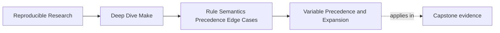
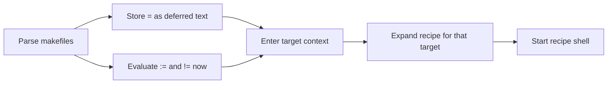

# Variable Precedence and Expansion


<!-- page-maps:start -->
## Page Maps




<!-- page-maps:end -->

Many Make variable bugs sound like shell bugs:

- `CFLAGS` changes only in CI.
- a prerequisite sees flags intended for one top-level target.
- a child Make reports a command-line value that the parent never exported.
- one expression changes meaning between parsing and recipe execution.

A final string cannot explain any of those. Record a variable's provenance as six
separate facts:

1. **origin** — which source won precedence
2. **flavor** — whether Make stored text or an already expanded result
3. **evaluation time** — when referenced names and functions are observed
4. **target scope** — which target context supplies the value
5. **process export** — whether a recipe's environment receives it
6. **recursive forwarding** — whether a child Make receives it as an environment or
   command-line definition

The distinction matters because "the child can see `MODE`" does not tell you whether
`$(origin MODE)` in that child is `environment` or `command line`. Those two sources have
different precedence.

## Origin answers which definition won

GNU Make's `origin` function reports one of these values:

| `$(origin NAME)` | Source | Ordinary precedence consequence |
| --- | --- | --- |
| `undefined` | no definition | `?=` may install a default |
| `default` | built-in definition | almost any explicit definition replaces it |
| `environment` | process environment | an ordinary makefile assignment replaces it |
| `environment override` | environment while `-e` is active | it replaces an ordinary makefile assignment |
| `file` | makefile definition | it replaces an ordinary environment value |
| `command line` | `gmake NAME=value` | it replaces an ordinary makefile assignment |
| `override` | makefile `override` directive | it replaces a command-line assignment |
| `automatic` | rule context, such as `$@` | it exists only where that rule is being expanded |

So the useful strongest-to-weakest ladder is:

1. an `override` directive
2. a command-line assignment
3. an ordinary makefile assignment
4. an environment assignment
5. a built-in definition

The `-e` option moves environment definitions above ordinary file definitions. It does
not move them above command-line or `override` definitions.

`override` is deliberately forceful:

```make
override CFLAGS += -fstack-protector-strong
```

Use it only for a real invariant. If a caller must never disable a safety flag, state that
contract and test it. If callers need to choose the whole value, an `override` directive
silently defeating `gmake CFLAGS=...` is the wrong interface.

## Flavor and evaluation time are different facts

`$(flavor NAME)` reports `simple`, `recursive`, or `undefined`. `$(value NAME)` returns the
stored text without expanding it. Together they distinguish a recipe's final text from
the expression that produced it.

```make
WARNINGS := -Wall
DEFERRED = $(WARNINGS) -Wextra
CAPTURED := $(WARNINGS) -Wextra
WARNINGS := -Werror
```

After parsing:

| Name | Flavor | `$(value NAME)` | Expanded value |
| --- | --- | --- | --- |
| `DEFERRED` | recursive | `$(WARNINGS) -Wextra` | `-Werror -Wextra` |
| `CAPTURED` | simple | `-Wall -Wextra` | `-Wall -Wextra` |

The assignment operators establish different observation boundaries:

| Form | When its right side is evaluated | Review question |
| --- | --- | --- |
| `NAME := expression` | immediately while parsing | should later definitions be invisible? |
| `NAME = expression` | whenever `NAME` is expanded | is that deferred dependency intentional? |
| `NAME ?= expression` | assignment is conditional; flavor is recursive when installed | does an empty-but-defined value count as configured? |
| `NAME != command` | the shell runs while parsing | is this external observation declared and stable? |
| `target: NAME := expression` | in a target-specific variable context | which prerequisite inherits the context? |
| recipe use of `$(NAME)` | Make expands the recipe before its shell runs | are you confusing Make expansion with shell expansion? |



Prefer `:=` for paths, discovered file lists, pinned tool names, and other values that
should describe one parse. Use `=` when later evaluation is part of the design, not merely
because it is shorter.

## Prove precedence instead of reciting it

Put this in an isolated `Makefile`:

```make
CFLAGS := FILE
OPTFLAGS = $(CFLAGS) -Wall

.PHONY: show
show:
	@printf 'origin=%s flavor=%s raw=%s expanded=%s\n' \
	  '$(origin CFLAGS)' '$(flavor CFLAGS)' \
	  '$(value CFLAGS)' '$(CFLAGS)'
	@printf 'OPTFLAGS flavor=%s raw=%s expanded=%s\n' \
	  '$(flavor OPTFLAGS)' '$(value OPTFLAGS)' '$(OPTFLAGS)'
```

Run one controlled case at a time:

```sh
env -u CFLAGS gmake --no-builtin-variables show
CFLAGS=ENV gmake --no-builtin-variables show
CFLAGS=ENV gmake --no-builtin-variables -e show
gmake --no-builtin-variables CFLAGS=CLI show
```

Then add this definition above the target and rerun the command-line case:

```make
override CFLAGS := REQUIRED
```

Your evidence should show `file`, `environment override`, `command line`, and `override`
origins in the relevant cases. The command also disables built-in variables so they
cannot blur this specific comparison.

## Target-specific values flow down the dependency graph

This declaration affects `debug` and the prerequisites built for it:

```make
debug: CFLAGS += -O0 -g
debug: app
```

That propagation is useful, but it creates a subtle shared-prerequisite problem:

```make
debug: MODE := debug
release: MODE := release

debug release: shared-data
```

If one invocation requests both goals, `shared-data` is built only once. Whichever target
context causes it to be built first supplies `MODE`. The shared output therefore cannot
honestly depend on that contextual value unless the value is encoded in the output path or
the graph separates the variants.

Use `private` when prerequisites must not inherit a target-specific value:

```make
debug: private MODE := debug
debug: app
```

Target-specific scope is Make state. It does not by itself mean "put this name in every
future process environment."

## Export and recursive forwarding are separate channels

`export` places a variable in recipe environments:

```make
export LC_ALL := C
```

`unexport` removes that channel:

```make
unexport DEVELOPER_TOKEN
```

Recursive Make adds another mechanism. GNU Make carries command-line variable definitions
through `MAKEOVERRIDES`, which contributes to the flags passed to a child through
`MAKEFLAGS`. Consequently a child normally sees a forwarded command-line assignment with
origin `command line`, even if the parent has no `export NAME` directive.

| Parent definition | Ordinary recipe environment | Child `$(origin MODE)` |
| --- | --- | --- |
| `MODE := file` | absent unless exported | `undefined` unless otherwise defined |
| `export MODE := release` | `MODE=release` | `environment` |
| `gmake MODE=release child` | `MODE=release` | `command line` |
| recipe `$(MAKE) MODE=release -C child` | `MODE=release` | `command line` |
| `unexport MODE` after a file definition | absent | `undefined` unless explicitly forwarded |

Do not edit `MAKEFLAGS` or `MAKEOVERRIDES` casually. They are protocol state for recursive
Make, not general-purpose configuration variables.

## A recursive provenance harness

Parent `Makefile`:

```make
SUBDIR := child
MODE := file

.PHONY: plain exported explicit diagnose

plain:
	@$(MAKE) --no-print-directory -C $(SUBDIR) show

exported: export MODE := exported
exported:
	@$(MAKE) --no-print-directory -C $(SUBDIR) show

explicit:
	@$(MAKE) --no-print-directory -C $(SUBDIR) MODE=explicit show

diagnose:
	@printf 'parent level=%s origin=%s flags=%s overrides=%s\n' \
	  '$(MAKELEVEL)' '$(origin MODE)' '$(MAKEFLAGS)' '$(MAKEOVERRIDES)'
	@$(MAKE) --no-print-directory -C $(SUBDIR) show
```

Child `child/Makefile`:

```make
.PHONY: show
show:
	@printf 'child level=%s origin=%s flavor=%s raw=%s value=%s env=%s\n' \
	  '$(MAKELEVEL)' '$(origin MODE)' '$(flavor MODE)' \
	  '$(value MODE)' '$(MODE)' "$${MODE-unset}"
```

Run:

```sh
gmake plain
gmake exported
gmake explicit
gmake MODE=command diagnose
```

The last command is the important counterexample. In the child, `MODE` remains a
command-line definition because recursive forwarding is stronger than an ordinary
environment import. The `MAKELEVEL` increase proves that the observation came from a
child Make rather than a shell-only subprocess.

## Diagnose one boundary at a time

| Symptom | First evidence to collect | Likely boundary |
| --- | --- | --- |
| CI has a different value | `origin`, invocation flags, presence of `-e` | source precedence |
| a value changes later | `flavor`, `value`, and the point of expansion | evaluation time |
| flags appear on a prerequisite | target path plus target-specific declarations | graph scope |
| a shell sees a hidden setting | controlled `env` output and export declarations | process export |
| a child reports `command line` | `MAKELEVEL`, `MAKEFLAGS`, `MAKEOVERRIDES` | recursive forwarding |
| flags grow on every use | raw value, flavor, and all `+=` sites | deferred self-reference |

Avoid dumping the whole environment as your first move. It obscures which semantic
boundary changed. A focused diagnostic is reviewable:

```make
$(info MODE origin=$(origin MODE) flavor=$(flavor MODE) raw=$(value MODE))
```

When the variable affects artifact bytes, record the effective expanded value in a
manifest or build-information file. Provenance explains why a value won; the manifest
connects that value to the artifact it produced.

## Practice before moving on

Choose one output-affecting variable from the capstone and write down:

1. the sources allowed to define it and their intended precedence
2. whether its right side must observe parsing time or later target context
3. whether prerequisites should inherit a target-specific value
4. whether recipe processes need it in their environment
5. whether recursive Make should receive it as environment or command-line state
6. the smallest harness that rejects an unintended source or propagation path

A satisfactory answer includes evidence from `origin`, `flavor`, `value`, and the relevant
process or recursive-Make boundary. Printing only the final value is not enough.

## End-of-page checkpoint

Before leaving, make sure you can explain:

- why `override` outranks a command-line definition and why that power needs a contract
- why `?=` treats an empty but defined value as already configured
- why a target-specific value can reach prerequisites without being exported
- why an exported value has `environment` origin in a child Make
- why a recursively forwarded command-line value keeps `command line` origin
- how `MAKELEVEL`, `MAKEFLAGS`, and `MAKEOVERRIDES` expose the recursive boundary
