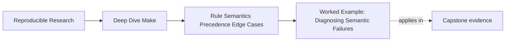
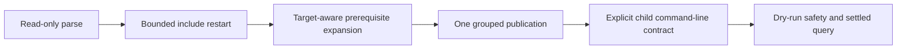

# Worked Example: Diagnosing Semantic Failures


<!-- page-maps:start -->
## Page Maps




<!-- page-maps:end -->

Semantic failures arrive as mixed evidence. This incident combines five boundaries:

- parsing mutates a log even under `-n`
- a generated include causes a legitimate second parse during bootstrap
- a command-line variable keeps command-line precedence in a child Make
- a computed prerequisite list expands too early
- a two-output generator can run twice under `-j`

The objective is not to memorize five repairs. It is to locate each observation at the
boundary that can cause it.

## Start with an event ledger

Do not write "Make ran twice." Record who did what:

| Event | Boundary | Evidence |
| --- | --- | --- |
| top-level diagnostic appears | parse | `MAKE_RESTARTS` and `MAKEFILE_LIST` |
| diagnostic mode changes `parse-events.log` | parse side effect | before/after digest around `gmake -n` |
| `MODE` becomes `command line` in publisher | recursive Make | child `origin`, `MAKELEVEL`, `MAKEOVERRIDES` |
| `report` has no input prerequisites | prerequisite expansion | `gmake -np report` |
| API generator starts twice | rule ownership and scheduling | `gmake -j4 --trace` plus invocation log |

This ledger prevents category mistakes. Shell quoting cannot repair an expression consumed
during initial prerequisite expansion. `.NOTPARALLEL` cannot explain variable precedence.

```mermaid
flowchart TD
  symptom["Unexpected observation"]
  parse["Did it happen while reading makefiles?"]
  graph["Did it change prerequisite or rule selection?"]
  process["Did a recipe or child process observe it?"]
  proof["Choose one boundary-specific probe"]

  symptom --> parse
  parse -->|no| graph
  graph -->|no| process
  parse -->|yes| proof
  graph -->|yes| proof
  process --> proof
```

## The inherited build

The main `Makefile` contains:

```make
$(info parse restart=$(or $(MAKE_RESTARTS),0) files=$(MAKEFILE_LIST))
$(shell printf 'parse\n' >> parse-events.log)

include mk/generated-config.mk

MODE ?= release
VALID_MODES := release debug
ifeq ($(filter $(MODE),$(VALID_MODES)),)
$(error unsupported MODE '$(MODE)')
endif

ifeq ($(MODE),debug)
MODE_FLAGS := -O0 -g
else
MODE_FLAGS := -O2
endif

report_INPUTS := data/observations.csv scripts/summarize.py
report: $($@_INPUTS)
	python3 scripts/summarize.py data/observations.csv > $@

generated/api.h generated/api.json: schema.yml tools/gen-api.py
	python3 tools/gen-api.py

.PHONY: publish
publish: report generated/api.json
	$(MAKE) --no-print-directory -C publisher MODE=$(MODE) publish

mk/generated-config.mk: config/toolchain.txt tools/render-config
	tools/render-config $< > $@
```

The child `publisher/Makefile` exposes its observation:

```make
.PHONY: publish
publish:
	@printf 'level=%s origin=%s mode=%s overrides=%s\n' \
	  '$(MAKELEVEL)' '$(origin MODE)' '$(MODE)' '$(MAKEOVERRIDES)'
```

The fragments are plausible in isolation. Their boundary interactions are not.

## Establish a non-mutating baseline

Before requesting a real build, preserve state around a dry run:

```sh
test ! -e parse-events.log
gmake -n publish
test ! -e parse-events.log
```

The last command fails because `$(shell printf ...)` ran during parsing. `-n` suppresses
ordinary recipes; it does not suppress functions evaluated while Make reads makefiles.

Repair the violation before trusting other diagnostic modes:

```make
$(info parse restart=$(or $(MAKE_RESTARTS),0) files=$(MAKEFILE_LIST))
```

Keep the informational event, remove the mutating shell expansion, and rerun the proof.
The dry run should leave no file behind.

## Interpret two parse messages correctly

Start without `mk/generated-config.mk` and run:

```sh
gmake --trace publish
```

The parse diagnostic should appear twice:

```text
parse restart=0 files=Makefile
tools/render-config config/toolchain.txt > mk/generated-config.mk
parse restart=1 files=Makefile
```

That is expected bootstrap behavior. Make read the graph, remade a missing makefile, and
restarted so the new definition could participate.

The weak generator still publishes directly to the final path. An interruption can leave
valid-looking partial Make syntax. Repair publication and convergence together:

```make
mk/generated-config.mk: config/toolchain.txt tools/render-config
	@set -eu; \
	candidate="$@.candidate.$$$$"; \
	trap 'rm -f "$$candidate"' EXIT HUP INT TERM; \
	tools/render-config $< > "$$candidate"; \
	if test -r "$@" && cmp -s "$$candidate" "$@"; then \
	  :; \
	else \
	  mv "$$candidate" "$@"; \
	fi
```

Prove four states:

| Invocation | Expected `MAKE_RESTARTS` | Expected publication |
| --- | ---: | --- |
| missing generated include | `1` after remake | complete file appears |
| unchanged settled build | `0` | identity and modification time unchanged |
| declared config changed | `1` after remake | content changes once |
| `gmake -n publish` | `0` when settled | no mutation |

Two parse messages are not themselves a defect. An unexplained parse mutation or a build
that never settles is.

## Follow `MODE` across the child boundary

Run:

```sh
gmake MODE=debug publish
```

The parent recipe explicitly passes `MODE=$(MODE)` to `$(MAKE)`. The child therefore
reports:

```text
level=1 origin=command line mode=debug
```

This is not export behavior. The recursive invocation gives the child a command-line
definition, and `MAKEOVERRIDES` records the forwarding protocol.

Now compare an environment contract:

```make
export MODE

publish: report generated/api.json
	$(MAKE) --no-print-directory -C publisher publish
```

When the parent value came from its file default, the child reports origin `environment`.
That is weaker than a command-line definition and can be replaced by an ordinary child
makefile assignment.

Choose intentionally:

- use an explicit child command-line assignment when the parent owns configuration
  precedence
- export when ordinary process environment is the intended interface
- reject inherited ambient values when they are not supported inputs

The final value may be identical in both designs; the provenance contract is not.

## Reveal the vanished prerequisite

The rule:

```make
report: $($@_INPUTS)
```

looks as if it selects `report_INPUTS`. During initial expansion, however, `$@` is empty.
The reference disappears before Make has a target context.

Inspect the database:

```sh
gmake -np report
```

The `report` entry lacks `data/observations.csv` and `scripts/summarize.py`. That explains
why changing the data does not rebuild the report.

Repair the boundary:

```make
.SECONDEXPANSION:

report_INPUTS := data/observations.csv scripts/summarize.py

report: $$($$@_INPUTS)
	python3 scripts/summarize.py data/observations.csv > $@
```

Run the database inspection again, then change `data/observations.csv` and use
`gmake --trace report`. A good repair changes both the graph evidence and the rebuild
behavior.

For one target, an explicit prerequisite list would be simpler. Secondary expansion earns
its place only if several targets share this visible naming scheme.

## Give the generator one owner

This independent-target rule can schedule the same recipe for each requested output:

```make
generated/api.h generated/api.json: schema.yml tools/gen-api.py
	python3 tools/gen-api.py
```

Replace it with a grouped rule after checking the advertised feature:

```make
ifeq ($(filter grouped-target,$(.FEATURES)),)
$(error this build requires GNU Make grouped-target support)
endif

generated/api.h generated/api.json &: schema.yml tools/gen-api.py
	python3 tools/gen-api.py
	test -s generated/api.h
	test -s generated/api.json
```

The test belongs to the publication event: success means both promised members exist.
Then prove:

```sh
gmake -j4 --trace generated/api.h generated/api.json
gmake -q generated/api.h generated/api.json
```

The trace should contain one generator invocation, and the settled query should return
`0`. Delete one member and rerun; grouped-target semantics should regenerate the group once.

## The repaired build

```make
$(info parse restart=$(or $(MAKE_RESTARTS),0) files=$(MAKEFILE_LIST))

include mk/generated-config.mk

MODE ?= release
VALID_MODES := release debug
ifneq ($(words $(MODE)),1)
$(error MODE must be exactly one of: $(VALID_MODES))
endif
ifeq ($(filter $(MODE),$(VALID_MODES)),)
$(error MODE must be one of: $(VALID_MODES))
endif

ifeq ($(MODE),debug)
MODE_FLAGS := -O0 -g
else
MODE_FLAGS := -O2
endif

.SECONDEXPANSION:
report_INPUTS := data/observations.csv scripts/summarize.py

report: $$($$@_INPUTS)
	python3 scripts/summarize.py data/observations.csv > $@

ifeq ($(filter grouped-target,$(.FEATURES)),)
$(error this build requires GNU Make grouped-target support)
endif

generated/api.h generated/api.json &: schema.yml tools/gen-api.py
	python3 tools/gen-api.py
	test -s generated/api.h
	test -s generated/api.json

.PHONY: publish
publish: report generated/api.json
	$(MAKE) --no-print-directory -C publisher MODE=$(MODE) publish

mk/generated-config.mk: config/toolchain.txt tools/render-config
	@set -eu; \
	candidate="$@.candidate.$$$$"; \
	trap 'rm -f "$$candidate"' EXIT HUP INT TERM; \
	tools/render-config $< > "$$candidate"; \
	if test -r "$@" && cmp -s "$$candidate" "$@"; then \
	  :; \
	else \
	  mv "$$candidate" "$@"; \
	fi
```

Each semantic choice is now inspectable:



## Write the incident explanation from evidence

A reviewable conclusion is:

> The dry run mutated state because a top-level shell function executed during parsing.
> The duplicate parse on bootstrap was expected: Make remade an included makefile and
> restarted once. The report ignored data changes because its target-derived prerequisite
> was consumed before target context existed. The API generator had two independently
> scheduled target owners. The publisher received `MODE` as a child command-line
> definition, not merely as exported environment. We removed the parse effect, made include
> publication convergent, escaped the second-expansion prerequisite, grouped the outputs,
> and documented the recursive configuration channel.

This account distinguishes one expected restart from four defects. "Make ran things
strangely" would hide that distinction.

## Preserve the proof bundle

For an incident like this, retain:

- the exact goal and options
- before/after state for `gmake -n`
- parse events with `MAKE_RESTARTS` and `MAKEFILE_LIST`
- parent and child `origin`, value, `MAKELEVEL`, and `MAKEOVERRIDES`
- the database entry before and after secondary expansion
- the parallel trace and generator invocation count
- a settled `gmake -q` result

Do not attach the entire Make database unless the bounded entry is insufficient. The proof
bundle should let another learner reconstruct each conclusion without an instructor
explaining which lines matter.
