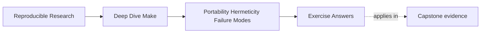

# Exercise Answers


<!-- page-maps:start -->
## Page Maps




<!-- page-maps:end -->

Use this after you have written your own answers. The point is comparison, not copying.

Strong Module 05 answers do not simply list tools or flags. They explain:

- what assumption is being made
- how the build would prove that assumption
- why the repair or boundary decision is honest

## Exercise 1: Write a portability contract

A strong answer makes the contract concrete, for example:

- GNU Make 4.3 or newer required
- POSIX `/bin/sh` syntax only
- `python3` required
- grouped targets optional only if a stamp-based fallback preserves the same generation semantics

The important move is separating required from optional. A weak answer says "support as
many environments as possible." A strong answer says exactly which ones are supported and
how unsupported ones fail.

## Exercise 2: Repair a recursive boundary

The core explanation is:

> plain `make` inside a recipe does not communicate recursive intent the same way `$(MAKE)`
> does, so the sub-build can lose jobserver semantics and behave misleadingly under dry
> runs.

A strong repair looks like:

```make
.PHONY: vendor

vendor:
	+$(MAKE) -C vendor/lib all
```

And a depth guard might look like:

```make
ifeq ($(MAKELEVEL),2)
$(error recursive build depth exceeded)
endif
```

The key idea is not the exact number in the guard. The key idea is that recursion is a
declared boundary with a budget and a depth, not just a habit.

## Exercise 3: Model one non-file input honestly

A strong answer chooses one real semantic input, such as `MODE` or compiler identity, and
represents it with a convergent file.

For example:

```make
MODE_MANIFEST := build/mode.manifest

$(MODE_MANIFEST): | build/
	@printf 'MODE=%s\n' '$(MODE)' > $@.tmp
	@cmp -s $@.tmp $@ 2>/dev/null || mv $@.tmp $@
	@rm -f $@.tmp
```

This is strong because:

- the file stands for one real build fact
- the file changes only when the fact changes
- downstream targets now have an honest edge to that fact

## Exercise 4: Separate performance layers

A good minimal loop is:

```sh
/usr/bin/time -p make -n all >/dev/null
/usr/bin/time -p make all >/dev/null
make --trace all > build/trace.log
wc -l build/trace.log
```

The answer is strong if it explains what the comparison means:

- expensive `make -n` suggests parse or decision overhead
- expensive full build with cheap `make -n` suggests recipe cost dominates
- very high trace volume suggests the evidence surface itself may be operationally costly

You do not need a fancy profiler first. You need a baseline that separates the
layers honestly.

## Exercise 5: Decide whether Make should still own the problem

A strong answer usually keeps artifact-oriented concerns in Make, such as:

- compilation
- file assembly
- packaging of already-resolved inputs

And it usually identifies one richer workflow concern as a boundary, such as:

- dependency version solving
- long-running promotion and approval orchestration

The best answers also say how proof survives the handoff. For example:

> Make remains the top-level verification and artifact assembly route, while the external
> tool owns dependency resolution or workflow state.

That is much stronger than saying only "use another tool."

## Exercise 6: Build a toolchain doctor

A useful answer reports facts and fails only for declared requirements:

```make
SHELL := /bin/sh

.PHONY: doctor
doctor:
	@printf 'make=%s\nshell=%s\nmakelevel=%s\n' \
	  '$(MAKE_VERSION)' '$(SHELL)' '$(MAKELEVEL)'
	@printf 'locale=%s\n' "$${LC_ALL:-not-set}"
	@command -v "$(CC)" || { echo 'C compiler is required' >&2; exit 1; }
	@command -v python3 || { echo 'python3 is required' >&2; exit 1; }
```

The answer should distinguish reporting from validation. An unset locale may be worth
reporting without being fatal; a missing required generator must fail before the build
reaches an obscure recipe error.

## Exercise 7: Remove a hidden shell dependency

POSIX `test` uses single brackets:

```make
SHELL := /bin/sh

.PHONY: report
report:
	@if [ -f data.csv ]; then echo ready; fi
```

Test both branches:

```sh
rm -f data.csv && make report
touch data.csv && make report
```

Other common audit points include arrays, brace expansion, `source`, process
substitution, and `set -o pipefail`. If a Bash feature is genuinely needed, declare
`SHELL := /bin/bash` and make Bash part of the portability contract instead of depending
on a developer's interactive shell.

## Exercise 8: Preserve the parallel budget across recursion

The parent should use Make's recursive invocation:

```make
.PHONY: nested
nested:
	+$(MAKE) -C nested all
```

The nested build can make the evidence visible:

```make
.PHONY: all
all:
	@printf 'level=%s flags=%s\n' '$(MAKELEVEL)' '$(MAKEFLAGS)'
```

Under `make -j2 nested`, the child should report a larger `MAKELEVEL` and inherited
parallel flags. `$(MAKE)` tells GNU Make that the command is recursive; the leading `+`
also permits the recursive line to run under modes such as `-n`, where the child must
interpret the dry run itself.

## Exercise 9: Prove an environment manifest converges

One valid rule is:

```make
MODE ?= release
ENV_MANIFEST := build/environment.txt

$(ENV_MANIFEST): | build/
	@{ \
	  printf 'MODE=%s\n' '$(MODE)'; \
	  printf 'CC=%s\n' "$$($(CC) --version | sed -n '1p')"; \
	  printf 'LC_ALL=%s\n' "$${LC_ALL:-not-set}"; \
	} > $@.candidate
	@cmp -s $@.candidate $@ 2>/dev/null || mv $@.candidate $@
	@rm -f $@.candidate
```

The first run creates the manifest. The second produces identical candidate content, so
`cmp` prevents a timestamp change. `make MODE=debug` changes semantic content and
therefore replaces the file. A strong submission records checksums or modification times
instead of merely asserting that this happened.

## Exercise 10: Harden an inherited build

A strong answer is an evidence packet rather than a rewritten Makefile alone. It should
contain:

- the supported GNU Make, shell, and required-tool contract
- `doctor` output from two environments
- a repaired recursive invocation or environment manifest where needed
- `make -n` and full-build timings
- a no-op check such as `make all && make -q all`
- a reasoned ownership decision

The two environments do not need to be two physical machines. A container, CI runner, or
deliberately changed `PATH`, `LC_ALL`, and `MODE` can expose assumptions. What matters is
that the comparison is controlled and the conclusion follows from observed differences.

## What mastery-level answers sound like

A mastery-level answer set in this module does three things well:

- it treats portability and hermeticity as declared contracts rather than vague values
- it measures before claiming a performance diagnosis
- it treats tool boundaries as ownership decisions, not ideological ones

That is the standard Module 05 is trying to build.
