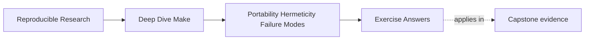

# Exercise Answers


<!-- page-maps:start -->
## Page Maps




<!-- page-maps:end -->

Use this after you have written your own answers. The point is comparison, not copying.

## How to use the answer page well

Do not read a model answer first and then retrofit your hardening packet to match it.

A better rhythm is:

1. finish the exercise with your own contract, probes, and notes
2. write one plain-language explanation of the boundary or assumption
3. compare that explanation with the model answer
4. revise where the model answer exposes a missing contract, weak measurement, or blurry
   ownership decision

Strong Module 05 answers do not simply list tools or flags. They usually do four things:

- they name the assumption directly
- they show how the build would prove that assumption
- they explain why the repair converges
- they make tool ownership explicit

The strongest self-study packets also leave behind six concrete artifacts:

- one portability contract
- one recursive-boundary repair
- one convergent semantic-input representation
- one performance baseline
- one doctor target
- one inherited-build audit

If your answers rely only on "hardening is important," the reasoning is still too thin.

## Exercise 1: Write a portability contract

A strong answer makes the contract concrete, for example:

- GNU Make 4.3 or newer required
- POSIX `/bin/sh` syntax only
- `python3` required
- grouped targets optional only if a stamp-based fallback preserves the same generation
  semantics

The important explanation is:

> The contract should separate required capabilities from optional ones and make
> unsupported environments fail with the first useful message instead of with a later
> syntax surprise.

Weak answer pattern:

- "Support as many environments as possible"

That is a wish, not a maintainable support contract.

## Exercise 2: Repair a recursive boundary

The strongest prediction separates planning from execution:

- `make -n vendor` prints the literal command but does not ask the child Make to reveal
  its plan
- the actual child may or may not inherit usable jobserver state, depending on the Make
  version and invocation environment

On GNU Make 4.4 with a FIFO jobserver, the literal child may report `-j2` and a jobserver
FIFO in `MAKEFLAGS`. Record that result rather than hiding it. It is an observation about
the current transport, not a portable declaration.

The durable repair is:

```make
.PHONY: vendor

vendor:
	+$(MAKE) -C vendor/lib all
```

After the repair, `make -n vendor` should enter the child graph and print its recipe
without creating the child output. In an actual run, the child should be exactly one
`MAKELEVEL` deeper than its parent.

A good explanation does not say "`+` preserves the jobserver." It says:

> `$(MAKE)` declares recursive intent; `+` makes that boundary visible when ordinary
> recipes are suppressed; the actual child flags show what this run inherited.

## Exercise 3: Model one non-file input honestly

The clock comparison should report:

| Model | Finding | `hashes_equal` |
| --- | --- | --- |
| clock-derived | `CLOCK_STATE_DRIFT_REPRODUCED` | false |
| declared-state | `DECLARED_STATE_STABLE` | true |

Those rows establish that a stamp filename does not make state reproducible. Its content
must be derivable from declared inputs.

A complete `MODE` model needs an evaluation trigger and change-only publication:

```make
MODE ?= release
MODE_MANIFEST := build/mode.manifest

.PHONY: FORCE
FORCE:

$(MODE_MANIFEST): FORCE | build/
	@printf 'MODE=%s\n' '$(MODE)' > $@.tmp
	@cmp -s $@.tmp $@ 2>/dev/null || mv $@.tmp $@
	@rm -f $@.tmp

build/application.txt: source.txt $(MODE_MANIFEST) | build/
	@printf 'mode=%s\n' '$(MODE)' > $@
	@cat source.txt >> $@
```

This is strong because:

- `FORCE` makes the manifest recipe inspect `MODE` on every invocation
- `cmp` leaves the existing file and mtime alone when `MODE` is unchanged
- changing `MODE` replaces the manifest
- the newer manifest then invalidates `build/application.txt`

The evidence should distinguish these events:

| Invocation | Candidate evaluated? | Manifest published? | Application rebuilt? |
| --- | --- | --- | --- |
| first `MODE=release` | yes | yes | yes |
| second `MODE=release` | yes | no | no |
| `MODE=debug` | yes | yes | yes |

The required distinction is:

> `FORCE` controls evaluation of the non-file fact; content comparison controls whether
> that fact is published as changed state.

Weak answer pattern:

- "Use `cmp` so the manifest notices when `MODE` changes"

Without an evaluation trigger, Make may never run `cmp` after the manifest first exists.

## Exercise 4: Separate performance layers

A good minimal loop is:

```sh
/usr/bin/time -p make -n all >/dev/null
/usr/bin/time -p make all >/dev/null
make --trace all > build/trace.log
wc -l build/trace.log
```

The answer is strong if it explains what the comparison means:

- expensive `make -n`:
  - suggests parse or decision overhead
- expensive full build with cheap `make -n`:
  - suggests recipe cost dominates
- very high trace volume:
  - suggests the evidence surface itself may be operationally costly

The key explanation is:

> "Felt slow" is not enough because it does not tell you whether the cost lives in Make's
> decisions, in the recipes, or in the observation method itself.

## Exercise 5: Decide whether Make should still own the problem

A strong answer usually keeps artifact-oriented concerns in Make, such as:

- compilation
- file assembly
- packaging of already-resolved inputs

And it usually identifies one richer workflow concern as a boundary, such as:

- dependency version solving
- long-running promotion and approval orchestration

The strongest answers also preserve the proof route:

> Make may remain the top-level verification and artifact assembly route while an external
> tool owns dependency resolution or workflow state.

Weak answer pattern:

- "Use another tool for everything complicated"

That abandons ownership rather than clarifying it.

## Exercise 6: Build a toolchain doctor

A useful answer separates diagnostics from enforcement:

```make
SHELL := /bin/sh
REQUIRED_TOOL ?= python3
RESULT := build/result.txt

.PHONY: all contract-check doctor
all: $(RESULT)

doctor:
	@printf 'make=%s\nshell=%s\nmakelevel=%s\n' \
	  '$(MAKE_VERSION)' '$(SHELL)' '$(MAKELEVEL)'
	@printf 'locale=%s\n' "$${LC_ALL:-not-set}"
	@printf 'compiler=%s\n' "$$(command -v "$(CC)" 2>/dev/null || printf missing)"
	@printf 'python=%s\n' "$$(command -v python3 2>/dev/null || printf missing)"

contract-check:
	@command -v "$(REQUIRED_TOOL)" >/dev/null 2>&1 || { \
	  printf 'contract: missing required tool %s\n' "$(REQUIRED_TOOL)" >&2; \
	  exit 2; \
	}

$(RESULT): | contract-check build/
	$(REQUIRED_TOOL) --version > build/tool-version.txt
	printf 'result=complete\n' > $@

build/:
	mkdir -p $@
```

The important edge is:

```make
$(RESULT): | contract-check
```

This requires the gate to finish before the result recipe starts without making the
phony gate force result publication on every invocation.

Do not write:

```make
all: contract-check $(RESULT)
```

Under `-j`, sibling prerequisites may run concurrently. Their left-to-right order is not
an execution sequence.

The audit supplies the expected failure evidence:

| Case | Finding | Publication state |
| --- | --- | --- |
| late check | `LATE_TOOL_FAILURE_LEFT_RESIDUE` | empty version file remains |
| missing gate | `REQUIRED_TOOL_REJECTED_EARLY` | no version or result file |
| available gate | `REQUIRED_TOOL_ACCEPTED` | both files exist |

This design distinguishes:

- advisory facts, which `doctor` reports for diagnosis
- required presence, which `contract-check` enforces before publication
- version compatibility, which needs its own accepted-version policy and boundary tests

The available case matters because a gate that rejects every tool would otherwise look
correct in the missing-tool test.

## Exercise 7: Remove a hidden shell dependency

POSIX `test` uses single brackets:

```make
SHELL := /bin/sh

.PHONY: report
report:
	@if [ -f data.csv ]; then echo ready; fi
```

Test both branches:

```sh
rm -f data.csv && make report
touch data.csv && make report
```

Other common audit points include arrays, brace expansion, `source`, process
substitution, and `set -o pipefail`.

The important explanation is:

> If Bash is genuinely required, declaring `SHELL := /bin/bash` is more honest than
> depending on a developer's interactive-shell preference.

## Exercise 8: Preserve the parallel budget across recursion

The expected summary rows are:

| Model | Finding |
| --- | --- |
| literal recursion | `LITERAL_RECURSION_HIDES_CHILD_PLAN` |
| declared recursion | `DECLARED_RECURSION_EXPOSES_CHILD_PLAN` |

The declared dry-run trace includes:

```text
child-plan: publish child.out
```

The literal dry-run trace does not. Neither dry-run workspace should contain
`child/child.out`; seeing the plan is not the same as performing it.

In actual runs, inspect the recorded `MAKEFLAGS` literally. A GNU Make 4.4 FIFO system may
show `-j2` in both models. The conclusion is not "both are equally correct." The
conclusion is:

- literal recursion happened to inherit the current transport
- declared recursion preserves planning visibility and communicates intent
- another supported Make version may expose jobserver state differently

The direct capstone route and the program wrapper add different outer Make levels. A
portable assertion is:

```text
child MAKELEVEL = audit process MAKELEVEL + 1
```

It is not:

```text
child MAKELEVEL = 1
```

Aggregate `PASS` confirms that the broken model hid the plan and the control exposed it.
The finding name, not the aggregate status alone, tells you which behavior is acceptable.

## Exercise 9: Prove an environment manifest converges

One valid rule is:

```make
MODE ?= release
ENV_MANIFEST := build/environment.txt

.PHONY: FORCE
FORCE:

$(ENV_MANIFEST): FORCE | build/
	@{ \
	  printf 'MODE=%s\n' '$(MODE)'; \
	  printf 'CC=%s\n' "$$($(CC) --version | sed -n '1p')"; \
	  printf 'LC_ALL=%s\n' "$${LC_ALL:-not-set}"; \
	} > $@.candidate
	@cmp -s $@.candidate $@ 2>/dev/null || mv $@.candidate $@
	@rm -f $@.candidate

build/application.txt: source.txt $(ENV_MANIFEST) | build/
	@printf 'environment=%s\n' "$$(sha256sum $(ENV_MANIFEST) | cut -d' ' -f1)" > $@
```

The two clean workspaces should produce equal manifest hashes when `MODE`, compiler
identity, and locale are equal. That proves the initial state is derived rather than
invented. In one workspace, the next equal-state invocation runs the candidate recipe but
`cmp` prevents a timestamp change. `make MODE=debug` changes semantic content, replaces
the file, and makes the downstream artifact out of date.

If `sha256sum` is unavailable on the supported platform, use the repository's declared
checksum tool or Python's `hashlib`; do not silently weaken the proof to visual inspection.

The key explanation is:

> Locale belongs in the manifest only when it changes build meaning; otherwise it is
> diagnostic noise rather than a semantic input.

## Exercise 10: Harden an inherited build

A strong answer is an evidence packet rather than a rewritten Makefile alone. It should
contain:

- the supported GNU Make, shell, and required-tool contract
- `doctor` output from two environments
- a repaired recursive invocation or environment manifest where needed
- `make -n` and full-build timings
- a no-op check such as `make all && make -q all`
- a reasoned ownership decision

The two environments do not need to be two physical machines. A container, CI runner, or
deliberately changed `PATH`, `LC_ALL`, and `MODE` can expose assumptions. What matters is
that the comparison is controlled and the conclusion follows from observed differences.

The weakest boundary is often the first one to fix because it tends to make every later
diagnosis noisier.

## What mastery-level answers sound like

A mastery-level answer set in this module does three things well:

- it treats portability and hermeticity as declared contracts rather than vague values
- it measures before claiming a performance diagnosis
- it treats tool boundaries as ownership decisions, not ideological ones

That is the standard Module 05 is trying to build.
