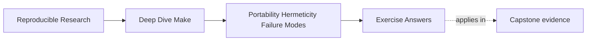

# Exercise Answers


<!-- page-maps:start -->
## Page Maps




<!-- page-maps:end -->

Compare reasoning and evidence boundaries, not incidental paths or timing values.

## Exercise 1: Prove a portability contract

A model contract is:

```make
ifeq ($(origin MAKE_VERSION),undefined)
$(error GNU Make is required)
endif

REQUIRED_MAKE_FEATURES := grouped-target second-expansion
MISSING_MAKE_FEATURES := $(filter-out $(.FEATURES),$(REQUIRED_MAKE_FEATURES))
ifneq ($(strip $(MISSING_MAKE_FEATURES)),)
$(error GNU Make $(MAKE_VERSION) lacks: $(MISSING_MAKE_FEATURES))
endif

SHELL := /bin/sh
.SHELLFLAGS := -eu -c

PYTHON ?= python3
PYTHONFLAGS ?=
ifneq ($(words $(PYTHON)),1)
$(error PYTHON must name one executable; use PYTHONFLAGS for arguments)
endif

.PHONY: contract-check
contract-check:
	@command -v "$(PYTHON)" >/dev/null 2>&1 || { \
	  printf 'contract: missing %s\n' "$(PYTHON)" >&2; exit 2; \
	}
	@"$(PYTHON)" -c 'import pathlib' >/dev/null 2>&1 || { \
	  printf 'contract: %s lacks required pathlib support\n' "$(PYTHON)" >&2; \
	  exit 2; \
	}
```

`.FEATURES` answers runtime capability. A CI matrix answers which releases maintainers
test and support. `MAKE_VERSION` remains useful diagnostics, but a prefix list is not a
sound "at least" comparison.

Required cases:

| Case | Expected boundary |
| --- | --- |
| current GNU Make with both feature tokens | parsing continues |
| controlled missing-feature value in a harness | parsing names the missing token |
| available compatible Python | gate succeeds |
| nonexistent Python | gate rejects before publication |
| present interpreter lacking required behavior | compatibility probe rejects |
| `PYTHON='python3 -I'` | parsing rejects; flags belong in `PYTHONFLAGS` |

## Exercise 2: Prove a recursive budget boundary

The durable parent form is:

```make
.PHONY: child-build
child-build:
	+$(MAKE) -C child all
```

For a wrapper:

```make
child-build:
	+MAKE="$(MAKE)" tools/run-child child
```

```sh
#!/bin/sh
set -eu
child_dir=$1
exec "$MAKE" -C "$child_dir" all
```

The child can record intervals:

```make
JOBS := alpha beta gamma delta
.PHONY: all $(JOBS)
all: $(JOBS)

$(JOBS):
	@start=$$(python3 -c 'import time; print(time.monotonic_ns())'); \
	sleep 0.2; \
	end=$$(python3 -c 'import time; print(time.monotonic_ns())'); \
	printf '%s\t%s\t%s\t%s\n' '$@' "$$$$" "$$start" "$$end" \
	  > ../evidence/interval-$@.tsv
```

Calculate peak overlap from the intervals rather than line order. With parent `-j2`, a
useful workload reaches two concurrent recipes but never exceeds two.

Evidence hierarchy:

1. `+$(MAKE)` or the declared wrapper establishes intent.
2. relative `MAKELEVEL` and literal flags establish observed child context.
3. interval overlap establishes behavior on this route.

Copying `--jobserver-auth` text is invalid because Make owns the underlying transport;
text can name a pipe or FIFO the receiving process cannot use.

## Exercise 3: Publish a semantic manifest safely

Classify first:

| Fact | Model answer |
| --- | --- |
| `MODE` | validate and attest; it changes output meaning |
| locale | pin `LC_ALL=C` if sorting or parsing depends on it |
| compiler identity | attest a canonical supported identity |
| hostname and terminal width | diagnostic-only |
| credentials | exclude entirely |

Use variant identity and collision-safe publication:

```make
MODE ?= release
VALID_MODES := release debug
ifneq ($(words $(MODE)),1)
$(error MODE must be exactly one of: $(VALID_MODES))
endif
ifeq ($(filter $(MODE),$(VALID_MODES)),)
$(error MODE must be one of: $(VALID_MODES))
endif

export LC_ALL := C
MODE_ROOT := build/$(MODE)
MANIFEST := $(MODE_ROOT)/environment.manifest

.PHONY: FORCE
FORCE:

$(MANIFEST): FORCE | $(MODE_ROOT)/
	@set -eu; \
	candidate="$@.candidate.$$$$"; \
	trap 'rm -f "$$candidate"' EXIT HUP INT TERM; \
	{ \
	  printf 'MODE=%s\n' '$(MODE)'; \
	  printf 'LC_ALL=C\n'; \
	  "$(CC)" --version | sed -n '1p'; \
	} > "$$candidate"; \
	if test -r "$@" && cmp -s "$$candidate" "$@"; then :; \
	else mv "$$candidate" "$@"; fi
```

`FORCE` controls reevaluation. Comparison controls durable identity. The process identifier
prevents work-file collisions. `build/debug` and `build/release` prevent one final path
from representing two supported configurations.

## Exercise 4: Locate a performance cost

A valid packet labels each sample:

| Field | Example |
| --- | --- |
| goal | `all` |
| workload | no-op after successful release build |
| Make/options | GNU Make 4.4.1, `-j2` |
| controlled environment | `LC_ALL=C`, same toolchain and storage |
| repetitions | one warm-up plus seven measured |
| summary | median and min–max range |
| observation mode | output discarded; trace disabled |

Compare:

- no-op `gmake -n all`
- no-op `gmake all`
- changed-input `gmake all`
- the same controlled workload after one experimental change

`-n` includes parsing, makefile remakes, graph traversal, recipe expansion and printing,
and declared recursive planning. Therefore it is an orchestration proxy, not a pure
decision timer.

If `-rR` reduces no-op planning time, verify identical selected recipes, prerequisite
causes, and output hashes before adopting it. The performance result identifies a suspect;
the correctness result licenses the change.

## Exercise 5: Design a tool handoff

For release promotion, a model interface is:

| Field | Contract |
| --- | --- |
| input identity | immutable bundle digest, checksum manifest, software bill of materials |
| invocation | idempotent submission keyed by digest and target environment |
| success output | signed receipt with remote revision |
| failure output | structured status with submission identity |
| publication owner | deployment system |
| retry/resume owner | deployment system |
| rollback owner | deployment system under policy |
| Make responsibility | build and verify bundle; validate receipt schema |

Failure cases:

- invalid manifest: Make rejects before submission
- authorization rejection: external owner returns no success receipt
- interruption after submission: status is recovered by idempotency key
- incompatible receipt: Make-side verifier rejects the receipt without redefining remote
  state

A non-publishing comparison may write to isolated evidence destinations. Running two real
promotion owners is not a safe comparison. After cutover, remove the former Make-side
remote writer.

## Exercise 6: Separate diagnosis from enforcement

```make
.PHONY: doctor contract-check

doctor:
	@printf 'make=%s\nfeatures=%s\n' '$(MAKE_VERSION)' '$(.FEATURES)'
	@printf 'shell=%s flags=%s\n' '$(SHELL)' '$(.SHELLFLAGS)'
	@printf 'python=%s\n' "$$(command -v "$(PYTHON)" 2>/dev/null || printf missing)"
	@printf 'locale=%s\nlevel=%s\nmode=%s\n' \
	  "$${LC_ALL-unset}" '$(MAKELEVEL)' '$(MODE)'

contract-check:
	@command -v "$(PYTHON)" >/dev/null 2>&1 || { \
	  printf 'contract: missing %s\n' "$(PYTHON)" >&2; exit 2; \
	}
	@"$(PYTHON)" -c 'import pathlib' >/dev/null 2>&1 || { \
	  printf 'contract: incompatible %s\n' "$(PYTHON)" >&2; exit 2; \
	}

build/result.txt: inputs/source.txt | contract-check build/
	"$(PYTHON)" tools/render.py $< > $@
```

`doctor` reports; it does not promise support. `contract-check` enforces presence and
compatibility. The order-only edge ensures the gate completes before this publication
frontier without making the phony gate force the result out of date.

`all: contract-check build/result.txt` is insufficient ordering under parallel Make
because sibling prerequisites may run concurrently.

## Exercise 7: Make shell failure portable

A POSIX rewrite avoids the unnecessary pipeline:

```make
SHELL := /bin/sh
.SHELLFLAGS := -eu -c

.PHONY: report
report:
	@test -r "data set.csv" || { \
	  printf 'missing input: %s\n' "data set.csv" >&2; exit 2; \
	}
	@awk -f tools/report.awk "data set.csv" > report.txt
```

This handles the spaced path as one argument and lets `awk` failure reach Make directly.
If two fallible pipeline commands are genuinely needed, split them into declared file
targets or write a small script with an explicitly supported shell and its tested failure
rules. POSIX `/bin/sh` has no portable `pipefail`.

Declaring Bash is clearer when arrays, process substitution, or Bash-specific pipeline
semantics are central rather than incidental.

## Exercise 8: Test recursion through a wrapper

The weak wrapper calls whatever `make` its `PATH` resolves. The repaired parent supplies
its selected executable:

```make
wrapped-child:
	+MAKE="$(MAKE)" tools/run-child child
```

The wrapper validates its one directory argument and ends with:

```sh
exec "$MAKE" -C "$child_dir" all
```

`exec` prevents an unnecessary supervising process and ensures signals reach the child
directly. The parent recipe still needs `+` so dry-run and pipe-based jobserver behavior
recognize the outer boundary.

Compare direct and wrapped routes using:

- child-plan visibility under `-n`
- no output under planning
- child depth equal to its immediate parent plus one
- peak interval overlap under the same `-j2`
- interruption leaving no detached child process

## Exercise 9: Prove manifest identity under contention

Two equal-state writers may each create:

```text
environment.manifest.candidate.<different-process-id>
```

Each complete candidate has the same content. Atomic rename leaves one valid final file;
the trap removes unpublished candidates after normal exit or handled interruption.

Different modes must not race for that final path. They publish:

```text
build/release/environment.manifest
build/debug/environment.manifest
```

The distinction is crucial:

- candidate identity prevents partial work-file collisions
- atomic rename prevents consumers from observing partial final bytes
- output namespace makes semantic configuration identity truthful

None substitutes for the others.

## Exercise 10: Harden an inherited build

A complete incident packet has this causal form:

| Boundary | Defect | Proof after repair |
| --- | --- | --- |
| runtime support | syntax/tool assumptions undeclared | missing feature/tool rejects; available case succeeds |
| recursion | parent planning hides child or wrapper breaks intent | child plan visible; token overlap bounded |
| semantic input | manifest stale, volatile, or shared across modes | clean-room equality, equal-state convergence, variant coexistence |
| performance | one unlabeled timing blamed Make | repeated workload comparison locates a layer |
| ownership | local file pretends to represent durable remote state | versioned digest handoff and recoverable external receipt |

Reject the decoy explicitly. For example, a different interactive login shell cannot
explain recipes after the Makefile pins `SHELL=/bin/sh`; show that evidence rather than
merely dismissing the idea.

The final explanation should name which observations came from course specimens and which
came from the inherited project. Mechanism evidence is transferable; project acceptance
must still be rerun locally.

## Review standard

A complete answer identifies the claim boundary, shows an accepted and rejected case,
states who owns recovery, and demonstrates either convergence or durable status after
interruption. Configuration syntax without those observations is not a model answer.
